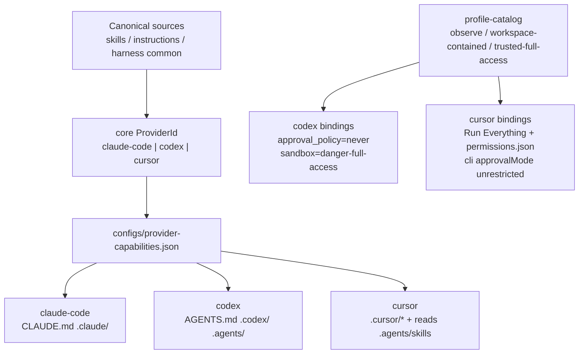

# Cursor как третий провайдер (Codex-sibling + autonomy)

> Канон носителя в пакете: `.cursor/plans/2026.09.17-cursor-third-provider.md`
> (перенесено из `~/.cursor/plans/` и кратко из `roadmap/`, 2026-09-17).

## Чеклист фаз

- [ ] P0 — ProviderId.cursor + capability matrix + allowlist sync + docs/reference regen
- [ ] P1 — harness configs/cursor: profile bindings, permissions/cli/mcp, rules, doctor/conformance
- [ ] P2 — skiller cursor publication/connect/sync; no dual-write with `.agents`
- [ ] P3 — task `mappings.cursor` + model inventory; render/parity/route_evidence; maind deploy/health
- [x] P4 — adapter + launch/autonomy docs + per-provider model role guide
- [x] P5 — validate → v0.20.0 release/attest/tag → `maind sync --all` + `skiller deliver --all`; enable cursor on swissknifeman + existing `.cursor` projects

## Решение владельца

- Вариант проекции: **Codex-sibling** — `AGENTS.md` остаётся у Codex; Cursor не переписывает его.
- Cursor native surfaces: `.cursor/{skills,rules,hooks,mcp.json,permissions.json,cli.json}`.
- Скиллы: native-канал `.cursor/skills`; discovery через уже существующий `.agents/skills` **без dual-write**.
- Главный инвариант: **autonomy** — в trusted-режиме агент не спрашивает подтверждений на разрешённых действиях (аналог Codex `-a never -s danger-full-access`).

## Модель исполнения

После approval плана реализация в Cursor-сессии (Composer). Для независимых тяжёлых срезов (capability matrix / harness adapter) при необходимости делегировать **Claude Opus thinking high** или **GPT 5.6 sol medium**; финальный provider-acceptance — smoke в Cursor IDE/CLI.

## Архитектура



### Autonomy: две дорожки (как у Claude/Codex)

Сегодня у Cursor **нет** harness trust path — только `vendor --agent cursor`. Нужно зеркалировать уже существующую dual-path модель:

| Дорожка | Claude Code сегодня | Codex сегодня | Cursor (цель) |
|---|---|---|---|
| Everyday onboard (`skiller integrate` / `maind onboard`) | presets + `defaultMode` + auto-approve `MODE=bypass` | MCP/hooks; full-access **не** наследуется флотом | `.cursor/permissions.json` + `.cursor/mcp.json` + CLI allow; **не** ставить Run Everything на весь флот |
| Explicit self-host profile apply | `trusted-full-access` → `bypassPermissions` | `never` + `danger-full-access` в `.codex/config.toml` | `trusted-full-access` → Run Everything + broad allowlists; гейт как у Codex |

**Гейт профиля** (из `packages/harness/lib/harness/profiles.py` / Codex conformance): `trusted-full-access` требует `origin=operation`, `operation_id=self-host-apply`, `target_identity=repo:…`. Наследование флотом запрещено (`HARNESS_FULL_ACCESS_INHERITANCE_FORBIDDEN`). Cursor должен пройти те же negative tests.

Semantic profile bindings (shipped IDs в `packages/harness/configs/common/profile-catalog.json`):

| Profile | Claude | Codex | Cursor IDE | Cursor CLI |
|---|---|---|---|---|
| `observe` | `defaultMode: default` | `untrusted` + `read-only` | Allowlist / read-biased | `approvalMode=allowlist`, no `--force` |
| `workspace-contained` | `acceptEdits` | `never` + `workspace-write` | Auto-review + scoped `.cursor/permissions.json` | allowlist + workspace `permissions.allow` |
| `trusted-full-access` | `bypassPermissions` | `never` + `danger-full-access` | **Run Everything** + `mcpAllowlist: ["*:*"]` + broad `terminalAllowlist` | unrestricted + `Shell(**)`/`Write(**)`/`Mcp(*:*)`; launch: `agent … --force` |

**Launch instructions** (обязательны, как Codex `-a never -s danger-full-access` в `AGENTS.md`): semantic `root.cursor.launch-and-autonomy` — cwd, model, Run Mode / `--force`, проверка doctor/MCP. Everyday Claude-путь (bypass hook) для Cursor = публикация permissions + docs checklist; persisted full-access только self-host-apply.

Primary docs (verified 2026-09): [permissions.json](https://cursor.com/docs/reference/permissions), [CLI permissions](https://cursor.com/docs/cli/reference/permissions), Run Modes.

## Фазы реализации

### P0 — Authority + vocabulary

- Расширить `core/provider/values.py`: `ProviderId.CURSOR = "cursor"`.
- Добавить провайдер в `configs/provider-capabilities.json` (36 capability): для Cursor заполнить `native`/`adapted`/`unsupported` + evidence.
  - **native/adapted first ship:** `instructions.project` (via `.cursor/rules`), `skills.repository`, `mcp.catalog`, `settings.permissions`, `doctor.*`, ключевые lifecycle где есть hooks API.
  - **unsupported (честно):** analytics transcript readers, Claude-only agent-packs workflows, surfaces без Cursor API — не фейковый паритет.
- Снять out-of-scope note в `docs/reference.md`; regen `docs/provider-support.md` через `python3 scripts/provider-docs.py --write`.
- Обновить hardcoded allowlists: harness `PROVIDERS`, maind `REQUIRED_PROVIDERS` / `provider_deploy`, task loops, skiller budget listing, `core/runs.py`.

### P1 — Harness Cursor adapter + autonomy

Новое дерево `packages/harness/configs/cursor/`:

- `config/profile-bindings.json` — map observe / workspace-contained / trusted-full-access → Cursor IDE+CLI shapes (таблица выше); тот же `self-host-apply` гейт, что у Codex.
- Everyday permissive path (зеркало Claude integrate bypass): preset permissions + MCP publish **без** profile `trusted-full-access` на флот.
- MCP bindings → `.cursor/mcp.json`.
- Permissions renderer → `.cursor/permissions.json` + `.cursor/cli.json`.
- Hooks bindings (адаптированный минимум: memory/router где Cursor hooks позволяют; иначе `unsupported` в matrix).
- Instruction fragments: `packages/harness/configs/common/instructions/` + catalog `root.cursor.*` (bootstrap, launch-and-autonomy, package-scope). **Не** писать в `AGENTS.md`.
- Targets: `.cursor/rules/swissknifeman.mdc` (alwaysApply) для Cursor-owned instruction extension.
- Wire `packages/harness/lib/harness/provider_render.py` `_ADAPTERS`, doctor, conformance (positive trusted + negative inheritance-forbidden).
- Wire integrate/onboard so Cursor channel gets everyday permissive configs when provider enabled (parallel to Claude `autoapprove: bypass`).

### P2 — Skiller publication + connect/sync

- `packages/skiller/lib/skiller/publication.py`: `render_cursor_publication` → `.cursor/skills` (и опционально `.cursor-plugin` только если нужен marketplace; иначе vendor/sync path).
- Connect/status/budget: listing provider `cursor`.
- Сохранить legacy `vendor --agent cursor` как совместимый путь; formal provider selection — через `.swissknife.json` / hub `providers.selection.cursor`.
- Ownership rule: один writer на skill tree; no dual-write `.agents` + `.cursor`.

### P3 — Task routing + per-provider model inventory + maind

**Уже есть SSOT:** `packages/task/configs/command-routing.json` — provider-neutral `model_class` (`economy < implementation < frontier`) + `effort`, затем `mappings.<provider>.class_selectors`. Claude/Codex сегодня только короткие pins (`haiku/sonnet/opus`, `luna/terra/sol`). Cursor сложнее: много моделей + Auto — нужен явный inventory, не только 3 pin'а.

#### Встраивание (без второй SSOT)

Расширить каждый `mappings.<provider>` hand-written блоком `model_inventory` (валидируется `command_catalog`; regen docs через `render-provider-commands.py`):

```json
"model_inventory": {
  "verified_at": "2026-09-17",
  "source": "docs/reference.md#cursor-models",
  "entries": [
    {"id": "composer-2.5-fast", "roles": ["economy", "explore"], "notes": "fast cheap coding"},
    {"id": "composer", "roles": ["implementation"], "notes": "default Cursor Agent / inherit"},
    {"id": "claude-opus-5-thinking-high", "roles": ["frontier", "design", "audit"], "notes": "plan-design/audit"},
    {"id": "gpt-5.6-sol-medium", "roles": ["frontier", "alternate"], "notes": "frontier alternate"},
    {"id": "auto", "roles": ["routing-assist"], "policy": "never-substitute-fixed-frontier"}
  ],
  "auto_mode": {
    "allowed_for": ["economy", "adhoc-explore"],
    "forbidden_for": ["fixed-frontier-commands", "plan-design", "plan-audit", "task:review"]
  }
}
```

Neutral ladder **не меняется**. `class_selectors` остаются единственным pin для fixed commands / launch-block.

#### Cursor class_selectors (первый ship, verified_at в evidence)

| Class | Cursor pin | Зачем |
|---|---|---|
| `economy` | `composer-2.5-fast` | дешёвый explore/fix-low |
| `implementation` | `composer` (IDE default / `inherit` для subagent) | plan-exec / plan-close / task:dev |
| `frontier` | `claude-opus-5-thinking-high` | plan-design / plan-audit / review |

Alternate frontier (`gpt-5.6-sol-medium`) и прочие модели — только в `model_inventory`, не в fixed pin. **Auto не заменяет** fixed frontier/implementation pin в launch-block (fail-closed, как unknown spelling в plan-protocol).

То же `model_inventory` добавить к `claude-code` и `codex` (документирует текущие 3 модели + роли design/exec/audit), чтобы «конфиг на каждый провайдер» был единообразным.

#### Код / артефакты

- `mappings.cursor` + inventory; relax parity `mappings == {claude-code,codex}` → тройка.
- `packages/task/lib/task/command_render.py`: cursor invocation + launch template (IDE checklist + CLI `agent -C … --model … --force`).
- `route_evidence_cursor.py` (best-effort: CLI argv / session metadata; иначе explicit attestation + doctor warn).
- Projections: `packages/task/adapters/cursor/` (generated) или rules/skills carrier, если slash нет.
- maind `packages/maind/lib/maind/provider_deploy.py`: `provider_deploy.cursor`; health `provider:cursor trust`.
- Instruction generate/check: third provider in harness instructions engine.
- Provenance: зафиксировать актуальный список Cursor-моделей в `docs/reference.md` (меняющаяся внешняя premise → verify-claims).

### P4 — Docs (autonomy + launch + model roles)

- Package adapter guide: расширить `packages/skiller/docs/adapters/cursor.md` — install, trusted profile, MCP, permissions.
- **Model role guide** (generated + prose): для каждого провайдера — какая модель на design / exec / audit / economy; для Cursor — таблица inventory + запрет Auto на fixed frontier.
- Root / harness install: как опубликовать trusted configs (`harness permissions|mcp … --provider cursor`, onboard/sync).
- **Launch block** аналог Codex: таблица Model class→selector / Effort / Run Mode / cwd + copy-paste CLI и IDE checklist (Run Mode = Run Everything для trusted self-host).
- Instruction semantic `root.cursor.launch-and-autonomy` в catalog (зеркало `root.codex.launch-and-hook-integrity`).
- CHANGELOG `[Unreleased]` → релиз: «добавлена поддержка провайдера Cursor».

### P5 — Validate, release, fleet

1. Affected validate: `core` provider tests + `packages/{harness,skiller,maind,task}/scripts/validate.sh`.
2. `skiller registry` если тронуты skill projections.
3. `skiller release` → minor bump (**ожидаемо `v0.20.0`**: новая framework capability), CHANGELOG, attest, annotated tag.
4. Раскатка «на все проекты из конфига»:
   - `maind sync --all --dry-run` затем `maind sync --all` по `config.json` (22 проекта).
   - `skiller deliver --release v0.20.0 --all --dry-run` затем apply по `~/.swissknifeman/projects.json`.
5. Cursor **enable** явно:
   - self-host `swissknifeman`: `selection.cursor.enabled=true` + trusted-full-access.
   - проекты, где уже есть `.cursor/mcp.json` (diabox, flexcrm, cms): enable + sync permissions/MCP.
   - остальные 19: получают обновление skills/runtime через deliver/sync, но **без** принудительного `providers.selection.cursor` (не размазывать `.cursor/` без Cursor).

## Вне scope первого релиза

- Полный паритет всех 36 capability на `native`.
- Cursor marketplace как полный близнец `.claude-plugin` (если discovery через skills достаточно).
- Agent-pack workflows / analytics readers без Cursor API.
- Перенос ownership `AGENTS.md` на Cursor.
- Автоскрейп живого каталога моделей Cursor/OpenAI/Anthropic — только hand-verified `model_inventory` + provenance в `docs/reference.md`.

## Риски

- IDE Run Mode «Run Everything» частично UI-owned — harness публикует file-based permissions/cli; docs обязаны явно сказать выставить Run Mode (или CLI `--force`).
- Team-admin dashboard может блокировать allowlist — doctor должен это диагностировать.
- Конфликт legacy `.cursor/skills` у consumers — merge-only + ownership markers.
