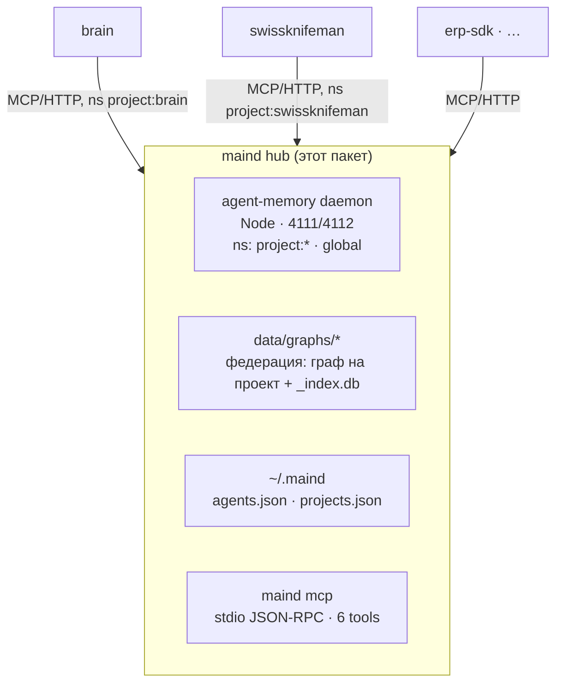
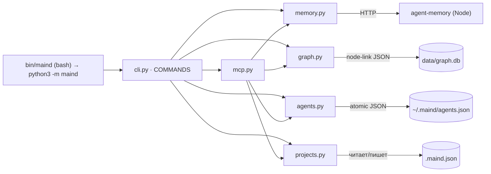

# Архитектура

**mAInd** — вершина иерархии экосистемы. Один общий хаб композирует три слоя под одним
конфигом `.maind.json` и одним CLI. Остальные проекты подключаются к нему как клиенты.

> Философию всей экосистемы (роли swissknifeman / brain / maind, принцип «связаны, но работают по
> отдельности», онбординг, слои командного пункта) см. на странице [Экосистема](/ecosystem).
> Здесь — внутренняя композиция самого узла maind.

## Топология: единый хаб + scopes



Изоляция между проектами — **логическая** (по `namespace`/scope), а не отдельными
демонами. Демон памяти **не** запускается на каждый проект — один на хаб.

## Три слоя



- **Память** (`memory.py`) — оркестрирует внешний Node-демон `@agentmemory/agentmemory`
  (start/stop/status, health-poll, pidfile) и говорит по HTTP со scope'ами. Демон —
  зависимость, не переписывается на Python.
- **Граф** (`graph.py`) — stdlib property-граф (BFS-соседи, кратчайший путь, подграф,
  статистика), персист в node-link JSON. `networkx`/`graphify` — опциональные адаптеры.
- **Агенты** (`agents.py`) — реестр в `~/.maind/agents.json`; состояние выводится из
  возраста heartbeat и живости pid.
- **Проекты** (`projects.py`) — `.maind.json` (надмножество brain `.projects.json`),
  fallback на legacy, синк из brain.
- **MCP** (`mcp.py`) — публикует всё это как stdio JSON-RPC сервер для внешних агентов.

## Три слоя графа

Связи бывают разной природы, и их нельзя смешивать (иначе топология выглядит «как единый код»):

1. **Код внутри проекта** (символы/файлы/вызовы) — `graphify-mcp --root <проект>`, граф на проект,
   уже физически отдельный. maind его не дублирует.
2. **Топология между проектами** (кто от кого зависит, общие пакеты) — это слой maind, см. ниже.
3. **Доки↔доки** — Brain vault (wikilinks, frontmatter `uses/used_by`). maind только **читает** их.

## Слой 2: федерация графов

`graph.adapter = "federation"` — вместо одного `graph.db` граф **на проект**
(`data/graphs/<id>.db`, или в репо проекта при `graph_store=local`) плюс тонкий регенерируемый
`data/graphs/_index.db` (только `project:*`-узлы + межпроектные рёбра). Запрос, пересекающий
границу проекта, **сшивает** нужные сторы в один in-memory union и гоняет обычный BFS
(`federation.Federation` поверх `graph.Graph`). Это даёт изоляцию (граф проекта можно удалить/
перенести без вреда остальным) при простом read-фасаде.

- `maind graph --project <id>` — граф одного проекта (его узлы + исходящие межпроектные рёбра).
- `maind graph --cross` — весь межпроектный слой (`_index.db`).
- `maind graph query --from project:flexcrm --depth 2` — обход через границы (федерация).

## Откуда берутся связи (derive, без дублей)

`maind graph derive` строит сторы проектов из **источников истины**, а не из ручного дубля
(`derive.py`), помечая узлы/рёбра планом (`code|doc|meta|runtime`) и источником (`via`):

| План | Источник | Рёбра |
|:--|:--|:--|
| code | `composer.json` + path-repos, `package.json` | `project ─requires→ package`, `package ─provided_by→ project`, cross `project ─depends_on→ project` |
| doc | Brain frontmatter `uses/used_by` (**read-only**) | `project ─uses→ project` |
| override | `<repo>/.maind.graph.json` | объявленные `relates_to`/… (runtime/API) |
| skills | `skills-lock.json` | `project ─uses→ skill ─provided_by→ tool` |

Истина связей остаётся в composer/Brain — `_index.db` лишь регенерируемый кэш. `maind graph
migrate-federation` бэкапит legacy `graph.db` и собирает федерацию.

## Namespaces: изоляция связей

Проект объявляет принадлежность к группам полем `projects[].namespaces: ["axioma", ...]`
(maind-only, как `tags`). Межпроектное ребро **A↔B строится, только если A и B делят хотя бы
один namespace** — связи внутри группы работают как раньше, между группами изолированы.

| Значение | Смысл |
|:--|:--|
| нет поля / `[]` | неявный `default` → прежнее поведение (всё связано) |
| `["axioma"]` | связь только с проектами, у которых тоже есть `axioma` |
| `["*"]` | wildcard: общая инфраструктура — связывается со ВСЕМИ namespace |

Изоляция применяется в **точке создания ребра** (`derive.py` → `namespaces.link_allowed`),
поэтому сторы физически не содержат меж-namespace мостов и всё ниже (union, query, `_index.db`,
seed) изолируется само; `rebuild_index` дублирует гейт как защиту устаревших/локальных сторов.
Связь с **незарегистрированным** внешним узлом (нет записи в `projects[]`) сохраняется — его
namespace неизвестен. Необязательный реестр `namespaces: { axioma: {...} }` в `.maind.json`
даёт метаданные и подсказки на опечатки; членство задаётся в проектах.

```bash
maind namespaces                       # группы и их проекты-члены
maind projects list --namespace axioma # проекты группы
maind sync --namespace axioma --only graph,memory   # фан-аут по группе
maind graph --cross --namespace axioma # межпроектный слой одной группы
```

## Гарантия подключения: healthcheck

Если в проекте не подняты память + maind MCP, разработка идёт «мимо» графа/памяти → пробелы.
`maind health --cwd` (клиентский, из проекта) печатает `connected|partial|standalone` + подсказки;
`--fix` поднимает память и дописывает MCP-серверы. «Приоритет №1» доставляется в проекты как
SessionStart-хук (`.claude/settings.json`, **не блокирует**) + управляемый блок в `CLAUDE.md` —
источник в `templates/health/*`.

## Память: видимость «общая» + seed

При онбординге/синке в scope `project:<id>` пишется базовый факт о связях (роль, зависимости,
«память ОБЩАЯ, факты экосистемы — в `global`») + cross-ref в `global` (`seed.py`, идемпотентно).
MCP-tool `maind_memory_links` отдаёт агенту граф-связи проекта + его ecosystem-link память.

## Единый провижининг: `maind sync`

Одна команда анализирует `.maind.json` и раскатывает **управляемые артефакты** на все
подключённые проекты через реестр провиженеров (`sync.py`): `mcp` · `graph` (derive) · `memory`
(seed) · `health-hook` · `health-doc`. `--only` сужает набор, `--mode install|update|auto` задаёт
«метод синка по области» (создать, если нет / обновить устаревшее по content-hash / и то, и
другое). Фан-аут по проектам и резолв пути/scope вынесены в `ProjectContext`/`select_projects`
(DRY): `deploy` — это `sync --only mcp`.

## Почему Python + bash

Ровно как `swissknifeman` и `brain`: тонкий лаунчер `bin/maind` проверяет окружение и
вызывает `python3 -m maind <root> <cmd>`; логика — в `lib/maind/*.py` на stdlib (тестируемо,
без сторонних зависимостей). Это держит узел переносимым и предсказуемым.
