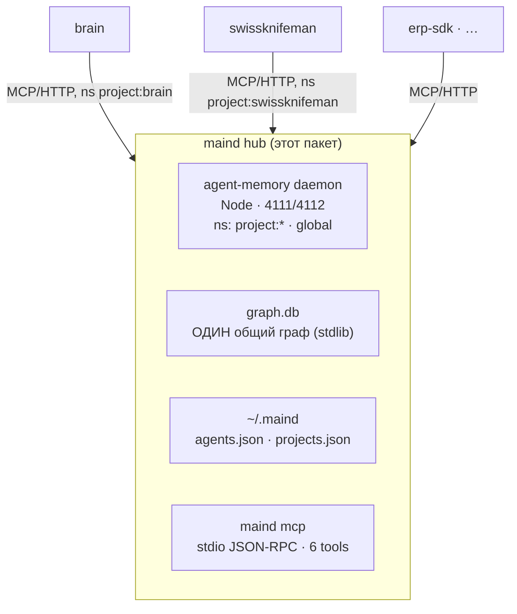
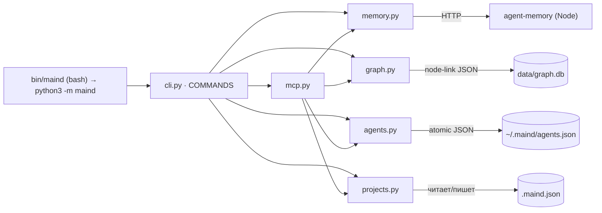

# Архитектура

**mAInd** — вершина иерархии экосистемы. Один общий хаб композирует три слоя под одним
конфигом `.maind.json` и одним CLI. Остальные проекты подключаются к нему как клиенты.

## Топология: единый хаб + scopes

Изоляция между проектами — **логическая** (по `namespace`/scope), а не отдельными
демонами. Демон памяти **не** запускается на каждый проект — один на хаб.

## Три слоя

- **Память** (`memory.py`) — оркестрирует внешний Node-демон `@agentmemory/agentmemory`
  (start/stop/status, health-poll, pidfile) и говорит по HTTP со scope'ами. Демон —
  зависимость, не переписывается на Python.
- **Граф** (`graph.py`) — stdlib property-граф (BFS-соседи, кратчайший путь, подграф,
  статистика), персист в node-link JSON. `networkx`/`graphify` — опциональные адаптеры.
- **Агенты** (`agents.py`) — реестр в `~/.maind/agents.json`; состояние выводится из
  возраста heartbeat и живости pid.
- **Проекты** (`projects.py`) — `.maind.json` (надмножество brain `.projects.json`),
  fallback на legacy, синк из brain.
- **MCP** (`mcp.py`) — публикует всё это как stdio JSON-RPC сервер для внешних агентов.

## Как строится «общая связь»

На `maind start` / `maind migrate from-brain` проекты из конфига регистрируются как узлы
графа, а поля `dependencies` / `skills` / `agents` материализуются в рёбра
`depends_on` / `uses` / `belongs_to`. Обход графа (`maind graph query --from project:brain
--depth 2`) показывает межпроектные связи — это и есть единый источник истины о топологии.

## Почему Python + bash

Ровно как `swissknifeman` и `brain`: тонкий лаунчер `bin/maind` проверяет окружение и
вызывает `python3 -m maind <root> <cmd>`; логика — в `lib/maind/*.py` на stdlib (тестируемо,
без сторонних зависимостей). Это держит узел переносимым и предсказуемым.
