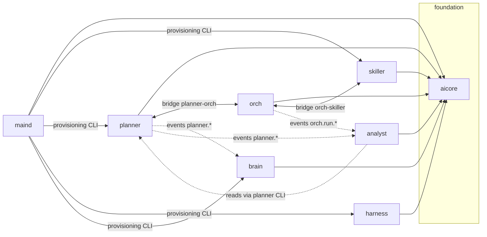

# Ecosystem architecture

How the repository is divided into isolated modules, what each module owns, how modules talk to each other and how
the move to this layout is kept safe. Decisions behind each section are in [decision records](decisions/README.md);
the live file-to-module map is generated into [ownership](ownership.md); contracts are inventoried in
[contracts](contracts.md).

## 1. Principles

1. **A folder is a module.** Everything a module needs lies in `packages/<id>/`. References leaving the folder go only
   to declared dependencies (`aicore`) and only through bridges or events. The root `AGENTS.md` and `CLAUDE.md`
   state this rule (generated by `harness` from its instruction catalog, [ADR 0026](decisions/0026-pinned-root-common-instruction.md)).
2. **One foundation.** A module may depend on `aicore` and on nothing else. The hub root, which assembles everything,
   is the only exception ([ADR 0002](decisions/0002-module-dependencies-only-on-aicore.md)).
3. **Three kinds of links, and only these:**
   - *dependency*: an import of `aicore`;
   - *bridge*: a synchronous request-response contract between two modules (CLI plus JSON);
   - *event*: an asynchronous notification; the source does not know its subscribers
     ([ADR 0003](decisions/0003-three-kinds-of-links-and-bridges.md)).
4. **Content has one canon, in its module.** Projections for Codex, Grok and Cursor are generated by `aicore`; there
   are no hand-made copies.
5. **Configuration in layers, state in standard places.** No scattering of dot-files
   ([ADR 0005](decisions/0005-layered-config-and-standard-state-locations.md)).
6. **Extension without a fork.** Anything a person wants to change is changed through configuration, overlays and
   subscriptions, not by editing module code ([ADR 0006](decisions/0006-extensibility-events-subscriptions-overlays.md)).
7. **Flexibility only where a consumer exists.** A shared contract is general; its implementation is minimal and has at
   least one real consumer now. Otherwise it is a roadmap entry with a trigger.

## 2. Repository layout

The layout imitates separate repositories while everything stays in one ([ADR 0001](decisions/0001-modules-as-isolated-folders.md)).

```text
swissknifeman/                      # the hub repository
  AGENTS.md  CLAUDE.md              # the folder-is-a-module rule, module map
  packages/
    aicore/    destination: own-repo   # foundation
    skiller/   destination: own-repo   # library of shared skills
    planner/   destination: own-repo   # plans (renamed from task)
    orch/      destination: own-repo   # orchestration (moves out after the first native engine)
    maind/     destination: hub
    analyst/   destination: hub
    harness/   destination: hub
    brain/     destination: hub        # Obsidian vault
  bridges/
    planner-orch/                    # glue between two modules (hub)
    orch-skiller/
  bin/swissknifeman                  # umbrella CLI: install, upgrade, doctor, config, units
  configs/  scripts/  bootstrap/  docs/  .github/
```

`core/` dissolves into `aicore` and `analyst` (the shared code is already in `packages/aicore`; `core/` keeps a
compatibility shim and the modules of later stages, see [ADR 0028](decisions/0028-aicore-subsystems-and-core-shim.md)); `packages/artifex` is retired and stays in history by tag;
`packages/task` becomes `packages/planner`; the root research folder of orchestration moves into
`packages/orch/docs/research/`. Until a module is moved, the transitional roots (`core/`, `orch/`, `packages/artifex/`,
`packages/task/`) are covered by the ownership map. The legacy driver `harness/run` stays until `orch` reaches parity.

### Modules

| Module | Purpose | Depends on | Built from (current paths) |
| --- | --- | --- | --- |
| `aicore` | foundation | none | exists: `core/*` except analytics, `core/provider/*`, `core/usage.py` and `configs/provider-*.json` moved in; still to come: generic parts of `skiller` (catalog, budget, publication, delivery, quality); generic part of the `task` command rendering |
| `skiller` | library of shared skills | `aicore` | `packages/skiller`: `skills/` (shared buckets only), `skm/`, `generate-skill/`, profiles and presets, upstream sync |
| `planner` | plans: schema, life cycle, API, commands | `aicore` | `packages/task` |
| `orch` | orchestration: contracts, engine port, engines, launch catalog | `aicore` | `packages/orch`, root `orch/` |
| `maind` | memory, graph, project registry, provisioning, MCP | `aicore` | `packages/maind` plus `topology`, `listing`, `state` from `skiller` |
| `analyst` | analytics, lessons, traces | `aicore` | `packages/analyst` plus `runs`, `pathology`, `codegraph_telemetry` from `core` |
| `harness` | provider environment: permissions, hooks, MCP, agent packs, profiles, instructions | `aicore` | `packages/harness` |
| `brain` | Obsidian vault: search, document sync, notes, event subscriptions, own skills | `aicore` | new; `brain_sync` from `skiller`, skill `brain-locator`, vault parts of `maind` |
| `bridges/*` | glue between modules | both sides through their CLI | the bridges now inside `task` and `orch` |
| hub root | assembly, install, update, docs, CI | all modules | `bin/`, `scripts/`, `configs/`, `bootstrap/`, `docs/` |

The file-level map, with the stage that moves each entry and a confidence mark, is generated into
[ownership](ownership.md); this document does not copy it.

### How modules are linked



| Link | Kind | Contract |
| --- | --- | --- |
| planner and orch | bridge `bridges/planner-orch` | work-source port plus `exec/v1` |
| orch and skiller | bridge `bridges/orch-skiller` | role to set of skills (`skiller resolve`) |
| analyst to planner | read-only planner CLI | plan read API |
| planner to brain, analyst | events | `planner.*` |
| orch to analyst | events | `orch.run.*` |
| maind to skiller, planner, harness, brain | module CLIs | provisioning commands |
| every module to aicore | import | `aicore` range in `unit.json` |

## 3. Module contract

Every module, `own-repo` or `hub`, has the same shape:

```text
packages/<id>/
  unit.json                    # module manifest
  README.md  AGENTS.md  CLAUDE.md  CHANGELOG.md  LICENSE
  bin/<cli>                    # thin wrapper: finds its lib and aicore
  lib/<id>/                    # Python: stdlib plus aicore
  skills/  commands/  hooks/  agents/     # content canon for providers, if any
  configs/config.schema.json   # schema of the module's config section; its `default` keywords are the defaults
  config.example.toml          # generated from the schema (aicore config example)
  schemas/                     # public contracts (JSON Schema), if any
  docs/  tests/  scripts/{test.sh,validate.sh}
```

The manifest schema is `packages/aicore/schemas/unit/v1` (see [contracts](contracts.md)). Rules checked
automatically by `python3 scripts/ecosystem-units.py check`:

- **Manifest:** `unit.json` exists, is valid, its `id` equals the folder and the single package in `lib/`, its
  `version` equals the existing version carrier, `requires` ranges are satisfied, and declared paths exist.
- **Boundary:** a module imports only its own `lib/` and `aicore`, and contains no path leading to another module.
  Violations that exist today sit in a baseline (`configs/ecosystem-baseline.json`); a new violation fails the check,
  and `--strict` fails on any.
- **Standalone:** the module's tests pass in a copy of its folder with only a stand-in for `aicore`
  (`ecosystem-units.py standalone`).
- **Finding `aicore`** by the `bin/` wrapper: `AICORE_ROOT`, then `<module>/_vendor/aicore`, then the neighbouring
  `../aicore` (only inside the hub repository, a development mode). One canonical fragment does the search and a miss
  ends with `AICORE_NOT_FOUND` ([ADR 0029](decisions/0029-aicore-locator-fragment.md)). How `aicore` is delivered after
  modules move out is decided together with that move.
- **Plugin** manifests for Claude Code are generated from `unit.json` by `aicore`, not written twice by hand.

## 4. aicore: the foundation

`aicore` is the base on which every module, including future ones, is built. It is extended through data (catalogs) and
named adapters: a new provider is an adapter plus a catalog entry; a new kind of content is a descriptor
([ADR 0004](decisions/0004-aicore-foundation-and-generalisation-boundary.md)).

| Subsystem | Role | Consumers |
| --- | --- | --- |
| `aicore.util` | atomic write, paths, text, terminal, CLI, processes, HTTP, repository root, managed blocks, project type | all |
| `aicore.config` | layered configuration with schemas and an explanation of where a value comes from | all |
| `aicore.state` | standard places for state, cache and backups; `SKM_HOME` for isolation | all |
| `aicore.provider` | provider capability manifests, configuration, control plane, health, adapter registry, model catalog | harness, maind, planner, orch, skiller |
| `aicore.artifacts` | plan, apply and lock of artifacts in projects, reconcile, backups | skiller, harness, maind |
| `aicore.content` | content model (skill, command, agent, hook, instruction): parsing, validation, catalog, context budget, provider projection, plugin and marketplace generation, skill eval and audit | skiller, planner, brain, harness, maind, hub |
| `aicore.delivery` | connecting module plugins to a project (Claude marketplace, vendoring for Codex, Grok, Cursor), status, update | skiller, planner, brain, hub |
| `aicore.release` | versions, tags `{name}--v{version}`, release attestation | all modules, hub |
| `aicore.ext` | events, subscriptions, overlays, external plugin commands | planner, orch, brain, analyst |
| `aicore.unit` | `unit.json` schema, boundary and standalone checks, new-module template | all modules, CI |
| `aicore.usage` | parsing usage from provider logs | analyst, skiller eval, orch |

The `aicore` CLI is a tool for module developers (catalog, project, config, events, unit, provider). End users work
with module CLIs and `swissknifeman`.

**Generalisation boundary.** Only what two or more modules already use, or what every module needs by contract, moves
into `aicore`. The assignment of `skiller` internals to `aicore` is a hypothesis until the owning stage reads the code;
the ownership map marks each entry `fixed` or `hypothesis`.

## 5. Configuration and service files

### 5.1 Configuration layers

| # | Layer | Where | Written by |
| --- | --- | --- | --- |
| 1 | module defaults | the `default` keywords of `packages/<id>/configs/config.schema.json` | module developer |
| 2 | machine and user | `~/.config/swissknifeman/config.toml` (one section per module) | person, `swissknifeman config set` |
| 3 | project | `<project>/.swissknifeman/config.toml` (in git) | person, module commands |
| 4 | environment | `SKM_<MODULE>_<PATH>` (`__` between path segments) | the invocation |
| 5 | `--config FILE` | a file in the same format as layers 2 and 3 | the invocation |
| 6 | flags | CLI | the invocation |

A module may add its own layers between 3 and 4 (a legacy file of the module, plan settings of the planner).

Each section is validated by the schema of its module. `swissknifeman config explain <module>` shows the
resulting value, the layer, file and line it came from and the values it overrides. Machine configuration (project paths, pools, MCP) lives in `~/.config`, not
in the repository working copy, so different computers and a development clone do not compete for one file. Layers
edited by hand are TOML; generated state, lock files and module defaults are JSON; every module ships
`config.example.toml` generated from its schema (defaults are the schema's `default` keywords) ([ADR 0011](decisions/0011-toml-for-human-edited-config.md)).
Merge, removal, explain, secrets and the invocation layer follow [ADR 0019](decisions/0019-config-semantics.md) as
made exact in [ADR 0034](decisions/0034-layered-config-semantics.md); config files are TOML 1.0
([ADR 0036](decisions/0036-toml-vendored-tomli-and-minimal-editor.md)).

### 5.2 State locations

| What | Where |
| --- | --- |
| machine configuration | `~/.config/swissknifeman/` (`$XDG_CONFIG_HOME`) |
| registries (projects, topology, agents, installed modules) | `~/.local/state/swissknifeman/` |
| data (memory, hub graph) | `~/.local/share/swissknifeman/` |
| cache | `~/.cache/swissknifeman/` |
| project configuration | `<project>/.swissknifeman/config.toml`, in git |
| project state (lock files, receipts, event journal) | `<project>/.swissknifeman/state/`, in `.gitignore` |
| project backups | `<project>/.swissknifeman/backups/<ts>/...`, in `.gitignore`, with rotation |
| isolation (tests, sandbox, development clone) | `SKM_HOME=<dir>` moves the four machine places to `<dir>/{config,state,data,cache}` and switches off legacy lookups |

Places are resolved by `aicore.state`; a relative `XDG_*` value is ignored and a relative `SKM_HOME` is an error. A file
found only at a legacy location is read from there with one warning per process, and is never copied until
`swissknifeman upgrade` ([ADR 0035](decisions/0035-state-locations-legacy-reads-and-backups.md)).

Provider surfaces (`.claude/settings*.json`, `.codex/config.toml`, `.grok/`, `.cursor/`, `.mcp.json`) stay with the
providers. They are written only through `aicore.artifacts`, with a lock file and a backup under
`.swissknifeman/backups/`, not with a `*.bak` file next to them.

### 5.3 Service file distribution

What each service file is today, who writes it and where it ends up:

| Today | Written by | Becomes |
| --- | --- | --- |
| `<project>/.swissknife.json` (plugins, providers) | skiller | `.swissknifeman/config.toml`, sections `delivery` and `skiller` |
| `<project>/.swissknifeman/config.json` (vendor skillset) | skiller | the same `skiller` section |
| `<project>/.swissknifeman/provider-artifacts.lock.json`, `rogue-lock.json`, `receipts/` | core.provider, skiller | `.swissknifeman/state/` |
| `<project>/.swissknifeman-manifest.json`, `.swissknifeman-codex-links.json` | skiller | `.swissknifeman/state/` |
| `<project>/.claude/{auto-approve,memory,review-gate}.env.ini` | harness, maind | sections `hooks.auto_approve`, `memory.mode`, `hooks.review_gate` of the project config; shell hooks read the generated `.swissknifeman/state/hooks.env`, which is not edited by hand |
| `*.bak`, `*.provider-artifact.bak` next to files | core.io, harness, maind, skiller | `.swissknifeman/backups/<ts>/` with rotation |
| `<project>/.maind.json`, `.maind.graph.json` | maind | sections `maind` and `graph` of the project config |
| `<project>/.claude/agent-pack.lock.json` | harness | `.swissknifeman/state/agent-packs.lock.json` |
| `~/.swissknifeman/{topology,projects}.json` | skiller | `~/.local/state/swissknifeman/` |
| `~/.maind/{projects,agents}.json` | maind | `~/.local/state/swissknifeman/` |
| `config.json`, `safe-dirs.json` in the repository root (machine-specific, ignored by git) | maind, harness | `~/.config/swissknifeman/config.toml` |
| `~/.claude/hooks/*` (global hooks) | harness | stay (a Claude surface) but are installed from the harness catalog with a lock file |
| `~/.local/bin/*` symlinks into the working copy | `install.sh` | created by `swissknifeman install`; the registry of installed modules lives in state |

## 6. Extensibility

### 6.1 Events

- Envelope: `{id, ts, source: "<module>", type: "<module>.<subject>.<verb>", project, subject, data}`; the schema is in
  `aicore`, the catalog of types is the `provides.events` list of each `unit.json`.
- A source calls `aicore.ext.emit(...)`: the event is appended to `<project>/.swissknifeman/state/events.jsonl` and
  delivered to subscribers.
- Guarantees: best effort, a timeout per subscriber, a subscriber failure is journaled and never breaks the source;
  redelivery by `id` is idempotent for the subscriber.

### 6.2 Subscriptions

- In configuration (machine or project): `subscriptions: [{"on": "planner.plan.closed", "run": ["brain", "note", "--event", "-"]}]`;
  the event arrives on stdin as JSON.
- A module may declare default subscriptions in `unit.json`; they are enabled with the module and can be disabled in
  configuration.
- Provider hooks (for example `SessionStart`, `Stop` of Claude Code) stay with `harness`, which may translate them into
  `aicore` events so they can be subscribed to the same way.

### 6.3 Instruction overlays

- Module commands declare slots (`overlay_slots`), for example `planner:plan-design`.
- Configuration at machine or project level maps a slot to files:
  `overlays: {"planner:plan-design": ["~/.config/swissknifeman/overlays/my-rules.md"]}`.
- Overlays are woven in when command projections are generated (`aicore.content`); for dynamic use there is the
  command `<cli> overlays <slot>`.

### 6.4 External plugin commands

- Extension points of a module are listed in `unit.json` (`extension_points`), for example external plan checks.
- Contract: a process receives JSON on stdin and writes JSON to stdout; the language does not matter. Registration is
  in configuration. The model is the one of bridges and needs no pip. Levels, handshake and trust are in
  [ADR 0016](decisions/0016-extension-model-levels-and-trust.md).

## 7. Module functional maps

### planner (formerly task)

- **Owns:** the plan schema (the URNs `urn:swissknifeman:task:plan:*` do not change, otherwise plans in every project
  break), the life cycle, the read API, the commands (design, dev, fix, review, research, `plan-*`), the skill
  `plan-protocol`, templates, workflow templates (`wf-*.js`), reviewer selection and the catalog of its commands.
- **Extended by** configuration with the priority defaults, machine, project, plan settings, flags: budgets and check
  thresholds, defaults of new plans, bounded cycle policies, view templates, the default orchestration scenario per
  item class ([ADR 0012](decisions/0012-planner-configuration.md), [ADR 0013](decisions/0013-orchestration-scenarios-and-prepared-brief.md));
  also by overlays of command slots, subscriptions to its own events and external plan checks.
- **Emits:** `planner.plan.created|closed`, `planner.item.started|finished`, `planner.phase.closed`,
  `planner.decision.accepted`.
- **Does not own:** model names (`aicore.provider`), launch argv (`orch`), delivery into projects (`aicore.delivery`),
  projection of commands to Codex, Grok and Cursor (`aicore.content`).
- **Rename:** `/task:*` becomes `/planner:*` and `SKM_TASK_ROOT` becomes `PLANNER_ROOT`, with transitional aliases
  ([ADR 0009](decisions/0009-task-renamed-to-planner.md)).

### orch

- **Owns:** the `exec/v1` contracts, the engine port, bindings and engines (`engines/`), the launch catalog (role by
  provider), and role texts.
- **Extended by** the engine choice in configuration (`orch.engine: native|cao|claude-only`, overridable per role) and by
  the capabilities required in run-policy; an engine without them is refused instead of silently degraded.
- **Scenarios:** run-policy profiles in the `orch` configuration, see
  [ADR 0013](decisions/0013-orchestration-scenarios-and-prepared-brief.md).
- **Links:** the work-source port (`next`, `brief`, `run`, `register`) is implemented by bridges
  (`bridges/planner-orch`); `orch` emits `orch.run.*`.

### skiller

- **Owns:** the shared skills (buckets), its own plugin of commands `skm`, profiles and presets (which buckets for which
  kind of project), the new-skill template and upstream synchronisation.
- **Code:** a thin CLI over `aicore.content` and `aicore.delivery` plus whatever concerns only its library.

### brain

- **Owns:** vault lookup (`brain.vault_path` in machine configuration), project-to-vault document synchronisation (from
  `skiller`), note writing, subscriptions to ecosystem events and its own skills (`brain-locator`; later `/vault:*`
  commands).
- **Foundation now:** module skeleton, `brain_sync` and `brain-locator`, the events contract and the first subscriber
  (`planner.plan.closed` produces a note in the vault). Moving the external vault code comes later
  ([ADR 0007](decisions/0007-brain-module-scope.md)).

### maind

Memory, graph, the project registry (including `topology` and `listing` from `skiller`), provisioning (onboard, sync,
deploy) on top of `aicore.artifacts` and `aicore.config`, and the MCP server. The vault parts (`MAIND_BRAIN_VAULT`,
`cache-brain-docs.sh`) go to `brain`.

### analyst

Lessons, digest, metrics, provider readers and traces, plus run analytics from `core` (`runs`, `pathology`,
`codegraph_telemetry`). Subscribes to `planner.*` and `orch.run.*`. Reads the planner workflow through its CLI, not by
import.

### harness

Catalogs and policies of the environment: permissions, settings, hooks, agent packs, profiles, instructions and MCP.
Dividing rule: **rendering into a provider format belongs to `aicore.provider`; catalogs and policies belong to
`harness`.** The concrete renderers (`cursor_render`, `grok_render`, `provider_render`, instruction projection) move by
this rule in the stage of the hub modules.

### hub root

The umbrella CLI `swissknifeman` (`install`, `upgrade`, `doctor`, `config`, `units`), the marketplace and plugin set,
the documentation site, the CI matrix and bootstrap skills.

## 8. Skill distribution

A shared skill stays in `skiller`; a skill about a particular module lives in that module
([ADR 0008](decisions/0008-skills-live-in-their-module.md)).

| Skill today | Goes to |
| --- | --- |
| `system/agent-packs`, `system/agents` | harness |
| `system/brain-locator` | brain |
| `system/local-topology`, `system/swissknifeman-locator`, `system/cross-project-coordinator`, `system/shared-memory` | maind |
| `system/session-observer` | analyst |
| bootstrap skills (`bootstrap/skills`, `*/dev-skills`) | unchanged |
| `general/complex-task-orchestrator`, `general/task-brief-template`, `general/skills-ssot`, `general/project-map`, `general/workflow-craft` | stay in `skiller`; module binding reviewed when `skiller` is reduced to shared skills |
| all other `general/*` and other buckets | stay in `skiller` |

## 9. Migration discipline

Rules every stage of the move follows ([ADR 0020](decisions/0020-migration-discipline.md)):

- **Golden fixtures** pin the behaviour of the CLIs and generators before code moves
  ([ADR 0027](decisions/0027-golden-fixtures-lifecycle.md)); a stage that moves code must pass `golden.py check`
  byte for byte.
- **Shims and aliases** have a compatibility window, a removal stage and a test.
- **Shadow comparison** of old and new output wherever it is comparable, without doubled side effects.
- **Architecture checks** of the stage are added with the stage; a statement "X must not own Y" without a check is
  unfinished.
- **Rollback criterion:** until the cutover, revert the commits of the stage on the branch; the cutover has its own
  rollback plan, and the previous release tag is the return point.
- **Development process:** work happens in a separate clone on the branch `ecosystem-split` with an isolation guard and a
  sandbox; the live checkout stays on `main`. See the branch section of [development](../develop.md).

### Stages

`ownership.md` names the stage that moves each entry with a `P<N>` label:

| Stage | Result |
| --- | --- |
| P1 | working environment: clone, branch, isolation, rhythm of merging `main` |
| P2 | module skeleton: `unit.json`, rule in root instructions, ownership map and boundary checks, golden fixtures, this documentation |
| P3 | `aicore` base: util, provider, artifacts, usage; `core` re-exports it through a shim |
| P4 | `aicore` configuration and state: layers, standard places, `SKM_HOME`, backups, `swissknifeman config` |
| P5 | `aicore` content and delivery: catalog, budget, projection, publication, delivery, release |
| P6 | `aicore` extensions: events, subscriptions, overlays, external plugin commands |
| P7 | `brain` skeleton, `brain_sync` and `brain-locator`, first subscriber |
| P8 | `skiller` reduced to shared skills; code on `aicore`; new service files |
| P9 | `planner` rename with aliases, configuration, overlays, events, commands on `aicore` |
| P10 | `orch` and bridges: work-source port, engine choice in configuration, events |
| P11 | hub modules (`maind`, `analyst`, `harness`) on `aicore` and new state places; `core/` and `artifex` removed |
| P12 | hub: umbrella CLI, marketplace and plugin set, CI matrix, module documentation |
| P13 | cutover: `swissknifeman upgrade`, upgrade guide, rehearsal, merge, tag, rollback |

## 10. Transition for live projects

`swissknifeman upgrade` has `--dry-run` (what changes and where), apply and `--rollback`
([ADR 0010](decisions/0010-upgrade-command-and-guide.md)):

- machine configuration moves to `~/.config/swissknifeman/` and registries to `~/.local/state/swissknifeman/`;
- CLI symlinks are re-created and the marketplace is registered under the new plugin names;
- every project is migrated: old service files to the new places, `*.env.ini` to configuration sections, `*.bak` into a
  backup, hook and MCP paths rewritten;
- everything changed is backed up and can be rolled back.

Compatibility: plan schemas and URNs do not change; aliases of `/task:*` and the old environment variables work for one
minor release with a warning. The guide `docs/upgrade/<version>.md` lists requirements, backup, dry-run, apply, the
`doctor` check, rollback and the steps for the second computer. The upgrade is rehearsed on copies of projects in a
sandbox and on the second computer; only then is the branch merged and a major version tagged.

## 11. Contracts, versions and verifiability

- **Contracts** are JSON Schema (draft 2020-12), the source of truth; shared ones live in
  `packages/aicore/schemas/<contract>/v<N>/` ([ADR 0014](decisions/0014-language-neutral-contracts-in-aicore.md)). The
  inventory is in [contracts](contracts.md).
- **Versions** are kept per dimension, with stability stages and an evolution policy for each contract
  ([ADR 0015](decisions/0015-versions-by-dimension-and-stability-stages.md)).
- **Extensions** are out-of-process only for now, with a manifest before launch, a handshake and a trust flag
  ([ADR 0016](decisions/0016-extension-model-levels-and-trust.md)).
- **Providers and execution:** an error taxonomy in `aicore.provider`, retries by class in `orch`
  ([ADR 0017](decisions/0017-provider-boundary-and-error-taxonomy.md)); event identity, fencing and idempotency, an
  immutable launch plan with proof and explain, one execution owner per run and per item attempt
  ([ADR 0018](decisions/0018-execution-protocol-identity-fencing-idempotency.md)).
- **Doctor** is a module contract: `provides.doctor` and the `check-result` schema
  ([ADR 0022](decisions/0022-doctor-as-module-contract.md)).
- **Releases:** checksums, changelog, compatibility manifest and schema package now; SBOM, signatures and provenance on a
  trigger ([ADR 0023](decisions/0023-releases-and-supply-chain.md)).
- **Names:** import names equal the module id; distribution names will be `skm-<id>`
  ([ADR 0024](decisions/0024-python-package-names.md)).

## 12. Risks and how they are held

| Risk | Measure |
| --- | --- |
| Live projects break | work only in the clone; a dev-clone marker; transition through `upgrade --dry-run` and rehearsal |
| `aicore` grows "just in case" | principle 7 and the generalisation boundary; every extension has a real consumer |
| Tests write to the real home directory | `SKM_HOME` or a throwaway `HOME` in tests; the isolation guard covers all modules |
| `main` moves ahead | merge `main` into the branch at the start of each stage and check golden fixtures |
| Hidden absolute paths in projects | inventory in `upgrade --dry-run`; search over the projects in the registry |
| Size | each stage is detailed only before it runs, and each ends with a complete result |

## 13. Out of scope

- Creating separate repositories and publishing modules to marketplaces (after the layout has been proven).
- Implementing the native engine and the CAO adapter of orchestration.
- Moving all code from the external vault tooling; only the `brain` foundation is in scope.
- Changing the content of shared skills.

## 14. Glossary of entities

A provider, an agent, a tool, an execution environment, a durable runtime and a remote agent are different things and
are never folded into one `Provider`. The table states what each is here and who owns it; it adds no requirements.

| Entity | In this ecosystem | Owner |
| --- | --- | --- |
| model provider | facts about a provider: capabilities, models, errors, authorisation routes (`aicore.provider`) | `aicore` |
| agent runtime | an orch engine binding together with the provider CLI it starts | `orch` |
| tool provider | an MCP server or a bridge that offers tools | the module that publishes it (`maind` for memory and graph) |
| execution substrate | a process, a worktree, a Landlock sandbox | `orch` and `harness` |
| durable runtime | timers, signals, replay, compensation, multi-day runs; deferred, not built | none |
| remote agent | an agent running outside the machine; deferred, not built | none |

A new entity is not added to `aicore.provider`.

## 15. Non-goals

Recorded in [ADR 0032](decisions/0032-ready-made-or-own-and-non-goals.md):

- The orch engines are not a durable runtime: no timers, signals, replay, compensation or multi-day runs. A specialised
  runtime would be an optional adapter behind a port.
- MCP is a tool surface. It is not the event bus `aicore.ext`, not the source of truth about a run and not a
  replacement of contracts.
- A model gateway, if one appears, does not own the state of a run.
- Servers and frameworks are not dependencies of the core; the minimum Python version is 3.9.
