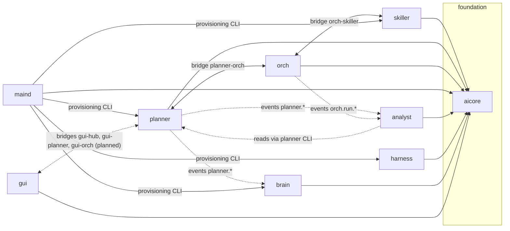
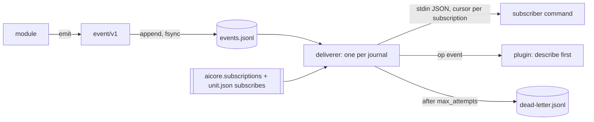

# Ecosystem architecture

How the repository is divided into isolated modules, what each module owns, how modules talk to each other and how
the move to this layout is kept safe. Decisions behind each section are in [decision records](decisions/README.md);
the live file-to-module map is generated into [ownership](ownership.md); contracts are inventoried in
[contracts](contracts.md).

## 1. Principles

1. **A folder is a module.** Everything a module needs lies in `packages/<id>/`. References leaving the folder go only
   to declared dependencies (`aicore`) and only through bridges or events. The root `AGENTS.md` and `CLAUDE.md`
   state this rule (generated by `harness` from its instruction catalog, [ADR 0026](decisions/0026-pinned-root-common-instruction.md)).
2. **One foundation.** A module may depend on `aicore` and on nothing else. The hub root, which assembles everything,
   is the only exception ([ADR 0002](decisions/0002-module-dependencies-only-on-aicore.md)).
3. **Three kinds of links, and only these:**
   - *dependency*: an import of `aicore`;
   - *bridge*: a synchronous request-response contract between two modules (CLI plus JSON);
   - *event*: an asynchronous notification; the source does not know its subscribers
     ([ADR 0003](decisions/0003-three-kinds-of-links-and-bridges.md)).
4. **Content has one canon, in its module.** Projections for Codex, Grok and Cursor are generated by `aicore`; there
   are no hand-made copies.
5. **Configuration in layers, state in standard places.** No scattering of dot-files
   ([ADR 0005](decisions/0005-layered-config-and-standard-state-locations.md)).
6. **Extension without a fork.** Anything a person wants to change is changed through configuration, overlays and
   subscriptions, not by editing module code ([ADR 0006](decisions/0006-extensibility-events-subscriptions-overlays.md)).
7. **Flexibility only where a consumer exists.** A shared contract is general; its implementation is minimal and has at
   least one real consumer now. Otherwise it is a roadmap entry with a trigger.

## 2. Repository layout

The layout imitates separate repositories while everything stays in one ([ADR 0001](decisions/0001-modules-as-isolated-folders.md)).

```text
swissknifeman/                      # the hub repository
  AGENTS.md  CLAUDE.md              # the folder-is-a-module rule, module map
  packages/
    aicore/    destination: own-repo   # foundation
    skiller/   destination: own-repo   # library of shared skills
    planner/   destination: own-repo   # plans (renamed from task)
    orch/      destination: own-repo   # orchestration (moves out after the first native engine)
    maind/     destination: hub
    analyst/   destination: hub
    harness/   destination: hub
    brain/     destination: hub        # Obsidian vault
    gui/       destination: own-repo   # desktop and browser control plane (tool module, Python 3.11+)
  bridges/
    planner-orch/                    # glue between two modules (hub)
    gui-hub/                         # GUI adapter of the hub: fleet, control surface, doctor, units
    gui-planner/                     # GUI adapter of the planner: plans, board, graph, items, timeline, forms and writes
    orch-skiller/
    orch-harness/
    gui-orch/                        # planned: GUI adapter of the orchestrator
  bin/swissknifeman                  # umbrella CLI: units, install, doctor, config, aliases of module CLIs
  configs/  scripts/  bootstrap/  docs/  .github/
```

`core/` dissolved into `aicore` and `analyst` (the shared code lives in `packages/aicore`; the compatibility shim was removed, see [ADR 0028](decisions/0028-aicore-subsystems-and-core-shim.md)); `packages/artifex` was retired and removed, it stays in history by tag;
`packages/task` became `packages/planner`; the root research folder of orchestration moves into
`packages/orch/docs/research/`. No transitional root is left: the ownership map holds only the files that still move to another module. The legacy driver `harness/run` stays until `orch` reaches parity.

### Modules

| Module | Purpose | Depends on | Built from (current paths) |
| --- | --- | --- | --- |
| `aicore` | foundation | none | exists: the former root `core/` package and `configs/provider-*.json` moved in (`core/` is removed); still to come: generic parts of `skiller` (catalog, budget, publication, delivery, quality); generic part of the `planner` command rendering |
| `skiller` | library of shared skills | `aicore` | `packages/skiller`: `skills/` (shared buckets only; the `system` bucket is provided by the host from module skills), `generate-skill/`, profiles and presets, upstream sync |
| `planner` | plans: schema, life cycle, API, commands | `aicore` | `packages/planner` |
| `orch` | orchestration: contracts, engine port, engines, launch catalog | `aicore` | `packages/orch` (research in `docs/research`) |
| `maind` | memory, graph, project registry, provisioning, MCP | `aicore` | `packages/maind` plus the `topology` registry of the machine from `skiller` |
| `analyst` | analytics, lessons, traces, run analytics, subscriber of run events | `aicore` | `packages/analyst` (run analytics from the former `core`) |
| `harness` | provider environment: permissions, hooks, MCP, agent packs, profiles, instructions | `aicore` | `packages/harness` |
| `brain` | Obsidian vault: search, document sync, notes, event subscriptions, own skills | `aicore` | new; `brain_sync` from `skiller`, skill `brain-locator`, vault parts of `maind` |
| `gui` | local control plane for desktop (Tauri 2) and browser mode: contracts, contribution resolver, API, frontend; a tool module (`standalone.tools`, Python 3.11+) | `aicore` | new ([ADR 0080](decisions/0080-gui-tauri-shell-react-python-control-plane.md)–[ADR 0084](decisions/0084-gui-state-canonical-files.md)) |
| `bridges/*` | glue between modules | both sides through their CLI | `bridges/planner-orch`, `bridges/orch-skiller`, `bridges/orch-harness` (moved out of `planner` and `orch`), `bridges/gui-hub`, `bridges/gui-planner`; planned `bridges/gui-orch` (GUI adapters, [ADR 0081](decisions/0081-gui-domains-through-bridges.md)) |
| hub root | assembly, install, update, docs, CI, the `skm` front door | all modules | `bin/`, `scripts/`, `configs/`, `bootstrap/`, `plugins/`, `docs/` |

The file-level map, with the stage that moves each entry and a confidence mark, is generated into
[ownership](ownership.md); this document does not copy it.

### How modules are linked

A module reaches a partner only through the partner's public command with JSON output, found by `aicore.util.partners`
(`SKM_<NAME>_BIN`, then `SKM_<NAME>_ROOT/bin/<name>`, then `PATH`); a missing partner is `PARTNER_UNAVAILABLE` and the command
degrades ([ADR 0063](decisions/0063-partner-command-links.md)). The boundary check is strict: `check --strict` has no
exception for code ([ADR 0071](decisions/0071-core-and-artifex-removal-and-strict-boundaries.md)).



| Link | Kind | Contract |
| --- | --- | --- |
| planner and orch | bridge `bridges/planner-orch` | work-source port plus `exec/v1` |
| orch and skiller | bridge `bridges/orch-skiller` | role to set of skills (`skiller resolve`) |
| orch and harness | bridge `bridges/orch-harness` | conformance of the role manifests with the agent-pack role catalog |
| gui and hub, planner, orch | bridges `bridges/gui-<module>` (`gui-hub`, `gui-planner`; `gui-orch` planned) | `gui.json` (`contribution/v1`) plus the aicore plugin protocol on `gui:query` and `gui:command`; the bridge calls the owner's CLI ([ADR 0081](decisions/0081-gui-domains-through-bridges.md)) |
| analyst to planner | read-only planner CLI | plan read API |
| planner to brain, analyst | events | `planner.*` |
| orch to analyst | events | `orch.run.*` |
| maind to skiller, planner, harness, brain, analyst | partner commands found by `aicore.util.partners` | provisioning commands and JSON commands of the partner (`run-lookup/v1`, `mcp-catalog/v1`, `profile-resolution/v1`) |
| analyst to maind | partner command | `maind projects list --json` |
| doctors of maind, analyst, harness, skiller, brain, orch, aicore | contract | `check-result/v1`, aggregated by `swissknifeman doctor` from `provides.doctor` ([ADR 0073](decisions/0073-doctor-aggregator.md)) |
| every module to aicore | import | `aicore` range in `unit.json` |

## 3. Module contract

Every module, `own-repo` or `hub`, has the same shape:

```text
packages/<id>/
  unit.json                    # module manifest
  README.md  AGENTS.md  CLAUDE.md  CHANGELOG.md  LICENSE
  bin/<cli>                    # thin wrapper: finds its lib and aicore
  lib/<id>/                    # Python: stdlib plus aicore
  skills/  commands/  hooks/  agents/     # content canon for providers, if any
  configs/config.schema.json   # schema of the module's config section; its `default` keywords are the defaults
  config.example.toml          # generated from the schema (aicore config example)
  schemas/                     # public contracts (JSON Schema), if any
  docs/  tests/  scripts/{test.sh,validate.sh}
```

The manifest schema is `packages/aicore/schemas/unit/v1` (see [contracts](contracts.md)). Rules checked
automatically by `python3 scripts/ecosystem-units.py check`:

- **Manifest:** `unit.json` exists, is valid, its `id` equals the folder and the single package in `lib/`, its
  `version` equals the existing version carrier, `requires` ranges are satisfied, and declared paths exist.
- **Boundary:** a module imports only its own `lib/` and `aicore`, and contains no path leading to another module.
  Violations that exist today sit in a baseline (`configs/ecosystem-baseline.json`); a new violation fails the check,
  and `--strict` fails on any.
- **Standalone:** the module's tests pass in a copy of its folder with only a stand-in for `aicore`
  (`ecosystem-units.py standalone`).
- **Finding `aicore`** by the `bin/` wrapper: `AICORE_ROOT`, then `<module>/_vendor/aicore`, then the neighbouring
  `../aicore` (only inside the hub repository, a development mode). One canonical fragment does the search and a miss
  ends with `AICORE_NOT_FOUND` ([ADR 0029](decisions/0029-aicore-locator-fragment.md)). How `aicore` is delivered after
  modules move out is decided together with that move.
- **Plugin** manifests for Claude Code are generated from `unit.json` by `aicore`, not written twice by hand.

## 4. aicore: the foundation

`aicore` is the base on which every module, including future ones, is built. It is extended through data (catalogs) and
named adapters: a new provider is an adapter plus a catalog entry; a new kind of content is a descriptor
([ADR 0004](decisions/0004-aicore-foundation-and-generalisation-boundary.md)).

| Subsystem | Role | Consumers |
| --- | --- | --- |
| `aicore.util` | atomic write, paths, text, terminal, CLI, processes, HTTP, repository root, managed blocks, project type | all |
| `aicore.config` | layered configuration with schemas and an explanation of where a value comes from | all |
| `aicore.state` | standard places for state, cache and backups; `SKM_HOME` for isolation | all |
| `aicore.provider` | provider capability manifests, configuration, control plane, health, adapter registry, model catalog, MCP projection (`aicore.provider.mcp`) | harness, maind, planner, orch, skiller |
| `aicore.artifacts` | plan, apply and lock of artifacts in projects, reconcile, backups | skiller, harness, maind |
| `aicore.content` | skill model and `skill-descriptor/v1`, the one token estimate and context budgets, publication mechanics (manifest bytes, whole-file artifacts, Codex plugin manifest, publication lock), the shared part of command projection, skill and system-bank evaluation with `eval-context/v1`; later: agent, hook and instruction models | skiller (harness uses the token estimate; planner uses command projection from P9) |
| `aicore.delivery` | mechanics of connecting plugins and skills to a project: Codex plugin selection, Claude marketplace settings merge, vendor and marketplace distribution plans, managed skill copies with manifest and `skills-lock.json` | skiller now; planner, brain, hub when they connect through it |
| `aicore.release` | release attestation, version rules (semver bump, next free version) and the changelog format | skiller now; hub scripts (`verify-tag`, `version-guard`) and all modules at their release stage |
| `aicore.ext` | events with a journal and delivery, subscriptions, overlays, external plugins and their conformance; telemetry names | planner, orch, brain, analyst, harness |
| `aicore.unit` | `unit.json` schema, boundary and standalone checks, new-module template | all modules, CI |
| `aicore.usage` | parsing usage from provider logs | analyst, skiller eval, orch |

The `aicore` CLI is a tool for module developers (catalog, project, config, events, unit, provider). End users work
with module CLIs and `swissknifeman`.

**Generalisation boundary.** Only what two or more modules already use, or what every module needs by contract, moves
into `aicore`. The assignment of `skiller` internals to `aicore` is a hypothesis until the owning stage reads the code;
the ownership map marks each entry `fixed` or `hypothesis`.

**Generalisation boundary in practice.** Reading the code of the skill library showed that most files mix general
mechanics with the policy of that library (buckets, the core set, profiles, presets, `.swissknife.json`, the host
configuration, the project registry, the hub). The line was therefore drawn by function, not by file
([ADR 0037](decisions/0037-content-delivery-release-boundary-by-function.md)): what takes explicit parameters and
knows no bucket or host moved into `aicore.content`, `aicore.delivery` and `aicore.release`; the old names in
`skiller` are re-exports or thin wrappers. What stays, and where it is decided:

- `skiller`: selection and composition (`resolve_active_set`, `first_turn_report`, profiles and presets), the
  publication catalog and the rendering of unit kinds (bucket, curated, meta, management), `registry.py` and
  `skills.json`, `connect`, `vendor`, `update`, `status`, `skillset` planning, `doctor`, `config`, `lock`, `resolve`
  and the `skiller` commands over the moved functions. Delivery to the fleet, `host.py` and the root bootstrap are hub
  work (P12); `lock.py` and `resolve.py` meet the orch bridge (P10); `topology` moved to `maind` (P11) while `listing` and `state` stay with `skiller`
  as the registry of connected projects (`skiller list --json`), `brain_sync` to `brain` (P7); the skills move with their modules (P8).
- `planner`: the catalog of commands, routing and the wrapper texts of command projection (P9); only the shared part is in
  `aicore.content.commands`.
- `harness`: the pure MCP projection is `aicore.provider.mcp` (P11); the profile renderers stay in harness.

## 5. Configuration and service files

### 5.1 Configuration layers

| # | Layer | Where | Written by |
| --- | --- | --- | --- |
| 1 | module defaults | the `default` keywords of `packages/<id>/configs/config.schema.json` | module developer |
| 2 | machine and user | `~/.config/swissknifeman/config.toml` (one section per module) | person, `swissknifeman config set` |
| 3 | project | `<project>/.swissknifeman/config.toml` (in git) | person, module commands |
| 4 | environment | `SKM_<MODULE>_<PATH>` (`__` between path segments) | the invocation |
| 5 | `--config FILE` | a file in the same format as layers 2 and 3 | the invocation |
| 6 | flags | CLI | the invocation |

A module may add its own layers between 3 and 4 (a legacy file of the module, plan settings of the planner).

A schema may also declare a *dictionary table* (`patternProperties` with one anchored pattern): entries named by
the person, such as `[aicore.subscriptions.notes]`, merge by key across layers and take the leaf defaults of the
schema. `x-skm-layers` applies to the leaves of every entry, so executable definitions (`run`, `plugin`, plugin
manifests) are accepted from the machine file, `--config` and flags but never from the project file, which is in
git; a project may only switch an entry off or add overlays. Environment variables cannot address entries.

Each section is validated by the schema of its module. `swissknifeman config explain <module>` shows the
resulting value, the layer, file and line it came from and the values it overrides. Machine configuration (project paths, pools, MCP) lives in `~/.config`, not
in the repository working copy, so different computers and a development clone do not compete for one file. Layers
edited by hand are TOML; generated state, lock files and module defaults are JSON; every module ships
`config.example.toml` generated from its schema (defaults are the schema's `default` keywords) ([ADR 0011](decisions/0011-toml-for-human-edited-config.md)).
Merge, removal, explain, secrets and the invocation layer follow [ADR 0019](decisions/0019-config-semantics.md) as
made exact in [ADR 0034](decisions/0034-layered-config-semantics.md); config files are TOML 1.0
([ADR 0036](decisions/0036-toml-vendored-tomli-and-minimal-editor.md)).

### 5.2 State locations

| What | Where |
| --- | --- |
| machine configuration | `~/.config/swissknifeman/` (`$XDG_CONFIG_HOME`) |
| registries (projects, topology, agents, installed modules) | `~/.local/state/swissknifeman/` |
| data (memory, hub graph) | `~/.local/share/swissknifeman/` |
| cache | `~/.cache/swissknifeman/` |
| project configuration | `<project>/.swissknifeman/config.toml`, in git |
| project state (lock files, receipts, event journal) | `<project>/.swissknifeman/state/`, in `.gitignore` |
| project backups | `<project>/.swissknifeman/backups/<ts>/...`, in `.gitignore`, with rotation |
| isolation (tests, sandbox, development clone) | `SKM_HOME=<dir>` moves the four machine places to `<dir>/{config,state,data,cache}` and switches off legacy lookups |

Places are resolved by `aicore.state`; a relative `XDG_*` value is ignored and a relative `SKM_HOME` is an error. A file
found only at a legacy location is read from there with one warning per process, and is never copied until
`swissknifeman upgrade` ([ADR 0035](decisions/0035-state-locations-legacy-reads-and-backups.md)).

Provider surfaces (`.claude/settings*.json`, `.codex/config.toml`, `.grok/`, `.cursor/`, `.mcp.json`) stay with the
providers. They are written only through `aicore.artifacts`, with a lock file and a backup under
`.swissknifeman/backups/`, not with a `*.bak` file next to them.

### 5.3 Service file distribution

What each service file is today, who writes it and where it ends up:

| Today | Written by | Becomes |
| --- | --- | --- |
| `<project>/.swissknife.json` (plugins, providers) | skiller | `.swissknifeman/config.toml`, table `[skiller]` (done in P8; the legacy file is read with a warning until upgrade); providers move with `delivery` |
| `<project>/.swissknifeman/config.json` (vendor skillset) | skiller | table `[skiller.sync]` of the same file (done in P8; the legacy file is read with a warning until upgrade) |
| `<project>/.swissknifeman/provider-artifacts.lock.json`, `rogue-lock.json`, `receipts/` | aicore.provider, skiller | the lock stays where it is (a committed contract read by hooks); `rogue-lock.json` and `receipts/` go to `.swissknifeman/state/` |
| `<project>/.swissknifeman-manifest.json`, `.swissknifeman-codex-links.json` | skiller | `.swissknifeman/state/` |
| `<project>/<provider>/<hook>.env.ini` (legacy `.claude/{auto-approve,memory,review-gate}.env.ini`) | harness, maind | `[harness.hooks.<hook>]` of the project config; `harness hooks sync` generates the committed `.swissknifeman/hooks.env`, which hooks read first and which is not edited by hand (done in P11; the legacy file is read until upgrade) |
| `*.bak`, `*.provider-artifact.bak` next to files | aicore.util, harness, maind, skiller | `.swissknifeman/backups/<ts>/` with rotation through `aicore.state.backup` (done in P11 for maind and harness) |
| `<project>/.maind.graph.json` | maind | table `[maind.graph.links.<project>]` of the project config (done in P11; the legacy file is read with a warning until upgrade) |
| `<project>/.claude/agent-pack.lock.json` | harness | stays: a committed contract that hooks read; the code holds only the constant |
| `~/.swissknifeman/topology.json`, `~/.swissknifeman/projects.json` | maind (topology), skiller (projects) | `<state>/maind/topology.json` and `<state>/skiller/projects.json` (done in P11; the legacy files are read with a warning until upgrade) |
| `~/.maind/{projects,agents}.json`, `<module>/data` | maind | `~/.local/state/swissknifeman/maind/` and `~/.local/share/swissknifeman/maind/` (done in P11; the legacy places are used with a warning until upgrade) |
| `config.json` (also `.maind.json`) in the repository root (machine-specific, ignored by git) | maind | settings: table `[maind]` of `~/.config/swissknifeman/config.toml`; fleet registry (projects, namespaces, agent definitions, MCP servers, providers, role packs): `~/.local/state/swissknifeman/maind/registry.json` (done in P11; the legacy file is read, and the registry written back to it, until upgrade) |
| `safe-dirs.json` in the repository root (machine-specific, ignored by git) | harness | `<config>/harness/safe-dirs.json` (done in P11; the legacy files are read as later steps of the ladder) |
| `<project>/.swissknife.json#/providers` | aicore.provider, maind | table `[aicore.providers.selection.<provider>]` of the project config (done in P11; the legacy carrier is read with a warning until upgrade) |
| `~/.claude/hooks/*` (global hooks) | harness | stay (a Claude surface) but are installed from the harness catalog with a lock file |
| `~/.local/bin/*` symlinks into the working copy | `install.sh` | created by `swissknifeman install`; the registry of installed modules lives in state |

## 6. Extensibility

The subsystem is `aicore.ext` (its README section is `packages/aicore/README.md#extensions-aicoreext`). Sources of
extensions are the modules that emit events or declare slots and points in `unit.json`, the machine configuration that
registers what runs, and third parties that supply plugins. Consumers are planner, orch, brain and analyst (events,
overlays, points) and harness (translating provider hooks into events); their phases adopt it.



### 6.1 Events

- Envelope `event/v1`, a CloudEvents 1.0 subset: `specversion`, `id`, `source` (`urn:swissknifeman:module:<id>`), `type`
  (`<module>.<subject>.<verb>`), `time`, optional `subject` and `data` (at most 64 KiB; larger data is an
  `artifact-ref/v1` into `aicore.state.blobs`), and the extension attributes `traceparent`, `causationid`,
  `correlationid`. There is no `project` field. The catalog of types is the `provides.events` list of each `unit.json`.
- A source calls `aicore.ext.emit(...)`: the event is appended to `<project>/.swissknifeman/state/events.jsonl` first,
  then delivered. The path is emit, journal, deliver (`background` by default, `sync` or `off`).
- Guarantees: at-least-once from the journal, a cursor per subscription, journal order, one attempt per event and pass, a
  dead letter after `events.max_attempts`, replay on request; subscribers are idempotent by `id`; a subscriber failure
  never breaks the source ([ADR 0041](decisions/0041-event-envelope-journal-and-delivery.md)).

### 6.2 Subscriptions

- In the machine configuration: `[aicore.subscriptions.<id>]` with `on` and `run` (or `plugin`); the event arrives on
  stdin as JSON. A project file may only switch an entry off (`enabled = false`)
  ([ADR 0040](decisions/0040-extension-configuration-map-tables.md)).
- A module declares default subscriptions in `unit.json` (`subscribes`, id `<module>:<name>`); they are enabled with the
  module and can be switched off or retimed in configuration, never replaced.
- Provider hooks (for example `SessionStart`, `Stop` of Claude Code) stay with `harness`, which may translate them into
  `aicore` events so they can be subscribed to the same way.

### 6.3 Instruction overlays

- Module commands declare slots (`overlay_slots`), for example `planner:plan-design`.
- Configuration maps a slot to files: `[aicore.overlays."planner:plan-design"]` holds the paths. A project may add overlays.
- Overlays are resolved at run time: a command calls `<cli> overlays <slot>` or `aicore ext overlays <slot>`. Static
  embedding is allowed only in projections generated into a project or onto a machine
  ([ADR 0044](decisions/0044-instruction-overlays-runtime-resolution.md)).

### 6.4 External plugin commands

- Extension points of a module are listed in `unit.json` (`extension_points`), for example external plan checks. A
  plugin is an `extension.json` (`extension/v1`) registered in `[aicore.plugins.<id>]`.
- Contract: protocol `1`, one JSON request on stdin and one JSON object on stdout; the language does not matter. The
  manifest is checked before launch and `describe` runs before every use. The model is the one of bridges and needs no pip.
  Levels, handshake and trust are in [ADR 0016](decisions/0016-extension-model-levels-and-trust.md); the protocol and
  process discipline in [ADR 0042](decisions/0042-external-plugin-protocol-and-process-discipline.md).

### 6.5 Trust model

| Question | Answer |
| --- | --- |
| Who can make something run | the machine configuration, the invocation file and flags; never the project file |
| What does a plugin receive | an allowlisted environment; a `trusted` plugin also gets the environment names and `env://` secrets its manifest declares |
| What is contained | the process group: new session, shared deadline, SIGTERM then SIGKILL to the group, output limits, secret redaction |
| What is not contained | a descendant that calls `setsid()`; no cgroup or Landlock enforcement, so `trusted-local` is reported `enforced: false` and `read-only` is unavailable |
| How is it checked | `aicore ext status` (doctor probe) and `aicore ext conformance MANIFEST` (ten scenarios) |

Enforcement and the other deferred items (journal rotation, timer retries, describe cache, `secret-resolver`, OpenTelemetry
export, in-process and remote extensions) are listed with their triggers in the aicore README. Names of spans and metric
labels are fixed by [ADR 0045](decisions/0045-telemetry-naming-conventions.md).

## 7. Module functional maps

### planner (formerly task)

- **Owns:** the plan schema (the URNs `urn:swissknifeman:task:plan:*` do not change, otherwise plans in every project
  break), the life cycle, the read API, the commands (design, dev, fix, review, research, `plan-*`), the skill
  `plan-protocol`, templates, workflow templates (`wf-*.js`), reviewer selection and the catalog of its commands.
- **Extended by** configuration with the priority defaults, machine, project, plan settings, flags: budgets and check
  thresholds, defaults of new plans, bounded cycle policies, view templates, the default orchestration scenario per
  item class ([ADR 0012](decisions/0012-planner-configuration.md), [ADR 0013](decisions/0013-orchestration-scenarios-and-prepared-brief.md));
  also by overlays of command slots, subscriptions to its own events and external plan checks.
- **Emits:** `planner.plan.created|closed`, `planner.item.started|finished`, `planner.phase.closed`,
  `planner.decision.accepted`, after the plan lock is released; the data follow `schemas/event-data/v1`
  ([ADR 0055](decisions/0055-planner-events-overlays-and-external-checks.md)).
- **Does not own:** model names (`aicore.provider`), launch argv (`orch`), delivery into projects (`aicore.delivery`),
  projection of commands to Codex, Grok and Cursor (`aicore.content`).
- **Rename:** `/task:*` became `/planner:*` and `SKM_TASK_ROOT` became `PLANNER_ROOT`, with transitional aliases for one
  minor release: the compatibility plugin `task` (`packages/planner/aliases/task`), the old environment variable with a
  warning, and `task:<id>` command lines read as `planner:<id>`
  ([ADR 0009](decisions/0009-task-renamed-to-planner.md), [ADR 0052](decisions/0052-planner-rename-compatibility-alias.md)).
- **After P9:**
  - *Command line:* `scripts/plan.py` (no `bin/` yet); plugin `planner`. Extra verbs `config show|explain` and
    `overlays <slot>`; `check` also runs external checks.
  - *Engine and foundation:* `lib/planner/plan/` is stdlib-only and runs without `aicore`; `lib/planner/integration/`
    is the only place that imports it, and the projection renderer is the other. Without `aicore` the configuration is
    the schema defaults and `plan.settings`, no events are emitted, overlays are empty and external checks are skipped
    ([ADR 0053](decisions/0053-planner-engine-without-hard-aicore-dependency.md)). The model catalog of command routing
    is a generated snapshot of the `aicore` catalog.
  - *Configuration:* table `[planner]` (`configs/config.schema.json`, `config.example.toml`) in the layered config,
    plus the `plan.settings` layer ([ADR 0054](decisions/0054-planner-settings-in-the-layered-config.md)).
  - *Extension:* ten overlay slots `planner:<command>` (one per command) and the extension point `planner:check` with
    `schemas/check-plugin/v1`; the data of events are the contract `schemas/event-data/v1`.
  - *Execution:* optional `orchestration.scenario` and one owner per attempt (`ITEM_OWNED`, `start --take-over`), minor
    changes of `plan/v1` ([ADR 0056](decisions/0056-execution-scenario-and-one-owner-per-attempt.md)).
  - *Skills:* the `workflow-craft` skill moved from `skiller` into the plugin `planner`.

### orch

- **Owns:** the `exec/v1` contracts, the engine port, bindings and engines (`engines/`), the launch catalog (role by
  provider), and role texts.
- **Extended by** the engine choice in configuration (`orch.engine: native|cao|claude-only`, overridable per role) and by
  the capabilities required in run-policy; an engine without them is refused instead of silently degraded.
- **Scenarios:** run-policy profiles in the `orch` configuration, see
  [ADR 0013](decisions/0013-orchestration-scenarios-and-prepared-brief.md).
- **After P10:** `orch` imports only the standard library, `orch` and `aicore` ([ADR 0057](decisions/0057-orch-on-the-aicore-foundation.md)).
  Partners are reached through the bridges of the hub, which find them by variable or command
  ([ADR 0058](decisions/0058-bridges-as-hub-units-and-partner-lookup.md)).
- **Links:** the work-source port `orch:work-source` (`claim`, `brief`, `register`) is served by the plugin of
  `bridges/planner-orch`, with owner fencing and an evidence gate ([ADR 0059](decisions/0059-work-source-port-and-evidence-gate.md));
  `orch` emits `orch.run.*` ([ADR 0061](decisions/0061-run-policy-packs-engine-choice-and-orch-events.md)).
- **Does not own:** durable timers, signals, workflow replay, compensation and multi-day execution; MCP is a tool surface,
  not the event bus ([ADR 0062](decisions/0062-engine-conformance-and-non-goals.md)).

### skiller

- **Owns:** the shared skills (buckets), profiles and presets (which buckets for which
  kind of project), the new-skill template and upstream synchronisation.
- **Code:** a thin CLI over `aicore.content` and `aicore.delivery` plus whatever concerns only its library.
- **After P8:** `skiller` depends only on `aicore` and holds the shared skills. Its settings are the tables `[skiller]`
  and `[skiller.sync]` of `.swissknifeman/config.toml` ([ADR 0050](decisions/0050-skiller-settings-in-the-layered-config.md)).
  The `system` bucket is host-provided: the host config maps it through `bucket_aliases` to the module plugins that own
  the skills ([ADR 0049](decisions/0049-module-skills-through-host-provided-buckets.md)). `skills.json` carries
  `license`, `compatibility` and `allowed_tools`, and `skiller describe` prints the `skill-descriptor/v1`
  ([ADR 0051](decisions/0051-skill-metadata-in-the-index.md)).

### brain

- **Owns:** vault lookup (`brain.vault_path` in machine configuration), project-to-vault document synchronisation (from
  `skiller`), note writing, subscriptions to ecosystem events and its own skills (`brain-locator`; later `/vault:*`
  commands).
- **Built (P7):** the commands `vault`, `project`, `docs`, `note`, `doctor` and `version`; the `[brain]` configuration
  table; document sync moved from `skiller` and called through a host command; the plugin `brain` with the skill
  `brain-locator`; module instructions; and the subscription `brain:plan-notes`, which writes one idempotent note per
  `planner.plan.closed` event and emits `brain.note.created`
  ([ADR 0046](decisions/0046-brain-surface-and-vault-lookup.md),
  [ADR 0047](decisions/0047-document-sync-through-a-host-command.md),
  [ADR 0048](decisions/0048-plan-closed-subscriber-and-idempotent-notes.md)).
- **Still to come:** `brain`
  on `PATH` (P12), the migration of `.swissknife.json::memory_brain` (P13). Moving the external vault code comes later
  ([ADR 0007](decisions/0007-brain-module-scope.md)).

### maind

Memory, graph, the project registry, the machine topology (`maind topology`), provisioning (onboard, sync,
deploy) on top of `aicore.artifacts` and `aicore.config`, and the MCP server. Settings are the `[maind]` table of the
layered configuration and the fleet registry is `<state>/maind/registry.json`
([ADR 0065](decisions/0065-maind-configuration-and-state.md)). It imports only itself and `aicore`: harness, analyst,
skiller and brain are reached through their commands
([ADR 0063](decisions/0063-partner-command-links.md), [ADR 0066](decisions/0066-maind-harness-link-and-mcp-projection.md)).
The MCP server negotiates the protocol version ([ADR 0070](decisions/0070-maind-mcp-protocol-negotiation.md)). The vault
location comes from `brain vault --json`.

### analyst

Lessons, digest, metrics, provider readers and traces, plus run analytics (`run_reports`, `pathology`, `codegraph`;
moved from the former `core`). Other modules read run reports through `analyst runs show|codegraph --json` (contracts `run-lookup/v1`
and `run-codegraph/v1`), found with `aicore.util.partners`. Subscribes to `planner.*` and `orch.run.*` and records outcomes without copying event data
([ADR 0064](decisions/0064-run-analytics-in-analyst-and-event-subscriber.md)). Reads the planner workflow and the project
registry (`maind projects list --json`) through their commands, not by import.

### harness

Catalogs and policies of the environment: permissions, settings, hooks, agent packs, profiles, instructions and MCP.
Dividing rule: **rendering into a provider format belongs to `aicore.provider`; catalogs and policies belong to
`harness`.** The pure MCP projection is `aicore.provider.mcp`; the profile renderers (`cursor_render`, `grok_render`,
`provider_render`) stay in harness because they carry policy and have one consumer. Hook modes live in `[harness.hooks]` and
the committed `.swissknifeman/hooks.env` ([ADR 0067](decisions/0067-harness-configuration-and-state.md)); the instruction
catalog holds its targets as data ([ADR 0068](decisions/0068-instruction-catalog-and-legacy-driver.md)). harness gives
maind JSON commands: `mcp catalog`, `profiles resolve`, `hooks codex-lifecycle`, `instructions scopes`.

### hub root

The hub root composes the modules and holds no module logic. It imports only `aicore` and finds every module by its
`unit.json`; the only place with module ids is data.

| Part | Where | What it does |
| --- | --- | --- |
| Umbrella CLI | `bin/swissknifeman`, `scripts/umbrella.py`, `configs/umbrella.json` | built-ins `units`, `install`, `doctor`, `-V`; a module with `provides.cli` is a command group; former groups and legacy skiller verbs are aliases ([reference](../reference/umbrella.md), [ADR 0072](decisions/0072-umbrella-reads-modules-from-unit-json.md)) |
| Doctor | `swissknifeman doctor` | runs the unique `provides.doctor` probes once, read-only, prints `umbrella-doctor/v1` ([reference](../reference/doctor.md), [ADR 0073](decisions/0073-doctor-aggregator.md)) |
| Install profiles | `configs/install-profiles.json`, `install.sh` | `minimal`, `standard` and `full`, ordered by `requires` ([guide](../install-profiles.md), [ADR 0074](decisions/0074-install-profiles.md)) |
| Marketplace | `.claude-plugin/marketplace.json`, `.agents/plugins/marketplace.json` | assembled by `aicore.content.marketplace` from `provides.plugins` ([ADR 0075](decisions/0075-marketplace-from-unit-json.md)) |
| Conformance | `swissknifeman conformance plugin\|engine` | protocol checks for plugins and engines ([reference](../reference/conformance.md), [ADR 0076](decisions/0076-conformance-kit.md)) |
| Release bundle | `swissknifeman release bundle` | `compat.json`, schema package, attestation, `SHA256SUMS` ([reference](../reference/release-bundle.md), [ADR 0077](decisions/0077-release-bundle.md)) |
| CI | `scripts/ci-matrix.py`, `.github/workflows/modules.yml`, `scripts/smoke-installed.sh` | steps and matrix generated from `unit.json`; smoke of the installed form ([ADR 0078](decisions/0078-installed-form-smoke-and-ci-matrix.md), [development](../develop.md)) |
| Site | `docs/` (`package.json`, `.vitepress`) | the documentation site; `docs/<module>/` are copies of `packages/<module>/docs` made by `scripts/docs-sync.sh` |
| Bootstrap skills | `bootstrap/skills/` | the skills of the root, projected by the generators |
| Front door plugin | `plugins/skm/`, `configs/umbrella.json#plugins` | `/skm`, `/skm:skills`, `/skm:integrate`, `/skm:status`, `/skm:doctor` (all modules through `swissknifeman doctor`); a hub plugin is data, read by the marketplace assembler ([ADR 0079](decisions/0079-umbrella-front-door-plugin-at-the-root.md)) |

## 8. Skill distribution

A shared skill stays in `skiller`; a skill about a particular module lives in that module
([ADR 0008](decisions/0008-skills-live-in-their-module.md)).

| Skill today | Goes to |
| --- | --- |
| `system/agent-packs` | harness (plugin `harness`, done in P8) |
| `system/agents` (agent `code-coordinator`) | maind (plugin `maind`, done in P8) |
| `system/brain-locator` | brain (plugin `brain`, done in P7) |
| `system/local-topology`, `system/swissknifeman-locator`, `system/cross-project-coordinator`, `system/shared-memory` | maind (plugin `maind`, done in P8) |
| `system/session-observer` | analyst (plugin `analyst`, done in P8) |
| bootstrap skills (`bootstrap/skills`, `*/dev-skills`) | unchanged |
| `general/workflow-craft` | planner (plugin `planner`, done in P9) |
| `general/complex-task-orchestrator`, `general/task-brief-template`, `general/skills-ssot`, `general/project-map` | stay in `skiller`; module binding reviewed when `skiller` is reduced to shared skills |
| all other `general/*` and other buckets | stay in `skiller` |

## 9. Migration discipline

Rules every stage of the move follows ([ADR 0020](decisions/0020-migration-discipline.md)):

- **Golden fixtures** pin the behaviour of the CLIs and generators before code moves
  ([ADR 0027](decisions/0027-golden-fixtures-lifecycle.md)); a stage that moves code must pass `golden.py check`
  byte for byte.
- **Shims and aliases** have a compatibility window, a removal stage and a test.
- **Shadow comparison** of old and new output wherever it is comparable, without doubled side effects.
- **Architecture checks** of the stage are added with the stage; a statement "X must not own Y" without a check is
  unfinished.
- **Rollback criterion:** until the cutover, revert the commits of the stage on the branch; the cutover has its own
  rollback plan, and the previous release tag is the return point.
- **Development process:** work happens in a separate clone on the branch `ecosystem-split` with an isolation guard and a
  sandbox; the live checkout stays on `main`. See the branch section of [development](../develop.md).

### Stages

`ownership.md` names the stage that moves each entry with a `P<N>` label:

| Stage | Result |
| --- | --- |
| P1 | working environment: clone, branch, isolation, rhythm of merging `main` |
| P2 | module skeleton: `unit.json`, rule in root instructions, ownership map and boundary checks, golden fixtures, this documentation |
| P3 | `aicore` base: util, provider, artifacts, usage; `core` re-exports it through a shim |
| P4 | `aicore` configuration and state: layers, standard places, `SKM_HOME`, backups, `swissknifeman config` |
| P5 | `aicore` content and delivery: catalog, budget, projection, publication, delivery, release |
| P6 | `aicore` extensions: events, subscriptions, overlays, external plugin commands |
| P7 | `brain` skeleton, document sync and `brain-locator`, first subscriber (done) |
| P8 | `skiller` reduced to shared skills; code on `aicore`; module skills through the host-provided `system` bucket; settings in the layered config; skill metadata and `skiller describe` (done) |
| P9 | `planner` rename with the `task` compatibility alias, layered configuration, events, overlay slots, external plan checks, execution scenario and attempt owner, commands on `aicore` (done) |
| P10 | `orch` on `aicore`; bridges as hub units (`bridges/`); work-source port with an evidence gate; `exec/v1` protocol fields; run-policy packs and engine choice in `[orch]`; `orch.run.*` events; engine conformance (done) |
| P11 | hub modules (`maind`, `analyst`, `harness`) on `aicore` and new state places; `core/` and `artifex` removed, `check --strict` green and in CI (done) |
| P12 | hub: umbrella CLI over `unit.json`, doctor aggregator, install profiles, marketplace from `unit.json`, conformance kit, release bundle, installed-form smoke, CI matrix, site in `docs/` (done) |
| P13 | cutover: `swissknifeman upgrade`, upgrade guide, rehearsal, merge, tag, rollback |

## 10. Transition for live projects

`swissknifeman upgrade` has `--dry-run` (what changes and where), apply and `--rollback`
([ADR 0010](decisions/0010-upgrade-command-and-guide.md)):

- machine configuration moves to `~/.config/swissknifeman/` and registries to `~/.local/state/swissknifeman/`;
- CLI symlinks are re-created and the marketplace is registered under the new plugin names;
- every project is migrated: old service files to the new places, `*.env.ini` to configuration sections, `*.bak` into a
  backup, hook and MCP paths rewritten;
- everything changed is backed up and can be rolled back.

Compatibility: plan schemas and URNs do not change; aliases of `/task:*` and the old environment variables work for one
minor release with a warning. The guide `docs/upgrade/<version>.md` lists requirements, backup, dry-run, apply, the
`doctor` check, rollback and the steps for the second computer. The upgrade is rehearsed on copies of projects in a
sandbox and on the second computer; only then is the branch merged and a major version tagged.

## 11. Contracts, versions and verifiability

- **Contracts** are JSON Schema (draft 2020-12), the source of truth; shared ones live in
  `packages/aicore/schemas/<contract>/v<N>/` ([ADR 0014](decisions/0014-language-neutral-contracts-in-aicore.md)). The
  inventory is in [contracts](contracts.md).
- **Versions** are kept per dimension, with stability stages and an evolution policy for each contract
  ([ADR 0015](decisions/0015-versions-by-dimension-and-stability-stages.md)).
- **Extensions** are out-of-process only for now, with a manifest before launch, a handshake and a trust flag
  ([ADR 0016](decisions/0016-extension-model-levels-and-trust.md)).
- **Providers and execution:** an error taxonomy in `aicore.provider`, retries by class in `orch`
  ([ADR 0017](decisions/0017-provider-boundary-and-error-taxonomy.md)); event identity, fencing and idempotency, an
  immutable launch plan with proof and explain, one execution owner per run and per item attempt
  ([ADR 0018](decisions/0018-execution-protocol-identity-fencing-idempotency.md)).
- **Doctor** is a module contract: `provides.doctor` and the `check-result` schema
  ([ADR 0022](decisions/0022-doctor-as-module-contract.md)).
- **Releases:** checksums, changelog, compatibility manifest and schema package now (`swissknifeman release bundle`,
  [ADR 0077](decisions/0077-release-bundle.md)); SBOM, signatures and provenance on a
  trigger ([ADR 0023](decisions/0023-releases-and-supply-chain.md)).
- **Names:** import names equal the module id; distribution names will be `skm-<id>`
  ([ADR 0024](decisions/0024-python-package-names.md)).

## 12. Risks and how they are held

| Risk | Measure |
| --- | --- |
| Live projects break | work only in the clone; a dev-clone marker; transition through `upgrade --dry-run` and rehearsal |
| `aicore` grows "just in case" | principle 7 and the generalisation boundary; every extension has a real consumer |
| Tests write to the real home directory | `SKM_HOME` or a throwaway `HOME` in tests; the isolation guard covers all modules |
| `main` moves ahead | merge `main` into the branch at the start of each stage and check golden fixtures |
| Hidden absolute paths in projects | inventory in `upgrade --dry-run`; search over the projects in the registry |
| Size | each stage is detailed only before it runs, and each ends with a complete result |

## 13. Out of scope

- Creating separate repositories and publishing modules to marketplaces (after the layout has been proven).
- Implementing the native engine and the CAO adapter of orchestration.
- Moving all code from the external vault tooling; only the `brain` foundation is in scope.
- Changing the content of shared skills.

## 14. Glossary of entities

A provider, an agent, a tool, an execution environment, a durable runtime and a remote agent are different things and
are never folded into one `Provider`. The table states what each is here and who owns it; it adds no requirements.

| Entity | In this ecosystem | Owner |
| --- | --- | --- |
| model provider | facts about a provider: capabilities, models, errors, authorisation routes (`aicore.provider`) | `aicore` |
| agent runtime | an orch engine binding together with the provider CLI it starts | `orch` |
| tool provider | an MCP server or a bridge that offers tools | the module that publishes it (`maind` for memory and graph) |
| execution substrate | a process, a worktree, a Landlock sandbox | `orch` and `harness` |
| durable runtime | timers, signals, replay, compensation, multi-day runs; deferred, not built | none |
| remote agent | an agent running outside the machine; deferred, not built | none |

A new entity is not added to `aicore.provider`.

## 15. Non-goals

Recorded in [ADR 0032](decisions/0032-ready-made-or-own-and-non-goals.md):

- The orch engines are not a durable runtime: no timers, signals, replay, compensation or multi-day runs. A specialised
  runtime would be an optional adapter behind a port.
- MCP is a tool surface. It is not the event bus `aicore.ext`, not the source of truth about a run and not a
  replacement of contracts.
- A model gateway, if one appears, does not own the state of a run.
- Servers and frameworks are not dependencies of the core; the minimum Python version is 3.9.
