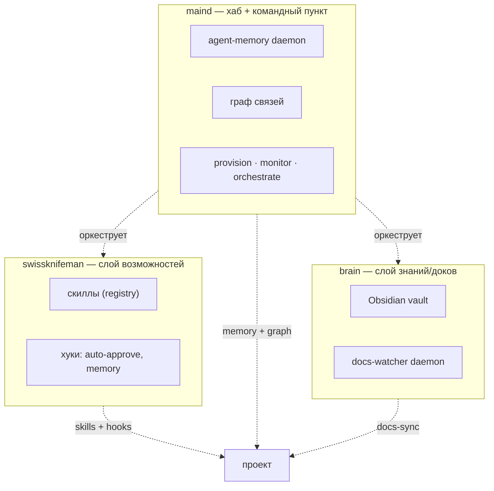
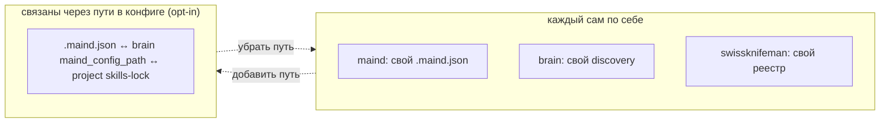
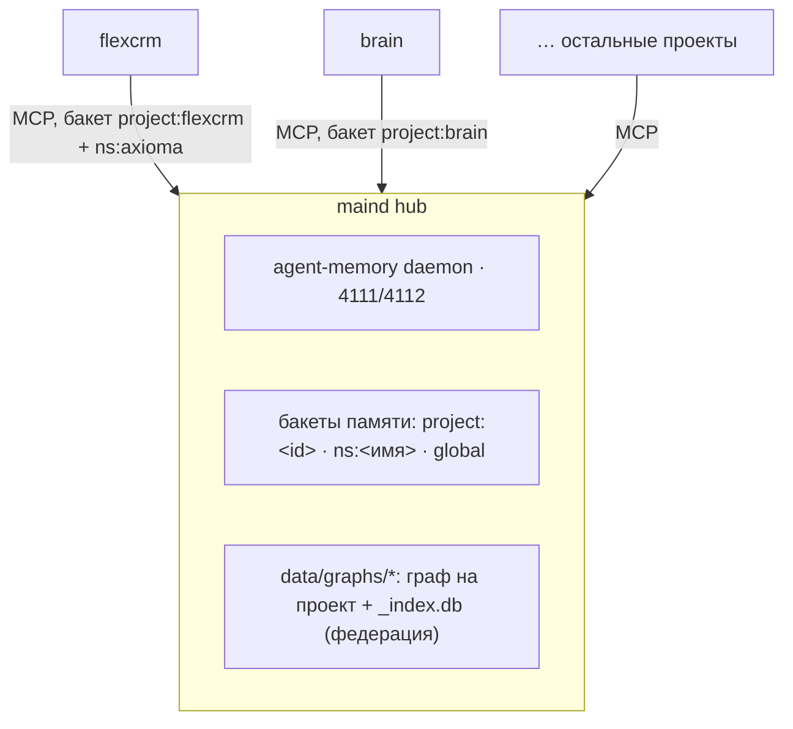
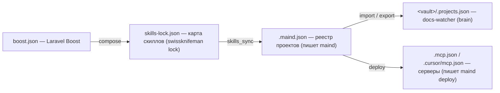
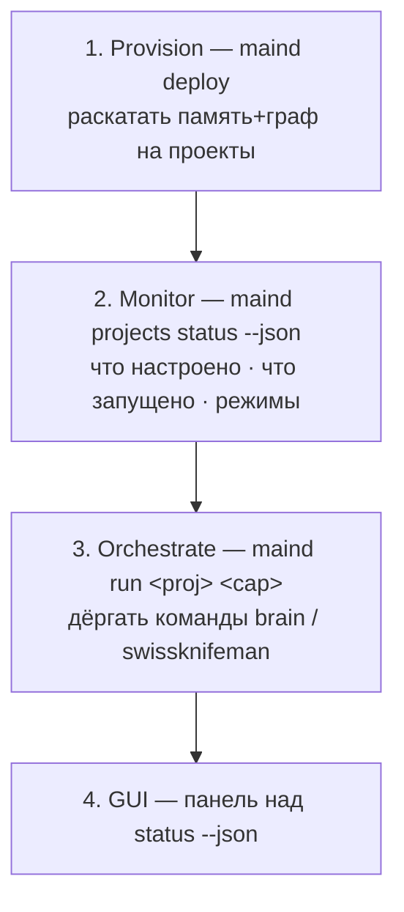

# Экосистема: философия трёх пакетов

Три пакета академической экосистемы — **swissknifeman**, **brain** и **maind** — устроены по
одному принципу: каждый **самодостаточен** и работает в одиночку, а связываются они **опционально**,
через пути в конфигах. Убери путь — пакеты снова автономны. Это держит систему предсказуемой:
ничего не ломается, если соседа нет.

## Роли

| Пакет | Слой | Что делает |
|:--|:--|:--|
| **swissknifeman** | возможности | синхронизирует **скиллы + хуки** в проект — «прокачивает агента» под задачу |
| **brain** | знания/доки | Obsidian-vault + демон `docs-watcher`, держит документацию в синхроне с репозиториями |
| **maind** | хаб + командный пункт | владеет общей **памятью** и **графом**, раскатывает их на проекты, мониторит и оркеструет остальных |

swissknifeman даёт проекту *навыки*, maind — *общую память и граф + координацию*, brain — *знания*.
Они дополняют друг друга и каждый ценен сам по себе.



## Принцип: связаны, но работают по отдельности

Интеграция — **opt-in через путь в конфиге**, с мягкой деградацией:

- **maind** без демона памяти — граф и реестр проектов всё равно работают.
- **brain** без maind — берёт проекты из своего discovery по control-файлам.
- **swissknifeman** всегда автономен — у него свой реестр подключённых проектов.



## Единый хаб + namespace'ы

Память и граф — **одни на всю экосистему**, на хабе maind. Изоляция — логическая и по
namespace'ам: граф — федерация (граф на проект + индекс), память — бакеты
(`project:<id>`/`ns:<имя>`/`global`). Внутри группы общее, между группами изолировано. Это и
есть «общий мозг» без отдельных демонов на проект.



Подробнее о топологии и внутренних слоях — [Архитектура](/architecture).

## Онбординг нового проекта

Конечная цель — одна команда. Создаём проект → swissknifeman добавляет нужные скиллы и хуки
(автоматически + можно выбрать конкретные) → maind подключает проект к общему мозгу (память + граф).
Каждый шаг **standalone-safe**: нет соседа — шаг пропускается с предупреждением, онбординг идёт дальше.

```mermaid
sequenceDiagram
  actor Dev
  participant maind
  participant skm as swissknifeman
  participant proj as проект
  participant brain
  Dev->>maind: maind onboard &lt;project&gt;
  maind->>maind: зарегистрировать в .maind.json
  maind->>skm: integrate (skills + hooks)
  skm->>proj: .claude/skills + хуки + skills-lock.json
  maind->>proj: deploy — agent-memory MCP (scope project:id) [+ graphify]
  maind->>maind: derive graph (composer/doc/override/skills → стор проекта + индекс)
  opt --with-brain
    maind->>brain: репозиторий для docs-sync
  end
  maind-->>Dev: отчёт (steps · deployed · graph)
```

## Поток конфигов и данных

maind — **читатель всех** ключевых файлов и **писатель** только `.maind.json`, MCP-конфигов
проекта и **собственного** `.claude/settings.local.json` (доверие хаба к проектам экосистемы,
см. [Workspace](/guide/workspace)). Скиллы проекта описывает `skills-lock.json` (composes
swissknifeman + Laravel Boost, swissknifeman wins). brain держит свой `<vault>/.projects.json`
для docs-watcher.



## maind как командный пункт — 4 слоя



Если слой 2 (`status`) держать **JSON-first**, то GUI (слой 4) — тонкая надстройка над тем же
контрактом, а не отдельная переписка. Каждый слой — отдельная команда maind; см. [CLI](/guide/cli).

## Источник истины

| Что | Где живёт | Кто пишет |
|:--|:--|:--|
| Реестр проектов | `.maind.json` | maind (`projects.write_config` — единственный писатель) |
| Доверие Claude к проектам | `<maind>/.claude/settings.local.json` | maind (`workspace sync` из реестра) |
| Общая память | agent-memory demon (бакеты `project:<id>`/`ns:<имя>`/`global`) | проекты пишут в свой `project:<id>`, cross-ref — в `ns:<группа>` |
| Граф связей | `data/graphs/<id>.db` + `_index.db` (федерация) | maind `derive` из composer/Brain/override/skills |
| Карта скиллов проекта | `<project>/skills-lock.json` | `swissknifeman lock` |
| Документация проекта | vault ↔ repo | `brain sync` (docs-watcher) |

Эта страница — канонический источник философии экосистемы. swissknifeman и brain ссылаются сюда.
