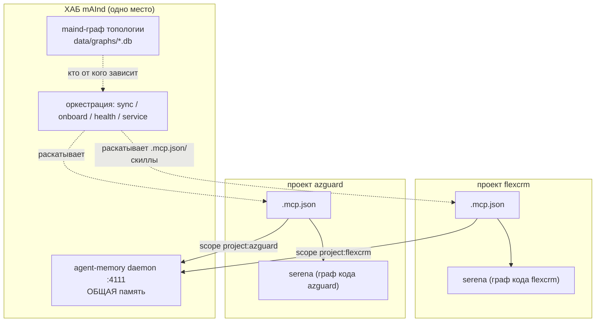
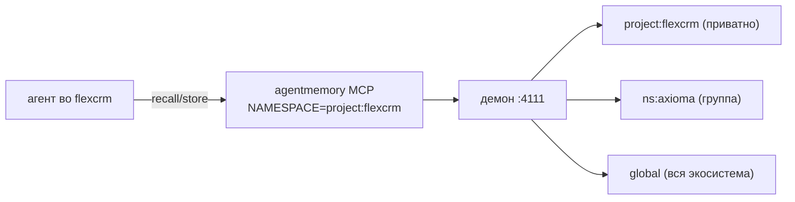
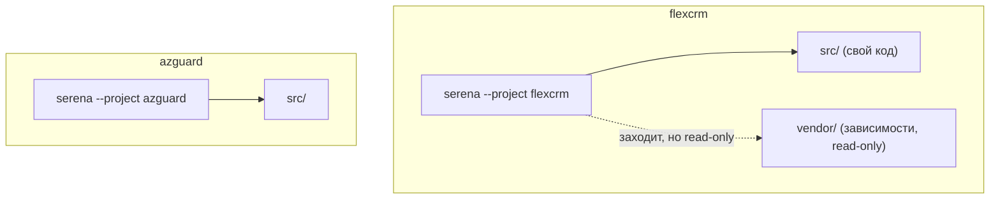
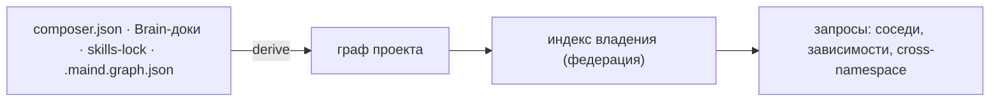
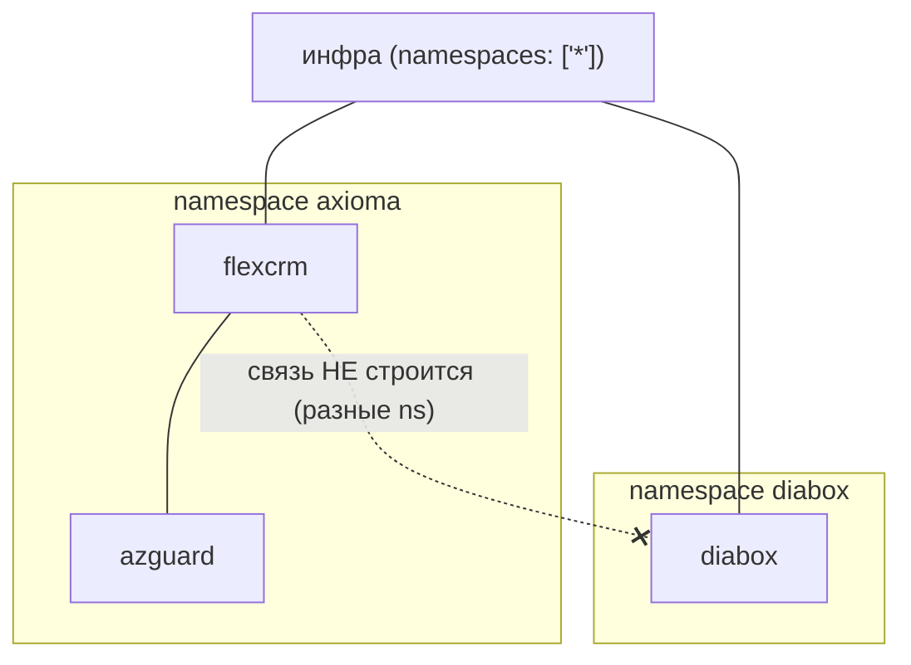

# Решения, трейд-оффы и ограничения

Эта страница — честная карта того, **почему схема устроена именно так**, что в ней общее, что
пер-проектное, где границы каждого слоя и чего система **не делает**. Если читаешь впервые —
сначала [Как это всё работает](/guide/how-it-works), здесь — нюансы и ограничения.

## Граница «хаб ↔ проект»

Главное, что снимает 80% путаницы: **что централизовано, а что живёт в проекте**.

- **Общее (на хабе):** память (один демон) + топология между проектами + оркестрация.
- **Пер-проектное (в репозитории):** граф кода (Serena) — свой сервер и свой индекс у каждого.

Хаб **не** хостит граф кода. Он его только включает и раскатывает. Это и есть ответ на частый
вопрос «не проще ли поднять graphify отдельно в каждом проекте» — **так и сделано**.

## Слой 1 — память (общая, централизованная)

### Почему общая, а не своя на проект

Смысл памяти — чтобы проекты видели решения друг друга внутри группы. Отдельная база на проект
**убила бы** саму идею. А федерировать N отдельных демонов обратно — **сложнее**, чем один демон +
namespace-скоупинг. Поэтому: один общий демон, видимость режется scope'ом.

### Ограничения памяти

- **Pull, не авто-захват.** Код в память **не попадает сам**. Агент должен явно вызвать `store`.
  Скилл `ecosystem-mcp` подсказывает когда, но гарантии нет — это свойство MCP, не баг.
- **Один демон = единая точка.** Лежит демон — память недоступна всем проектам. Митигировано
  systemd-сервисом (автозапуск + рестарт) и linger; см. [systemd](/guide/systemd). Это
  сознательный размен: простота общей памяти против распределённости.
- **Изоляция — на уровне scope, не физическая.** Проект технически не может читать чужой
  `project:<id>`, но это обеспечивается конфигом (`AGENTMEMORY_NAMESPACE` в `.mcp.json`), а не
  отдельными БД. Не правь scope руками.
- **Качество памяти = качество записей.** Мусор на входе → мусор на выходе. Не дублируй в память
  то, что и так есть в коде/гите.

## Слой 2 — граф кода (пер-проектный, движок Serena)

Граф кода (символы, ссылки, реализации) — **отдельный MCP-сервер в каждом проекте**. Движок по
умолчанию — [Serena](/guide/code-graph) (language-agnostic, LSP, через `uvx`). Команды доступны
**внутри** проекта; `maind sync --all --only mcp` раскатывает/перегенерирует на всех из хаба.

### Монорепо с симлинками: пакеты — свои графы

В Composer path-repos один first-party пакет часто подсимлинкован в проект по 2–3 путям
(`vendor/<vendor>/<pkg>` и `packages/<pkg>` → один исходник). Индексировать его внутри зависимого
проекта = **дубли символов** + **рекурсивные симлинки** (testbench), на которых скан виснет.
Поэтому **по умолчанию** maind при `code:true` кладёт `.serena/project.yml` с игнором
`vendor`/`packages`, а каждый first-party пакет графится как свой проект.

Но если ты **разрабатываешь пакеты вместе с проектом** (нужен единый граф app + пакеты) — есть
**workspace-режим** (`code_workspace:true`): пакеты под `packages/*` индексируются как часть
проекта (один корень, PHP-LSP резолвит ссылки), правки идут в их реальные репозитории через
симлинк, а `vendor`/вложенные `vendor` режутся (дубли + рекурсия). Проверено на flexcrm+corex.
Подробнее — [граф кода](/guide/code-graph).

### Что с графом МЕЖДУ проектами: что можно, а что нет

- **Локальные пакеты под деревом проекта** (симлинки `packages/*`) — **можно объединить** в один
  граф: [workspace-режим](#монорепо-с-симлинками-пакеты-свои-графы) (`code_workspace:true`).
  Их исходник физически под корнем проекта, LSP резолвит ссылки, правки идут в их репозитории.
  Это закрывает кейс «разрабатываю ядро вместе с приложением».
- **Независимые проекты** (не под одним деревом) — **в один граф символов не объединить**.
  Serena-фича `additional_workspace_folders` (мультирут с кросс-ссылками) пока **только для
  TypeScript**. Для PHP — каждый отдельный проект графится сам; «кто от кого зависит» между ними
  даёт [maind-граф топологии](#слой-3-топология-между-проектами-самый-тяжёлый), а кросс-проектные
  повторы — [`maind fleet duplicates`](/guide/fleet). Полноценный единый LSP-граф всей экосистемы
  не нужен и не строится.

### Прочие ограничения кода-графа

- **Требует `uvx`** (из [uv](https://docs.astral.sh/uv/)) в PATH. Нет — корректный пропуск
  (`skipped-not-installed`), остальное работает.
- **Первый запуск медленнее** — Serena поднимает LSP под язык проекта; дальше быстрее.
- **Опционален и pull-based** — включается полем `code:true`; агент сам решает звать
  `find_symbol`/`find_referencing_symbols`, ничего не «перехватывается».
- **Движок сменный** — не нравится Serena или нужен стек-специфичный сервер: `code_command`
  / `code_args` (`{root}`) / `code_server_name` (см. [граф кода](/guide/code-graph)).

## Слой 3 — топология между проектами (самый «тяжёлый»)

maind-граф строится `derive` из composer/доков/скиллов: узлы `project`/`package`/`skill`, рёбра
`depends_on`/`requires`/`uses`. Живёт на хабе.

### Честный трейд-офф

Это **самая сложная машинерия за наименьшую ежедневную пользу**. Она отвечает на «кто от кого
зависит» — полезно, но дёргается редко. Память и граф кода оправданы целью напрямую; топологию
стоит **развивать только если ты ей пользуешься**. Она не вредит (детерминированна, регенерится
из источников, не ручная), но если запросов к ней нет — это кандидат «держать, но не растить»:
`composer.json` + Serena покрывают навигацию и без неё.

## Namespace-изоляция: правила и граничные случаи

Один механизм изоляции для **и графа, и памяти**.

- **Внутри группы — общее, между группами — изолировано.** Ребро A↔B строится, только если делят
  namespace.
- **`["*"]` — инфраструктура**, связывается со всеми (azguard/docvault/swissknifeman и т.п.).
- **Граничный случай: незарегистрированный узел.** Если таргет связи не в `.maind.json` (внешний
  алиас, напр. `getchat`) — связь **сохраняется** (namespace внешнего узла неизвестен, не режем).
- **Свежий проект без namespace → `default`** и **не свяжется** с группой. Всегда задавай
  `namespaces` явно. Подробнее — [Namespaces](/guide/namespaces).

## Общие ограничения (свойства MCP, не баги)

- **MCP пассивен (pull).** Серверы не следят за кодом и ничего не перехватывают — инструмент
  вызывает **модель**. Максимум управления — сделать инструмент доступным (`.mcp.json`) и
  объяснить когда звать (скилл `ecosystem-mcp`).
- **`.mcp.json` читается при старте сессии.** Добавили сервер (напр. `serena`) → нужен
  **перезапуск сессии** в проекте, чтобы клиент его поднял.
- **Раскатка — по команде, не непрерывно.** `maind sync`/`onboard` — снимок в момент запуска;
  авто только SessionStart-хук, и он лишь печатает статус (не синхронизирует).

## Терминологический долг (осознанный)

Слово «граф» означает **три разные вещи** (память — вообще не граф), а код-слой исторически
зовётся `graphify` — по имени несуществующего инструмента; движок по факту **Serena**. Имена
полей сохранены для совместимости. Если читаешь конфиг — держи в голове карту из раздела
[Граница «хаб ↔ проект»](#граница-хаб-проект).

## Сводка: что есть, чего нет

| Хочешь | Есть? | Чем |
|:--|:--|:--|
| Общая память внутри группы | ✅ | agent-memory + namespace scope |
| Изоляция памяти между группами | ✅ | scope `project`/`ns`/`global` |
| Навигация по коду внутри проекта | ✅ | Serena (пер-проектный) |
| Единый граф символов МЕЖДУ проектами | ❌ | не нужен; топология решает «кто от кого зависит» |
| «Кто от кого зависит» между проектами | ✅ | maind-граф (derive) |
| Авто-запись кода/изменений в память | ❌ | pull: агент вызывает `store` сам |
| Раскатка/перегенерация на все проекты | ✅ | `maind sync --all` |
| Память «всегда поднята» | ✅ | systemd-сервис + linger |

Дальше: [Память →](/guide/memory) · [Граф кода →](/guide/code-graph) · [Namespaces →](/guide/namespaces)
