# Граф зависимостей скиллов

> Сгенерировано `scripts/generate-graph.sh` из `skills.json` — не редактировать вручную.
> Пересборка: `skiller registry`.

Сплошная стрелка `A --> B` — `A` требует `B` (`requires`): `skiller vendor` дотянет `B`
при установке `A`. Пунктирная `A -.-> B` — результат `A` служит входом для `B`
(`produces_for`). Показаны только скиллы, участвующие в графе; изолированные —
в таблице ниже.

```mermaid
flowchart LR
  subgraph architect["architect"]
    agent_design["agent-design"]
    api_design["api-design"]
    architecture["architecture"]
    data_schema["data-schema"]
    eval_design["eval-design"]
    figma_mcp_core["figma-mcp-core"]
    legal_compliance["legal-compliance"]
    observability_design["observability-design"]
    package_contribution_protocol["package-contribution-protocol"]
    security_design["security-design"]
    tech_stack_selection["tech-stack-selection"]
  end
  subgraph blender["blender"]
    mcp_blender_workflow["mcp-blender-workflow"]
    model_rules["model-rules"]
    parametric_config["parametric-config"]
    threading["threading"]
    version_gotchas["version-gotchas"]
  end
  subgraph devops["devops"]
    ci_cd["ci-cd"]
    db_test_preflight["db-test-preflight"]
    docker_dev_prod["docker-dev-prod"]
    docker_php["docker-php"]
    docker_postgres["docker-postgres"]
    docker_services["docker-services"]
    docker_vite["docker-vite"]
    gitops["gitops"]
    makefile["makefile"]
    node_pnpm_preflight["node-pnpm-preflight"]
  end
  subgraph founder["founder"]
    adversarial_check["adversarial-check"]
    competitive_analysis["competitive-analysis"]
    customer_discovery["customer-discovery"]
    defensibility["defensibility"]
    idea_discovery["idea-discovery"]
    new_project["new-project"]
    pitch_deck["pitch-deck"]
    risk_assessment["risk-assessment"]
    startup_lifecycle["startup-lifecycle"]
  end
  subgraph frontend["frontend"]
    backend_type_sync["backend-type-sync"]
    dark_mode["dark-mode"]
    figma_to_vue["figma-to-vue"]
    inertia_vue["inertia-vue"]
    naive_ui_theming["naive-ui-theming"]
    reka_ui_cva["reka-ui-cva"]
    tailwind_conventions["tailwind-conventions"]
    vite_module_loader["vite-module-loader"]
    vite_multi_build["vite-multi-build"]
    vitest["vitest"]
    wayfinder["wayfinder"]
  end
  subgraph general["general"]
    anti_drift["anti-drift"]
    complex_task_orchestrator["complex-task-orchestrator"]
    context_economy["context-economy"]
    cross_layer_change_checklist["cross-layer-change-checklist"]
    git_commit_rules["git-commit-rules"]
    session_handoff["session-handoff"]
    spec_interview["spec-interview"]
    task_brief_template["task-brief-template"]
    ticket_workflow["ticket-workflow"]
    user_roles["user-roles"]
  end
  subgraph mobile["mobile"]
    figma_to_flutter["figma-to-flutter"]
  end
  subgraph operator["operator"]
    capacity_planning["capacity-planning"]
    incident_response["incident-response"]
    oncall_rotation["oncall-rotation"]
    postmortem["postmortem"]
    runbook["runbook"]
  end
  subgraph oss_dev["oss-dev"]
    dependency_audit["dependency-audit"]
    dx_design["dx-design"]
    gh_review["gh-review"]
    github_flow["github-flow"]
    oss_development["oss-development"]
    oss_governance["oss-governance"]
    release_engineering["release-engineering"]
  end
  subgraph php["php"]
    attribute_authorization["attribute-authorization"]
    botkit["botkit"]
    database["database"]
    dependency_injection["dependency-injection"]
    filament["filament"]
    laravel["laravel"]
    laravel_data["laravel-data"]
    laravel_permissions["laravel-permissions"]
    laravel_security_audit["laravel-security-audit"]
    laravel_structure["laravel-structure"]
    laravel_testing["laravel-testing"]
    modular_architecture["modular-architecture"]
    repositories["repositories"]
    static_analysis["static-analysis"]
    test_isolation_guard["test-isolation-guard"]
  end
  subgraph pm["pm"]
    brd["brd"]
    business_process["business-process"]
    go_to_market["go-to-market"]
    monetization_design["monetization-design"]
    pmf_diagnostics["pmf-diagnostics"]
    prd_from_brd["prd-from-brd"]
    product_roadmap["product-roadmap"]
    requirement_critic["requirement-critic"]
    unit_economics["unit-economics"]
  end
  subgraph python["python"]
    ml_project_structure["ml-project-structure"]
    venv_dependencies["venv-dependencies"]
  end
  subgraph quality["quality"]
    code_review["code-review"]
    code_simplifier["code-simplifier"]
    mutation_testing["mutation-testing"]
    playwright_e2e["playwright-e2e"]
    refactoring_plan["refactoring-plan"]
    tech_debt_audit["tech-debt-audit"]
    test_strategy["test-strategy"]
    testing_safety_report["testing-safety-report"]
  end
  subgraph system["system"]
    cross_project_coordinator["cross-project-coordinator"]
    local_topology["local-topology"]
    shared_memory["shared-memory"]
  end
  agent_design -->|requires| architecture
  api_design -->|requires| data_schema
  architecture -->|requires| brd
  architecture -->|requires| tech_stack_selection
  attribute_authorization -->|requires| laravel_permissions
  backend_type_sync -->|requires| wayfinder
  botkit -->|requires| laravel
  brd -->|requires| business_process
  capacity_planning -->|requires| observability_design
  competitive_analysis -->|requires| idea_discovery
  cross_project_coordinator -->|requires| local_topology
  customer_discovery -->|requires| idea_discovery
  dark_mode -->|requires| tailwind_conventions
  data_schema -->|requires| brd
  database -->|requires| laravel
  db_test_preflight -->|requires| docker_postgres
  dependency_audit -->|requires| oss_development
  docker_dev_prod -->|requires| docker_php
  docker_services -->|requires| docker_php
  docker_services -->|requires| docker_postgres
  dx_design -->|requires| oss_development
  eval_design -->|requires| agent_design
  figma_to_flutter -->|requires| figma_mcp_core
  figma_to_vue -->|requires| figma_mcp_core
  filament -->|requires| laravel
  filament -->|requires| laravel_structure
  gh_review -->|requires| context_economy
  git_commit_rules -->|requires| node_pnpm_preflight
  github_flow -->|requires| gh_review
  github_flow -->|requires| git_commit_rules
  github_flow -->|requires| release_engineering
  go_to_market -->|requires| competitive_analysis
  go_to_market -->|requires| monetization_design
  laravel_security_audit -->|requires| static_analysis
  legal_compliance -->|requires| architecture
  mcp_blender_workflow -->|requires| model_rules
  mcp_blender_workflow -->|requires| parametric_config
  mcp_blender_workflow -->|requires| threading
  mcp_blender_workflow -->|requires| version_gotchas
  modular_architecture -->|requires| laravel
  monetization_design -->|requires| idea_discovery
  mutation_testing -->|requires| test_strategy
  naive_ui_theming -->|requires| tailwind_conventions
  new_project -->|requires| competitive_analysis
  new_project -->|requires| idea_discovery
  new_project -->|requires| risk_assessment
  observability_design -->|requires| architecture
  oss_governance -->|requires| oss_development
  package_contribution_protocol -->|requires| anti_drift
  package_contribution_protocol -->|requires| api_design
  package_contribution_protocol -->|requires| architecture
  package_contribution_protocol -->|requires| task_brief_template
  parametric_config -->|requires| model_rules
  parametric_config -->|requires| threading
  pitch_deck -->|requires| competitive_analysis
  pitch_deck -->|requires| go_to_market
  pitch_deck -->|requires| unit_economics
  pmf_diagnostics -->|requires| product_roadmap
  postmortem -->|requires| incident_response
  prd_from_brd -->|requires| brd
  product_roadmap -->|requires| brd
  product_roadmap -->|requires| go_to_market
  refactoring_plan -->|requires| tech_debt_audit
  reka_ui_cva -->|requires| tailwind_conventions
  release_engineering -->|requires| oss_development
  requirement_critic -->|requires| brd
  security_design -->|requires| architecture
  shared_memory -->|requires| local_topology
  tech_stack_selection -->|requires| brd
  test_isolation_guard -->|requires| laravel_testing
  ticket_workflow -->|requires| laravel
  ticket_workflow -->|requires| repositories
  ticket_workflow -->|requires| user_roles
  unit_economics -->|requires| monetization_design
  user_roles -->|requires| laravel
  venv_dependencies -->|requires| ml_project_structure
  vite_multi_build -->|requires| vite_module_loader
  vitest -->|requires| inertia_vue
  adversarial_check -.->|feeds| competitive_analysis
  adversarial_check -.->|feeds| idea_discovery
  adversarial_check -.->|feeds| new_project
  adversarial_check -.->|feeds| pmf_diagnostics
  adversarial_check -.->|feeds| risk_assessment
  adversarial_check -.->|feeds| startup_lifecycle
  agent_design -.->|feeds| observability_design
  anti_drift -.->|feeds| session_handoff
  architecture -.->|feeds| api_design
  architecture -.->|feeds| data_schema
  ci_cd -.->|feeds| release_engineering
  code_simplifier -.->|feeds| code_review
  complex_task_orchestrator -.->|feeds| cross_layer_change_checklist
  cross_project_coordinator -.->|feeds| refactoring_plan
  customer_discovery -.->|feeds| competitive_analysis
  customer_discovery -.->|feeds| monetization_design
  customer_discovery -.->|feeds| new_project
  db_test_preflight -.->|feeds| laravel_testing
  db_test_preflight -.->|feeds| test_isolation_guard
  defensibility -.->|feeds| go_to_market
  defensibility -.->|feeds| pitch_deck
  dependency_audit -.->|feeds| release_engineering
  dependency_audit -.->|feeds| security_design
  docker_dev_prod -.->|feeds| docker_services
  docker_php -.->|feeds| docker_vite
  docker_postgres -.->|feeds| docker_dev_prod
  docker_vite -.->|feeds| docker_dev_prod
  eval_design -.->|feeds| observability_design
  figma_to_vue -.->|feeds| dark_mode
  figma_to_vue -.->|feeds| naive_ui_theming
  figma_to_vue -.->|feeds| reka_ui_cva
  figma_to_vue -.->|feeds| tailwind_conventions
  gitops -.->|feeds| github_flow
  laravel -.->|feeds| dependency_injection
  laravel -.->|feeds| repositories
  laravel_data -.->|feeds| backend_type_sync
  laravel_security_audit -.->|feeds| security_design
  legal_compliance -.->|feeds| security_design
  makefile -.->|feeds| docker_dev_prod
  makefile -.->|feeds| docker_services
  monetization_design -.->|feeds| brd
  mutation_testing -.->|feeds| code_review
  observability_design -.->|feeds| incident_response
  observability_design -.->|feeds| runbook
  oncall_rotation -.->|feeds| incident_response
  oss_governance -.->|feeds| dependency_audit
  postmortem -.->|feeds| runbook
  postmortem -.->|feeds| tech_debt_audit
  prd_from_brd -.->|feeds| api_design
  prd_from_brd -.->|feeds| architecture
  prd_from_brd -.->|feeds| product_roadmap
  refactoring_plan -.->|feeds| testing_safety_report
  risk_assessment -.->|feeds| pitch_deck
  runbook -.->|feeds| incident_response
  spec_interview -.->|feeds| task_brief_template
  startup_lifecycle -.->|feeds| customer_discovery
  startup_lifecycle -.->|feeds| defensibility
  startup_lifecycle -.->|feeds| new_project
  startup_lifecycle -.->|feeds| pmf_diagnostics
  task_brief_template -.->|feeds| complex_task_orchestrator
  tech_stack_selection -.->|feeds| oss_development
  tech_stack_selection -.->|feeds| release_engineering
  test_strategy -.->|feeds| code_review
  test_strategy -.->|feeds| playwright_e2e
  unit_economics -.->|feeds| go_to_market
  version_gotchas -.->|feeds| parametric_config
```

**В графе:** 106 скиллов, 78 рёбер requires, 66 рёбер produces_for.

## Изолированные скиллы (73)

Скиллы без связей `requires`/`produces_for` — самодостаточны.

| Бакет | Скиллы |
|---|---|
| devops | `docker` |
| frontend | `antfu`, `document-writer`, `eslint-flat-config`, `filepond-upload`, `js-code-style`, `laravel-echo-client`, `motion`, `nuxt`, `nuxt-modules`, `nuxt-seo`, `pinia`, `pinia-stores`, `ts-library`, `vite`, `vitepress`, `vitest-vue`, `vue`, `vue-best-practices`, `vue-composition-api`, `vue-dynamic-icons`, `vue-router-best-practices`, `vue-testing-best-practices`, `vueuse-functions`, `web-design-guidelines` |
| general | `ai-context-workflow`, `compact-responses`, `packages-stack`, `project-map`, `skills-ssot`, `writing-style` |
| imported | `agent-security-super-skill`, `ai-agent-super-skill`, `content-creative-super-skill`, `dev-engineering-super-skill`, `finance-super-skill`, `legal-super-skill`, `marketing-super-skill`, `operations-cx-super-skill`, `pm-super-skill`, `research-knowledge-super-skill`, `sales-super-skill`, `token-efficient` |
| php | `azguard`, `code-style-spatie`, `enum-attributes`, `enum-state-machine`, `health-checks`, `laravel-best-practices`, `laravel-broadcasting`, `laravel-dusk`, `laravel-package-compatibility`, `laravel-package-docs`, `laravel-package-expressive`, `laravel-package-generate-skill`, `laravel-package-release`, `laravel-package-scaffold`, `laravel-package-service-provider`, `laravel-package-testing`, `laravel-packages`, `laravel-subagents`, `livewire-blade-attributes`, `medialibrary`, `named-arguments`, `pao`, `pennant-development`, `php-patterns`, `php-upgrade-checklist`, `spatie-settings` |
| roles | `open-source-maintainer`, `solo-founder`, `startup-cto`, `tech-lead` |
