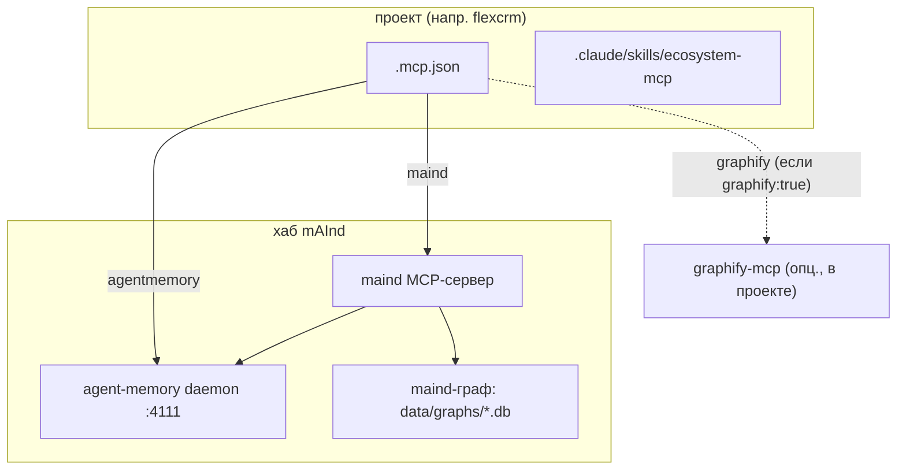
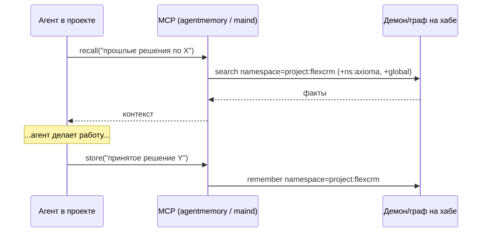
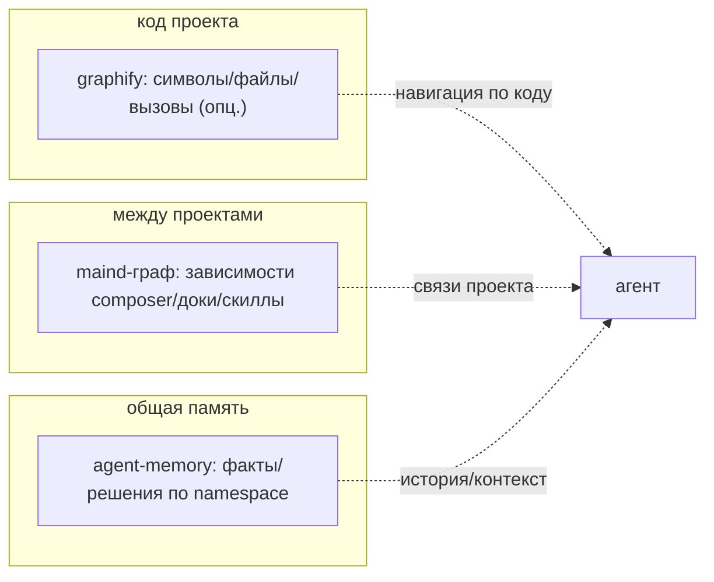
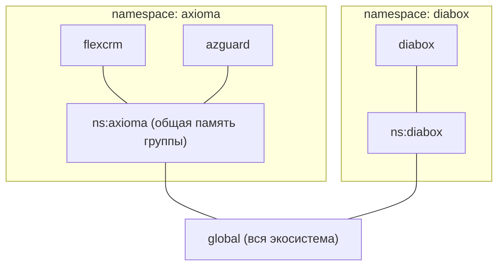

# Как это всё работает вместе

Эта страница — сквозная картина: что подключается к проекту, где физически лежат данные, и что
происходит, когда агент выполняет задачу. Если после неё остались вопросы — значит, тут чего-то
не хватает; дополняйте.

## Три разные вещи (не путать)

Слова «граф» и «база» в экосистеме означают **три независимых** механизма с разными задачами:

| Механизм | Что хранит | Где живёт | Статус |
|:--|:--|:--|:--|
| **agent-memory** | факты/решения/контекст (общая память) | демон на хабе `:4111` | работает (под systemd) |
| **maind-граф** | топология **между** проектами (кто от кого зависит) | в хабе `data/graphs/<id>.db` | работает |
| **graphify** | граф **кода внутри** проекта (символы/файлы/вызовы) | отдельный MCP-сервер в проекте | **опционален**, бинаря пока нет |

Ключевое: **agent-memory централизован специально** (в этом смысл общей памяти — проекты видят
решения друг друга внутри namespace). **graphify, наоборот, пер-проектный** — код у каждого свой.
maind-граф — это НЕ код, а топология зависимостей.

## 1. Топология: что подключено к проекту

`.mcp.json` проекта перечисляет MCP-серверы. Клиент (Claude Code) при старте сессии их поднимает —
и их инструменты появляются у агента. Скилл `ecosystem-mcp` объясняет агенту, что это и когда звать.

## 2. Поток выполнения задачи (pull, не «перехват»)

MCP-серверы **пассивны**: они не следят за кодом и ничего не «перехватывают». Запрос инициирует
**сама модель**, когда решает вызвать инструмент.

scope (`project:flexcrm`) зашит в `.mcp.json` проекта (`AGENTMEMORY_NAMESPACE`), поэтому проект по
умолчанию пишет/читает **свою** память + общие бакеты группы. Никакой автоматики «само записалось»
нет — агент явно вызывает `store`/`recall` (скилл `ecosystem-mcp` подсказывает когда).

## 3. Три слоя данных — кто за что

- **agent-memory** отвечает на «что мы уже решали».
- **maind-граф** — на «что с чем связано» (зависимости, соседи по экосистеме).
- **graphify** — на «где определён этот символ / кто его вызывает» (когда включён).

## 4. Namespace-изоляция в действии

Связи и память изолируются по группам. Внутри группы — общее, между группами — закрыто; `["*"]` —
инфраструктура, видна всем.

flexcrm видит: `project:flexcrm` + `ns:axioma` + `global`. diabox из другой группы `ns:axioma`
**не видит**. Так же режутся и рёбра графа: межпроектная связь строится, только если проекты делят
namespace.

## Надёжность «всё всегда поднято»

- Демон памяти — под **systemd** (`maind service install`), автозапуск + авто-рестарт. Для старта
  при загрузке ОС (без логина) — `loginctl enable-linger $USER`. См.
  [Демон памяти (systemd)](/guide/systemd).
- MCP-серверы прописаны в `.mcp.json` каждого проекта — клиент поднимает их сам при старте сессии.
- SessionStart-хук печатает статус связи; чинит — `maind health --cwd --fix`.

Дальше: [Память →](/guide/memory) · [Граф →](/guide/graph) · [Namespaces →](/guide/namespaces) ·
[graphify →](/guide/graphify).
