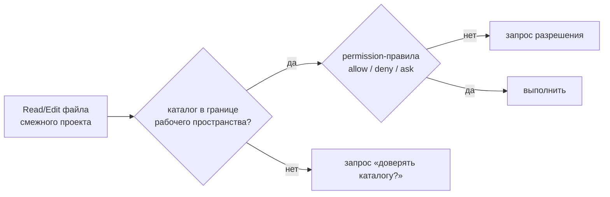

# Доверие Claude (workspace)

Единое пространство правок: сессия Claude Code, запущенная из хаба maind, читает и
правит **любой проект экосистемы без подтверждений**. Список доверенных путей maind
берёт из реестра проектов (`.maind.json`) и кладёт в свой `.claude/settings.local.json`.

## Проблема

В Claude Code две **независимые** системы доступа:



`bypassPermissions` отключает только **вторую** систему (allow/deny). Когда файл лежит
**вне** cwd и вне доверенных каталогов, срабатывает **первая** — граница рабочего
пространства, и приходит отдельный запрос «доверять каталогу?», который bypass **не
глушит**. Поэтому при правке смежных проектов подтверждения приходят даже в auto-approve.

Фикс границы — `permissions.additionalDirectories` (абсолютные пути). maind уже владеет
авторитетным списком: `projects[].local_path` в `.maind.json`.

## Решение: hub-scoped

maind генерирует и сопровождает **свой** `.claude/settings.local.json` (в корне maind).
Доверие получает сессия, запущенная **из хаба** — минимальный радиус поражения, файл
gitignored (абсолютные персональные пути). Реестр проектов — единственный источник правды.

```bash
maind workspace sync                 # записать/обновить доверие из реестра
maind workspace sync --dry-run       # показать план без записи
maind workspace sync --no-allow      # только additionalDirectories (без Read/Edit-глоб)
maind workspace sync --no-mode       # не ставить defaultMode
maind workspace status [--json]      # что доверено / чего не хватает / drift
```

## Что пишется

```json
{
  "permissions": {
    "additionalDirectories": ["/home/u/projects/flexcrm", "..."],
    "allow": ["Read(//home/u/projects/flexcrm/**)", "Edit(//home/u/projects/flexcrm/**)", "..."],
    "defaultMode": "acceptEdits"
  }
}
```

- `additionalDirectories` чинит **границу каталогов** (убирает запрос доверия).
- `allow` (Read/Edit-глобы) и `defaultMode` дополнительно убирают трение **без** bypass.
  Абсолютный путь в правиле — с двойным слешем: `Read(//abs/path/**)`.

Берутся только **включённые** (`enabled != false`) проекты с **существующим** каталогом
на диске; отсутствующие и беспутёвые — пропускаются.

## Слияние и безопасность

Запись — зеркало `mcpconfig` (load → merge → write), **аддитивная и идемпотентная**:

- списки сливаются union с дедупом — **чужие записи сохраняются**;
- пользовательский `defaultMode` **не перетирается** (ставим, только если не задан);
- перед записью — `.bak`, сама запись атомарна (`tmp` + `os.replace`);
- битый JSON настроек → останавливаемся, файл не трогаем;
- повторный `sync` без изменений в реестре → «уже актуально», файл не переписывается.

::: tip Радиус поражения
Доверие живёт в `.claude/settings.local.json` **только хаба** — другие сессии Claude его
не наследуют. Это осознанно: широкий `additionalDirectories` + `acceptEdits` — мощный
инструмент, и он ограничен сессией, запущенной из maind.
:::

## Видимость

Состояние доверия видно в трёх местах (поле `trusted` в probe-контракте):

```bash
maind workspace status     # доверено N/M проектов реестра, missing, drift
maind projects status      # колонка trust✓ / trust· у каждого проекта
maind status               # строка «доверие: N/M проектов»
```

GUI-панель (`gui/index.html`) показывает колонку **trust** над тем же `status --json`.

Дальше: [MCP-сервер →](/guide/mcp)
