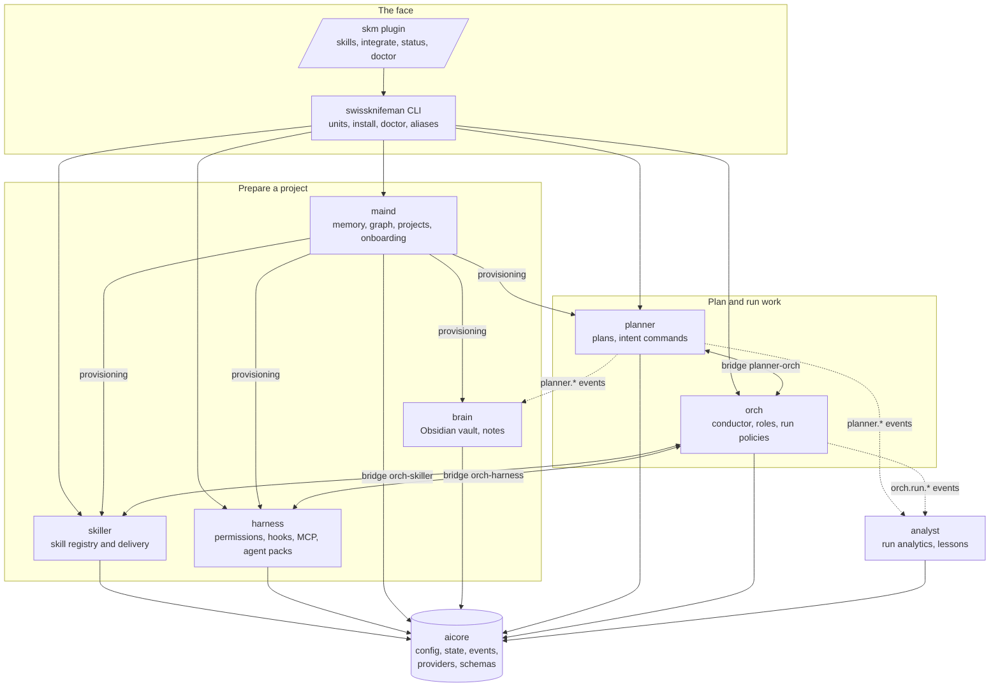
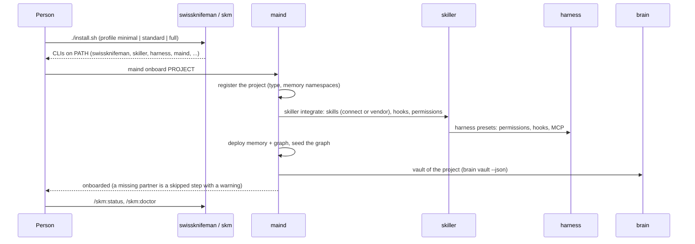
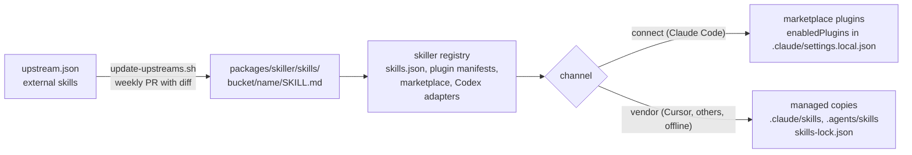
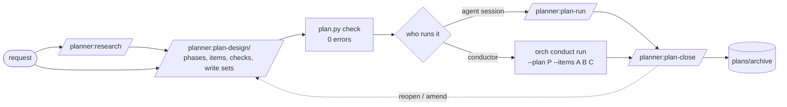
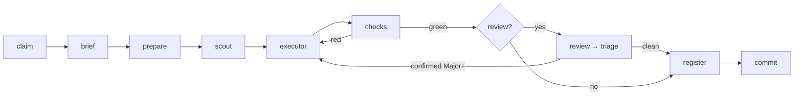
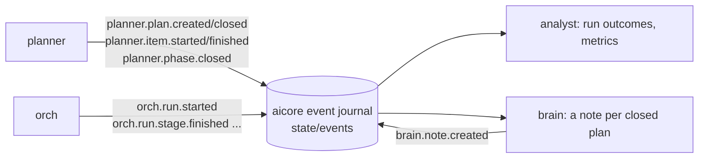
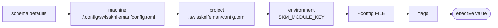
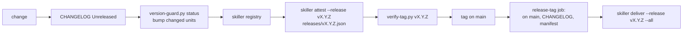

# How SwissKnifeMan works

SwissKnifeMan prepares a project for AI agents (Claude Code, Codex, Cursor, Grok) and runs planned work through them. The principles behind it: [Philosophy](philosophy.md).
It is one repository of modules: each does one job, reaches the others only through their commands, bridges or
events, and shares the foundation `aicore`. This page explains what each part does and how the parts meet; the pages
it links hold the reference.

## The map

| Module | The job | Start with |
| --- | --- | --- |
| [skiller](skiller/guide/) | one registry of provider-neutral skills (`SKILL.md`), delivered to a project by marketplace (`connect`) or as copies (`vendor`) | `skiller status`, `/skm:skills` |
| [harness](harness/) | the agent environment: permission presets, auto-approve modes, MCP servers, hooks, agent packs, instructions | `harness permissions`, `harness mcp` |
| [maind](maind/guide/) | the hub of the machine: shared memory, the connection graph, the project registry, onboarding and sync of projects, an MCP server | `maind onboard`, `maind status` |
| [brain](brain/guide/) | the Obsidian vault: where it is, project documents synced into it, notes written on plan events | `brain vault`, `brain doctor` |
| [planner](planner/) | plans as JSON (phases, items, decisions, checks) and the `/planner:*` intent commands (dev, fix, review, research, plan-*) | `/planner:plan-design`, `plan.py next` |
| [orch](orch/) | runs the items of a plan through narrow roles (scout, executor, reviewer, triager) with checks, review and recovery | `swissknifeman orch conduct run --plan P --items A` |
| [analyst](analyst/guide/) | reads what runs did: run reports, metrics, lessons a person may promote to memory or skills | `analyst runs`, `analyst digest` |
| aicore | the foundation every module imports: layered configuration, state locations, events, provider catalogs, schemas, release attestation | `swissknifeman config explain MODULE` |

## A project from zero

`install.sh` installs the CLIs of a profile ([install profiles](install-profiles.md)). `maind onboard` chains the
steps through the partner commands, each one standalone-safe; `/skm:integrate` is the integration wizard inside the
agent. Every writer is merge-only and keeps backups; `swissknifeman doctor` checks every module read-only and prints
the remediation.

## Skills: one canon, two channels

A skill is written once, in English, in its module (shared skills in skiller, module skills in their module).
`skiller registry` regenerates every projection and CI proves they are current (`skiller registry --check`). The
channel is always the person's choice: `connect` keeps skills live in the marketplace, `vendor` copies them into the
repository for people without swissknifeman. The curated `core` set is delivered by default; `--no-core` opts out;
`skiller budget` reports what each set costs in context tokens.

## Planned work

A plan is JSON under `plans/<ID>/` (`plan.json`, phases, items, decisions; Markdown views are generated, never read by
agents). An item is ready when it has a goal, scope, a write set, acceptance checks and a route. The owner runs it in a
session (`/planner:plan-run`) or hands a batch to the conductor. Ordinary work needs no plan: `/planner:dev` and
`/planner:fix` run directly. See [methodology](planner/methodology.md).

## The conductor in one picture

The conductor branches only on exit codes, closed role results and limits; it never reads the plan itself. Limits
are targets that print beacons, not walls; a stop is resumable and keeps every closed step. The full set of diagrams
(item lifecycle, correction rounds, the review decision, batches, questions, provider failures, recovery, settings,
debug mode) is on [How work flows](orch/flows.md); the reference is [Conductor](orch/conductor.md).

## Events: who hears what

A source never knows its subscribers. Event data follow `event-data/v1`, are redacted before they are written, and
carry the digests of the configuration and run options, so two runs can be compared.

## Settings: one model for every module

Each module has a table (`[orch]`, `[planner]`, `[skiller]`, `[maind]` ...) with a schema and a generated
`config.example.toml`. The most specific layer wins; `swissknifeman config explain MODULE KEY` names the layer, file
and line. Some keys are machine-only (a project cannot set its own trust), and the run options of orch may only
tighten isolation below the conductor configuration. State lives in standard places (`~/.local/state/swissknifeman`,
`<project>/.swissknifeman`), never in scattered dot-files.

## Releases

Every installable unit has its own version; provider caches are keyed by it, so changed bytes need a bump. The
attestation records the SHA-256 of every delivered file per provider; a unit whose bytes changed under the same version
is `RELEASE_IMMUTABLE_TUPLE`. Workflows pin actions by commit SHA and never push to `main`; see
[SECURITY.md](https://github.com/academici/swissknifeman/blob/main/SECURITY.md).

## Where to go next

- New here: [Getting started](getting-started.md), then [Install profiles](install-profiles.md).
- Running work with agents: [orch quickstart](orch/quickstart.md) and [How work flows](orch/flows.md).
- How the modules are divided and why: [Architecture](architecture/) and its [decisions](architecture/decisions/README.md).
- What works today and what does not: [Status](status.md).
