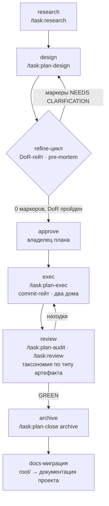

# Методология plan-protocol 2.0 — полный цикл

Как план проживает жизнь от исследования до документации проекта. SSOT схем, гейтов и
маркеров — скилл `general/plan-protocol` (v2.0.0); эта страница — карта цикла со ссылками
на команды и секции скилла. Протокол фиксирует ТОЛЬКО Axioma-специфику — то, что plan mode
и модель не выведут сами: схемы, гейты, маркеры, конвейеры.

## research

Несущие решения плана не берутся из памяти модели: внешние факты (версии, API, best
practices, рынок) добываются `/task:research` — многоисточниковый fan-out с adversarial-
верификацией. Выжимки ложатся в `plans/<ID>/20_research/` и `findings/` (скилл §16), а не
остаются в чате: downstream-исполнитель читает файл, не восстанавливает контекст. Каждый
верифицированный факт несёт след `RAG:✅ <дата/суть>`, неверифицированный — `[UNVERIFIED]`.

## design

`/task:plan-design` (opus/high) строит мастер-план `plans/<ID>/` по схемам скилла: plan.md
(§4), phases/Pn.md с 16 полями item'а (§5), handoff.md (§8). Спорное место при авторинге —
либо маркер `[NEEDS CLARIFICATION: <вопрос>]`, либо вопрос владельцу; самовольное допущение
запрещено. Незатребованные фазы несут скелет-маркер, а не «просто пустые поля». Порог
«нужен ли план вообще» — эвристика в §1 скилла: мелкая правка идёт в `/task:fix` без плана.

## refine (DoR-гейт, pre-mortem)

Канонический контур авторинга (скилл §7): design → self-audit по DoR-чеклисту → правка →
повтор до 0 маркеров. Definition of Ready фазы: все `[NEEDS CLARIFICATION]` сняты; Scope
Included/Excluded заполнены; Alternatives несущих решений — в D-логе; Open Questions
разнесены по статусам `open-questions.md`; несущие факты несут RAG-маркеры. Для high-stakes
планов (фискалка/платежи/tenant-isolation/ядро экосистемы) перед закрытием фазы дизайна —
pre-mortem раунд по протоколу Klein: «план провалился через 6–12 мес — почему», mitigations
с owner в Risks/D-лог.

## approve

Сформированный план не исполняется до утверждения владельцем (Approval Owner в Meta).
Правки до утверждения — правки к плану, не старт исполнения. Спорные пункты не блокируют
утверждение, если вынесены в `open-questions.md` (статусы `Exploration` / `Decision
pending` / `Resolved → D#`, скилл §3) — но закрыть план с pending-вопросами можно только
как `🟠 Done with deviations`.

## exec (commit-гейт, два дома)

`/task:plan-exec` (sonnet/medium) исполняет item строго по ТЗ. **Commit-гейт** (скилл §6):
статус `🟢`/`🟠` не ставится без закоммиченного диффа item'а — Conventional Commits,
зелёный `validate.sh` до коммита, фиксы ревью отдельным коммитом. **Два дома** (скилл §12):
до старта exec базовый план живёт в Brain; на старте переезжает в репо проекта (Meta
`Home: repo:<путь>`), SSOT = репо, Brain — зеркало; расхождение базового с working-копией —
не молчаливый merge, а `temporary divergence` + эскалация §10. Exec также сверяет свою
модель/effort с Routing плана — расхождение фиксируется в Known Deviations.

## review (таксономия)

Ревью диспетчируется по типу артефакта (скилл `quality/artifact-review`): **план/спека** —
профиль `/task:plan-audit` (opus/xhigh): RAG-groundedness несущих, DoR-ретроспектива,
«висящие» Open Questions, routing-adherence; **документация** и **код** — профили
`/task:review`, для кода — плюс skill-conformance по применимым скиллам стека. Общая шкала
severity: Blocker / Major / Minor / Nit + Conventional-Comments-лейбл — две независимые оси.
Находки чинятся отдельными коммитами и возвращают item в exec; вердикт GREEN открывает путь
к закрытию фазы (`/task:plan-close`).

## archive

Терминальный план уходит в архив командой `/task:plan-close archive <ID>` (конвейер в
скилле §12): перенос в `plans/archive/<ID>` ОТДЕЛЬНЫМ коммитом `chore(plan): archive <ID>`,
обновление `ACTIVE.md` и реестров, чек-лист миграции — в финальный handoff. `artifacts/`
уезжает в архив вместе с планом — это рабочий материал фаз.

## docs-миграция

Долгоживущий материал из `root/` не архивируется, а становится документацией проекта по
Diátaxis-типам: architecture/philosophy → explanation, data-model/contracts → reference,
гайды фаз → how-to. Что и куда мигрирует — таблица на странице
[Структура плана](/task/plan-structure); чек-лист миграции (что перенесено, что осталось
в архиве) обязателен в финальном handoff.
