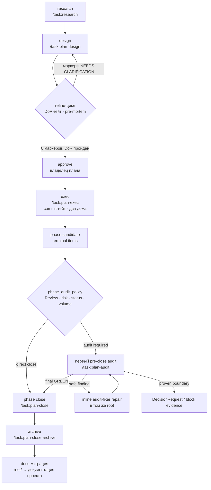

# Методология Task plan-protocol v2 — полный цикл

Как план проживает жизнь от исследования до документации проекта. SSOT схем, гейтов и
маркеров — компактный скилл `general/plan-protocol`; эта страница — карта цикла со ссылками
на команды и секции скилла. Протокол фиксирует ТОЛЬКО Axioma-специфику — то, что plan mode
и модель не выведут сами: схемы, гейты, маркеры, конвейеры.

## research

Несущие решения плана не берутся из памяти модели: внешние факты (версии, API, best
practices, рынок) добываются `/task:research` — многоисточниковый fan-out с adversarial-
верификацией. Выжимки ложатся в `plans/<ID>/20_research/` и `findings/` (скилл §16), а не
остаются в чате: downstream-исполнитель читает файл, не восстанавливает контекст. Каждый
верифицированный факт несёт след `RAG:✅ <дата/суть>`, неверифицированный — `[UNVERIFIED]`.

## design

`task:plan-design` (frontier/high) строит layout-v2 план: stable `plan.md`, phase index/item
specs, append-only decisions и generated state/views/bundles. `design-finish` сверяет
детализированный дизайн, `design-roadmap` обновляет только execution map. Каждый item нового
плана обязан иметь `Batch`: `solo` с причиной или стабильный batch-ID. Смежные items одной
фазы объединяются, когда общие reads/files/setup/validation экономят контекст; отдельные
deliverables, commit-гейты и item acceptance внутри batch сохраняются. Phase audit/close,
разный `Exec`, authority/irreversible gate или ожидаемое переполнение контекста — границы
объединения. Спорное место —
либо маркер `[NEEDS CLARIFICATION: <вопрос>]`, либо вопрос владельцу; самовольное допущение
запрещено. Незатребованные фазы несут скелет-маркер, а не «просто пустые поля». Порог
«нужен ли план вообще» — эвристика в §1 скилла: мелкая правка идёт в `/task:fix` без плана.

## refine (DoR-гейт, pre-mortem)

Канонический контур авторинга (скилл §7): design → self-audit по DoR-чеклисту → правка →
повтор до 0 маркеров. Definition of Ready фазы: все `[NEEDS CLARIFICATION]` сняты; Scope
Included/Excluded заполнены; Alternatives несущих решений — в D-логе; Open Questions
разнесены по статусам `open-questions.md`; несущие факты несут RAG-маркеры. Для high-stakes
планов (фискалка/платежи/tenant-isolation/ядро экосистемы) перед закрытием фазы дизайна —
pre-mortem раунд по протоколу Klein: «план провалился через 6–12 мес — почему», mitigations
с owner в Risks/D-лог.

## approve

Сформированный план не исполняется до утверждения владельцем (Approval Owner в Meta).
Правки до утверждения — правки к плану, не старт исполнения. Спорные пункты не блокируют
утверждение, если вынесены в `open-questions.md` (статусы `Exploration` / `Decision
pending` / `Resolved → D#`, скилл §3) — но закрыть план с pending-вопросами можно только
как `🟠 Done with deviations`.

## exec (commit-гейт, два дома)

`task:plan-exec` (implementation/medium) исполняет item строго по ТЗ. В layout v2 он читает
пять объявленных носителей и не использует handoff как execution input. **Commit-гейт**:
статус `🟢`/`🟠` не ставится без закоммиченного диффа item'а — Conventional Commits,
зелёный `validate.sh` до коммита, фиксы ревью отдельным коммитом. **Два дома** (скилл §12):
до старта exec базовый план живёт в Brain; на старте переезжает в репо проекта (Meta
`Home: repo:<путь>`), SSOT = репо, Brain — зеркало; расхождение базового с working-копией —
не молчаливый merge, а `temporary divergence` + эскалация §10. Exec также сверяет свою
модель/effort с Routing плана — расхождение фиксируется в Known Deviations. Execution handoff
всегда показывает `Batch`; batch выполняется последовательно в одной сессии, после каждого
item проходят его собственные acceptance/commit/close gates, а следующий carrier сохраняет
весь оставшийся смежный suffix группы. Audit/close фазы запускается уже отдельным carrier.
Для `plan-run` canonical `plan-exec` резолвится через установленный `task.command_catalog`, а
маршрут снимается provider-neutral функцией `task.route_evidence.capture_launch()`: Codex argv и
Claude Code session JSONL остаются additive adapters одного record. Missing/ambiguous evidence —
`ROUTE-UNVERIFIABLE`, не undershoot. Start event хранит `route-run-receipt/v1`; pre-final обязан
перечитать его, повторно снять route и отказать при смене session/model/effort/cwd/invocation.

Ошибка в ходе exec проходит continue-first gate: малый обратимый дефект чинится в том же attempt,
а Blocked появляется только после isolated `JUSTIFIED`, concrete `boundary_evidence` и verified RAG
для внешнего класса. Масштаб диагностики не является границей: `scope_coverage=in-scope` всегда
декомпозируется и чинится в том же attempt. Terminal item event несёт `terminal-evidence/v1`,
привязанное к digest текущего ТЗ и всем Validation carriers; любой red оставляет item в progress.
`closed-deviations` требует той же зелёной Validation и отдельного закрытого
`recoverable-validation-gap/v1`, а не заменяет ремонт. Перед final terminal-команды собирают
delivery receipt, связанный с terminal state и exact persisted handoff. См. [Continue-first](./continue-first).
После journal start `validation-admission/v1` проверяет literal `make <target>` из Validation:
доказанно отсутствующий локальный target создаёт `local-repair` того же attempt, после чего
исходный carrier повторяется; dynamic Makefile остаётся `unknown`, а не ложным блоком.

## review (по material trigger)

Ревью диспетчируется по типу артефакта, но не по ритуальному статусу. Один scoped verdict
переиспользуется, пока не изменились material scope, SHA или risk. Терминальные items образуют
кандидата фазы. Единый `phase_audit_policy` выбирает следующий исполняемый carrier без пробного
`plan-close`: `Review=full`, material risk, non-green terminal item или несколько items при
`Review=light` требуют `/task:plan-audit`; `Review=none` и один зелёный `light` item без material
risk идут прямо в `/task:plan-close`. Process-only deviation при статусе 🟢 сам по себе аудит не
включает. Если аудит требуется, только его fresh GREEN на rebound candidate разрешает `/task:plan-close`.
Audit-fixer остаётся независимым при старте, но после обнаружения владеет safe in-scope ремонтом:
повторяет точную Validation, регенерирует owner views и пересобирает candidate в том же root.
Routine `audit → repair-run → second audit → AUDIT-CAP` запрещён. Первый same fingerprint меняет
tactic; лишь повтор или новый material risk допускает один isolated reviewer return в этот же root.
Acceptance failure остаётся работой owning root. Authority/public-frozen сигнал проходит
`plan_authority`: delegated продолжает repair, `approval_required`/`denied` создаёт exact
waiting/terminal continuation. Safety проходит `plan_blocking`, и только `terminal-block` после
distinct `JUSTIFIED` терминален. В phase-режиме `ATTENTION` не завершает root: non-gating остаток
репортится под GREEN, исправимый — чинится. `plan-design` не является successor phase RED;
одобренное изменение stable Intent/Scope/Files/Validation выполняет возобновлённый owning root.

Исключение возможно лишь как явное owner decision: `phase_close_gate(..., owner_decision="D#")`.
Direct-green-validation требует один accepted, phase-scoped и superseding decision carrier с
literal `phase-close: direct-green-validation`. После исчерпанного AUDIT-CAP отдельный remediation
carrier должен покрывать точный полный набор items фазы и явно фиксировать, что третьего audit нет,
а фаза закрывается штатным `task:plan-close`; разрешение действует только после самого ремонта и
повторного deterministic gate. Отсутствие или любое несовпадение остаётся fail-closed и использует
обычный audit GREEN путь.

Отдельное исключение для terminal blocked phase требует accepted, non-superseded D# с `item: Pn`,
точным набором `Pn` и всех `Pn.*`, а также literal
`phase-close: terminal-blocked-deviations`. Оно допускает только `closed-deviations` phase close:
сама фаза проецируется как `🟠 Done with deviations`, тогда как RED/blocked item states, audit
history и release authorization не меняются. Без такой D# blocked item по-прежнему закрывает фазу
fail-closed.

**Вердикт аудита ≠ приёмка плана.** Это две независимые оси, и смешивать их запрещено:
вердикт phase audit (`GREEN`/reducer-confirmed `RED`) говорит «запись фазы сходится с кодом и git-фактами»,
а приёмка — что ИЗМЕРЕННЫЕ величины плана взяли объявленные пороги (floors). План с
безупречной записью может остаться с невыполненной приёмкой; тогда item остаётся в progress и
owning root продолжает repair. `🟠 Done with deviations` допустим только после зелёной обязательной
Validation и отдельного reducer evidence о неремонтируемом residual; он не повышает недостающее
измерение до зелёного. Повышение `not-met`/`unknown` до met, пересчёт порога под результат и «зелёный
по умолчанию» на неизмеренном — запрещены; неизмеренная величина публикуется как `unknown` со
скоупом, датой и названной причиной, а не округляется. Число, стоящее на классе
`pinned-not-recomputable`/`unknown`, не может обосновывать приёмочный предикат
([структура плана](./plan-structure) → «Портируемость»).

## archive

Терминальный план уходит в архив командой `/task:plan-close archive <ID>` (конвейер в
скилле §12): перенос в `plans/archive/<ID>` ОТДЕЛЬНЫМ коммитом `chore(plan): archive <ID>`,
обновление `ACTIVE.md` и реестров, чек-лист миграции — в финальный handoff. `artifacts/`
уезжает в архив вместе с планом — это рабочий материал фаз.

## docs-миграция

Долгоживущий материал из `root/` не архивируется, а становится документацией проекта по
Diátaxis-типам: architecture/philosophy → explanation, data-model/contracts → reference,
гайды фаз → how-to. Что и куда мигрирует — таблица на странице
[Структура плана](./plan-structure); чек-лист миграции (что перенесено, что осталось
в архиве) обязателен в финальном handoff.
