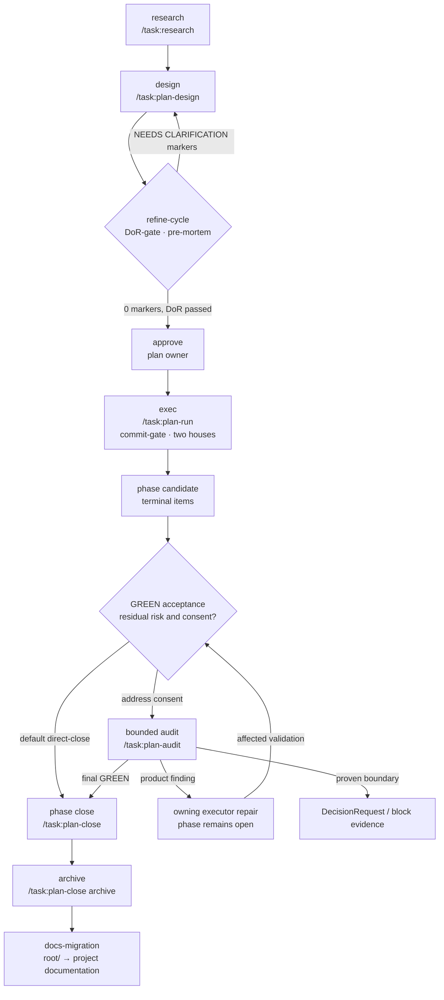

# Methodology Task plan-protocol v2 - full cycle

This card is valid when a planned workflow is explicitly selected. Regular development and fixes
are completed directly via `task:dev`/`task:fix`; scope of task and instructions in old audit
do not select a plan. The general routing boundary is `references/intent-routing.md` of the Task package.

## Compact normal path

`task.plan_lifecycle` provides advisory impact selection alongside existing runtime owners and persists no new carrier.  Low-risk
items use focused validation, changed projections once, one semantic Next and one scoped commit.
Declared hard risk widens validation and review; audits are read-only and return product findings to
their owning item.

How a plan lives life from research to project documentation. SSOT circuits, gates and
markers - compact skill `general/plan-protocol`; this page is a cycle map with links
for commands and skill sections. The protocol captures ONLY Axioma specifics - what plan mode
and the model will not be derived by itself: circuits, gates, markers, conveyors.

## research

Carrying decisions of the plan are not taken from the model memory: external facts (versions, API, best
practices, market) are mined `/task:research` - multi-source fan-out with adversarial-
verification. The extracts go to `plans/<ID>/20_research/` and `findings/` (skill §16), not
remain in the chat: the downstream performer reads the file, does not restore the context. Everyone
a verified fact carries the trace `RAG:✅ <date/gist>`, an unverified fact - `[UNVERIFIED]`.

## design

`task:plan-design` (frontier/high) builds layout-v2 plan: stable `plan.md`, phase index/item
specs, append-only decisions and generated state/views/bundles. `design-finish` checks
detailed design, `design-roadmap` updates only the execution map. Every item is new
plan must have `Batch`: `solo` with reason or stable batch-ID. Adjacent items of one
phases are combined when common reads/files/setup/validation save context; separate
deliverables, commit gates and item acceptance inside the batch are saved. Phase audit/close
various `Exec`, authority/irreversible gate or expected context overflow - boundaries
associations. Disputed place -
either marker `[NEEDS CLARIFICATION: <question>]` or question to the owner; unauthorized admission
prohibited. Unrequested phases carry a skeleton marker rather than "just empty fields".
The plan is created at the explicit request of the owner; a normal task of any size can go
directly via `/task:dev`, and minor edits via `/task:fix`.

## refine (DoR-gate, pre-mortem)

Canonical authoring circuit (skill §7): design → self-audit according to the DoR checklist → editing →
repeat up to 0 markers. Definition of Ready phases: all `[NEEDS CLARIFICATION]` are cleared; Scope
Included/Excluded are filled; Alternatives of carrier solutions - in the D-log; Open Questions
separated by status `open-questions.md`; Bearing facts carry RAG markers. For high stakes
plans (fiscal/payments/tenant-isolation/ecosystem core) before closing the design phase -
pre-mortem round according to the Klein protocol: “the plan failed after 6–12 months - why”, mitigations
with owner in Risks/D-log.

## approve

The generated plan is not executed until approved by the owner (Approval Owner in Meta).
Edits before approval - edits to the plan, not the start of execution. Disputed items are not blocked
approval, if submitted to `open-questions.md` (statuses `Exploration` / `Decision
pending` / `Resolved → D#`, skill §3) - but you can only close a plan with pending questions
as `🟠 Done with deviations`.

## exec (commit gate, two houses)

`task:plan-run` (session route) executes the item strictly according to the specifications. In layout v2 it reads
five declared media and does not use handoff as execution input. **Commit gate**:
status `🟢`/`🟠` is not set without a committed diff item'a - Conventional Commits,
risk checks and declared Validation before commit; related fixes and bookkeeping together. **Two houses** (skill §12):
before exec starts, the basic plan lives in Brain; at the start it moves to the project repo (Meta
`Home: repo:<path>`), SSOT = repo, Brain - mirror; discrepancy between the base and working copy -
is not silent merge, but `temporary divergence` + escalation §10. Exec also checks its
model/effort with Routing plan - the discrepancy is recorded in Known Deviations. Execution handoff
always shows `Batch`; batch is executed sequentially in one session, after each
item passes its own acceptance/commit/close gates, and the next carrier saves
recommended remainder of the group. New lines `Why: recommended:` allow ready subset
and order of independent items; `required:` and historical unlabeled groups retain
completeness/order required. A change to a frozen group is fixed by the existing solution.
Closing item and valid direct-close phases are performed in the current invocation before handoff;
the presence of a separate command `plan-close` does not require a new session.
`plan-run` resolves through the installed `task.command_catalog`. The route is captured by the
provider-neutral `task.route_evidence.capture_launch()`; Codex argv and Claude Code session JSONL are
additive adapters of one record. Missing or ambiguous evidence is `ROUTE-UNVERIFIABLE`, not an
undershoot. The start event stores `route-run-receipt/v1`; route/context evidence is reused until a
proven change of session/model/effort/cwd/invocation.

Before journal/product mutation executor compiles `evidence-graph/v1` from immutable item-spec,
digest-qualified bundle, declared `Files` and registry of carrier owners. Real
`Files ∩ digest_inputs` returns when a fresh closure carrier is required
`SELF_INVALIDATING_EVIDENCE_ANCHOR`: first product anchor, then closure anchor. If
there is no intersection, anchors collapse. In the closure, product paths must be byte-identical;
volatile generated journal/view/handoff carriers do not become product semantics without explicit
Deliverable declaration.

Error during exec passes continue-first gate: small reversible defect is repaired in the same attempt,
and Blocked appears only after isolated `JUSTIFIED`, concrete `boundary_evidence` and verified RAG
for outer class. The diagnostic scope is not a boundary: `scope_coverage=in-scope` always
is decomposed and repaired in the same attempt. Terminal item event carries `terminal-evidence/v1`,
linked to the digest of the current TK and all Validation carriers; any red leaves item in progress.
`closed-deviations` requires the same green Validation and a separate closed
`recoverable-validation-gap/v1` and does not replace repairs. Before the final terminal commands are collected
delivery receipt associated with terminal state and exact persisted handoff. See [Continue-first](./continue-first).
After journal start `validation-admission/v1` checks the literal `make <target>` from Validation:
a proven missing local target creates `local-repair` of the same attempt, after which
original carrier is repeated; dynamic Makefile remains `unknown`, not a dummy block.

### Execution economy and stop rule

When the owner asks for a fast, practical implementation, treat that as a validation-budget
constraint. Once affected tests are green, do not start another review/rewrite loop unless a
remaining defect can break the requested real-project check, corrupt data, or cross an actual
security/authority boundary. Repair concrete blockers once and stop. Record unsupported future
capabilities as fail-closed limitations instead of designing speculative infrastructure.

If work becomes disproportionate, narrow immediately to the smallest safe patch, affected tests,
one package validator, and concise evidence. Do not add agents, schemas, byte-level comparisons, or
another review round merely to increase confidence beyond that boundary.

## review (by material trigger)

Keep review in its own invocation and name `--reviewer <provider/model>` explicitly. The executor
owns implementation/self-check/affected tests; the reviewer owns a read-only verdict and one owning
continuation. `plan-run ... --reviewer provider/model` automatically orchestrates independent item
review, one owning correction and at most two completed rounds in one owner invocation. Explicit
item review uses a digest-bound packet and terminal GREEN gate, never recursive/unbounded fixing.
Systemic risks use a shared invariant model;
re-review covers the affected class, and repeated class/area findings require a changed tactic.
See [independent review transport](reference/plan-tooling.md#independent-review-transport).

Reviews are dispatched by artifact type, but not by ritual status. One scoped verdict
is reused as long as the material scope, SHA or risk has not changed. Terminal items form
runtime-built phase candidate. A single `plan_assurance.evaluate()` selects the next carrier without
trial `plan-close`: missing `Phase Assurance | v1` means isolated/reversible default;
an explicit block is needed for seam/hard-risk/live or owner audit. `Routing.Review` and the number of items remain
depth of item review, not phase risk.
Default for GREEN acceptance is direct-close. Legacy `required/auto/light` does not assign audit;
`required` gives advisory migration hint. The missing candidate is collected by the existing runtime,
incomplete/red acceptance is returned to the contractor. Additional phase audit is only allowed
with a specific uncovered issue and targeted owner consent in the existing decision record:
`audit-admission/v2` is assigned to a phase, material candidate and one run. Upon completion of run, consent
consumed; a repeat audit requires new consent. The fields and owner-message format are described in
canonical `plan-protocol/references/plan-layout-v2.md`, Phase Assurance section.
Impact classification remains information for selecting the affected audit, and not the right to a new audit.
GREEN audit regenerates its owned views exactly once, rebuilds candidate and saves
`audit-finalization/v1` with exact close admission. Therefore the next `plan-close` consumes
is proven to be the same candidate, and does not detect self-invalidation by repeated audit.
Audit remains read-only and returns the owning executor defect. The performer repairs it in his own
session, repeats affected Validation and updates views; new independent full review is not added
on the very fact of repair.
Routine `audit → repair-run → second audit → AUDIT-CAP` is prohibited. The first same fingerprint changes
tactic; only a repeat or a new material risk allows one isolated reviewer return to the same root.
Acceptance failure remains the job of owning root. Authority/public-frozen signal passes
`plan_authority`: delegated continues repair, `approval_required`/`denied` creates exact
waiting/terminal continuation. Safety passes `plan_blocking`, and only `terminal-block` after
distinct `JUSTIFIED` is terminal. In phase mode, `ATTENTION` does not complete root: non-gating remainder
is reported under GREEN, the correctable one is repaired. `plan-design` is not a successor phase RED;
approved change stable Intent/Scope/Files/Validation performed by resumed owning root.

Historical exceptions are compatible read via `phase_close_gate(..., owner_decision="D#")`.
Direct-green-validation requires one accepted, phase-scoped and superseding decision carrier with
literal `phase-close: direct-green-validation`. After exhausted AUDIT-CAP separate remediation
carrier must cover the exact full set of phase items and explicitly state that there is no third audit,
and the phase is closed with the regular `task:plan-close`; the permit is valid only after the repair itself and
re-deterministic gate. An invalid explicit exception remains fail-closed. For regular
GREEN-phase such a carrier is not needed.

A separate exception for terminal blocked phase requires accepted, non-superseded D# with `item: Pn`,
exact set `Pn` and all `Pn.*`, as well as literal
`phase-close: terminal-blocked-deviations`. It only allows `closed-deviations` phase close:
the phase itself is projected as `🟠 Done with deviations`, while RED/blocked item states, audit
history and release authorization do not change. Without such D# the blocked item still closes the phase
fail-closed.

**Audit verdict ≠ acceptance of the plan.** These are two independent axes, and it is prohibited to mix them:
phase audit verdict (`GREEN`/reducer-confirmed `RED`) says “phase record agrees with code and git facts”,
and acceptance - that the MEASURED values of the plan took the declared thresholds (floors). Plan with
a perfect record may remain with unfulfilled acceptance; then item remains in progress and
owning root continues repair. `🟠 Done with deviations` is acceptable only after the green mandatory
Validation and separate reducer evidence about unrepairable residual; it does not increase what is missing
measure to green. Raising `not-met`/`unknown` to met, recalculating the threshold to match the result and “green”
by default" on unmeasured - prohibited; unmeasured quantity is published as `unknown` with
by scope, date and stated reason, rather than rounded. The number on the class
`pinned-not-recomputable`/`unknown`, cannot justify an acceptance predicate
([plan structure](./plan-structure) → “Portable”).

## archive

The terminal plan is archived with the command `/task:plan-close archive <ID>` (pipeline in
skill §12): moved to `plans/archive/<ID>` by a SEPARATE commit `chore(plan): archive <ID>`,
update `ACTIVE.md` and registries, migration checklist - to the final handoff. `artifacts/`
goes into the archive along with the plan - this is the working material of the phases. Archive does not check or
calls Brain: Brain synchronization remains a separate opt-in docs operation.

## docs-migration

Long-lived material from `root/` is not archived but becomes project documentation for
Diátaxis-types: architecture/philosophy → explanation, data-model/contracts → reference,
phase guides → how-to. What migrates where and where - table on the page
[Plan structure](./plan-structure); migration checklist (what was transferred, what remained
in the archive) is required in the final handoff.
