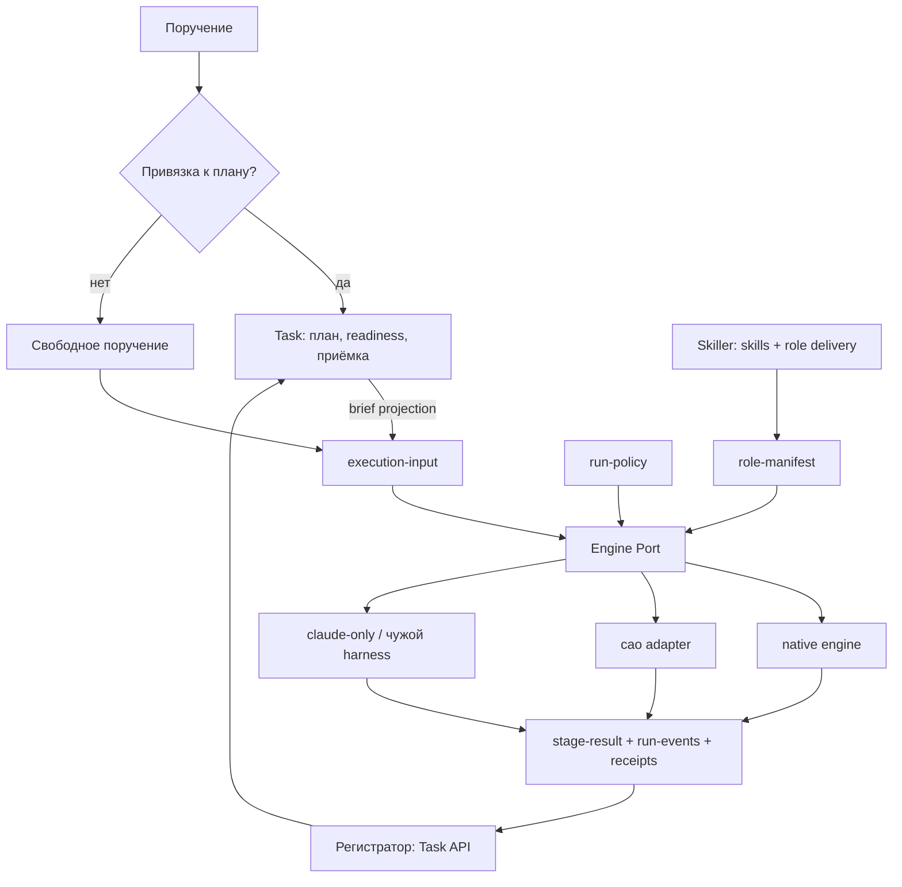

# Решения по оркестрации: итоговый документ

Дата: **2026-10-05**. Автор: Claude Code (Opus 5.5), независимый review папки `orch/`.
Статус: **принятые решения для планирования**. Остальные файлы `orch/` — черновики и доказательная база;
при расхождении приоритет у этого файла. Реализация ещё не начиналась.

Полный реестр требований владельца — [REQUIREMENTS.md](REQUIREMENTS.md) (R1–R26, I1–I15). Команда для сессии,
которая проектирует Plan 1, — [PLAN1-PROMPT.md](PLAN1-PROMPT.md). Каркас в §9 — **стартовая гипотеза**, не норма:
окончательное разбиение делает сессия проектирования.

Из этого документа вырастают два плана:

1. **План 1 — подготовка к оркестрации** (без breaking changes): контракты, схемы, разделение пакетов.
2. **План 2 — реализация движка** и адаптеров поверх подготовленных контрактов.

Обозначения уверенности: **[факт]** — проверено в коде/первичном источнике; **[вывод]** — следует из
кода/документации; **[гипотеза]** — проверяется в плане 2.

---

## 0. Короткий ответ

| Вопрос | Решение |
| --- | --- |
| Свой движок или CAO? | **Свой тонкий native-движок** на структурированных headless-интерфейсах CLI. CAO — **не основной движок**, а второй адаптер за тем же портом (опционально, в плане 2+). |
| Насколько выбор очевиден? | Достаточно очевиден, чтобы не ставить платный сравнительный пилот *перед* планом 1. План 1 вообще не зависит от выбора движка. |
| Что делает систему гибкой? | Нейтральный слой контрактов (JSON Schema) + **Engine Port**. Task, Skiller и движки зависят от контрактов, а не друг от друга. |
| Что с Harness? | Остаётся установщиком окружения (permissions, hooks, MCP, проекции). Старый `harness/run` — legacy до parity. |
| Что с Artifex? | **Заморозить**. Новых фич нет; отдельные механизмы (worktree, store, telemetry) переносить в движок явно, после проверки. |
| Vercel HarnessAgent / Pydantic / AI-DLC / Agent Orchestrator | Отложены. Причины в §7. |

---

## 1. Почему свой движок, а не CAO

### 1.1. Что на самом деле ломается у пользователя

Жалоба: «Codex и Grok путаются в Task, что-то не так делают, зависают». Это две **разные** проблемы:

| Проблема | Причина | Чем лечится |
| --- | --- | --- |
| **Путаются** | Worker получает плановый процесс: `task:plan-run` с lifecycle, `report_api` в unit brief, `start → scout` внутри Task **[факт:** `harness/run/worker.py:26`, `task/plan/units.py:117`, `task/plan/lifecycle.py:465`**]** | Разделение ролей и узкий execution input (§3, §4). **Ни CAO, ни свой движок это сами не решают** — это работа плана 1. |
| **Зависают / непрозрачны** | Harness worker запускает CLI через `subprocess.run(capture_output=True)` — вывод виден только после завершения; очередь последовательная **[факт:** `worker.py:184`**]** | Потоковый запуск со структурированными событиями и детерминированным признаком завершения. |

Главный вывод: **половина боли лечится не выбором движка, а декомпозицией Task**. Значит выбор движка
должен оптимизировать вторую половину — надёжность транспорта и наблюдаемость.

### 1.2. Транспорт CAO — источник того же класса сбоев

CAO в стандартном backend определяет состояние агента **по выводу TUI в tmux** **[факт, аудит B §2]**. В
открытых issues upstream на 2026-10-05 (113 открытых) — ровно симптомы «зависает/путается» **[факт]**:

- Claude Code: статус `COMPLETED`, пока длинный ответ ещё стримится → `run_step`/`handoff` убивает worker посреди задачи;
- #739 — запуск Codex не завершается, если TUI показывает account notice;
- #735 — `session send` возвращает ответ **предыдущего** хода или промежуточный кадр;
- #728 — канал результата handoff/assign молча обрезает или теряет ответ worker;
- #659 — Codex assign может удалить активный worker, когда кэш статуса отстаёт от экрана;
- #671 — allowlist tools профиля не применяется к CAO MCP.

Источник: [CAO issues](https://github.com/awslabs/cli-agent-orchestrator/issues). Perplexity
[Q11](research/perplexity/Q11.md) независимо подтверждает: с v2.3 статус читается из виртуального буфера
экрана (pyte), в v2.5.1 добавлен «self-heal» зависшего PROCESSING тоже через захват pane; отдельного
headless/stream/ACP-режима для Claude, Codex или Grok в CAO нет; история фиксов статуса и извлечения ответа
длинная (#392, #539, #545, #579, #655, #763, orphan tmux #555/#498). Это не доказывает, что CAO
плох, — это доказывает, что **парсинг экрана — нестабильная граница**, и у нас она будет ломаться при каждом
обновлении трёх CLI. Именно этого пользователь хочет избежать.

### 1.3. Самая трудная часть — наша в обоих вариантах

Аудит B честно фиксирует: Git commit, worktree, tests и `plan.py finish` в CAO workflow — **вне
memoization**; `reconcile` полноценно не реализован; idempotency — обещание автора шага **[вывод, аудит B §5–6]**.
Effect receipts, приёмка, recovery и lifecycle Task пишем **мы** при любом движке. CAO даёт сверху:
tmux-терминалы, supervisor/inbox/assign, memory federation, fleet, EKS — большая часть этого нам не нужна.

### 1.4. Нужный движок маленький

Сценарий пользователя — **последовательный конвейер стадий + ограниченный DAG units**, а не сеть свободно
общающихся агентов. У всех трёх CLI есть машинный интерфейс **[факт, аудит A §3]**:

| CLI | Интерфейс стадии | Признак завершения |
| --- | --- | --- |
| Claude Code | `claude -p --output-format stream-json --verbose`; `session_id` в `system/init` | обязательное финальное `result`; EOF без него = ошибка |
| Codex | `codex exec --json`: `thread.started` → `item.*` → `turn.completed` (с usage) / `turn.failed` | финальное событие + exit |
| Grok Build | **ACP** `grok agent stdio` (JSON-RPC); `-p --output-format streaming-json` — запасной | ответ на `session/prompt`; у streaming-json терминальное событие **не документировано** |

Завершение определяется событием протокола и кодом выхода процесса, а не регэкспом по экрану.
Подтверждено Perplexity [Q12](research/perplexity/Q12.md) по официальным docs. Важно: Claude `--bare` **не
читает OAuth подписки** и пропускает hooks/skills/plugins/CLAUDE.md — для нашего сценария не использовать.
JSONL-схемы не являются стабильным межверсионным API: версии CLI фиксируются, неизвестные поля сохраняются.
В репозитории уже есть: модели и provider mappings (`command-routing.json`), argv-шаблоны scout для
Claude/Codex, `ProviderId`, разбор usage из JSONL (`core/usage.py`), units/DAG/lifecycle в Task.

### 1.5. Сводка за и против

| | Свой native-движок | CAO |
| --- | --- | --- |
| **За** | Детерминированное завершение по событиям; точный контроль Task lifecycle и effects; stdlib Python без новой runtime-зависимости; движок ровно под наш конвейер; используем готовые mappings/scout/units | Готовые живые tmux-терминалы и attach; multi-CLI lifecycle и UI из коробки; Python workflows с replay агентных шагов; активно развивается |
| **Против** | Сопровождаем 3 adapters и их event schema; interactive attach надо делать отдельно; recovery пишем сами | TUI-парсинг (см. §1.2); очень быстрый дрейф поверхности (v2.3→v2.5.1 за 2 мес.: удалены провайдеры, Rust TUI, durable workflows, EKS) **[факт, releases]**; PyPI ≠ GitHub ≠ main; recovery Git/Task всё равно наш; Grok effort не пробрасывается |

### 1.6. Когда пересмотреть решение (условия переключения на CAO)

Решение обратимо благодаря Engine Port (§2). Включаем CAO-адаптер как основной, если в плане 2:

- нужен **полноценный интерактивный attach** к нескольким живым агентам, а наш tmux-view (§5.4) недостаточен;
- adapter-ы трёх CLI требуют постоянного ремонта event schema чаще, чем CAO чинит свои parsers;
- нужен supervisor-режим (агенты сами раздают задачи) — это не наш текущий сценарий.

---

## 2. Архитектура: порты и адаптеры



### 2.1. Правило зависимостей (главный инвариант гибкости)

```
contracts  ←  task, skiller, engines, harness
task       ↛  engines        (Task не знает, кто исполняет)
engines    ↛  task internals (только через Task CLI/JSON API и контракты)
skiller    ↛  engines        (публикует содержание, не управляет retries)
```

- Task не импортирует движок и не запускает модели.
- Движок не читает файлы плана напрямую и не знает monorepo-путей — только Task CLI через установленный
  entrypoint или capability discovery (сейчас `plan_reader.py:24` хардкодит `packages/task/...` **[факт]**).
- Один run — один владелец workflow (lock, attempts, retries, cancel). Вложенных оркестраторов нет.

### 2.2. Где живёт код

| Компонент | Место | Решение |
| --- | --- | --- |
| Контракты (JSON Schema + stdlib-валидатор) | **новый пакет `packages/orch`** (рабочее имя), `schemas/exec/v1/` | Нейтральная территория: устанавливается без Task (свободные поручения, внешний reviewer) |
| Engine Port + native engine + adapters | `packages/orch/lib/orch/` | План 2. Engine — один из adapters, а не ядро контрактов |
| Плановые данные и brief projection | `packages/task` | Аддитивные команды (§4) |
| Role delivery skills | `packages/skiller` | Аддитивная команда resolve (§6) |
| Provider launch catalog (argv, flags, model/effort binding) | обобщить `command-routing.json → orchestration` | Один источник для scout и всех стадий (§5.2) |
| Окружение, hooks, permissions, проекции | `packages/harness` | Без изменений по назначению |
| `harness/run` | legacy | Работает до parity, затем депрекация отдельным решением |
| Artifex | заморожен | Механизмы переносятся по одному с тестами |

`packages/orch` должен быть stdlib-only Python, как остальное ядро. Внешние движки (CAO, Node sidecar)
подключаются как процессы через CLI/HTTP, не как pip/npm-зависимости ядра.

---

## 3. Контракты (схемы плана 1)

Все — JSON Schema draft 2020-12, `$id` с версией `exec/v1`, `additionalProperties: false`, поле
`contract_version`. Совместимость: minor — только новые optional поля; major — новый каталог `v2`.

| Схема | Назначение | Кто пишет → кто читает |
| --- | --- | --- |
| `execution-input` | Неизменяемое задание стадии: goal, scope/write-set, constraints, decisions, acceptance + checks, mandatory reads (с hash), context refs, result contract, provenance (plan/item/unit ref или `adhoc`) | Task brief / ad-hoc builder → engine → роль |
| `run-policy` | Профиль конвейера: стадии, роль и model class каждой, required/optional, review on/off, retries budget, git action, finalize kind | владелец/конфиг → engine |
| `role-manifest` | Роль: инструкции (ссылки на canonical source), skills, tools/permissions, write authority, форма результата | Skiller/harness roles → adapter |
| `capability-record` | Что умеет конкретный engine × provider × версия CLI: transport (`jsonl`/`acp`/`tui`), auth route, model/effort set+observe, stream/attach, resume, native restrictions vs prompt-only, skill delivery mode | adapter probe → engine (отказ при неподдерживаемом) |
| `run-event` | Нормализованное событие: run/stage/attempt, kind (`started`, `model_wait`, `tool`, `question`, `quota_block`, `timeout`, `cancelled`, `unknown_outcome`, `completed`), ts, raw_ref | adapter → журнал, консоль |
| `stage-result` | requested/resolved/observed route, input+instructions hashes, session id, status, changed paths, artifacts, checks, usage (`unknown` ≠ 0), errors | engine → регистратор |
| `effect-receipt` | Git/Task эффект: ключ, intent, предусловие, фактический результат, reconcile-метод | engine → recovery |
| `check-evidence` | Команда/процедура, кандидат (commit/tree hash), окружение, exit/наблюдение, лог | engine → Task `finish` |

Engine Port (6 операций, без «универсального multi-agent framework»):

```text
capabilities()                       -> capability-record[]
prepare(input, policy, roles)        -> launch-plan        (валидирует, отказывает явно)
run(launch-plan) / watch(run_id)     -> stream of run-event
cancel(run_id)                       -> завершение дерева процессов + unknown для незавершённого
resume(run_id)                       -> продолжение или явный отказ
results(run_id)                      -> stage-result[], effect-receipt[]
```

**Тест переносимости контрактов** (критерий готовности плана 1): один и тот же `execution-input`
валидно исполняется (а) native engine, (б) «ручным» Claude-only harness по prompt-рендеру — без
переписывания goal/checks под движок.

---

## 4. Task: что меняем (принимаю рекомендацию Sol, с уточнениями)

Принимаю вывод [task-role-decomposition.md](task-role-decomposition.md): **путь A (граница с
совместимостью) в плане 1, путь B (очистка пакетов) — целевое состояние**. Все изменения плана 1 —
аддитивные; существующие команды и схемы не меняют поведение.

| # | Изменение | Совместимость |
| --- | --- | --- |
| T1 | `plan.py brief <item> [--unit U] --json` → `execution-input`. Из полного `context.collect` детерминированно; без lifecycle-инструкций, `report_api`, workflow следующей роли | Новая команда; `context` и unit brief не меняются |
| T2 | Проверка полноты: все acceptance/constraints/mandatory reads источника присутствуют в brief; иначе ошибка, не truncation | Новая |
| T3 | Включение содержимого mandatory reads (с hash) для ролей без tools | Флаг `--inline-reads` |
| T4 | Resolver квалифицированных ссылок на другие планы (сейчас `loaded: false`) | Расширение context, старый вывод сохраняется |
| T5 | Разделение actor: `executed_by` / `registered_by` в log-event и unit return | Optional поля → minor bump `plan/v1` |
| T6 | `finish`/`unit accept` принимают `--evidence <check-evidence ref>` наряду с `--check V1=0` | Старый флаг остаётся; в плане 2 — режим «evidence required» per policy |
| T7 | Идемпотентная регистрация: повтор того же attempt id не создаёт второго перехода | Новый optional `attempt_id` |
| T8 | Scout: Task только строит данные; запуск модели переходит к engine. `start --scout` продолжает работать через тот же launch catalog (§5.2) до депрекации | Без изменения CLI |
| T9 | Разметка содержимого `plan-protocol`, `plan-run`, `review`, `design-mode` по владельцу (данные/API, оформление, execution, review, design, routing), затем **перенос текстов к владельцам в плане 1** (R19) | Старые команды работают; тексты переезжают, ссылки и проекции генерируются |

Что **не** делаем: не добавляем `execution.provider`/`cao.agent` в plan schemas (policy живёт отдельно и
ссылается на plan/item); не урезаем `context.collect`; не вводим второй редактируемый план (YAML TaskSpec);
не делаем ревью обязательным для всех.

Уточнение к Sol: ссылки на `task:plan-run` не передаются worker никогда. Worker получает **рендер
`execution-input` + role-manifest**, а не Task-команду. `plan-run` остаётся командой координатора
(человека или engine), и в плане 2 её тело сводится к «вызвать engine с policy».

---

## 5. Native engine (проектные решения для плана 2)

### 5.1. Конвейер по умолчанию

```text
context-pack (Python) → [scout: economy, если policy.required] → primary (implementation|frontier)
  → [bounded units: economy, если primary выдал units] → checks (команды проекта)
  → [review: независимый provider, если включено] → registrar (Python, Task API) → [git action по policy]
```

Профили (`run-policy`) поставляются готовыми: `solo` (strong-only), `scout+solo`,
`frontend-bounded` (scout → frontier design → economy units), `review-only` (без Task). Минимальный
route плана не понижается ради экономии; `mode=self` units не делегируются.

### 5.2. Provider launch catalog — один источник

Обобщить секцию `orchestration` в [command-routing.json](../packages/task/configs/command-routing.json):
сейчас там argv только для scout (Claude, Codex). Нужно: argv-шаблон на **роль × provider** (включая Grok),
флаги stream-формата, способ задать и **наблюдать** model/effort, sandbox/permissions, delivery skills.
Его читают и Task scout (пока он жив), и engine. Model class → selector — только через существующие
`mappings`; ручных копий моделей в профилях нет. Каталог переезжает в `packages/orch` в плане 2,
`command-routing.json` ссылается на него.

### 5.3. Процессы и события

- `subprocess.Popen` в собственной process group; построчное чтение stdout JSONL; stderr отдельно.
- Сырые события сохраняются рядом с нормализованными (`run-event`); ошибка парсинга → `unknown_outcome`,
  никогда не «агент думает» и не success.
- Heartbeat + «последнее значимое событие»; таймауты на стадию и на тишину.
- Quota/auth/provider error отличаются от task failure; без скрытого понижения модели.
- Cancel = SIGTERM группе → grace → SIGKILL; проверка остаточных потомков.
- Версии CLI записываются в capability-record на каждый run; несовпадение с проверенной — предупреждение.

### 5.3a. Транспорт адаптера: выбирается per provider, порт от него не зависит

Perplexity [Q13b](research/perplexity/Q13b.md) рекомендует стандартизировать ACP (Agent Client Protocol,
v1 stable, v2 draft, есть официальный Python SDK). Принимаю **частично**:

| Provider | Основной транспорт | Запасной | Почему |
| --- | --- | --- | --- |
| Claude Code | `claude -p` stream-json | ACP через `claude-agent-acp` (Agent SDK) | `-p` — это сам CLI: гарантированно та же подписка, plugins, skills, hooks. ACP-адаптер идёт через Agent SDK + Node-пакет; сохранение подписочного логина и plugins Perplexity не подтвердил — только probe |
| Codex | `codex exec --json` | ACP через `codex-acp` / app-server | JSONL документирован с терминальными событиями и usage; ACP нужен для approvals/steering |
| Grok Build | ACP `grok agent stdio` (нативный) | `-p streaming-json` | Нет документированного end-события у streaming-json |

Правила порта (из Q13b, совпадает с §3): нейтральные `run-event` без ACP/JSONL-объектов в домене; команды
(`start/send/approve/cancel/resume`) отдельно от событий; собственный run/session id, транспортный — только
привязка; capability discovery с явным `unsupported/degraded`; версии порта, ACP и адаптеров — раздельно, в
lock; golden event traces как тесты adapter-ов. Транспорт — поле `capability-record`, а не свойство движка.

Следствие: для одноходовых стадий конвейера ACP не обязателен; он становится основным, когда понадобится
интерактивный steering/approvals. Переход на ACP для Claude/Codex — замена adapter-а без изменения контрактов.
ACP-клиент пишется на stdlib (JSON-RPC по stdio), чтобы не тянуть зависимость в ядро; официальный Python SDK —
референс для тестов совместимости.

### 5.4. Наблюдаемость без TUI-парсинга

- `orch run` печатает живой поток: stage, provider/model/effort (resolved и observed), tool calls, checks.
- `orch watch <run>` / `orch status` из журнала.
- Опционально `--tmux`: каждая стадия получает окно tmux, в котором идёт `orch watch --stage` — видимость
  «как в CAO», но источник — структурированный поток, а не экран.
- Интерактивный steering — позже через Claude `--input-format stream-json`, Codex app-server, Grok ACP.

### 5.5. State и recovery

- Одно хранилище: atomic JSON-файлы на run в `.swissknifeman/runs/<run_id>/` (SQLite не вводим, пока не
  понадобится конкурентная запись; решение переоценивается после чтения `artifex/store.py`).
- Run/stage/attempt identities; native session id хранится отдельно от run id.
- Effects по алгоритму [architecture-contract.md §«Эффекты»](architecture-contract.md): intent → проверка
  факта → действие → receipt → reconcile при сбое; неоднозначный исход останавливает зависимые стадии.
- Resume сверяет hashes input/policy/instructions/route; drift → новый запуск, не replay.
- Один workspace на задачу; worktree только для реально параллельных units с непересекающимися write sets.

---

## 6. Skiller: доставка по ролям

| # | Изменение | Совместимость |
| --- | --- | --- |
| S1 | `skiller resolve --role <id> --provider <p> --json` → набор skills с транзитивным `requires`, источниками и способом доставки | Новая команда |
| S2 | Доставка per-run без переключения глобальных конфигов: Claude — `--plugin-dir`/`--settings` на запуск; Codex — изолированный профиль/`CODEX_HOME`; Grok — проверить все источники discovery (`.grok`, Claude-источники, `.agents`) | Новый delivery mode; существующие connect/vendor не меняются |
| S3 | Probe фактической загрузки: «установлен» ≠ «загружен»; результат идёт в capability-record | Новый |
| S4 | Один delivery owner на skill в run: native plugin **или** engine-delivery | Правило в engine |

Роли (`role-manifest`) строятся на существующем [roles.json](../packages/harness/configs/common/agent-packs/roles.json)
и генераторе agent-packs, а не в новом реестре.

---

## 7. Отложенные и отклонённые варианты

| Вариант | Решение | Почему |
| --- | --- | --- |
| **CAO** | Второй adapter, не основной | §1.2–1.5. Может пригодиться для attach/supervisor-режима; adapter пишется к тому же Engine Port |
| **Vercel HarnessAgent** | Отложен | Официально experimental: «Expect breaking changes between releases» **[факт]**; adapters рассчитаны на sandbox bridges; auth auto-detect может уйти в API billing; требует Node sidecar |
| **Pydantic AI Harness** | Отклонён как движок | Собственный agent loop вместо native CLI и их skills/подписок |
| **AWS AI-DLC** | Не ставить целиком | Методология поверх Task = второй lifecycle; отдельные шаблоны стадий — можно |
| **Agent Orchestrator (ex-Composio)** | Резерв | Issue-first модель; смотреть, если приоритет сместится к параллельным задачам + CI/merge |
| **Artifex как база движка** | Нет | Узкий admission path (`provider-readiness-smoke`, P3.4) **[факт, repository-audit]**; переносим только проверенные механизмы |
| **Удаление Harness** | Нет | Установщик/hooks/проекции нужны при любом движке |

---

## 8. Поправки к черновикам

| Черновик утверждает | Решение здесь |
| --- | --- |
| README: «сначала проверить CAO как исполнитель» | Основной — native; CAO — опциональный второй adapter. Основание — открытые TUI-баги CAO (§1.2) |
| pilot: 18+ платных runs до выбора движка | Не блокирует. Вместо этого в плане 2 — дешёвые capability probes (по 1–2 вызова на CLI) и failure injection native engine. Экономический эксперимент — после работающего движка |
| Нужно выбрать между развитием Artifex и Harness как runtime owner | Ни то, ни другое: новый `packages/orch` с нейтральными контрактами; оба старых пути — legacy/донор |
| Причина зависаний не доказана | Согласен для отдельных сессий, но два структурных источника подтверждены кодом (§1.1) — их устраняем независимо |

Исследование этой ревизии: 4 вызова Perplexity (`perplexity-web-mcp`, тот же pool; Q11–Q13b, журнал в
[perplexity-log](research/perplexity-log.md)) + WebFetch первичных страниц CAO (releases, issues) и Vercel
docs, 2026-10-05. Ответы Perplexity использованы как discovery и сверены; Q13b содержит противоречие о Grok
ACP, разрешённое в пользу официальной документации x.ai. Поведение headless-режимов на наших аккаунтах
**подлежит probe** в плане 2.

| Новое в Perplexity | Влияние на решение |
| --- | --- |
| CAO: статус по экрану (pyte), headless-режима нет (Q11) | Укрепляет выбор native |
| `--bare` не читает OAuth (Q12) | Запрет `--bare` в launch catalog |
| Grok streaming-json без end-события (Q12) | Grok → ACP основным |
| ACP v1 stable + Python SDK (Q13b) | Транспорт — сменная деталь adapter-а (§5.3a); ACP-клиент в плане 2 |

---

## 9. Каркас плана 1 — подготовка (без breaking changes)

| Фаза | Содержание | Готово, когда |
| --- | --- | --- |
| P1. Контракты | `packages/orch` skeleton; 8 схем `exec/v1`; stdlib-валидатор; fixtures (valid/invalid) | Схемы валидируются в CI; fixtures покрывают plan-bound и ad-hoc |
| P2. Task projection | T1–T3, T5–T7 | `plan.py brief` на реальном v4-плане даёт валидный `execution-input`; completeness-тест; старые тесты Task зелёные |
| P3. Разделение инструкций и пакетов (рефакторинг, R19) | T9: инвентаризация, затем перенос: worker/role-шаблоны (executor, scout, reviewer, registrar) отдельно от Task-протокола; review-методология → существующие quality-skills; reviewer routing → launch catalog; `plan-run` — команда координатора | Worker-вход не содержит lifecycle; старые команды работают; проекции перегенерированы |
| P4. Launch catalog | §5.2: argv на роль × provider, включая Grok; scout переключён на catalog | `start --scout` работает как раньше; catalog-тест |
| P5. Skiller role delivery | S1, S3 (resolve + offline-проверка closure) | `skiller resolve` для 5 ролей; closure без лишних широких skills |
| P6. Развязка путей | Task CLI доступен через entrypoint/discovery; `plan_reader` без monorepo-хардкода | Brief собирается из стороннего репозитория |
| P7. Тест переносимости | Один `execution-input` → prompt-рендер для Claude-only reviewer | Goal/checks не переписаны под движок |

Принципы плана 1: только аддитивные изменения; каждый новый контракт сразу с fixture и потребителем;
никаких моделей в CI; проверки — существующие validators и тесты пакетов.

## 10. Каркас плана 2 — реализация

1. **Probes** (платные, минимальные): по каждому CLI — stream-формат, model/effort set+observe, skills
   loading, session id, quota-классификация → `capability-record` fixtures и golden event traces. Для Grok —
   ACP `grok agent stdio` с подписочным login; для Claude — `-p` с OAuth и native plugins.
2. **Native engine MVP**: один item, последовательные стадии, live stream, journal, cancel. Без git effects.
3. **Registrar + effects**: receipts, reconcile, evidence-based `finish`; failure injection из
   [pilot](pilot-and-claude-handoff.md) (kill CLI/runner, crash после commit, drift при resume, duplicate run).
4. **Bounded units** + параллелизм с worktree по непересекающимся write sets.
5. **Переключение `plan-run` на engine**: тело команды становится вызовом engine с policy. Тексты уже разнесены в плане 1 (P3).
6. **Parity и депрекация** `harness/run` и Artifex — отдельным решением владельца.
7. *(опционально)* CAO adapter к тому же Engine Port; экономический эксперимент (§model-economics).
