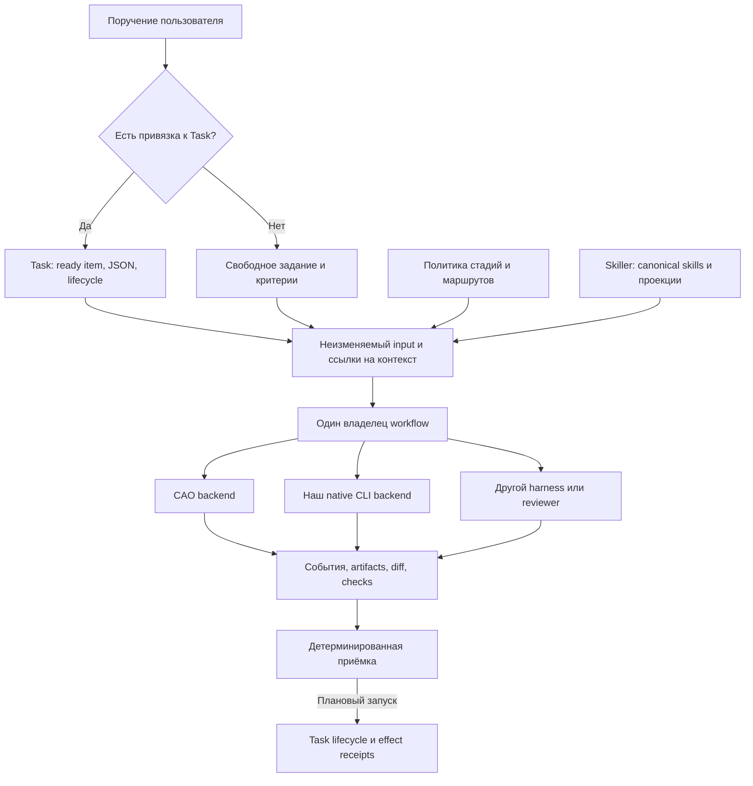

# Общий контракт: переносимое ядро, сменный исполнитель

Это предложение для обоих вариантов аудита. Новые поля, profiles и interfaces ниже **не являются уже реализованными возможностями Swiss Knife Man**. Доменная основа — существующие Task JSON schemas и canonical commands, а не ещё один независимый план.

## Границы ответственности



Диаграмма показывает варианты backend, а не три одновременно работающих scheduler. Task определяет готовность и принимает результат. Backend определяет порядок execution stages и управляет процессами. Adapter связывает доменный контракт с конкретным backend. Skiller публикует содержимое, а не управляет retries.

В Task уже есть [четыре canonical workflow templates](../packages/task/workflows/README.md): research-fanout, author-by-spec, audit-adversarial и dev-slice. Описанный development pipeline соответствует dev-slice плюс bounded authoring; design остаётся сильной ролью. Их stage semantics и optional review следует переносить в backend bindings, а не создавать конкурирующую методологию. Эти JS templates используют Workflow runtime (`agent`, `pipeline`), поэтому сами по себе не являются готовыми программами plain Node/CAO. Design-only item не запускает implementation; dev item не получает дополнительные обязательные design/audit стадии по умолчанию.

## Вход: проекция текущего Task

Для plan-bound run input собирается из `plan.py show/next/context` и unit brief, с проверкой ошибок JSON envelope. Он содержит plan/item/unit references, goal, instructions, acceptance/checks, dependencies, declared reads/write scope, minimum route, snapshot hashes и source provenance. Existing unit `mode=self` сохраняется; `delegate` и `either` учитываются при выборе роли.

Runtime policy размещается отдельно от plan documents. В существующие schemas с `additionalProperties: false` нельзя незаметно добавить `execution.provider`, `cao.agent` или новый arbitrary stage graph. Если нужен plan-level выбор policy, сначала нужно согласовать schema/API расширение; до этого — внешний binding по plan/item reference. Plan orchestration и runtime settings объединяются явным compiler, не двумя независимо редактируемыми DAG.

Текущая `task:plan-run` имеет собственный protocol: один commit на item, текущая session model и native delegation своего провайдера. Для смены моделей/провайдеров между stages нужен отдельный execution binding и ограниченные stage commands. До его согласования policy не отменяет canonical command requirements. Профиль с `git_action=none` ниже иллюстрирует самостоятельный run и не является допустимой незаметной заменой current plan-run.

Свободное поручение использует тот же execution input, но без Task reference и без Task lifecycle. Независимый reviewer должен суметь работать с diff/base/head, instructions и checks, не требуя создания плана. Это основа переносимости к Claude-only harness.

## Роли и outputs

| Стадия | Кто исполняет | Вход | Проверяемый результат |
| --- | --- | --- | --- |
| Context pack | Python/rg/git/имеющийся code graph | Task snapshot, reads | Полный pack, index, hashes, missing required reads |
| Context scout | Economy agent, обязательный по выбранному профилю | Pack и read-only scope | Карта путей/символов, unknowns; без выдуманных фактов |
| Design или implementation | Сильная модель нужной роли | Requirements, mandatory context, scout map | Решения, код либо bounded units; сохранённые acceptance |
| Bounded implementation | Economy agent, если включено | Конкретный unit, design contract, tests | Diff только в scope, artifacts и evidence |
| Verification | Команды проекта | Actual diff/worktree | Exit codes и logs; команда не заменяется фразой агента |
| Review | Независимая модель, если включено | Diff, criteria, проверенные результаты | Findings с severity/location и verdict |
| Finalize | Детерминированный код; необязательный writer для текста | Acceptance evidence | Receipts, unit acceptance/item finish, выбранные Git-операции |

Это не семь обязательных модельных сессий. Python context и verification не расходуют модель. Сильная стадия может сама реализовать всё. Для пользовательского профиля «дешёвый разведчик всегда» scout обязателен; если он недоступен, нельзя незаметно пропустить его. Для других профилей допустим deterministic-only context. Выбор фиксируется до запуска.

Иллюстрация policy, **не готовый конфиг для существующего CLI**:

```json
{
  "policy_id": "frontend-with-bounded-units",
  "engine": "cao",
  "context_agent": {"required": true, "role": "context-scout", "model_class": "economy"},
  "primary": {"role": "frontend", "model_class": "frontier", "provider": "codex"},
  "bounded_implementation": {"enabled": true, "role": "implementation", "model_class": "economy"},
  "review": {"enabled": false},
  "finalize": {"kind": "deterministic", "git_action": "none"}
}
```

Роль и model class различаются: frontend — ответственность/skills, а в текущем inventory классы `economy/implementation/frontier`. Class разрешается через canonical model inventory; конкретные selectors и effort не копируются вручную в каждый workflow. Minimum route плана имеет приоритет над желанием сэкономить. Назначение сильной frontend-модели не означает, что любое последующее программирование можно безопасно понизить: compiler принимает только достаточно ограниченные units.

Повторы имеют численный предел; resume не сбрасывает уже использованный бюджет. Для явно запрошенного Task review сохраняется существующая граница: до двух завершённых review rounds и одного owning correction, без recursive fixes у reviewer. Детерминированные checks переиспользуются при неизменных relevant inputs и повторяются на affected delta, а не из-за движения bookkeeping.

## Context artifact и контекст конкретной роли

Полный current Task context сохраняется как authoritative artifact. Большая «портянка» доступна для проверки и передачи. Дополнительный stage view включает все обязательные требования и контекст, относящийся к ответственности роли; source excerpts имеют пути и hashes, omitted optional material перечисляется. Модель может дозагрузить источники из index.

Это будущая оптимизация интерфейса, не разрешение урезать current `context.collect`. Нужны контракты completeness и проверки mandatory reads. Summary дешёвой модели — карта поиска; оно не заменяет решения владельца, исходный код и tests. Если размер необходимого контекста превышает рабочий бюджет, запуск сообщит о проблеме и предложит декомпозицию; молчаливое truncation недопустимо.

## Минимальная поверхность adapter

Достаточно нескольких операций: узнать capabilities/version, подготовить launch, запустить/наблюдать, отменить, восстановить или явно отказать в восстановлении, получить artifacts. Не нужно вводить generic multi-agent framework со всеми возможными features заранее.

Capability record должен различать:

- native auth route и API/Gateway route;
- установку и наблюдение model/effort;
- stream events и terminal attach;
- завершение turn, восстановление session и replay завершённого step;
- prompt-level policy, native tool restrictions и OS sandbox;
- native skills/plugins, MCP skill loading и plain prompt fallback;
- plan write authority и обычный code write scope.

Запрошенная неподдерживаемая capability даёт явный отказ или заранее согласованную альтернативу. «Reviewer prompt» не заменяет hard read-only capability. Unknown usage сохраняется как unknown, а не ноль.

## Result и приёмка

Stage result содержит run/stage/attempt, requested/resolved/observed route, input/instructions hashes, session/terminal IDs, status, actual changed paths, artifacts, check results, usage availability и errors. Exit 0 — transport evidence; completed task требует выполнения acceptance.

Task unit не получает статус accepted только по сообщению worker. Integrator проверяет scope, зависимости и checks, затем принимает unit существующей Task-операцией. Parent item закрывается после своей приёмки. У code worker нет обязанности редактировать canonical plan JSON напрямую.

При параллельных units write sets должны быть независимыми. Отдельные worktrees полезны для параллелизма, но worktree на каждую последовательную роль добавляет лишнюю интеграцию. Сначала один task workspace, затем изоляция по реально параллельным units. Shared files, generated output и общие plan writes обслуживает один integrator.

## Эффекты Git и Task при восстановлении

Порядок для каждого effect:

1. Записать intent с устойчивым ключом, input hash и ожидаемым предыдущим состоянием.
2. Проверить, не выполнен ли effect: Task event/status, commit/tree, созданный worktree, validation log.
3. Выполнить действие с проверкой предусловий.
4. Сохранить receipt с фактическим результатом.
5. При crash между действием и receipt сначала reconcile по реальному состоянию. Если результат не определяется однозначно, остановить dependent stages с unknown outcome.

Это не exactly-once гарантия для любых shell-команд. Для каждого разрешённого effect нужен конкретный способ сверки. Commit, merge, push, release и публикация — отдельные действия с собственным пользовательским scope; успешная реализация сама по себе их не включает.

Один runtime владеет workspace lock, attempts, cancellation и retries. Task остаётся единственным владельцем плана. При смене движка переносим canonical inputs/artifacts и receipts; native conversation/session IDs между разными engines автоматически не переносим.

Input hash отражает material requirements, source/test/tool/config inputs и route. Собственные ожидаемые `start/dispatch/finish` events проверяются через receipts и state preconditions; они не должны сами инвалидировать уже принятое evidence. Generated views, timestamps и новые audit receipts не включаются в material candidate так, чтобы приёмка бесконечно меняла собственный hash.

## Единый источник инструкций и доставочный слой

Тела commands остаются в `packages/task/commands`, skills — в `packages/skiller/skills`, model mappings — в canonical catalog. Engine profile содержит короткую роль и ссылки; длинная политика lifecycle не копируется туда второй раз. Provider renderer добавляет нужный формат invocation и native capabilities.

Нужно учитывать фактическую discovery: cwd и root guides, trust, plugins, skill catalog, MCP и active session. Установленный файл и загруженная инструкция — разные факты. Для одного skill выбирается один delivery owner в конкретном run: native plugin **или** CAO delivery. Generated projections допускаются; ручные semantic forks требуют явного обоснования.

Проверка переносимости — выполнить reviewer run без Task и тот же plan unit с двумя engines. Если canonical goal/checks пришлось переписать под engine, boundary ещё недостаточно универсален. Первичные документы о различиях: [Claude skills](https://code.claude.com/docs/en/skills), [Codex SDK](https://learn.chatgpt.com/docs/codex-sdk), [CAO skills](https://github.com/awslabs/cli-agent-orchestrator/blob/c31dc281ec1f215cef898c2ed919a0ce507afd08/docs/skills.md), [Grok skills](https://docs.x.ai/build/features/skills-plugins-marketplaces).
