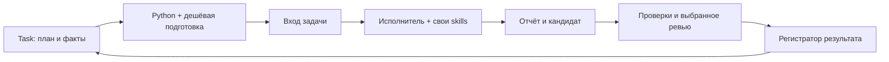

# Task, исполнение и инструкции по ролям

Дата: **5 октября 2026**. Статус: **исследование и предложение; реализация не менялась**.

Это отдельное дополнение к [сравнению оркестраторов](README.md): оно разбирает внутреннюю декомпозицию Swiss Knife Man независимо от выбора собственного runtime или AWS Labs CAO. Основание — уточнение владельца, просмотр локального кода и проверка официальной документации провайдеров. Изложенные ниже названия новых контрактов и ролей — предложения, а не уже доступные команды.

## 1. Согласие с идеей и её точная граница

**Да, разделение обоснованно:** Task должен описывать и обслуживать план; Harness или подключённый оркестратор — организовывать выполнение; отдельный модуль ревью — задавать метод проверки; предметные skills — помогать конкретной роли. Исполнитель получает задачу, ограничения, принятые решения, исходные данные и критерии результата. Навык управления планом ему не нужен.

Под «регистратором» здесь понимается роль, которая читает и обновляет **план**, а не registry Skiller. Сбор контекста и регистрация результата могут быть двумя стадиями одной дешёвой роли. Python выполняет детерминированные операции; модель нужна для поиска связей, объяснения неизвестного и подготовки понятного сообщения.

Однако из Task нельзя удалить сами критерии приёмки, зависимости и правила корректного изменения состояния. Например, требование независимого ревью остаётся фактом задачи, а способ его проведения и выбор reviewer принадлежат оркестрации. Иначе перенос методологии незаметно ослабит исходную задачу.

Перегруженные инструкции действительно могут мешать исполнителю. **Причина текущих остановок Codex пока не доказана:** нужно различать конфликт инструкций, отсутствие полномочий, сбой hook, нехватку контекста и обоснованный вопрос о задаче. Размер файлов skills сам по себе не показывает, сколько инструкций получил конкретный запуск.

## 2. Что сейчас смешано

Проверены исходники рабочего каталога. В Task параллельно идут другие изменения; таблица описывает наблюдавшееся устройство, а не утверждает, что прежние тесты покрывают весь текущий WIP. Канонические источники — package-файлы ниже; `.agents/skills/*` являются проекциями.

| Место | Текущее смешение | Возможное изменение |
| --- | --- | --- |
| [plan-protocol](../packages/task/skills/plan-protocol/SKILL.md) | Схемы, статусы и API соседствуют с правилами design, review и маршрутизацией reviewer | Оставить протокол данных; методологию и запуск ролей вынести |
| [plan-run](../packages/task/commands/plan-run.md), [execution-mode](../packages/task/skills/plan-protocol/references/execution-mode.md) | Реализация, проверки, ревью, закрытие и Git описаны одним процессом | Команда координатора вызывает runtime; сильному worker передаётся отдельное задание |
| [review](../packages/task/commands/review.md), [review-mode](../packages/task/skills/plan-protocol/references/review-mode.md), [reviewer-selection](../packages/task/references/reviewer-selection.md) | Методика ревью, выбор native route и запись отчёта в план находятся в Task | Отделить reviewer, runtime routing и регистратора; сохранить требования и результат в плане |
| [design-mode](../packages/task/skills/plan-protocol/references/design-mode.md) | Продумывание решения и оформление JSON-плана объединены | Архитектор создаёт содержание; регистратор оформляет его через Task API |
| [common-principles](../packages/task/skills/plan-protocol/references/common-principles.md) | Принципы разработки соседствуют с правилами работы с планом | Плановые правила — Task; применимые правила разработки — профиль исполнителя |
| [context.py](../packages/task/lib/task/plan/context.py) | `collect()` отдаёт полный план, фазу, item, units и orchestration; часть исходников представлена путями | Сохранить полный pack; добавить отдельное представление задачи и сбор нужных исходных фрагментов |
| [scout.py](../packages/task/lib/task/plan/scout.py), [lifecycle.py](../packages/task/lib/task/plan/lifecycle.py) | `start()` при включённом scout запускает модель из Task | Task строит данные; scout запускается внешним runtime |
| [units.py](../packages/task/lib/task/plan/units.py) | Unit brief содержит полный parent context и `report_api` с `unit return` | Worker возвращает отчёт; регистратор вызывает API |
| [Harness worker](../packages/harness/lib/harness/run/worker.py) | Запуск жёстко связан с `task:plan-run` и каталогом маршрутов Task | Запускать роль с подготовленным входом; плановый адаптер оставить у координатора |
| [Harness gate](../packages/harness/lib/harness/run/gate.py) | Вердикт оценивает также состояние Task после worker | Разделить успех исполнения и последующую регистрацию; общий run завершается после обеих стадий |
| [roles.json](../packages/harness/configs/common/agent-packs/roles.json), [agentpacks.py](../packages/harness/lib/harness/agentpacks.py) | Уже есть общие роли и генерация provider-проекций, но установка agent-pack не обеспечивает минимальный набор инструкций каждого запуска | Переиспользовать генерацию; добавить выбор содержимого по роли и проверку фактической доставки |
| [Skiller connect](../packages/skiller/lib/skiller/connect.py), [vendor](../packages/skiller/lib/skiller/vendor.py) | Выбор профиля относится к проекту; добавляется core и раскрываются `requires` | Разделить установку библиотеки и передачу выбранных skills конкретной роли |

Уже есть важное ограничение: `plan-protocol` активируется по явному вызову Task и имеет `disable-model-invocation: true`. Поэтому неправильно утверждать, что весь этот skill всегда загружен в каждый Codex. Но запуск worker через `plan-run`, содержимое context pack, общие инструкции и hooks всё равно необходимо проверять отдельно.

## 3. Предлагаемое владение

| Слой | Что ему принадлежит | Что получает модель |
| --- | --- | --- |
| **Task: данные плана** | Создание и изменение JSON, идентификаторы, зависимости, решения, статусы, readiness, переходы, журнал, сбор исходных плановых фактов | Эти инструкции нужны только автору/регистратору плана |
| **Runtime / Harness: процесс** | Выбор стадии и модели, запуск, доставка инструкций, инструменты, повтор, отмена, проверки, интеграция и Git-процесс | Каждой роли — её задание и правила выполнения |
| **Reviewer: методология** | Как анализировать diff, риски, доказательства и оформить замечания | Только reviewer; можно заменить внешним skill |
| **Skiller: содержание и доставка skills** | Канонические тексты, зависимости, публикация и provider-проекции | Выбранные предметные skills, когда они нужны роли |
| **Контракт задачи** | Цель, рамки, обязательные условия, данные, критерии и форма результата | Общий вход для исполнителя в любом runtime |

Здесь «Harness» обозначает владельца процесса, а не требование физически поместить весь новый код в `packages/harness/`. Методология ревью может жить в отдельном plugin; CAO может владеть workflow; наш Harness продолжает предоставлять окружение и адаптеры. Для одного запуска остаётся один владелец последовательности стадий.

Нужен **один источник каждой инструкции**, а не один огромный общий документ. Task-протокол, правила review и PHP-skill имеют разных владельцев. Provider-файлы генерируются из этих источников. Уже существующие канонические каталоги следует использовать, не создавать рядом второй registry с ручными копиями.

### Роли и интеллект

| Роль | Вход и результат | Типичный маршрут |
| --- | --- | --- |
| Регистратор контекста | Читает план через API; получает pack, находит нужные связи; возвращает вход задачи и неизвестные | Python + economy для семантической части |
| Архитектор / основной исполнитель | Получает задачу; продумывает решение или выполняет сложную работу | implementation / frontier по сложности |
| Исполнитель ограниченного участка | Получает конкретный участок решения, допустимые файлы и критерии | economy, если участок действительно посилен |
| Reviewer | Получает требования, кандидат результата, diff и доказательства; возвращает замечания и вердикт | По риску и запросу владельца; не обязательно economy |
| Проверяющий / интегратор | Проверяет конкретный кандидат, собирает evidence, при необходимости интегрирует изменения | Прежде всего код; модель для недетерминированной части |
| Регистратор результата | Читает отчёт и проверенные evidence; обновляет Task и закрывает допустимые состояния | Python + economy для пояснений |

Это логические роли, а не обязательные шесть субагентов. В желаемом профиле дешёвая подготовка может быть первой обязательной стадией. Глобально для всех задач дополнительные модели не обязательны. Git-команды и стандартное закрытие часто достаточно выполнить кодом.

Планировщик, который механически оформляет план, не нуждается в PHP-инструкциях. Архитектор, который выбирает устройство PHP-системы, может нуждаться в предметных знаниях. Разделять следует **обязанности**, а не запрещать архитектурной роли понимать предмет задачи.

## 4. Как подготовить вход сильному исполнителю

Предлагается отдельное представление `execution input`. Оно генерируется из Task и файлов репозитория; **оно не становится вторым редактируемым планом**. Для задачи без плана тот же вход строится из запроса пользователя.

Минимальное содержимое:

1. Цель, ожидаемый результат, рамки изменений и исключения.
2. Обязательные ограничения, принятые решения и значимые уроки предыдущих пунктов.
3. Критерии приёмки и необходимые проверки: команда либо процедура, ожидаемое наблюдение, существенные условия запуска.
4. Выбранные JSON-факты с происхождением; связанные задачи и решения — как содержательные зависимости.
5. Исходные файлы и нужные фрагменты, пути, рабочий каталог, версия кандидата, сведения о чужих незавершённых изменениях.
6. Известные неизвестные, доступные способы получить дополнительные данные и причины для эскалации.
7. Простой контракт результата: что изменено, какие проверки выполнены, где evidence, что осталось нерешённым.

Исполнителю не передаются lifecycle-команды `start/finish`, порядок закрытия фаз, `report_api`, инструкции reviewer или полный workflow следующей роли. Идентификатор пункта допустим как ссылка для происхождения; он не обязывает worker управлять планом.

Полный существующий context pack сохраняется. Обязательные данные нельзя молча обрезать ради лимита строк или «оптимального» числа файлов. Представление для worker отделяет относящиеся к его работе факты от внутренних инструкций оркестрации; дополнительные исходники доступны для чтения. Сильный исполнитель может обнаружить необходимый файл сам: предварительный scout не гарантирует полноту исследования.

### Детерминированная сборка и связанные планы

Сначала Python получает `show/context`, разрешает пути и явно указанные ссылки, извлекает нужные JSON-разделы и исходные фрагменты. Затем дешёвая модель помогает найти дополнительные связи и оформить сообщение. Скрипт сверяет, что обязательные ограничения и критерии из источника присутствуют в результате. Свободный пересказ дешёвой моделью не должен становиться единственным носителем требований.

В текущем `context.py` внешние решения могут возвращаться как `{"ref": "…", "loaded": false}`; upstream собирается по локальным items. Поэтому **полноценное разрешение связей с другими планами ещё предстоит сделать**, хотя формат квалифицированных ссылок уже [описан](../packages/task/skills/plan-protocol/references/work-references.md).

Возможное решение — общий resolver плановых ссылок: известное соответствие repository → root, загрузка исходного JSON, проверка состояния решения, сохранение пути и версии, отслеживание посещённых узлов при циклах. Неразрешённая обязательная ссылка явно возвращается координатору; она не заменяется догадкой. Из чужого плана импортируются нужные факты, а не его процесс выполнения и полный набор инструкций.

Обычный source-файл сейчас может присутствовать в pack только как путь. Если дешёвому агенту запрещены tools, этот путь сам по себе не даёт содержимого. Следовательно, Python заранее добавляет нужные данные либо агенту предоставляется подходящее чтение. В текущем scout это особенно существенно для Claude-маршрута без tools.

## 5. Возврат результата и закрытие

Предлагаемый поток:

У фронтенд-задачи между основным исполнителем и отчётом может быть дешёвый coding worker: сильная роль передаёт ему конкретное решение и ограничения. Оркестратор определяет ответственность за интеграцию и принятие участка. Это не должно превращаться в цепочку, где каждый агент заново изучает план и запускает собственный workflow.

**Регистратор закрывает по проверенному результату.** Сейчас `finish()` проверяет наличие и значения переданных check exits, но не исполняет сами команды. Переданное `--check V1=0` не доказывает, что V1 действительно запускался. Runtime должен связать evidence с конкретным кандидатом: commit либо идентифицируемое состояние рабочего дерева, команда/процедура, окружение, результат, артефакт. Проверка старого diff не подтверждает новый diff. Для ручной процедуры нельзя выдумывать shell exit.

Есть и отдельная проблема identity: `start()` проверяет маршрут `actor` и сохраняет его как `result.executor`; `finish()` может использовать executor как actor по умолчанию. Дешёвый регистратор и сильный исполнитель — разные участники. Нельзя запускать пункт от имени дешёвого actor, обходя минимальный класс исполнителя, либо приписывать исполнителю чужую регистрацию.

Возможный контракт адаптера: отдельно `executed_by` и `registered_by`; Task получает заявленный и проверенный runtime маршрут исполнителя, журнал — действительного инициатора записи. Точные поля и совместимость требуют отдельного проектирования. Простая замена текста skill этот вопрос не решает.

Смысл требований остаётся в Task; runtime отвечает за получение результата. Независимое ревью, явно запрошенное владельцем, сохраняется. Универсальное обязательное ревью каждого изменения не добавляется. Существующие ограничения повторов и отсутствие искусственных циклов закрытия должны сохраняться при переносе, а не возникать в каждом reviewer заново.

Повторная доставка того же отчёта после восстановления не должна повторно закрывать фазу или делать второй commit. Нужны идентификатор попытки и распознавание уже зарегистрированного результата в runtime/адаптере; это задача реальной интеграции, а не новая инструкция сильной модели.

## 6. «Skills только нужной роли»: что именно надо разделить

Здесь пять разных вещей: **установка**, **обнаружение метаданных**, **предзагрузка тела**, **вызов skill**, **возможность прочитать его файл или использовать инструмент**. Установленный skill не обязательно целиком находится в prompt. Запрет автоматического вызова не равен отсутствию метаданных или ограничению доступа.

| Среда | Подтверждённая особенность | Следствие для проекта |
| --- | --- | --- |
| Claude Code | `skills` предзагружает тело, но не задаёт список доступных skills. Обычный custom subagent наследует CLAUDE.md. `omitClaudeMd` доступен с v2.1.271 и игнорируется для main `--agent`. Skills с `disable-model-invocation: true` нельзя предзагрузить | Использовать проверенную конфигурацию роли; Task-протокол передавать нужной роли другим поддержанным способом; обязательные правила репозитория сохранять. [Документация](https://code.claude.com/docs/en/sub-agents) |
| Codex | Skills раскрываются постепенно; локальные отключаются через `skills.config`, а `allow_implicit_invocation: false` запрещает неявный вызов. AGENTS.md имеет собственную иерархию | Не переносить Claude `skills:` как универсальную настройку. Адаптер должен проверить эффективный каталог, инструкции и поддержку выбранного способа запуска. [Skills](https://learn.chatgpt.com/docs/build-skills), [AGENTS.md](https://learn.chatgpt.com/docs/agent-configuration/agents-md) |
| Grok | Помимо `.grok` автоматически читаются Claude-источники и пользовательские `.agents` skills; `allowed-tools` не ограничивает tools, `model/effort` в skill не применяются | Проверять все источники обнаружения и реальные параметры запуска; один минимальный `.grok` bundle не доказывает изоляцию. [Документация](https://docs.x.ai/build/features/skills-plugins-marketplaces) |
| CAO | В просмотренной версии выбор skills профиля ограничивает объявленный список, а не доступ через `load_skill` | Если нужен строгий набор, проверять и ограничивать именно доставку/loader; native skills CLI проверять отдельно. [Код и документация на исследованном commit](https://github.com/awslabs/cli-agent-orchestrator/blob/c31dc281ec1f215cef898c2ed919a0ce507afd08/docs/skills.md) |

Эти возможности меняются; перед реализацией нужна проверка установленной версии. `--bare` у Claude также не является универсальным решением для запуска с подпиской: документированное ограничение OAuth необходимо учитывать. [Headless](https://code.claude.com/docs/en/headless).

Практический вариант — канонический **манифест роли**: вход, инструкции, выбранные skills, tools, маршрут и форма результата. Provider-адаптер переводит его в реально поддерживаемую конфигурацию. Манифест не должен содержать ручные копии тел skills или дублировать provider model catalog.

Пример распределения, **не готовый синтаксис CLI**:

| Роль | Её инструкции | Её skills |
| --- | --- | --- |
| Подготовка контекста | Чтение Task, происхождение данных, формат входа | Поиск и сбор контекста; предметные навыки лишь при нужной семантической работе |
| Регистрация | Изменение Task через API, проверка полученных evidence | Узкий плановый протокол |
| Исполнение PHP | Задание, рамки, контракт отчёта | Применимые PHP/Laravel skills |
| Исполнение frontend | Задание, рамки, контракт отчёта | Применимые frontend/design skills |
| Reviewer | Требования, кандидат, метод ревью, контракт замечаний | Выбранный review skill и необходимые предметные проверки |

Короткие обязательные инварианты репозитория и существенные полномочия остаются у всех соответствующих ролей. Длинные плановые, review и предметные workflow глобально не подключаются. В Skiller надо учитывать транзитивные `requires`: узкий выбор skill может снова притащить широкий набор. Нельзя просто удалить зависимость, если без неё теряется нужное правило.

Промпт «не используй Task» полезен как временная договорённость, но не убирает уже загруженный текст, hooks или доступные API. Ограничение записи плана достигается также инструментами/адаптером. Наличие shell с доступом к репозиторию не позволяет обещать абсолютную изоляцию файлов только настройкой skills.

Переключать глобальные плагины и общий пользовательский config перед каждым worker опасно для параллельных сессий. Предпочтительны независимо подготовленные профили запуска там, где провайдер это поддерживает, и проверка их эффективной конфигурации. Новая роль не должна отключать обязательные project или managed правила ради красивого числа токенов.

Hooks тоже относятся к этой границе. Например, Harness уже имеет [provider bindings](../packages/harness/configs/codex/hooks/lifecycle-context-bindings.json) и [защиту generated plan-файлов](../packages/harness/lib/harness/lifecycle_plan_guard_core.py). Защита данных может оставаться общей; требование к coding worker самостоятельно завершить Task должно относиться к координатору. В исследовании не проверялась фактическая регистрация hooks во всех пользовательских окружениях, поэтому это пункт будущего пилота, а не диагноз нынешних остановок.

## 7. Работа без субагентов и без плана

Контракты должны зависеть от роли, а не от наличия дерева агентов.

**Без субагентов:** программа или оператор готовит вход; один исполнитель выполняет работу; программа проверяет и регистрирует результат. Одна и та же дешёвая модель может обслуживать подготовку и регистрацию в отдельных вызовах. Runtime может последовательно запускать независимые сессии вместо native subagents.

**Одна общая модельная беседа:** инструкции можно раскрывать по необходимости, но после чтения Task они уже находятся в истории. Простое переименование роли не очищает контекст. Полное отделение сильного исполнителя требует соответствующего способа запуска; чистота отдельной сессии всё равно зависит от project instructions, skills, памяти и hooks.

**Без плана:** Task вообще не вызывается. Исполнитель и внешний reviewer используют тот же контракт задачи; runtime определяет необходимые стадии. Это позволит использовать Swiss Knife Man с Claude-only harness без обязательной установки планового workflow.

## 8. Возможные решения и предпочтительный путь

### A. Ввести границу, сохранив совместимость

Добавить представление задачи, внешний сбор контекста, worker с узким входом и адаптер регистрации. Текущий `plan-run` временно остаётся публичным входом координатора, который делегирует процесс runtime. Он не передаётся исполнителю как инструкция. Старые планы и полный pack продолжают читаться.

Преимущество — можно проверить выбранный CAO или собственный runtime, не совмещая эксперимент с полной миграцией публикации. Риск — старые файлы методологии останутся рядом; нужен явный переходный статус и один фактический владелец процесса, иначе возникнут два конкурирующих workflow.

### B. Завершить очистку границ пакетов

Task остаётся библиотекой данных, API и узких плановых навыков. Execution/review/design methodology, provider launch и scout переносятся к соответствующим владельцам. Общий каталог моделей/маршрутов выделяется или переиспользуется так, чтобы Task хранил семантические требования, а native mappings не дублировались между runtime.

Это целевое состояние, наиболее близкое запросу владельца. Потребуется обновить command catalog, публикацию plugins, generator-проекции, ownership/locks, ссылки и релевантные проверки. Перенос одного `SKILL.md` без изменения запусков и payload будет неполным.

### C. Только переписать prompt

Можно быстро разделить тексты и запретить исполнителю плановую церемонию. Это полезная промежуточная проверка, но она не меняет `start → scout`, `report_api`, связку Harness worker с `plan-run` и источники обнаружения skills. Такое изменение нельзя считать завершённой декомпозицией.

**Рекомендация: A как проверяемый первый шаг, B как целевое устройство.** Контракт задач и ролей проектируется один раз для собственного runner, CAO и native Claude-only harness. Адаптеры меняют способ запуска; Task и методология reviewer не переписываются под каждый backend.

## 9. Что предстоит доработать

1. **Разобрать содержание Task.** Пометить каждую инструкцию: данные/API, плановое оформление, execution, review, design methodology, provider routing. Определить одного владельца; убрать process-инструкции из worker-входа, включая вложенные поля.
2. **Сделать вход задачи.** Сохранить полный context pack; добавить представление для роли, сбор исходников и resolver внешних ссылок. Обязательные критерии переносить детерминированно.
3. **Разделить actors и возврат.** Исполнитель сообщает результат без Task API. Координатор связывает попытку, маршрут, candidate и evidence; регистратор обновляет план с собственной identity.
4. **Вынести запуск моделей.** Scout и другие стадии вызывает runtime; заменить зависимость coding worker от `task:plan-run`. Разделить verdict исполнения и завершение регистрации.
5. **Выделить review-контракт.** Reviewer получает содержательные требования и кандидат, возвращает замечания; внешний skill меняется конфигурацией роли. Task не диктует ему методику и не требует самостоятельно писать lifecycle-события.
6. **Настроить доставку по ролям.** Переиспользовать agent-packs и Skiller; проверить dependency closure, project/user/plugin каталоги, root instructions и hooks на каждом backend.
7. **Провести миграцию источников.** После выбора границ перенести каноническое содержание, обновить catalog и генераторы; не редактировать `.agents/skills` и provider-копии вручную.

Это перечень будущих изменений, а не уже созданный Task-план. Не требуется добавлять новую схему каждого сообщения, обязательный аудит любой стадии или искусственный gate там, где достаточно существующего API и простого результата.

## 10. Как понять, что идея реализована

| Сценарий | Наблюдаемое условие |
| --- | --- |
| Закрытие PHP-пункта | Регистратор имеет плановый API, но не получает весь PHP workflow |
| Сильный исполнитель | В фактически доставленном входе нет Task lifecycle-инструкций и требований управлять фазой; критерии задачи сохранены |
| Внешний reviewer | Замена review skill не требует переписывать Task-протокол; запрошенное ревью не исчезает |
| Связь с другим планом | Нужный JSON загружен с происхождением либо явно сообщено, какая обязательная ссылка не разрешилась |
| Ложный или устаревший check | Кандидат не закрывается только по свободному тексту модели или exit от предыдущей версии |
| Возобновление после сбоя | Уже зарегистрированный отчёт не создаёт повторные закрытия и Git-эффекты |
| Нет субагентов / нет плана | Те же execution/review контракты работают последовательно; отсутствие плана не запускает Task |
| Другой provider или backend | Сохраняются роль и задача; изменяется адаптер, а не вручную скопированный набор правил |

Экономию и влияние на остановки надо измерять на сопоставимых задачах: фактически доставленные инструкции, usage провайдера, лишние вызовы, причины остановок, потери требований, качество результата и время до принятия. Сравнение количества строк старого и нового skill не доказывает экономию. Пилот дополняет [существующую программу проверки](pilot-and-claude-handoff.md), не заменяя её новым обязательным многоступенчатым процессом.

Для следующего аудитора главный вопрос: **проходит ли граница через содержимое Task, payload, API, запуск, skills и hooks одновременно?** Если очищен только текст одного skill, сильный исполнитель всё ещё может получать прежний плановый workflow другим путём.
