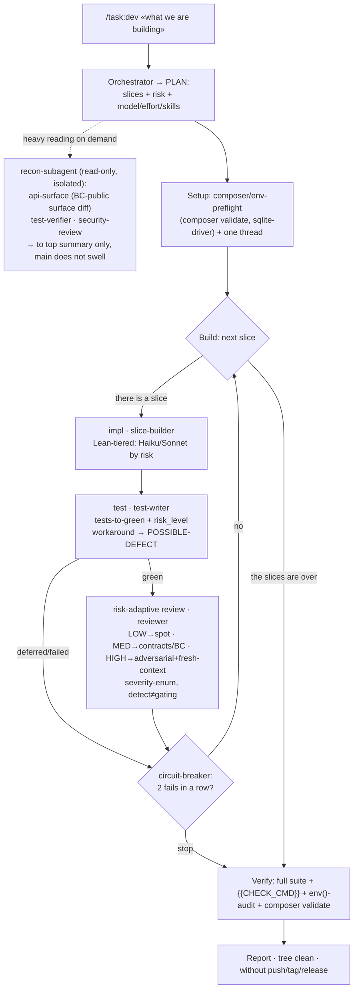

# Guideline: subagents and workflow in {{PACK_PREFIX}}

How {{PACK_PREFIX}} (Laravel-**package**, {{PACKAGE_NAMESPACE}}) uses subagents and
Workflow-orchestration. Operationalizes skill `laravel-architecture:laravel-subagents` +
lessons overnight-run under package canon (public contract/BC instead app-canon).
Context and references - skill `laravel-architecture:laravel-subagents`.

> [!info] Artifacts in the repository
> - Agents (build): `.claude/agents/{{PACK_PREFIX}}-{slice-builder,test-writer,reviewer}.md` (+ opt. `spec-writer`)
> - Agents (recon, read-only): `.claude/agents/{{PACK_PREFIX}}-{api-surface,test-verifier,security-review}.md`
> - Workflow: `.claude/workflows/{{PACK_PREFIX}}-dev-loop.js`
> - Review-gate hook: `.claude/hooks/review-gate.sh` + `.claude/review-gate.env.ini` (taken from `backend-laravel` via `src_pack` — same hook contract for all Laravel-packs)

## How tasks are set

Two inputs. **Via plugin `tasks`** (intent commands - kick the model+effort for the task, so as not to
switch manually):

| Command | Profile | Model/effort (commands) |
|:--|:--|:--|
| `/task:dev` | adaptive dev-loop (slice→impl→test→risk-review) | Opus/high (planning); subagents - by risk |
| `/task:design` | design: research-fanout + plan/ADR, no code | Opus/high |
| `/task:review` | read-only adversarial-review, severity-enum | Opus/xhigh |
| `/task:research` | multi-source research (RAG) | Opus/high |
| `/task:fix` | minor edit: single-agent, without fan-out | Sonnet/medium |

**Or directly:** orchestrator builds machine-readable PLAN (slices + `risk` + `skills`) and runs
Workflow `{{PACK_PREFIX}}-dev-loop` with `args.slices` (see below). The scope of the slices is decided by a person.

### Process workflow (dev-loop)



Key: **model/effort subagents are set at cutoff risk and interrupt the session** (Sonnet impl / Opus+xhigh
on HIGH-review / Haiku trivial); **fan-out — only on research-phase** (`/task:design|research`), not on
coding. Delegate heavy reconnaissance recon-subagents - they read in their window and send a summary to the top.

## When to call subagents

Subagent value - **context isolation and fresh perspective**, is not parallelism.
Threshold (from `laravel-architecture:laravel-subagents`):

- **Yes:** new feature with a visible public surface (contract/facade/config-key/event);
  edit ServiceProvider; extensive examination of dozens of files; review of risky
  (BC-changes, migrations, authorization).
- **No (are more important than triggers):** small/average edit - one or two layers, bugfix, field,
  refactor without access to a public contract - do it directly. Forced decomposition
  little things = tax: tokens grow, context is lost, quality does not improve.

Architectural code (contracts, ServiceProvider, key Actions) write mostly yourself
context - knowledge of technical specifications is concentrated there. Don't kick cheap models into the ground.

## Project Agents

Preloaded with architectural skills through the native field `skills:` (Claude Code
≥2.0.43, deterministic preload). Tuned for {{PACK_PREFIX}}: {{PHP_RUNNER}},
test framework {{TEST_FRAMEWORK}}, public contract/BC instead app-canon access-layer.

| Agent | Role | When to call |
|:--|:--|:--|
| `{{PACK_PREFIX}}-slice-builder` | package feature implementer (contract→implementation→ServiceProvider→publishables), commits to the current branch, does not write tests | for feature implementation |
| `{{PACK_PREFIX}}-test-writer` | tests ({{TEST_FRAMEWORK}} on Testbench) according to the finished code, iterates until green through {{PHP_RUNNER}} | after the feature is implemented |
| `{{PACK_PREFIX}}-reviewer` | risk-adaptive read-only review (LOW→spot / MED→contracts-BC / HIGH→adversarial+fresh-context), severity-enum, detect≠gating | after each green one |
| `{{PACK_PREFIX}}-api-surface` | **read-only recon**: map added/changed/removed public surface (BC-diff) — input for reviewer'a | before review, when public is affected API |
| `{{PACK_PREFIX}}-{test-verifier,security-review}` | **read-only recon** (running tests→summary / security-pass) in ISOLATED context - summary only to top | heavy reconnaissance before editing (main-context does not swell); model `{{MODEL_RECON}}` (cheap) |

> Models build-agents - Lean-tiered default (slice-builder/test-writer `sonnet`, reviewer/spec-writer
> `opus`), a per-slice still to be confirmed `risk`. Foundation (contracts, ServiceProvider) write it yourself - don’t pin it
> cheap models.

Plugin swissknifeman gives more `Explore` (read-only research), `Plan`
(architectural plan), `maind:code-coordinator` (cross-project analysis),
`php:laravel-reviewer`/`php:laravel-test-writer` (general, app-oriented -
for {{PACK_PREFIX}} prefer design ones `{{PACK_PREFIX}}-*`, sharpened to BC/package).

## Workflow `{{PACK_PREFIX}}-dev-loop`

Executes a list of slices (package features) sequentially on one branch: by cut
**impl → tests-to-green → review-gate**, circuit-breaker, final verify.

**Scope is decided by man** and transmits via `args` (workflow executes, not
comes up with product volume):

```js
args = {
  branch: 'feat/<run-name>',   // one branch for the entire run
  base: 'main',                    // base for diff/review
  max_slices: 2,                   // hardcap (is worried resume)
  slices: [
    { id: 'rate-limiter-driver', title: '...', domain: 'Contracts',
      goal: '...', acceptance_criteria: '...', skills: ['php-packages:...'] },
  ],
}
```

Launch: orchestrator calling Workflow with `{ name: '{{PACK_PREFIX}}-dev-loop' }` and this `args`,
or skill `/{{PACK_PREFIX}}-dev-loop`. Before starting usually: inline collect a list of slices
(can be done using a separate pass docs), show to the user, and only then drive.

## Lessons overnight-run (are hardwired into workflow — observe and manually)

1. **One branch per run, NOT branch-to-cut.** Implementing agents do not
   `checkout base` before the new branch → slices are stacked, the last one goes away
   from an ancient commit. All cuts are sequential on ONE branch (or
   worktree-isolation with explicit base). Agents do not create branches/do not switch.
2. **Keep the hard cap of the number of slices as a literal in the script.** `args` on resume may not
   fly → `slice(0, undefined)` = no limit. B `{{PACK_PREFIX}}-dev-loop` default
   `DEFAULT_MAX` is protected by a constant.
3. **Backlog synthesis - two steps.** One agent with heavy nesting schema gets stuck in
   retry-loop. Solution: free-text synthesis (without schema) → tiny `effort:low`
   structuring pass.
4. **Fiddly-setup do it inline yourself** (one-time harness Testbench, skeleton workbench).
   Workflow — to the repeatable part (package features).
5. **Circuit-breaker.** 2 non-green slices in a row → stop, report. Don't dig yourself in.
6. **Parallel - only for file independent.** Slices on the same branch are divided
   working tree → build sequentially. Crossing files without worktree =
   conflict.
7. **Model/effort — by RISK, not by default.** Cheap models perform well
   conditional work, dear designs/arbitrates: impl LOW→haiku otherwise sonnet,
   review LOW→sonnet · MED→opus/high · HIGH→opus/xhigh, setup/verify→sonnet. Inheritance
   parent model - deliberate exception, not default (otherwise all the fan-out goes to the top model).
8. **Don't flood background agents.** The notification about the completion of the subagent comes automatically -
   polling cycles / `ScheduleWakeup` «check if it's ready» burns the context cache in vain.
   Wait for notification; polling is justified only for the external state, which Harnes does not
   tracks (CI/deployment/remote queue).
9. **Prompts are deterministic - for the sake of resume-cache.** Stop at quota → editing one
   parameter → `resumeFromRunId` gives away completed stages for free from the cache. Condition:
   none timestamp/random in prompts; model/effort-override — as a separate parameter
   call (opts do not change completed stages); stage = pure function from (prompt, opts).
   In a big fan-out (research/design, not this one dev-loop) log `budget.remaining()`
   after the wave - otherwise you will find out about the overspending after the fact.

## Review-gate (SubagentStop)

`.claude/hooks/review-gate.sh` runs a light check on subagent completion.
Mode in `.claude/review-gate.env.ini`: `off | warn | strict` (default
**warn** — advisory, does not block). Default check - `{{CHECK_CMD}}` (static
project). `strict` blocks completion (exit 2) until repaired.
This deterministic-insurance on top of the reviewing agent, not a replacement for him.

## Hard gates {{PACK_PREFIX}} (for agents and workflow)

- Tests/PHP — only `{{PHP_RUNNER}}` ({{TEST_RUNNER_CMD}}), not bare `php`.
- Test infrastructure - Orchestra Testbench, DB `{{TEST_DB}}` (in-memory sqlite); none
  real `.env`/external database - the package does not have them.
- Project test framework - {{TEST_FRAMEWORK}}. Scheme/change migrations as needed
  (if the package distributes them). Static (if available) — {{CHECK_CMD}}.
- Public contract: minimum `public`, `env()` only in batch `config/*.php`,
  ServiceProvider `register()` cheap (without I/O), `boot()` — publishables/subscriptions.
- NOT push, NOT PR-merge, NOT tag/release. Each run is on its own branch. DO NOT change files
  outside the package - workbench/testbench the only one «application» site.

## Checklist

- [ ] Subagent threshold checked (visible public surface/ServiceProvider), otherwise did it directly.
- [ ] Research - Explore-agents/api-surface; architectural code itself.
- [ ] Run on ONE branch; hard cap is set and experiencing resume.
- [ ] Model/effort are set by cut risk (not inheriting by default).
- [ ] Each unit passed `{{PACK_PREFIX}}-reviewer`; tests green through {{PHP_RUNNER}}.
- [ ] Parallel only on independent files (otherwise worktree/sequentially).
- [ ] Background agents are not streaming - I'm waiting for notification; prompts are deterministic (resume-cache).
- [ ] Review findings have been corrected point-by-point, without regeneration from scratch.
