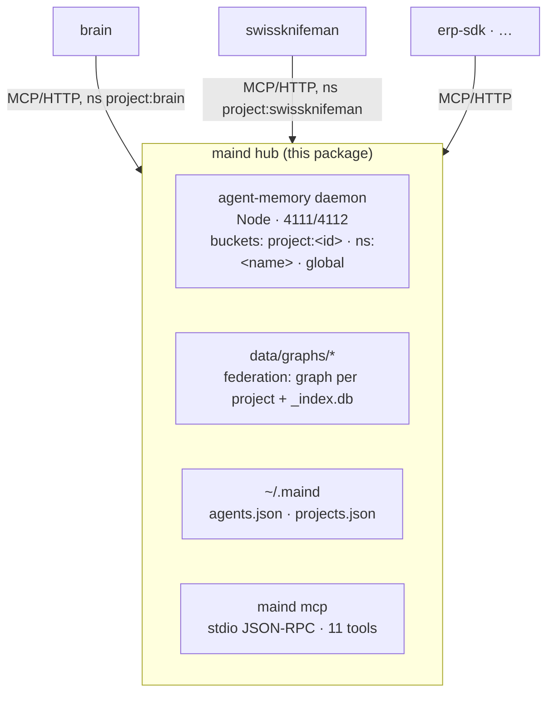
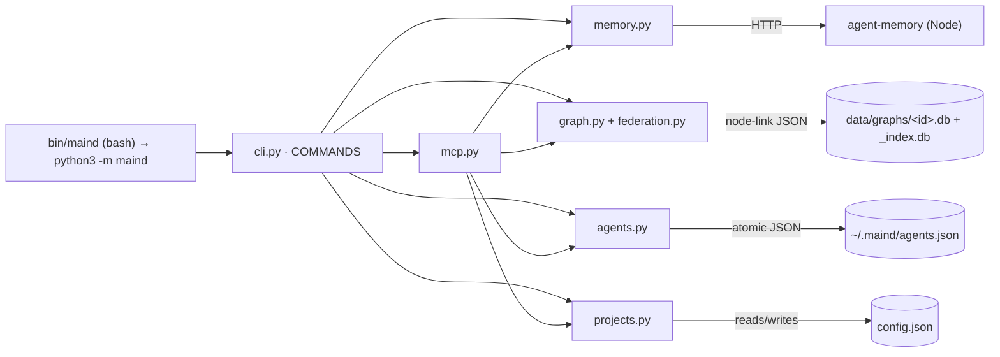

# Architecture

**mAInd** — the top of the ecosystem hierarchy. One common hub composes three layers under one
config `config.json` and one CLI. Other projects connect to it as clients.

> Philosophy of the entire ecosystem (roles swissknifeman / brain / maind, principle «are related, but work according to
> separately», onboarding, command post layers) see page [Ecosystem](./ecosystem).
> Here is the internal composition of the node itself maind.

## Topology: single hub + scopes



Isolation between projects - **boolean** (graph - by namespace; memory - by bucket
`project:<id>`/`ns:<name>`/`global`), and not individual daemons. Memory Demon **not**
is launched for each project - one per hub; only rolled out for projects MCP-client to him.

## Three layers



- **Memory** (`memory.py`) — orchestrates external Node-demon `@agentmemory/agentmemory`
  (start/stop/status, health-poll, pidfile) and speaks HTTP with scope'ami. Demon -
  dependency, not rewritten to Python.
- **Graph** (`graph.py` + `federation.py`) — stdlib property-graph (BFS-neighbors, shortest
  path, subgraph, statistics), persistent in node-link JSON; layout - federation (graph on
  project + `_index.db`). Built from the sources of truth (`derive.py`), not from a manual take.
- **Agents** (`agents.py`) — registry in `~/.maind/agents.json`; state is derived from
  age heartbeat and liveliness pid.
- **Projects** (`projects.py`) — `config.json` (superset brain `.projects.json`;
  legacy-name `.maind.json` is still being picked up), sync from brain.
- **MCP** (`mcp.py`) — posts all this as stdio JSON-RPC server for external agents.

## Three graph layers

Connections come in different natures and cannot be mixed (otherwise the topology looks like «as a single code»):

1. **Code inside the project** (characters/files/calls) — `serena` (via uvx) per project, graph per project,
   is already physically separate. maind does not duplicate it.
2. **Topology between projects** (who depends on whom, common packages) — is a layer maind, see below.
3. **Docks↔docks** — Brain vault (wikilinks, frontmatter `uses/used_by`). maind only **reads** them.

## Layer 2: Graph Federation

`graph.adapter = "federation"` — instead of one `graph.db` graph **for the project**
(`data/graphs/<id>.db`, or in the project repo when `graph_store=local`) plus thin regenerable
`data/graphs/_index.db` (only `project:*`-nodes + cross-project edges). Request crossing
project boundary, **stitches** necessary stores in one in-memory union and drives the normal one BFS
(`federation.Federation` on top `graph.Graph`). This gives insulation (project graph can be deleted/
transfer without harm to others) when idle read-facade.

- `maind graph --project <id>` — graph of one project (its nodes + outgoing cross-project edges).
- `maind graph --cross` — entire cross-project layer (`_index.db`).
- `maind graph query --from project:flexcrm --depth 2` — border traversal (federation).

## Where do connections come from? (derive, without duplicates)

`maind graph derive` builds project stores from **sources of truth**, and not from a manual take
(`derive.py`), marking nodes/ribs plan (`code|doc|meta|runtime`) and source (`via`):

| Plan | Source | Ribs |
|:--|:--|:--|
| code | `composer.json` + path-repos, `package.json` | `project ─requires→ package`, `package ─provided_by→ project`, cross `project ─depends_on→ project` |
| doc | Brain frontmatter `uses/used_by` (**read-only**) | `project ─uses→ project` |
| override | `<repo>/.maind.graph.json` | declared `relates_to`/… (runtime/API) |
| skills | `skills-lock.json` | `project ─uses→ skill ─provided_by→ tool` |

The truth of the connections remains in composer/Brain — `_index.db` only a regenerated cache. Config fields
project (`dependencies`/`agents`) are not materialized by the graph; manual connections are announced via
`<repo>/.maind.graph.json` (plan `override`).

## Namespaces: connection isolation

The project declares group membership as a field `projects[].namespaces: ["axioma", ...]`
(maind-only, like `tags`). Cross-project edge **A↔B is built only if A and B divide at least
one namespace** — connections within a group work as before, between groups are isolated.

| Meaning | Meaning |
|:--|:--|
| no field / `[]` | implicit `default` → old behavior (everything is connected) |
| `["axioma"]` | connection only with projects that also have `axioma` |
| `["*"]` | wildcard: general infrastructure - communicates with ALL namespace |

Insulation is used in **edge creation point** (`derive.py` → `namespaces.link_allowed`),
therefore the stores do not physically contain inter-namespace bridges and everything below (union, query, `_index.db`,
seed) isolates itself; `rebuild_index` duplicates the gate as protection for obsolete/local stores.
Contact **unregistered** external node (no entry in `projects[]`) is saved - it
namespace unknown. Optional registry `namespaces: { axioma: {...} }` in `config.json`
provides metadata and hints for typos; membership is set in projects.

```bash
maind namespaces                       # groups and their member projects
maind projects list --namespace axioma # group projects
maind sync --namespace axioma --only graph,memory   # group fan out
maind graph --cross --namespace axioma # cross-project layer of one group
```

## Connection guarantee: healthcheck

If memory is not raised in the project + maind MCP, development in progress «past» column/memory → spaces.
`maind health --cwd` (client, from project) prints `connected|partial|standalone` + hints;
`--fix` picks up memory and adds MCP-servers. «Priority №1» is delivered to projects as
managed block in `CLAUDE.md`. SessionStart-hook available as explicit opt-in via
`observability.session_start_health_hook`; default health is started manually.

## Memory: visibility «general»

Connections are read from config/graph and never written to memory.
Graph namespaces do not publish memory automatically. Common areas are listed separately in
`memory_namespaces` and are read only through explicit `scope=ns:<name>`.

## Unified provisioning: `maind sync`

One command analyzes `config.json` and rolls out **managed artifacts** for everything
connected projects through the registry of providers (`sync.py`): `mcp` · `graph` (derive) ·
`memory-hook` (digest auto-loading + native off) · `health-hook` · `health-doc` ·
`ecosystem-skill` (skill `ecosystem-mcp` to the project).
`--only` narrows the set, `--mode install|update|auto` sets
«syncing method by area» (create if not / update outdated software content-hash / both
other). Fan-out on projects and resolution paths/scope moved to `ProjectContext`/`select_projects`
(DRY): `deploy` — this `sync --only mcp`.

## Cross-machine memory

Eight operational forks (host, transport, authentication, offline degradation, backup, etc.)
for option «is the only daemon on the current machine, the rest are network clients» committed
in [ADR-0001](./adr/ADR-0001-cross-machine-memory.md).

## Why Python + bash

Exactly like `swissknifeman` and `brain`: slim launcher `bin/maind` checks the environment and
calls `python3 -m maind <root> <cmd>`; logic - in `lib/maind/*.py` on stdlib (testable,
without third party dependencies). This keeps the node portable and predictable.
