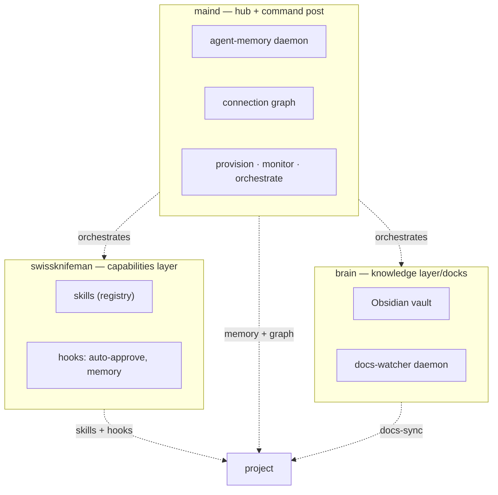
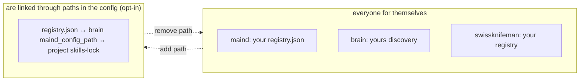
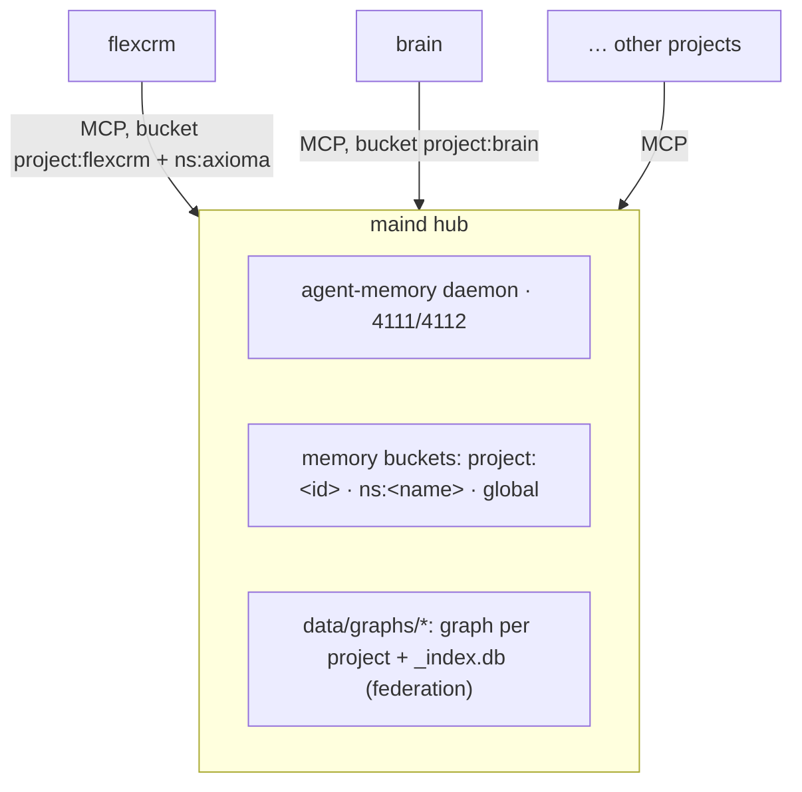
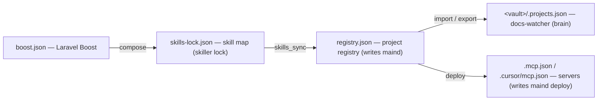
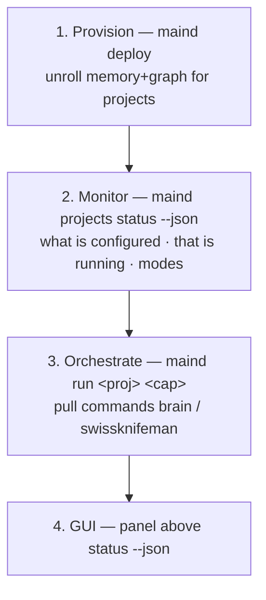

# Ecosystem: three-pack philosophy

Three academic ecosystem packages - **swissknifeman**, **brain** and **maind** — are arranged according to
one principle: every **is self-sufficient** and works alone, but they communicate **optional**,
through paths in configs. Remove the path and the packages are autonomous again. This keeps the system predictable:
nothing breaks if there is no neighbor.

## Roles

| Package | Layer | What it does |
|:--|:--|:--|
| **swissknifeman** | capabilities | synchronizes **skills + hooks** to the project - «pumps up the agent» for the task |
| **brain** | knowledge/docks | Obsidian-vault + demon `docs-watcher`, keeps documentation in sync with repositories |
| **maind** | hub + command post | owns the shared **memory** and **graph**, rolls them out to projects, monitors and orchestrates others |

swissknifeman gives the project *skills*, maind — *shared memory and graph + coordination*, brain — *knowledge*.
They complement each other and each is valuable in its own right.



## Principle: connected, but work separately

Integration - **opt-in via the path in the config**, with mild degradation:

- **maind** without the memory daemon - the graph and project registry still work.
- **brain** without maind — takes projects from his discovery by control-files.
- **swissknifeman** is always autonomous - it has its own register of connected projects.



## Single hub + namespace's

Memory and graph - **alone for the entire ecosystem**, on the hub maind. Isolation - logical and
namespace'am: count - federation (graph per project + index), memory - buckets
(`project:<id>`/`ns:<name>`/`global`). Common within a group, isolated between groups. This and
yes «common brain» without separate daemons per project.



More about topology and internal layers - [Architecture](./architecture).

## Onboarding a new project

The ultimate goal is one team. Creating a project → swissknifeman adds the necessary skills and hooks
(automatically + you can select specific) → maind connects the project to the general brain (memory + graph).
Every step **standalone-safe**: there is no neighbor - the step is skipped with a warning, onboarding moves on.

```mermaid
sequenceDiagram
  actor Dev
  participant maind
  participant skm as swissknifeman
  participant proj as project
  participant brain
  Dev->>maind: maind onboard &lt;project&gt;
  maind->>maind: register in registry.json
  maind->>skm: integrate (skills + hooks)
  skm->>proj: .claude/skills + hooks + skills-lock.json
  maind->>proj: deploy — agent-memory MCP (scope project:id) [+ code graph/Serena]
  maind->>maind: derive graph (composer/doc/override/skills → project store + index)
  opt --with-brain
    maind->>brain: repository for docs-sync
  end
  maind-->>Dev: report (steps · deployed · graph)
```

## Config and data flow

maind — **reader everyone** key files and **writer** only `registry.json`, MCP-configs
project and **own** `.claude/settings.local.json` (hub trust in ecosystem projects,
see [Workspace](./guide/workspace)). Project skills described `skills-lock.json` (composes
swissknifeman + Laravel Boost, swissknifeman wins). brain holds his `<vault>/.projects.json`
for docs-watcher.



## maind as a command post - 4 layers



If layer 2 (`status`) hold **JSON-first**, then GUI (layer 4) — subtle add-on to the same
contract, and not separate correspondence. Each layer is a separate command maind; see [CLI](./guide/cli).

## Source of Truth

| What | Where does he live? | Who writes |
|:--|:--|:--|
| Project Registry | `registry.json` in the maind state directory (legacy: `config.json` at the root of the monorepo) | maind (`projects.write_registry` — sole writer) |
| Node settings | `[maind]` table of the layered config (`config.example.toml`) | a person (`swissknifeman config set`) |
| Trust Claude to projects | `<maind>/.claude/settings.local.json` | maind (`workspace sync` from the registry) |
| Shared memory | agent-memory demon (buckets `project:<id>`/`ns:<name>`/`global`) | projects are written to their `project:<id>`, cross-ref — in `ns:<group>` |
| Connection graph | `data/graphs/<id>.db` + `_index.db` (federation) | maind `derive` from composer/Brain/override/skills |
| Project skill map | `<project>/skills-lock.json` | `skiller lock` |
| Project documentation | vault ↔ repo | `brain sync` (docs-watcher) |

This page is the canonical source for ecosystem philosophy. swissknifeman and brain link here.
