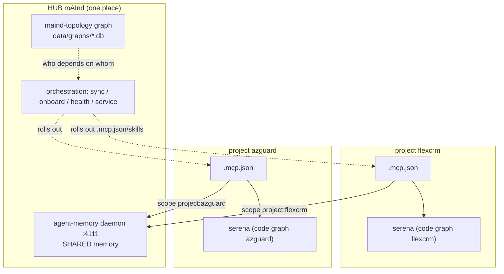
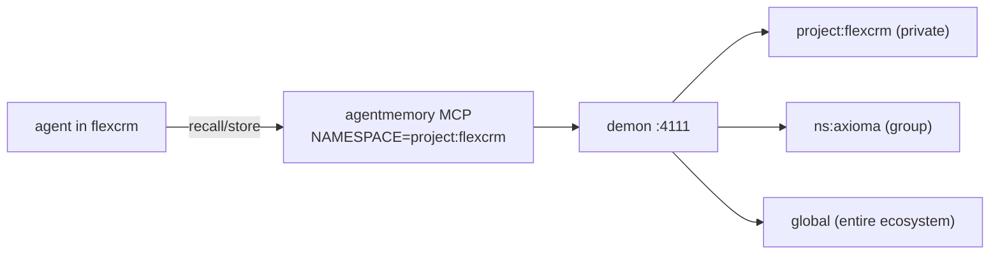
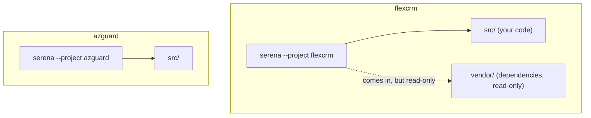
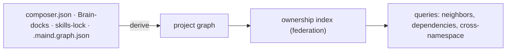
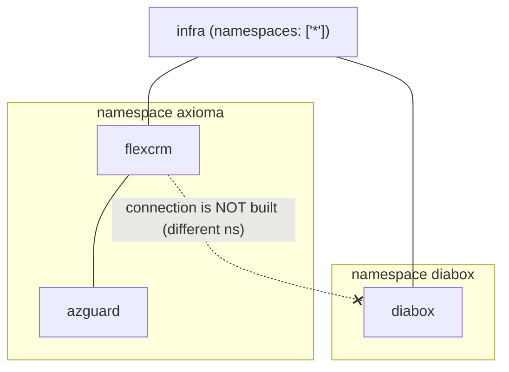

# Decisions, trade-offs and restrictions

This page is an honest map of **why the circuit is designed this way**, what is common in it, what
per-design, where are the boundaries of each layer and what is the system **doesn't**. If you are reading for the first time -
first [How it all works](./how-it-works), here are the nuances and limitations.

## Border «hub ↔ project»

The main thing is that it removes 80% confusion: **what is centralized and what lives in the project**.

- **General (on the hub):** memory (one demon) + topology between projects + orchestration.
- **Per-project (in the repository):** code graph (Serena) — each has its own server and its own index.

Hub **not** hosts the code graph. He just turns it on and rolls it out. This is the answer to the frequent
question «isn't it easier to raise the code graph separately in each project» — **done so**.

## Layer 1 - memory (general, centralized)

### Why is it shared and not your own for the project?

The purpose of memory is for projects to see each other's solutions within the group. Separate database for the project
**would kill** the idea itself. And to federate N individual demons back - **more difficult**, than one demon +
namespace-scooping. Therefore: one common demon, visibility is cut scope'ohm.

### Memory limits

- **Pull, not auto-capturing.** Code to memory **doesn't hit itself**. The agent must explicitly call `store`.
  Skill `ecosystem-mcp` suggests when, but there is no guarantee - this is a property MCP, is not a bug.
- **One demon = single point.** The demon is lying - memory is not available to all projects. Mitigated
  systemd-service (autorun + restart) and linger; see [systemd](./systemd). This
  conscious exchange: simplicity of shared memory versus distribution.
- **Insulation - at the level scope, not physical.** The project technically cannot read someone else's
  `project:<id>`, but this is provided by the config (`AGENTMEMORY_NAMESPACE` in `.mcp.json`), and not
  separate databases. Don't correct scope hands.
- **Memory quality = quality of recordings.** Garbage at the entrance → garbage output. Do not duplicate in memory
  what is already in the code/git.

## Layer 2 - code graph (per-project engine Serena)

Code graph (symbols, links, implementations) — **separate MCP-server in each project**. Engine by
default - [Serena](./code-graph) (language-agnostic, LSP, via `uvx`). Commands available
**inside** project; `maind sync --all --only mcp` rolls out/will regenerate on everyone from the hub.

### Monorepo with symlinks: packages - their own graphs

B Composer path-repos one first-party the package is often sub-linked into the project along 2-3 paths
(`vendor/<vendor>/<pkg>` and `packages/<pkg>` → one source). Index it inside the dependent
project = **duplicate characters** + **recursive symlinks** (testbench), on which the scan hangs.
Therefore **default** maind when `code:true` puts `.serena/project.yml` with ignore
`vendor`/`packages`, and each first-party the package is graphed as its own project.

But if you **develop packages along with the project** (need a single graph app + packages) — yes
**workspace-mode** (`code_workspace:true`): packages under `packages/*` are indexed as part
project (one root, PHP-LSP resolves links), edits go to their real repositories via
symlink, and `vendor`/nested `vendor` are cut (duplicates + recursion). Tested for flexcrm+corex.
More details - [code graph](./code-graph).

### What about the graph BETWEEN projects: what is possible and what is not

- **Local packages under the project tree** (symlinks `packages/*`) — **can be combined** into one
  graph: [workspace-mode](#monorepo-with-symlinks-packages-own-graphs) (`code_workspace:true`).
  Their source is physically under the project root, LSP resolves the links, edits go to their repository.
  This closes the case «developing the kernel along with the application».
- **Independent projects** (not under the same tree) — **cannot be combined into one character graph**.
  Serena-feature `additional_workspace_folders` (multi-root with cross-links) for now **only for
  TypeScript**. For PHP — each individual project is graphed itself; «who depends on whom» between them
  gives [maind-topology graph](#layer-3-topology-between-projects-heaviest), and cross-project
  repeats - [`maind fleet duplicates`](./fleet). Complete single LSP-graph of the entire ecosystem
  is not needed and is not built.

### Other code graph restrictions

- **Requires `uvx`** (from [uv](https://docs.astral.sh/uv/)) in PATH. No - correct omission
  (`skipped-not-installed`), the rest works.
- **First launch is slower** — Serena raises LSP for the project language; further faster.
- **Optional and pull-based** — is included by the field `code:true`; agent decides to call
  `find_symbol`/`find_referencing_symbols`, nothing «is intercepted».
- **Replaceable engine** — don't like it Serena or you need a stack-specific server: `code_command`
  / `code_args` (`{root}`) / `code_server_name` (see [code graph](./code-graph)).

## Layer 3 - topology between projects (the most «heavy»)

maind-graph is being built `derive` from composer/docks/skills: nodes `project`/`package`/`skill`, edges
`depends_on`/`requires`/`uses`. Lives at the hub.

### Fair trade-off

This **the most complex machinery for the least daily benefit**. She answers «who from whom
depends» — useful, but rarely twitches. The memory and code graph are justified by the purpose directly; topology
costs **develop only if you use it**. She does no harm (deterministic, regenerative
from sources, not manual), but if there are no requests for it, this is a candidate «keep, but do not grow»:
`composer.json` + Serena cover navigation without it.

## Namespace-isolation: rules and edge cases

One isolation mechanism for **both graph and memory**.

- **Within a group - common, between groups - isolated.** Rib A↔B is built only if divide
  namespace.
- **`["*"]` — infrastructure**, contacts everyone (azguard/vaulter/swissknifeman etc.).
- **Edge case: unregistered node.** If the communication target is not in `config.json` (external
  alias, e.g. `getchat`) — connection **is saved** (namespace external node unknown, do not cut).
- **Fresh project without namespace → `default`** and **will not contact** with the group. Always ask
  `namespaces` explicitly. More details - [Namespaces](./namespaces).

## General restrictions (properties MCP, not bugs)

- **MCP passive (pull).** Servers do not monitor the code and do not intercept anything - tool
  calls **model**. Maximum control - make the tool accessible (`.mcp.json`) and
  explain when to call (skill `ecosystem-mcp`).
- **`.mcp.json` is read when the session starts.** Added server (e.g. `serena`) → needed
  **session restart** in the project so that the client picks it up.
- **Rolling out - on command, not continuously.** `maind sync`/`onboard` — snapshot at startup;
  auto only SessionStart-hook, and it only prints the status (does not sync).

## Terminological debt (conscious)

Word «graph» historically meant **three different things** (memory is not a graph at all). Now in prose and
docks they are clearly separated: **agent-memory** (memory/context), **maind-graph** (topology between
projects), **code graph** (symbols inside the project, engine **Serena**). Old name `graphify` (by
to a non-existent tool) cut out of prose and left **just like legacy-alias** in
back-compat-surfaces: fields `graphify_*`/`graphify:true`, flag `--with-graphify` and value
`graph.adapter=graphify`. If you are reading the old config, keep in mind the map from the section
[Border «hub ↔ project»](#border-hub-project).

## Summary: What's there and what's not

| Do you want | Yes? | Than |
|:--|:--|:--|
| Shared memory within a group | ✅ | agent-memory + namespace scope |
| Memory isolation between groups | ✅ | scope `project`/`ns`/`global` |
| Code navigation within the project | ✅ | Serena (per-project) |
| Single symbol graph BETWEEN projects | ❌ | not needed; topology decides «who depends on whom» |
| «Who depends on whom» between projects | ✅ | maind-graph (derive) |
| Auto-write code/changes to memory | ❌ | pull: agent calls `store` himself |
| Rolling out/regeneration for all projects | ✅ | `maind sync --all` |
| Memory «always raised» | ✅ | systemd-service + linger |

Next: [Memory →](./memory) · [Code graph →](./code-graph) · [Namespaces →](./namespaces)
