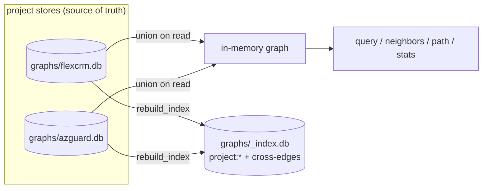

# Count Federation

The connection graph is stored **by project**, and not one file. This is the default layout and
the only first-class (`graph.adapter = "federation"`).

> **Not to be confused with memory.** Here `federation` — about **graph** (project stores + index).
> In memory hook `MODE=federation` — is separate **file** backend (`~/.swissknifeman/
> memory/<brain>/*.md`), not related to the graph. Project memory - mode `MODE=maind`
> (daemon, isolation by scope), see [Memory](./memory).

## Why

One monolithic `graph.db` doesn't scale well: it can't be given away/delete by project, and connections
different domains are mixed. The Federation gives:

- **graph per project** — `data/graphs/<id>.db` (or `<repo>/.maind/graph.db` when `graph_store: "local"`);
- **thin index** — `data/graphs/_index.db`: only `project:*`-nodes + interproject edges, **regenerable** (not a source of truth);
- **federate-on-read** — request crossing the project boundary merges the necessary stores into one
  in-memory union and drives an ordinary BFS (`federation.Federation` on top `graph.Graph`).



## Node Ownership

Node **belongs to** project `pid`, if in its store the node `attrs.project == pid` (so marks
`derive`). Edge - **cross**, if the owners src and dst different. Index holds the ownership card +
cross-ribs. Contact with **unregistered** external node (no entry in `projects[]`) is saved.

## Commands

```bash
maind graph derive --all                 # rebuild the stores of all projects from sources
maind graph derive --project flexcrm     # one project
maind graph rebuild                      # rebuild only _index.db
maind graph --project flexcrm            # graph of one project (its nodes + outgoing cross-edges)
maind graph --cross [--namespace axioma] # entire cross-project layer (opt. one group)
maind graph query --from project:flexcrm --depth 2   # border traversal (federation)
maind graph stats                        # per-project + cross-edge summary
```

## Where does the stor live?

`graph_store` for the project: `hub` (default - `data/graphs/<id>.db` in the hub) or `local`
(`<repo>/.maind/graph.db` — the graph lives in the project repo itself, convenient for portability).

## Reading from code

Through a single facade - do not open the store directly:

```python
from .federation import graph_reader   # Federation (or die when adapter=disabled)
g = graph_reader(env, config)
g.query("project:flexcrm", depth=2)
```

Next: [Namespaces →](./namespaces)
