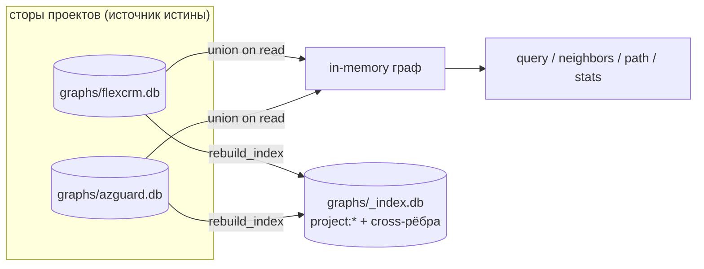

# Федерация графа

Граф связей хранится **по проекту**, а не одним файлом. Это раскладка по умолчанию и
единственная первоклассная (`graph.adapter = "federation"`).

> **Не путать с памятью.** Здесь `federation` — про **граф** (сторы проектов + индекс).
> В хуке памяти `MODE=federation` — это отдельный **файловый** бэкенд (`~/.swissknifeman/
> memory/<brain>/*.md`), к графу отношения не имеющий. Память проектов — режим `MODE=maind`
> (демон, изоляция по scope), см. [Память](./memory).

## Зачем

Один монолитный `graph.db` плохо масштабируется: его нельзя отдать/удалить по проекту, а связи
разных доменов смешиваются. Федерация даёт:

- **граф на проект** — `data/graphs/<id>.db` (или `<repo>/.maind/graph.db` при `graph_store: "local"`);
- **тонкий индекс** — `data/graphs/_index.db`: только `project:*`-узлы + межпроектные рёбра, **регенерируемый** (не источник истины);
- **federate-on-read** — запрос, пересекающий границу проекта, сшивает нужные сторы в один
  in-memory union и гоняет по нему обычный BFS (`federation.Federation` поверх `graph.Graph`).



## Владение узлами

Узел **принадлежит** проекту `pid`, если в его сторе у узла `attrs.project == pid` (так помечает
`derive`). Ребро — **cross**, если владельцы src и dst разные. Индекс держит карту владения +
cross-рёбра. Связь с **незарегистрированным** внешним узлом (нет записи в `projects[]`) сохраняется.

## Команды

```bash
maind graph derive --all                 # пересобрать сторы всех проектов из источников
maind graph derive --project flexcrm     # один проект
maind graph rebuild                      # пересобрать только _index.db
maind graph --project flexcrm            # граф одного проекта (его узлы + исходящие cross-рёбра)
maind graph --cross [--namespace axioma] # весь межпроектный слой (опц. одной группы)
maind graph query --from project:flexcrm --depth 2   # обход через границы (федерация)
maind graph stats                        # per-project + cross-edge сводка
```

## Где живёт стор

`graph_store` у проекта: `hub` (по умолчанию — `data/graphs/<id>.db` в хабе) или `local`
(`<repo>/.maind/graph.db` — граф живёт в самом репо проекта, удобно для переносимости).

## Чтение из кода

Через единый фасад — не открывайте стор напрямую:

```python
from .federation import graph_reader   # Federation (или die при adapter=disabled)
g = graph_reader(env, config)
g.query("project:flexcrm", depth=2)
```

Дальше: [Namespaces →](./namespaces)
