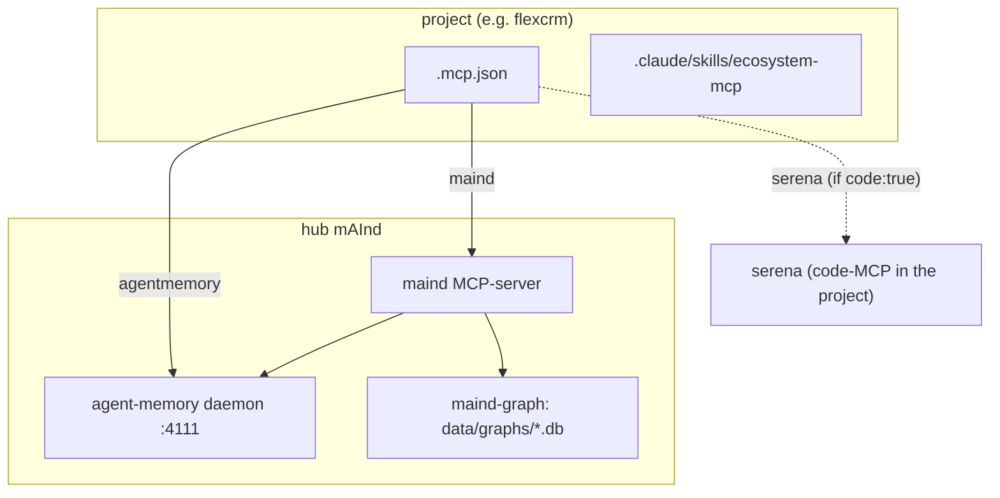
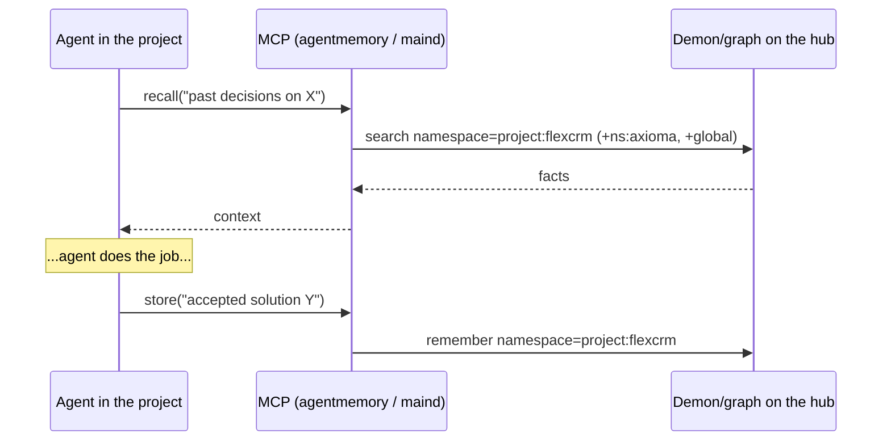
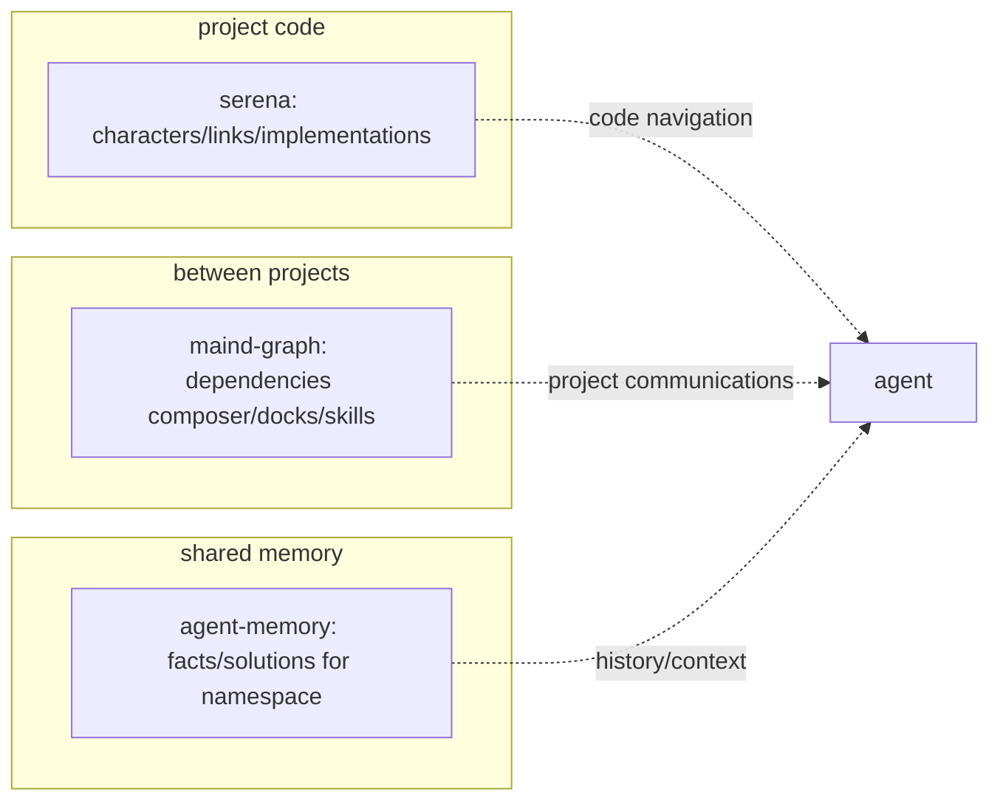
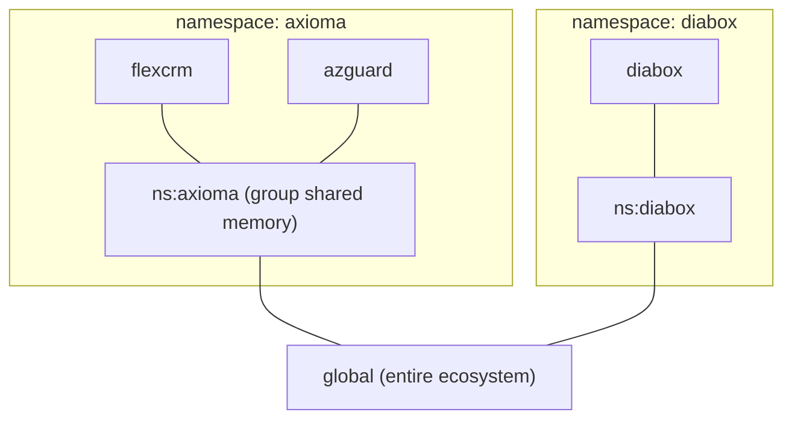

# How it all works together

This page is an end-to-end picture: what is connected to the project, where the data is physically located, and what
occurs when the agent performs a task. If there are still questions after it, it means there’s something here.
is missing; complement.

## Three different things (not to be confused)

Words «graph» and «base» in the ecosystem mean **three independent** mechanism with different tasks:

| Mechanism | What does it store? | Where does he live? | Status |
|:--|:--|:--|:--|
| **agent-memory** | facts/solutions/context (shared memory) | daemon on the hub `:4111` | works (under systemd) |
| **maind-graph** | topology **between** projects (who depends on whom) | in the hub `data/graphs/<id>.db` | works |
| **code-MCP (Serena)** | graph **code inside** project (characters/links/implementations) | separate MCP-server in the project (uvx Serena) | works (universal, according to `code:true`) |

Key: **agent-memory is centralized specifically** (this is the meaning of shared memory - projects see
solutions to each other inside namespace). **code-MCP (Serena), on the contrary, per-project** — everyone has their own code.
maind-a graph is NOT code, but a topology of dependencies.

### Where is the data physically located?

Common confusion: «looked for files in the project - did not find them». Because **two of the three planes live in
hub** (package `maind`), and not in the project repository:

| Plane | Exact path | Where is it |
|:--|:--|:--|
| **agent-memory** | `<maind>/data/state_store.db/` (directory; one for the entire ecosystem) + `stream_store/` | **hub** (one demon, all namespace inside) |
| **maind-graph** | `<maind>/data/graphs/<project_id>.db` + `_index.db` (or `<repo>/.maind/graph.db` when `graph_store: local`) | **hub** (default) |
| **code graph (Serena)** | `<repo_project>/.serena/` — `project.yml` + `cache/` (character index) | **in the project repository** |

That is, memory and maind-graph look in `data/` package maind (not in the project); code graph Serena — on the contrary,
in `.serena/` of each repository. Check the content after the fact - `maind verify`.

## 1. Topology: what is connected to the project The project's



`.mcp.json` lists MCP-servers. Client (Claude Code) raises them when the session starts -
and their tools appear on the agent. Skill `ecosystem-mcp` explains to the agent what it is and when to call.

## 2. Task execution flow (pull, not «interception»)

MCP-servers **passive**: they don't follow the code and don't do anything «intercept». Request initiates
**the model itself**, when he decides to call the tool.



scope (`project:flexcrm`) is hardwired into `.mcp.json` project (`AGENTMEMORY_NAMESPACE`), therefore the project
by default writes/reads **your** memory + group shared buckets. No automation «recorded itself»
no - the agent explicitly calls `store`/`recall` (skill `ecosystem-mcp` tells you when).

## 3. Three layers of data - who does what



- **agent-memory** answers to «what we have already solved».
- **maind-graph** — on «what is connected with what» (dependencies, ecosystem neighbors).
- **code-MCP (Serena)** — on «where the symbol is defined / who calls it» (when enabled).

## 4. Namespace-isolation in action

Links and memory are isolated into groups. Within a group - general, between groups - closed; `["*"]` —
infrastructure, visible to everyone.



flexcrm sees: `project:flexcrm` + `ns:axioma` + `global`. diabox from another group `ns:axioma`
**doesn't see**. The edges of the graph are cut in the same way: inter-project communication is built only if projects share
namespace.

## 5. When to reindex what (frequency and cost)

Frequently asked question: «how often should I run indexing to have an effect?». Reply «times every N hours» no -
each plane has its own trigger. Rule: **think about the event that changed the data, not the timer.**

| Plane | Deprecated when… | Update command | Cost |
|:--|:--|:--|:--|
| **agent-memory** | never manually - written as you go through `store` | — (auto) | 0 |
| **maind-graph** | change *communications*: new dependency (composer/npm), cross-project link, `uses/used_by` in Brain, set of skills | `maind graph derive --project <id>` (or `--all`); `maind sync --only graph` | seconds, complete rebuild |
| **code graph (Serena)** | updates itself via LSP as edits | (opt.) warming up `serena project index` | first call in session longer (raises LSP) |

Engine Facts (why is this so):

- **maind-the graph is rebuilt entirely, not incrementally** — intentionally so that there is no
  obsolete edges (idempotent). **Watcher'a / git hook / there is no guard demon** — reindexing
  only by `derive` / `sync` / `onboard`.
- **Code edits are NOT done on a daily basis maind-graph obsolete** — it's about dependencies, not strings.
  Rebuilding it makes sense only when the topology has changed (dependencies/skills/links).
- **Serena lives through LSP** — separate «reindexing» is not required. The question is not «how often», a
  «is it connected MCP to session». Pays off on large turnips; on small packages - extra LSP-process.

Practice on events:

```bash
maind graph derive --project flexcrm   # after editing composer.json / connections of one project
maind sync --only graph                # cheaply roll out a fresh graph to all enabled-projects
maind onboard ~/projects/newrepo       # new project: memory + graph + MCP + skills in one pass
maind graph derive --all               # mass rebuild (e.g. after dependency refactor)
```

Lightweight cron `maind sync --only graph` (once a day/week) justified as insurance against drift
dependencies - costs a penny. But «by event» is enough; There is no point in running a code graph on a timer.

## 6. How to make sure it works (and not «idle»)

Infrastructure can be raised (demons are alive, MCP connected), but **not filled** — memory
only saves seed-facts onboard, graph not derive'appears. To see this with one command:

```bash
maind verify          # proof of 3 planes: the demon is alive, whether the memory is full, graph coverage, Serena
maind verify --json   # the same machine
```

What it shows (live measurement, read-only):

- **agent-memory** — whether the daemon is responding; how many records, of which **seed** (auto from onboard) vs
  **real**; when last entry; URL viewer. If `real 0` — projects do not write knowledge.
- **maind-graph** — **coating** (how much enabled-projects have stories from all), nodes/ribs, freshness.
  Will highlight «not built for N projects → `maind graph derive --all`».
- **code graph (Serena)** — on which projects it was rolled out `.serena/`, is there a symbol cache, freshness.

Section **RESULT** aggregates «idle»-symptoms. This is the honest answer «works or not».

## Visualization: where to look with your eyes

| Plane | How to see | Out of the box? |
|:--|:--|:--|
| **agent-memory** | web viewer **http://127.0.0.1:3113** — records, search, sessions | yes (is built into agentmemory) |
| **maind-graph** | `maind graph export --cross` / `--project <id>` → **Mermaid** (is rendered in GitHub/VitePress) | yes (without runtime) |
| **code graph (Serena)** | symbol-tools in session; opt. web-dashboard Serena (flag in `code_graph.args`) | yes (per-project) |

::: warning Word «graph» = FOUR different things
1. **maind-graph** — topology between projects (this layer; `graph export`).
2. **code graph (Serena)** — symbols within the same project.
3. **knowledge-graph in the memory viewer** — tab `http://127.0.0.1:3113/#graph`: entities,
   retrieved from memory **via LLM**. Default **disabled** (`GRAPH_EXTRACTION` off,
   provider `noop` without key) — so the tab says «Graph query failed». This **not** cross-project
   graph; to turn it on you need LLM-key and flag extraction. Without them - the norm, just not used.
4. The word itself «graph» in prose.

For cross-project communications, see `maind graph export`, and not a tab `#graph` memory viewer.
:::

## Reliability «everything is always up»

- Memory Daemon - under **systemd** (`maind service install`), autorun + auto-restart. To start
  when loading OS (without login) — `loginctl enable-linger $USER`. See
  [Memory Daemon (systemd)](./systemd).
- MCP-servers are registered in `.mcp.json` of each project - the client picks them up himself at the start of the session.
- SessionStart-hook prints connection status; repairs - `maind health --cwd --fix`.
- Is the demon alive? ≠ whether the system is filling up. Periodically (or when in doubt) — `maind verify`:
  features «raised» from «really write». Linking one project - `maind health --cwd`.

Nuances, boundaries of each layer and what the system **doesn't** — separately:
[Solutions, trade-offs, restrictions](./design-notes).

Next: [Memory →](./memory) · [Graph →](./graph) · [Namespaces →](./namespaces) ·
[Code graph →](./code-graph).
