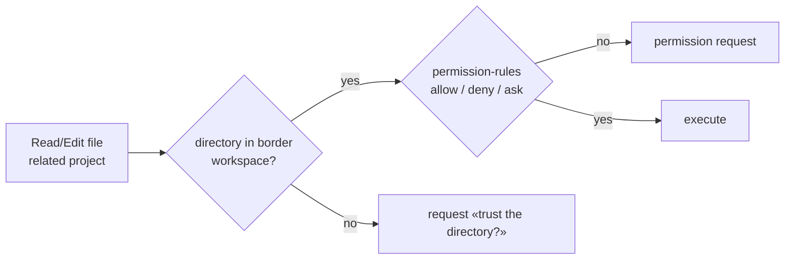

# Trust Claude (workspace)

Single edit space: session Claude Code, launched from the hub maind, reads and
rules **any ecosystem project without confirmation**. List of trusted paths maind
takes from the project registry (`config.json`) and puts it in his `.claude/settings.local.json`.

## Problem

B Claude Code two **independent** access systems:



`bypassPermissions` disables only **second** system (allow/deny). When the file is lying
**out** cwd and outside of trusted directories, triggers **first** — worker boundary
space, and a separate request arrives «trust the directory?», which bypass **not
jams**. Therefore, when editing related projects, confirmations come even in auto-approve.

Fix border - `permissions.additionalDirectories` (absolute paths). maind already owns
authoritative list: `projects[].local_path` in `config.json`.

## Solution: hub-scoped

maind generates and maintains **yours** `.claude/settings.local.json` (at the root maind).
The session started by **from the hub** — minimum damage radius, file
gitignored (absolute personal paths). The Project Registry is the only source of truth.

```bash
maind workspace sync                 # write/update trust from registry
maind workspace sync --dry-run       # show plan without entry
maind workspace sync --no-allow      # only additionalDirectories (without Read/Edit-glob)
maind workspace sync --no-mode       # do not set defaultMode
maind workspace status [--json]      # that is entrusted / what's missing / drift
```

## What is written

```json
{
  "permissions": {
    "additionalDirectories": ["/home/u/projects/flexcrm", "..."],
    "allow": ["Read(//home/u/projects/flexcrm/**)", "Edit(//home/u/projects/flexcrm/**)", "..."],
    "defaultMode": "acceptEdits"
  }
}
```

- `additionalDirectories` repairs **directory border** (removes the trust request).
- `allow` (Read/Edit-globs) and `defaultMode` additionally remove friction **without** bypass.
  The absolute path in the rule is with a double slash: `Read(//abs/path/**)`.

Taken only **included** (`enabled != false`) projects with **existing** directory
on disk; absent and pathless are skipped.

## Merging and security

Entry - mirror `mcpconfig` (load → merge → write), **additive and idempotent**:

- lists are merged union with grandfather - **other people's entries are saved**;
- custom `defaultMode` **does not fray** (is set only if not specified);
- before recording - a backup under `.swissknifeman/backups/`, the record itself is atomic (`tmp` + `os.replace`);
- broken JSON settings → stop, don't touch the file;
- repeated `sync` without registry changes → «is already relevant», file is not overwritten.

::: tip Damage radius
Trust lives in `.claude/settings.local.json` **hub only** — other sessions Claude him
are not inherited. This is deliberate: wide `additionalDirectories` + `acceptEdits` — powerful
tool and it is limited to the session started from maind.
:::

## Visibility

Trust status is visible in three places (field `trusted` in probe-contract):

```bash
maind workspace status     # trusted N/M registry projects, missing, drift
maind projects status      # column trust✓ / trust· for each project
maind status               # string «trust: N/M projects»
```

GUI-panel (`gui/index.html`) shows the column **trust** above the same `status --json`.

Next: [Agents →](./agents)
