# How work flows: diagrams

The pictures of this page follow one piece of work from the plan to its commit: who takes it, which roles touch it,
where the conductor decides and where it stops. The text under each picture says what it shows; the reference of each
step stays in [Conductor](conductor.md), the contract of the plan side in [Work source](work-source.md).

## 1. The parts and how they talk

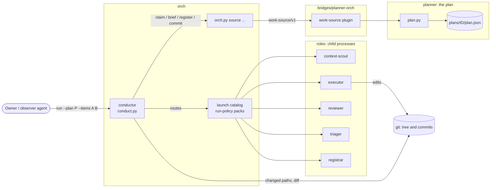

The conductor decides nothing by itself: it branches on exit codes, on the closed results of the roles
(`schemas/conductor/v1`) and on the limits of the run options. It never reads the plan: every plan operation goes
through `orch.py source …`, which calls the work-source plugin of the bridge, which calls `plan.py`. Every role is a
child process started from the launch catalog; models are used only in these narrow roles.

## 2. One piece, end to end

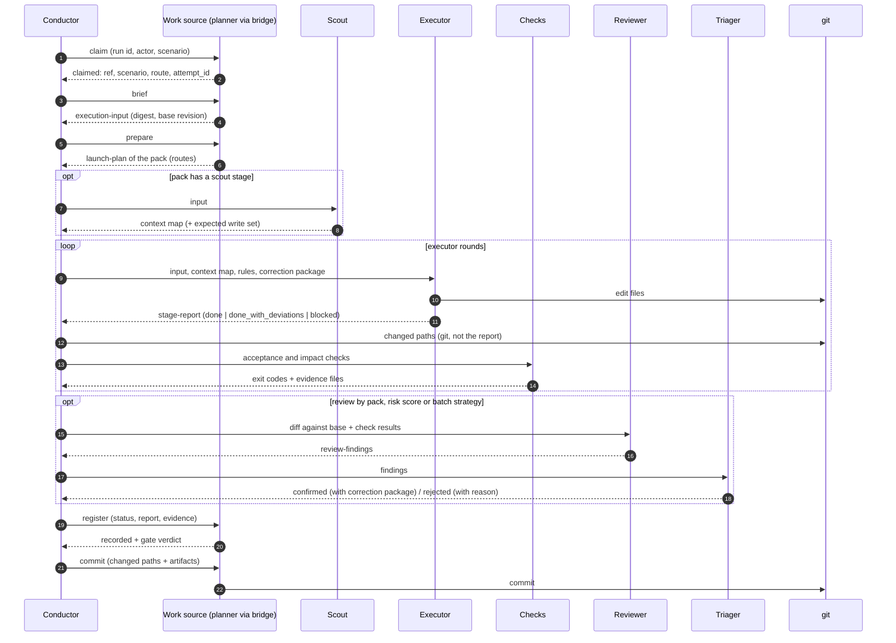

Every numbered step has a key in `state.json`; a step that closed is never run again by `resume` (it prints
`stage.skip`). What changed is always read from git after each executor round; the union over the rounds becomes
`changed_paths` of the report and the paths of the commit.

## 3. The plan side: life of an item

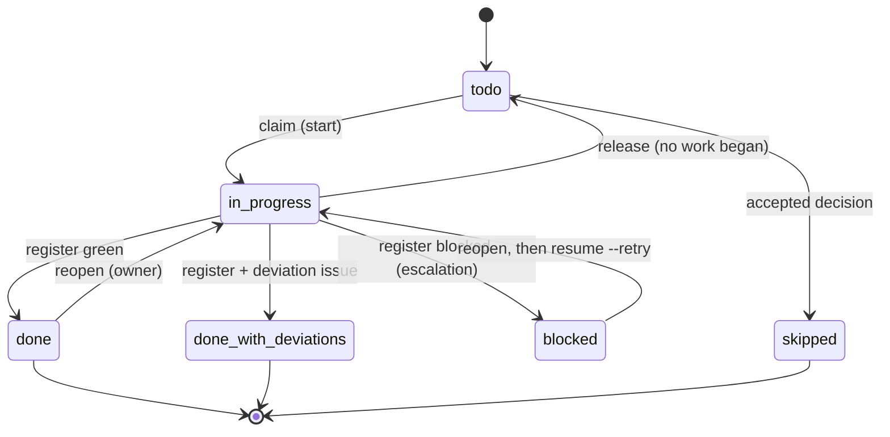

`claim` starts the item in the plan (`in_progress`); only `register` ends it. A run that stopped before any executor
round gives the claim back (`release`, `CLAIM_RELEASED`). A blocked item does not satisfy dependencies; a dependency
that is in progress in the same batch counts as met.

## 4. Inside the piece: rounds, corrections and limits

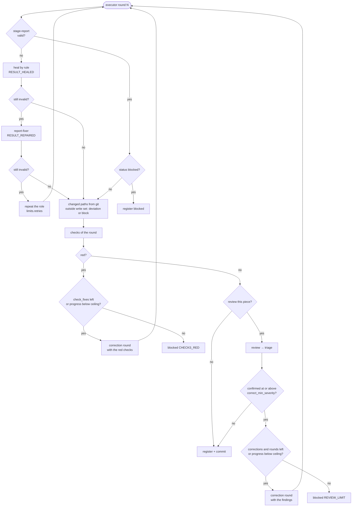

Limits are targets, not walls: past a target a round still runs while the last correction made progress (other or
fewer red checks, fewer findings), up to `limits.ceiling_factor` times the target, and every such round prints
`LIMIT_OVER` and leaves a plan note. A correction that changed nothing, or the ceiling, blocks the piece. Findings
below `review.correct_min_severity` (default `Major`) are not corrected: they travel as notes in the report.

## 5. Does this piece get a review?

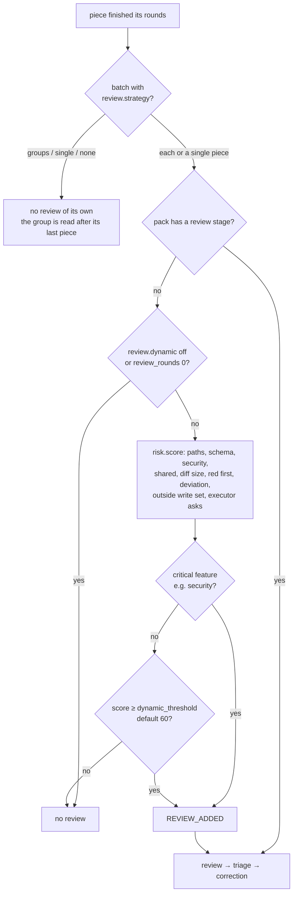

The risk score is a pure function of facts read from git and from the closed results; no model is asked. A change of
the code that confines the roles (sandbox, launch catalog, run policies, hooks, CI workflows, `install.sh`) is
`security`, which is critical: it gets a review whatever the score.

## 6. A batch: one session, pieces in order, a common review

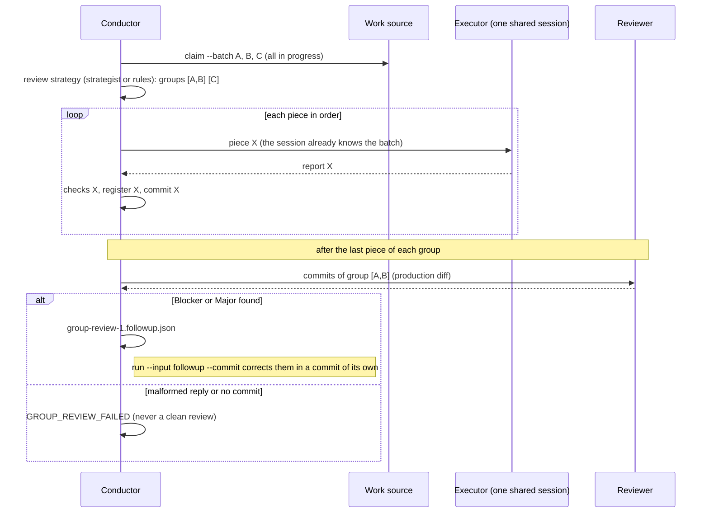

`--batch` is the default for `--items A B C`: one executor session carries the pieces in order and builds each on the
earlier ones; checks, register and commit stay per piece. A stop gives no piece back: all stay in progress and
`resume` goes on.

## 7. Questions of the executor and the advisor

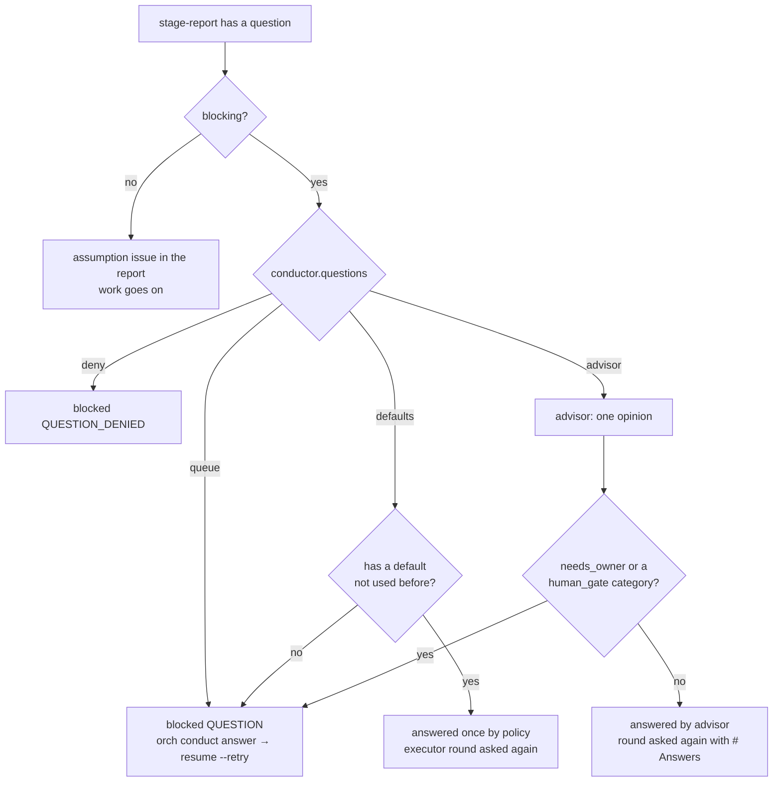

A question is a saved decision bound to the input it was asked on, never a waiting process. An answer to an input that
changed since is `QUESTION_STALE` and the question is asked again. The advisor is also asked, when enabled, for red
checks past `check_fixes` and for a Blocker or Major finding the triager rejected.

## 8. When a provider fails

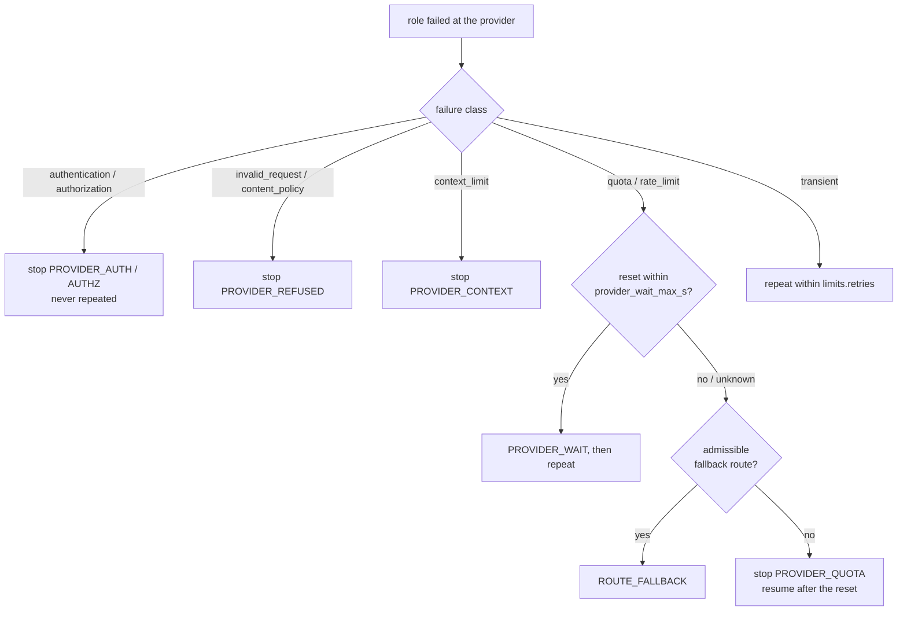

An exhausted account quota is also recorded as a capacity gate of the machine, so the next run does not start a role on
that provider before the reset (`orch conduct gates`).

## 9. Stop and recovery

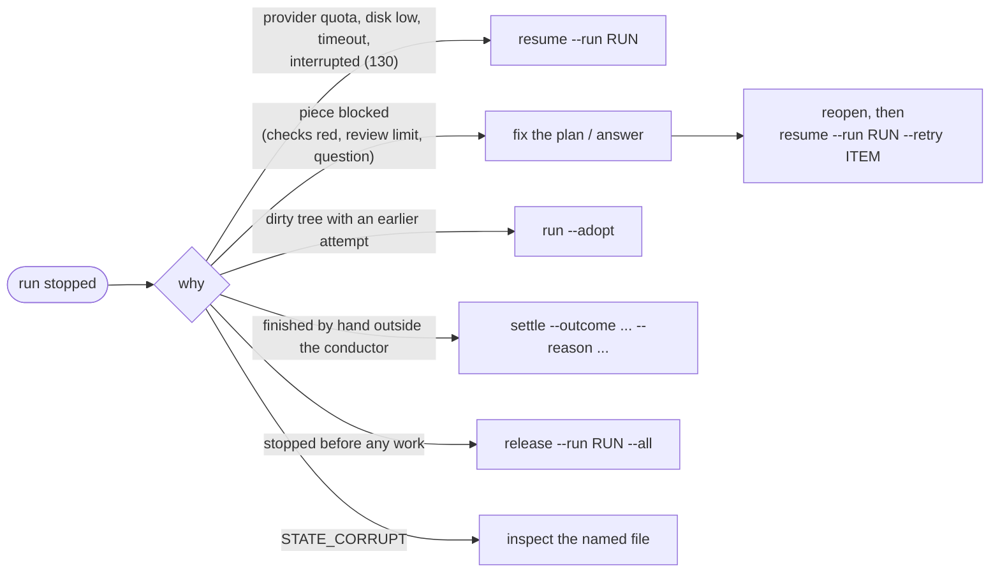

| State | Command | What is kept |
| --- | --- | --- |
| provider quota | `resume` after the reset | every closed step; no new attempt |
| checks red, review limit | amend the plan, `reopen`, `resume --retry ITEM` | earlier rounds, logs and the work in the tree |
| disk low | free the space, `resume` | the provider side effects already made |
| killed or interrupted | `resume` | the claim of the run (no second owner) |
| finished by hand | `settle` | the journal keeps the reason |
| no work began | `release --all` | nothing to keep; a new run can claim |

A closed step returns its recorded result; the JSON files of a run are written crash-safely (temp file, `fsync`,
rename, `fsync` of the folder), and a torn one stops with `STATE_CORRUPT` naming the file instead of being reset.

## 10. Where a setting comes from

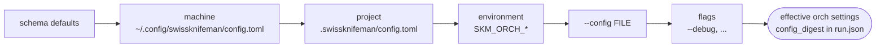

The most specific layer wins (`swissknifeman config explain orch KEY` names it). The run options of a piece have their own
ladder (defaults → conductor config → pack → plan → phase → item → `--options`), with one floor: a layer of the work
source may tighten the isolation (sandbox, fence, `isolate_roles`) but never loosen it, and never add `extra_paths`
(`OPTIONS_UNTRUSTED`).

## 11. Debug mode

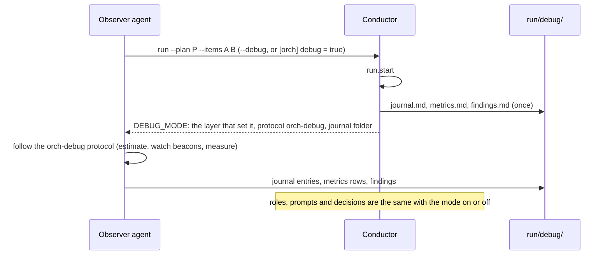

See [Debug mode](conductor.md#debug-mode) for the three levels (machine, project, `--debug`).
