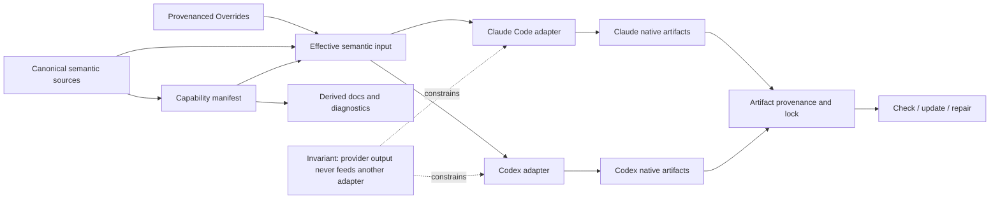

# ADR-0001 — Canonical semantic source and deterministic provider adapters

**Status:** accepted

**Target version:** v1.0.0 contracts

**Date:** 2026-07-20

**Decision owner:** Dmitry Vostrikov

**Approval:** D55, 2026-07-20

## Context

Swissknifeman должен полноценно обслуживать Claude Code и Codex, сохраняя Claude
compatibility и provider-native semantics. Текущий repo имеет canonical skills/task sources,
Claude-specific delivery surfaces и bootstrap-only Codex adapters. P0.1/P0.5 inventory counts
являются observations, а D53 уже утвердил общий vocabulary/scenario set.

Бизнес-ограничение: одна migration не должна создавать два author-owned дерева, скрывать
`unsupported`, смешивать Project Trust/Approval Policy/Sandbox Boundary или массово менять
fleet. P1–P7 требуют стабильной архитектурной границы до package implementation.

## Decision

Принять canonical semantic source + deterministic provider adapters:

1. Author меняет один Canonical Source и versioned capability/artifact contracts.
2. Capability manifest задаёт Support Level, native bindings, Native Extensions, evidence,
   adapter gates и derived diagnostics/docs.
3. Claude Code и Codex adapters независимо рендерят provider-native outputs из общего
   semantic input; output одного Provider никогда не переводится в output другого.
4. Project/shared Overrides разрешаются как явные provenanced inputs до render.
5. Managed outputs получают stable artifact identity, source/rendered hashes, managed
   boundary и fail-closed check/update/repair lifecycle.
6. Symlink разрешён только как optional local-authoring optimization. Он не является
   distribution, cache, vendor или archive contract.

Решение принято D55 одновременно с frozen v1.0.0 capability/artifact contracts.

## Alternatives

### A — Symlink-first provider trees

- Pros: минимум локальных копий; source edit виден сразу.
- Cons: ломается на plugin cache/vendor/archive/Windows boundaries; не выражает native
  transforms; provenance и repair недостаточны.
- Complexity: low для local checkout, high для distribution/operations.
- business_rationale: снижает краткосрочную стоимость authoring, но не выполняет цель
  воспроизводимой двухпровайдерной доставки и безопасного self-host update.
- Verdict: reject как основной contract; оставить optional developer convenience.

### B — Independent manually maintained provider trees

- Pros: каждый output сразу нативен; нет initial renderer investment.
- Cons: два semantic source, двойная review/update стоимость, неизбежный parity drift,
  разные repair rules по packages.
- Complexity: low на первом файле, постоянно растущая operational complexity.
- business_rationale: ускоряет bootstrap ценой систематического риска регрессии Claude и
  недостоверного Codex parity; противоречит требованию единого канона.
- Verdict: reject.

### C — Canonical source + deterministic adapters (chosen)

- Pros: один semantic owner; независимые native outputs; derived capability matrix;
  reproducible provenance/hash/drift/repair; переносимость cache/vendor/archive.
- Cons: требует initial contracts, renderer kernel и conformance fixtures; managed outputs
  нельзя безопасно править вручную.
- Complexity: medium upfront, bounded operational complexity afterwards.
- business_rationale: платит один раз за renderer/contracts, чтобы сохранить Claude
  compatibility, получить полноценный Codex channel и ограничить blast radius self-hosting.
- Verdict: chosen by D55.

## Consequences

Положительные:

- provider formats остаются нативными без второго semantic canon;
- `unsupported` и Native Extensions видимы, lowest-common-denominator parity запрещён;
- docs/doctor/adapters стоят на одном capability manifest;
- drift и repair ограничены declared managed boundary;
- P1–P7 могут реализовываться последовательно против frozen contracts.

Принятые издержки и риски:

- P1/P2 обязаны реализовать versioned catalog, deterministic hashing и fail-closed state
  machine до package publication/deployment;
- любое изменение frozen public contract требует SemVer и consumer notification;
- manual edits внутри managed output классифицируются как drift и требуют explicit repair;
- bootstrap `.agents/` и текущая рабочая Codex-сессия не являются release evidence.

Не следует из ADR:

- FOREMAN не снимается с pause;
- fleet не получает writes;
- P4 routing, P5 harness profiles и P7 release verdict не замораживаются здесь;
- конкретные Python modules/paths остаются решениями P1/P2.

## Component diagram

Dependency direction: contracts/canonical sources не импортируют provider renderer;
adapters зависят от contracts; deployment orchestrates adapters, но не становится renderer.
