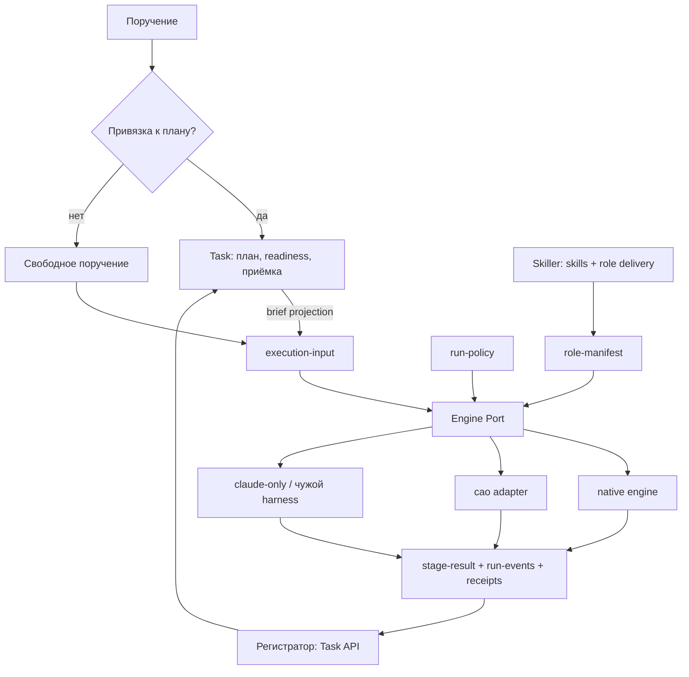
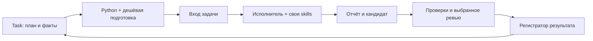
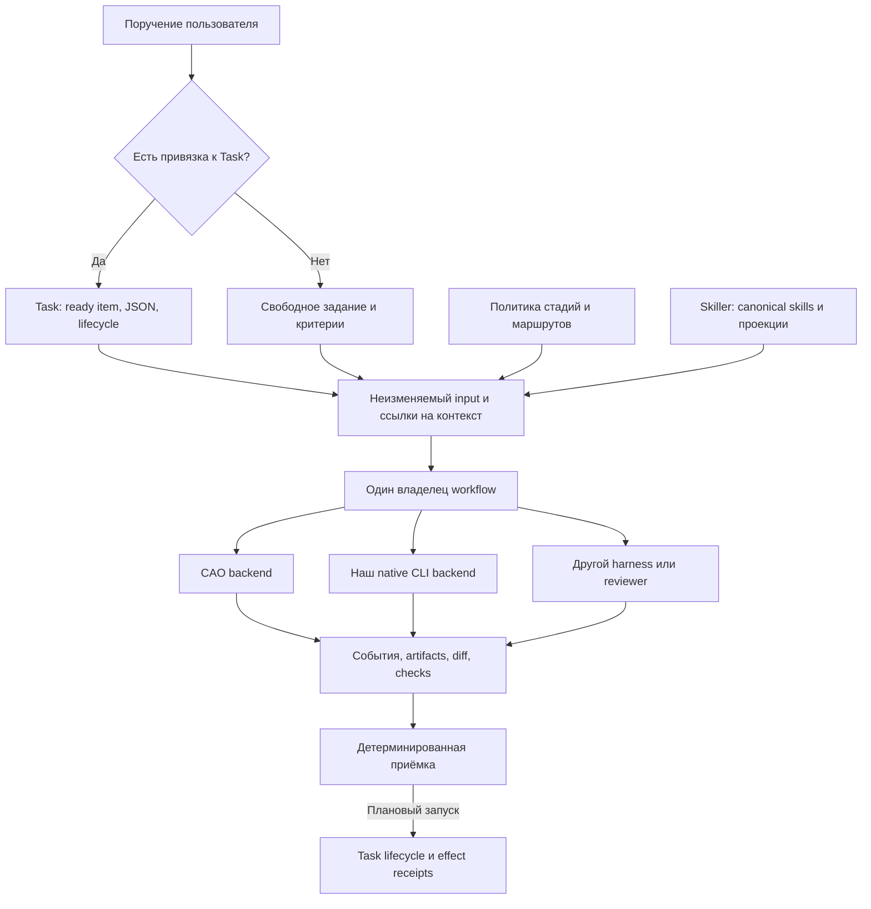

<!-- generated by task plan.py render — edit JSON through plan.py -->
# Исходные материалы orch/ (дословные копии на 2026-10-05)

Source: [JSON](../../knowledge/sources.json). This view is for people; agents use JSON through the Task API.

## Applies to

- P5.6

## Provenance

```json
{
  "path": "orch/DECISIONS.md",
  "note": "verbatim copies so the plan stays self-sufficient if orch/ drafts change"
}
```

## orch/REQUIREMENTS.md (verbatim, sha256 0028d87ed062d39f)

# Реестр требований владельца (оркестрация)

Дата: 2026-10-05. Это сквозной реестр всего, что владелец просил в исходном диалоге
([perplexity-thread.md](perplexity-thread.md)) и в сессии аудита ([plan1-owner-message.md](plan1-owner-message.md)).
**Каждое требование должно быть покрыто Plan 1, явно отнесено к Plan 2 или явно отклонено с причиной.**
Планы ссылаются на ID `R#`; потерять требование = не упомянуть его ID.

Колонка «План»: **1** — входит в подготовку; **2** — реализация движка; **1+2** — контракт в Plan 1, исполнение в Plan 2;
**✓** — уже закрыто решением в [DECISIONS.md](DECISIONS.md).

## A. Исходная проблема и цель (диалог Perplexity)

| ID | Требование | Источник | План | Где учтено |
| --- | --- | --- | --- | --- |
| R1 | Codex и Grok «путаются» в Task: делают не то, теряются в процессе | thread:5 | 1 | Узкий execution input без lifecycle; разделение инструкций (DECISIONS §1.1, §4) |
| R2 | Codex и Grok «зависают», и это не видно | thread:5 | 1+2 | Plan 1: launch catalog, контракт `run-event`. Plan 2: потоковый native-движок |
| R3 | Главная задача Task — разбить план на задачи и описать их; процесс выполнения не в Task | thread:5 | 1 | Task = данные плана + brief projection + регистрация; scout и процесс уходят из Task (§4 T8, T9) |
| R4 | Одна точка управления провайдерами: подписки Claude Code, Codex, Grok через нативные CLI | thread:5 | 1+2 | Launch catalog для роли × provider (§5.2); нативные CLI без `--bare` |
| R5 | Работа из терминала: конфиг + задачи, движок сам понимает, как оркестрировать | thread:5 | 1+2 | Контракт `run-policy` (Plan 1); `orch run` (Plan 2) |
| R6 | Конвейер: дешёвая модель собирает контекст → сильная делает сложное/каркас → слабая пишет банальный код → ревью (например, исполняет GPT, ревьюит Grok) | thread:5 | 1+2 | Стадии и роли в `run-policy`/`role-manifest` (§3, §5.1) |
| R7 | Схему меняют для каждой задачи: где-то без ревью, где-то без передачи кода, любой провайдер на любую стадию | thread:5 | 1 | Профили `run-policy`; route по стадиям; review и delegation опциональны |
| R8 | Видно всё, что происходит, в консоли: ничего не скрыто, видно, когда модель «тупит» | thread:5 | 1+2 | Контракт `run-event` и состояния (Plan 1); live stream и `--tmux` (Plan 2, §5.4) |
| R9 | Встраивать готовые skills (code review и др.), а не писать свои | thread:5 | 1 | Review-методология → существующие skills (`quality:code-review`, `artifact-review`); роль reviewer получает skill из конфига; выборочно skills из Superpowers и др. через Skiller |
| R10 | Рассмотреть и готовые CLI-движки, и JS-API для скриптов | thread:5 | ✓ | DECISIONS §1, §7 |
| R11 | Не тратить силы на сопровождение сложного своего движка; лучше обкатанный готовый | thread:659 | 1+2 | **Сознательный компромисс**: свой движок — тонкий, только конвейер (§1.4); CAO можно подключить вторым adapter (§1.6). Plan 1 не зависит от выбора движка |
| R12 | Понимать, как устроен движок, чтобы его дорабатывать | thread:659 | 1 | Документ архитектуры и binding-матрица в Plan 1 |
| R13 | Ad-hoc задания без плана и работа без субагентов тоже поддерживаются | Sol §7 | 1 | `execution-input` с `adhoc`-provenance; reviewer без Task |

## B. Сессия аудита (2026-10-05)

| ID | Требование | Источник | План | Где учтено |
| --- | --- | --- | --- | --- |
| R14 | Максимальная гибкость: Task и Skiller работают с разными движками (наш Harness/native, CAO) | msg1 | 1 | Нейтральные контракты + Engine Port (§2, §3) |
| R15 | Решить: CAO или свой движок, с аргументами за и против | msg1 | ✓ | DECISIONS §0–§1 |
| R16 | Обратимость: можно переделать под второй вариант | msg1 | 1 | Порт; binding-матрица native/CAO/Claude-only; конформанс-тест |
| R17 | Разделить всё по идее Sol для универсальной оркестрации | msg1, [task-role-decomposition.md](task-role-decomposition.md) | 1 | Путь A + **рефакторинг B без breaking** в Plan 1 (см. R19) |
| R18 | Plan 1 готовит всё под оркестрацию, включая схемы под разные движки | msg1 | 1 | Фазы контрактов и bindings |
| R19 | **Рефакторинг пакетов (Task, Skiller, Harness) с разделением для универсальности — в Plan 1**, до доработки движка | msg1 | 1 | Исправление: в DECISIONS §10 перенос методологии стоял в Plan 2; теперь это Plan 1, без breaking |
| R20 | Plan 2 — реализация (Harness/native или CAO); его составляют отдельно | msg1, msg3 | 2 | Не проектировать Plan 2 в Plan 1 |
| R21 | Мягкий подход: ничего не ломать, без breaking changes | msg1 | 1 | Только аддитивные изменения; старые команды, схемы и `plan-run` работают; депрекация вместо удаления |
| R22 | Perplexity обязателен в исследовании | msg2 | 1 | Каждое внешнее утверждение при проектировании — через `perplexity-web` (как запускать — в PLAN1-PROMPT) |
| R23 | Plan 1 выполняется разумными кусками; один запуск не тянется неделю | msg3 | 1 | Правила размера item (PLAN1-PROMPT §4) |
| R24 | Модели: Opus — самое сложное и надёжный каркас; Sonnet — средние; GPT-Sol 6.1 — доделать мелочи | msg3 | 1 | Таблица исполнителей по item (PLAN1-PROMPT §5) |
| R25 | Ничего не потерять из сообщений владельца | msg3 | 1 | Этот реестр + матрица покрытия в Plan 1 |
| R26 | Проектирование — в новой сессии; здесь только фиксация и команда | msg3 | ✓ | [PLAN1-PROMPT.md](PLAN1-PROMPT.md) |

## C. Инварианты из аудитов (не терять при проектировании)

| ID | Инвариант | Источник |
| --- | --- | --- |
| I1 | Полный context pack не урезается; новые представления добавляются рядом, проверка полноты обязательна | architecture-contract, repository-audit |
| I2 | Один владелец workflow на run: без вложенных оркестраторов и двойных retry | architecture-contract |
| I3 | Task — единственный владелец плана; worker не правит plan JSON и не вызывает lifecycle | Sol §3–§5 |
| I4 | Закрытие только по evidence, привязанному к кандидату; `--check V1=0` без запуска не доказывает | Sol §5 |
| I5 | Исполнитель (`executed_by`) и регистратор (`registered_by`) — разные actor; минимальный route не обходится | Sol §5 |
| I6 | Повторная регистрация того же attempt не создаёт второй переход или commit | Sol §5 |
| I7 | Обязательный scout не пропускается молча; неподдерживаемая capability — явный отказ | architecture-contract |
| I8 | Модели берутся из `command-routing.json → mappings`; ручных копий моделей нет | architecture-contract |
| I9 | Canonical source у каждой инструкции один; provider-файлы генерируются; `.agents/skills` руками не правятся | Sol §3, repository-audit |
| I10 | Review — opt-in; лимит: 2 раунда, 1 исправление; reviewer не исправляет код | plan-protocol, philosophy |
| I11 | Ядро — stdlib-only Python; CAO/Node — внешние процессы, не зависимости | DECISIONS §2.2 |
| I12 | Не использовать `--bare` для Claude: он не читает OAuth подписки | DECISIONS §1.4, Q12 |
| I13 | Нет хардкода monorepo-путей в потребителях Task | repository-audit |
| I14 | Unknown usage не равен 0; quota/auth ошибки отличаются от провала задачи; модель не понижается скрыто | architecture-contract |
| I15 | Artifex заморожен; Harness остаётся установщиком; ничего не удаляется до parity | DECISIONS §2.2 |


## orch/DECISIONS.md (verbatim, sha256 29f37e45fd9bc1c9)

# Решения по оркестрации: итоговый документ

Дата: **2026-10-05**. Автор: Claude Code (Opus 5.5), независимый review папки `orch/`.
Статус: **принятые решения для планирования**. Остальные файлы `orch/` — черновики и доказательная база;
при расхождении приоритет у этого файла. Реализация ещё не начиналась.

Полный реестр требований владельца — [REQUIREMENTS.md](REQUIREMENTS.md) (R1–R26, I1–I15). Команда для сессии,
которая проектирует Plan 1, — [PLAN1-PROMPT.md](PLAN1-PROMPT.md). Каркас в §9 — **стартовая гипотеза**, не норма:
окончательное разбиение делает сессия проектирования.

Из этого документа вырастают два плана:

1. **План 1 — подготовка к оркестрации** (без breaking changes): контракты, схемы, разделение пакетов.
2. **План 2 — реализация движка** и адаптеров поверх подготовленных контрактов.

Обозначения уверенности: **[факт]** — проверено в коде/первичном источнике; **[вывод]** — следует из
кода/документации; **[гипотеза]** — проверяется в плане 2.

---

## 0. Короткий ответ

| Вопрос | Решение |
| --- | --- |
| Свой движок или CAO? | **Свой тонкий native-движок** на структурированных headless-интерфейсах CLI. CAO — **не основной движок**, а второй адаптер за тем же портом (опционально, в плане 2+). |
| Насколько выбор очевиден? | Достаточно очевиден, чтобы не ставить платный сравнительный пилот *перед* планом 1. План 1 вообще не зависит от выбора движка. |
| Что делает систему гибкой? | Нейтральный слой контрактов (JSON Schema) + **Engine Port**. Task, Skiller и движки зависят от контрактов, а не друг от друга. |
| Что с Harness? | Остаётся установщиком окружения (permissions, hooks, MCP, проекции). Старый `harness/run` — legacy до parity. |
| Что с Artifex? | **Заморозить**. Новых фич нет; отдельные механизмы (worktree, store, telemetry) переносить в движок явно, после проверки. |
| Vercel HarnessAgent / Pydantic / AI-DLC / Agent Orchestrator | Отложены. Причины в §7. |

---

## 1. Почему свой движок, а не CAO

### 1.1. Что на самом деле ломается у пользователя

Жалоба: «Codex и Grok путаются в Task, что-то не так делают, зависают». Это две **разные** проблемы:

| Проблема | Причина | Чем лечится |
| --- | --- | --- |
| **Путаются** | Worker получает плановый процесс: `task:plan-run` с lifecycle, `report_api` в unit brief, `start → scout` внутри Task **[факт:** `harness/run/worker.py:26`, `task/plan/units.py:117`, `task/plan/lifecycle.py:465`**]** | Разделение ролей и узкий execution input (§3, §4). **Ни CAO, ни свой движок это сами не решают** — это работа плана 1. |
| **Зависают / непрозрачны** | Harness worker запускает CLI через `subprocess.run(capture_output=True)` — вывод виден только после завершения; очередь последовательная **[факт:** `worker.py:184`**]** | Потоковый запуск со структурированными событиями и детерминированным признаком завершения. |

Главный вывод: **половина боли лечится не выбором движка, а декомпозицией Task**. Значит выбор движка
должен оптимизировать вторую половину — надёжность транспорта и наблюдаемость.

### 1.2. Транспорт CAO — источник того же класса сбоев

CAO в стандартном backend определяет состояние агента **по выводу TUI в tmux** **[факт, аудит B §2]**. В
открытых issues upstream на 2026-10-05 (113 открытых) — ровно симптомы «зависает/путается» **[факт]**:

- Claude Code: статус `COMPLETED`, пока длинный ответ ещё стримится → `run_step`/`handoff` убивает worker посреди задачи;
- #739 — запуск Codex не завершается, если TUI показывает account notice;
- #735 — `session send` возвращает ответ **предыдущего** хода или промежуточный кадр;
- #728 — канал результата handoff/assign молча обрезает или теряет ответ worker;
- #659 — Codex assign может удалить активный worker, когда кэш статуса отстаёт от экрана;
- #671 — allowlist tools профиля не применяется к CAO MCP.

Источник: [CAO issues](https://github.com/awslabs/cli-agent-orchestrator/issues). Perplexity
[Q11](research/perplexity/Q11.md) независимо подтверждает: с v2.3 статус читается из виртуального буфера
экрана (pyte), в v2.5.1 добавлен «self-heal» зависшего PROCESSING тоже через захват pane; отдельного
headless/stream/ACP-режима для Claude, Codex или Grok в CAO нет; история фиксов статуса и извлечения ответа
длинная (#392, #539, #545, #579, #655, #763, orphan tmux #555/#498). Это не доказывает, что CAO
плох, — это доказывает, что **парсинг экрана — нестабильная граница**, и у нас она будет ломаться при каждом
обновлении трёх CLI. Именно этого пользователь хочет избежать.

### 1.3. Самая трудная часть — наша в обоих вариантах

Аудит B честно фиксирует: Git commit, worktree, tests и `plan.py finish` в CAO workflow — **вне
memoization**; `reconcile` полноценно не реализован; idempotency — обещание автора шага **[вывод, аудит B §5–6]**.
Effect receipts, приёмка, recovery и lifecycle Task пишем **мы** при любом движке. CAO даёт сверху:
tmux-терминалы, supervisor/inbox/assign, memory federation, fleet, EKS — большая часть этого нам не нужна.

### 1.4. Нужный движок маленький

Сценарий пользователя — **последовательный конвейер стадий + ограниченный DAG units**, а не сеть свободно
общающихся агентов. У всех трёх CLI есть машинный интерфейс **[факт, аудит A §3]**:

| CLI | Интерфейс стадии | Признак завершения |
| --- | --- | --- |
| Claude Code | `claude -p --output-format stream-json --verbose`; `session_id` в `system/init` | обязательное финальное `result`; EOF без него = ошибка |
| Codex | `codex exec --json`: `thread.started` → `item.*` → `turn.completed` (с usage) / `turn.failed` | финальное событие + exit |
| Grok Build | **ACP** `grok agent stdio` (JSON-RPC); `-p --output-format streaming-json` — запасной | ответ на `session/prompt`; у streaming-json терминальное событие **не документировано** |

Завершение определяется событием протокола и кодом выхода процесса, а не регэкспом по экрану.
Подтверждено Perplexity [Q12](research/perplexity/Q12.md) по официальным docs. Важно: Claude `--bare` **не
читает OAuth подписки** и пропускает hooks/skills/plugins/CLAUDE.md — для нашего сценария не использовать.
JSONL-схемы не являются стабильным межверсионным API: версии CLI фиксируются, неизвестные поля сохраняются.
В репозитории уже есть: модели и provider mappings (`command-routing.json`), argv-шаблоны scout для
Claude/Codex, `ProviderId`, разбор usage из JSONL (`core/usage.py`), units/DAG/lifecycle в Task.

### 1.5. Сводка за и против

| | Свой native-движок | CAO |
| --- | --- | --- |
| **За** | Детерминированное завершение по событиям; точный контроль Task lifecycle и effects; stdlib Python без новой runtime-зависимости; движок ровно под наш конвейер; используем готовые mappings/scout/units | Готовые живые tmux-терминалы и attach; multi-CLI lifecycle и UI из коробки; Python workflows с replay агентных шагов; активно развивается |
| **Против** | Сопровождаем 3 adapters и их event schema; interactive attach надо делать отдельно; recovery пишем сами | TUI-парсинг (см. §1.2); очень быстрый дрейф поверхности (v2.3→v2.5.1 за 2 мес.: удалены провайдеры, Rust TUI, durable workflows, EKS) **[факт, releases]**; PyPI ≠ GitHub ≠ main; recovery Git/Task всё равно наш; Grok effort не пробрасывается |

### 1.6. Когда пересмотреть решение (условия переключения на CAO)

Решение обратимо благодаря Engine Port (§2). Включаем CAO-адаптер как основной, если в плане 2:

- нужен **полноценный интерактивный attach** к нескольким живым агентам, а наш tmux-view (§5.4) недостаточен;
- adapter-ы трёх CLI требуют постоянного ремонта event schema чаще, чем CAO чинит свои parsers;
- нужен supervisor-режим (агенты сами раздают задачи) — это не наш текущий сценарий.

---

## 2. Архитектура: порты и адаптеры



### 2.1. Правило зависимостей (главный инвариант гибкости)

```
contracts  ←  task, skiller, engines, harness
task       ↛  engines        (Task не знает, кто исполняет)
engines    ↛  task internals (только через Task CLI/JSON API и контракты)
skiller    ↛  engines        (публикует содержание, не управляет retries)
```

- Task не импортирует движок и не запускает модели.
- Движок не читает файлы плана напрямую и не знает monorepo-путей — только Task CLI через установленный
  entrypoint или capability discovery (сейчас `plan_reader.py:24` хардкодит `packages/task/...` **[факт]**).
- Один run — один владелец workflow (lock, attempts, retries, cancel). Вложенных оркестраторов нет.

### 2.2. Где живёт код

| Компонент | Место | Решение |
| --- | --- | --- |
| Контракты (JSON Schema + stdlib-валидатор) | **новый пакет `packages/orch`** (рабочее имя), `schemas/exec/v1/` | Нейтральная территория: устанавливается без Task (свободные поручения, внешний reviewer) |
| Engine Port + native engine + adapters | `packages/orch/lib/orch/` | План 2. Engine — один из adapters, а не ядро контрактов |
| Плановые данные и brief projection | `packages/task` | Аддитивные команды (§4) |
| Role delivery skills | `packages/skiller` | Аддитивная команда resolve (§6) |
| Provider launch catalog (argv, flags, model/effort binding) | обобщить `command-routing.json → orchestration` | Один источник для scout и всех стадий (§5.2) |
| Окружение, hooks, permissions, проекции | `packages/harness` | Без изменений по назначению |
| `harness/run` | legacy | Работает до parity, затем депрекация отдельным решением |
| Artifex | заморожен | Механизмы переносятся по одному с тестами |

`packages/orch` должен быть stdlib-only Python, как остальное ядро. Внешние движки (CAO, Node sidecar)
подключаются как процессы через CLI/HTTP, не как pip/npm-зависимости ядра.

---

## 3. Контракты (схемы плана 1)

Все — JSON Schema draft 2020-12, `$id` с версией `exec/v1`, `additionalProperties: false`, поле
`contract_version`. Совместимость: minor — только новые optional поля; major — новый каталог `v2`.

| Схема | Назначение | Кто пишет → кто читает |
| --- | --- | --- |
| `execution-input` | Неизменяемое задание стадии: goal, scope/write-set, constraints, decisions, acceptance + checks, mandatory reads (с hash), context refs, result contract, provenance (plan/item/unit ref или `adhoc`) | Task brief / ad-hoc builder → engine → роль |
| `run-policy` | Профиль конвейера: стадии, роль и model class каждой, required/optional, review on/off, retries budget, git action, finalize kind | владелец/конфиг → engine |
| `role-manifest` | Роль: инструкции (ссылки на canonical source), skills, tools/permissions, write authority, форма результата | Skiller/harness roles → adapter |
| `capability-record` | Что умеет конкретный engine × provider × версия CLI: transport (`jsonl`/`acp`/`tui`), auth route, model/effort set+observe, stream/attach, resume, native restrictions vs prompt-only, skill delivery mode | adapter probe → engine (отказ при неподдерживаемом) |
| `run-event` | Нормализованное событие: run/stage/attempt, kind (`started`, `model_wait`, `tool`, `question`, `quota_block`, `timeout`, `cancelled`, `unknown_outcome`, `completed`), ts, raw_ref | adapter → журнал, консоль |
| `stage-result` | requested/resolved/observed route, input+instructions hashes, session id, status, changed paths, artifacts, checks, usage (`unknown` ≠ 0), errors | engine → регистратор |
| `effect-receipt` | Git/Task эффект: ключ, intent, предусловие, фактический результат, reconcile-метод | engine → recovery |
| `check-evidence` | Команда/процедура, кандидат (commit/tree hash), окружение, exit/наблюдение, лог | engine → Task `finish` |

Engine Port (6 операций, без «универсального multi-agent framework»):

```text
capabilities()                       -> capability-record[]
prepare(input, policy, roles)        -> launch-plan        (валидирует, отказывает явно)
run(launch-plan) / watch(run_id)     -> stream of run-event
cancel(run_id)                       -> завершение дерева процессов + unknown для незавершённого
resume(run_id)                       -> продолжение или явный отказ
results(run_id)                      -> stage-result[], effect-receipt[]
```

**Тест переносимости контрактов** (критерий готовности плана 1): один и тот же `execution-input`
валидно исполняется (а) native engine, (б) «ручным» Claude-only harness по prompt-рендеру — без
переписывания goal/checks под движок.

---

## 4. Task: что меняем (принимаю рекомендацию Sol, с уточнениями)

Принимаю вывод [task-role-decomposition.md](task-role-decomposition.md): **путь A (граница с
совместимостью) в плане 1, путь B (очистка пакетов) — целевое состояние**. Все изменения плана 1 —
аддитивные; существующие команды и схемы не меняют поведение.

| # | Изменение | Совместимость |
| --- | --- | --- |
| T1 | `plan.py brief <item> [--unit U] --json` → `execution-input`. Из полного `context.collect` детерминированно; без lifecycle-инструкций, `report_api`, workflow следующей роли | Новая команда; `context` и unit brief не меняются |
| T2 | Проверка полноты: все acceptance/constraints/mandatory reads источника присутствуют в brief; иначе ошибка, не truncation | Новая |
| T3 | Включение содержимого mandatory reads (с hash) для ролей без tools | Флаг `--inline-reads` |
| T4 | Resolver квалифицированных ссылок на другие планы (сейчас `loaded: false`) | Расширение context, старый вывод сохраняется |
| T5 | Разделение actor: `executed_by` / `registered_by` в log-event и unit return | Optional поля → minor bump `plan/v1` |
| T6 | `finish`/`unit accept` принимают `--evidence <check-evidence ref>` наряду с `--check V1=0` | Старый флаг остаётся; в плане 2 — режим «evidence required» per policy |
| T7 | Идемпотентная регистрация: повтор того же attempt id не создаёт второго перехода | Новый optional `attempt_id` |
| T8 | Scout: Task только строит данные; запуск модели переходит к engine. `start --scout` продолжает работать через тот же launch catalog (§5.2) до депрекации | Без изменения CLI |
| T9 | Разметка содержимого `plan-protocol`, `plan-run`, `review`, `design-mode` по владельцу (данные/API, оформление, execution, review, design, routing), затем **перенос текстов к владельцам в плане 1** (R19) | Старые команды работают; тексты переезжают, ссылки и проекции генерируются |

Что **не** делаем: не добавляем `execution.provider`/`cao.agent` в plan schemas (policy живёт отдельно и
ссылается на plan/item); не урезаем `context.collect`; не вводим второй редактируемый план (YAML TaskSpec);
не делаем ревью обязательным для всех.

Уточнение к Sol: ссылки на `task:plan-run` не передаются worker никогда. Worker получает **рендер
`execution-input` + role-manifest**, а не Task-команду. `plan-run` остаётся командой координатора
(человека или engine), и в плане 2 её тело сводится к «вызвать engine с policy».

---

## 5. Native engine (проектные решения для плана 2)

### 5.1. Конвейер по умолчанию

```text
context-pack (Python) → [scout: economy, если policy.required] → primary (implementation|frontier)
  → [bounded units: economy, если primary выдал units] → checks (команды проекта)
  → [review: независимый provider, если включено] → registrar (Python, Task API) → [git action по policy]
```

Профили (`run-policy`) поставляются готовыми: `solo` (strong-only), `scout+solo`,
`frontend-bounded` (scout → frontier design → economy units), `review-only` (без Task). Минимальный
route плана не понижается ради экономии; `mode=self` units не делегируются.

### 5.2. Provider launch catalog — один источник

Обобщить секцию `orchestration` в [command-routing.json](../packages/task/configs/command-routing.json):
сейчас там argv только для scout (Claude, Codex). Нужно: argv-шаблон на **роль × provider** (включая Grok),
флаги stream-формата, способ задать и **наблюдать** model/effort, sandbox/permissions, delivery skills.
Его читают и Task scout (пока он жив), и engine. Model class → selector — только через существующие
`mappings`; ручных копий моделей в профилях нет. Каталог переезжает в `packages/orch` в плане 2,
`command-routing.json` ссылается на него.

### 5.3. Процессы и события

- `subprocess.Popen` в собственной process group; построчное чтение stdout JSONL; stderr отдельно.
- Сырые события сохраняются рядом с нормализованными (`run-event`); ошибка парсинга → `unknown_outcome`,
  никогда не «агент думает» и не success.
- Heartbeat + «последнее значимое событие»; таймауты на стадию и на тишину.
- Quota/auth/provider error отличаются от task failure; без скрытого понижения модели.
- Cancel = SIGTERM группе → grace → SIGKILL; проверка остаточных потомков.
- Версии CLI записываются в capability-record на каждый run; несовпадение с проверенной — предупреждение.

### 5.3a. Транспорт адаптера: выбирается per provider, порт от него не зависит

Perplexity [Q13b](research/perplexity/Q13b.md) рекомендует стандартизировать ACP (Agent Client Protocol,
v1 stable, v2 draft, есть официальный Python SDK). Принимаю **частично**:

| Provider | Основной транспорт | Запасной | Почему |
| --- | --- | --- | --- |
| Claude Code | `claude -p` stream-json | ACP через `claude-agent-acp` (Agent SDK) | `-p` — это сам CLI: гарантированно та же подписка, plugins, skills, hooks. ACP-адаптер идёт через Agent SDK + Node-пакет; сохранение подписочного логина и plugins Perplexity не подтвердил — только probe |
| Codex | `codex exec --json` | ACP через `codex-acp` / app-server | JSONL документирован с терминальными событиями и usage; ACP нужен для approvals/steering |
| Grok Build | ACP `grok agent stdio` (нативный) | `-p streaming-json` | Нет документированного end-события у streaming-json |

Правила порта (из Q13b, совпадает с §3): нейтральные `run-event` без ACP/JSONL-объектов в домене; команды
(`start/send/approve/cancel/resume`) отдельно от событий; собственный run/session id, транспортный — только
привязка; capability discovery с явным `unsupported/degraded`; версии порта, ACP и адаптеров — раздельно, в
lock; golden event traces как тесты adapter-ов. Транспорт — поле `capability-record`, а не свойство движка.

Следствие: для одноходовых стадий конвейера ACP не обязателен; он становится основным, когда понадобится
интерактивный steering/approvals. Переход на ACP для Claude/Codex — замена adapter-а без изменения контрактов.
ACP-клиент пишется на stdlib (JSON-RPC по stdio), чтобы не тянуть зависимость в ядро; официальный Python SDK —
референс для тестов совместимости.

### 5.4. Наблюдаемость без TUI-парсинга

- `orch run` печатает живой поток: stage, provider/model/effort (resolved и observed), tool calls, checks.
- `orch watch <run>` / `orch status` из журнала.
- Опционально `--tmux`: каждая стадия получает окно tmux, в котором идёт `orch watch --stage` — видимость
  «как в CAO», но источник — структурированный поток, а не экран.
- Интерактивный steering — позже через Claude `--input-format stream-json`, Codex app-server, Grok ACP.

### 5.5. State и recovery

- Одно хранилище: atomic JSON-файлы на run в `.swissknifeman/runs/<run_id>/` (SQLite не вводим, пока не
  понадобится конкурентная запись; решение переоценивается после чтения `artifex/store.py`).
- Run/stage/attempt identities; native session id хранится отдельно от run id.
- Effects по алгоритму [architecture-contract.md §«Эффекты»](architecture-contract.md): intent → проверка
  факта → действие → receipt → reconcile при сбое; неоднозначный исход останавливает зависимые стадии.
- Resume сверяет hashes input/policy/instructions/route; drift → новый запуск, не replay.
- Один workspace на задачу; worktree только для реально параллельных units с непересекающимися write sets.

---

## 6. Skiller: доставка по ролям

| # | Изменение | Совместимость |
| --- | --- | --- |
| S1 | `skiller resolve --role <id> --provider <p> --json` → набор skills с транзитивным `requires`, источниками и способом доставки | Новая команда |
| S2 | Доставка per-run без переключения глобальных конфигов: Claude — `--plugin-dir`/`--settings` на запуск; Codex — изолированный профиль/`CODEX_HOME`; Grok — проверить все источники discovery (`.grok`, Claude-источники, `.agents`) | Новый delivery mode; существующие connect/vendor не меняются |
| S3 | Probe фактической загрузки: «установлен» ≠ «загружен»; результат идёт в capability-record | Новый |
| S4 | Один delivery owner на skill в run: native plugin **или** engine-delivery | Правило в engine |

Роли (`role-manifest`) строятся на существующем [roles.json](../packages/harness/configs/common/agent-packs/roles.json)
и генераторе agent-packs, а не в новом реестре.

---

## 7. Отложенные и отклонённые варианты

| Вариант | Решение | Почему |
| --- | --- | --- |
| **CAO** | Второй adapter, не основной | §1.2–1.5. Может пригодиться для attach/supervisor-режима; adapter пишется к тому же Engine Port |
| **Vercel HarnessAgent** | Отложен | Официально experimental: «Expect breaking changes between releases» **[факт]**; adapters рассчитаны на sandbox bridges; auth auto-detect может уйти в API billing; требует Node sidecar |
| **Pydantic AI Harness** | Отклонён как движок | Собственный agent loop вместо native CLI и их skills/подписок |
| **AWS AI-DLC** | Не ставить целиком | Методология поверх Task = второй lifecycle; отдельные шаблоны стадий — можно |
| **Agent Orchestrator (ex-Composio)** | Резерв | Issue-first модель; смотреть, если приоритет сместится к параллельным задачам + CI/merge |
| **Artifex как база движка** | Нет | Узкий admission path (`provider-readiness-smoke`, P3.4) **[факт, repository-audit]**; переносим только проверенные механизмы |
| **Удаление Harness** | Нет | Установщик/hooks/проекции нужны при любом движке |

---

## 8. Поправки к черновикам

| Черновик утверждает | Решение здесь |
| --- | --- |
| README: «сначала проверить CAO как исполнитель» | Основной — native; CAO — опциональный второй adapter. Основание — открытые TUI-баги CAO (§1.2) |
| pilot: 18+ платных runs до выбора движка | Не блокирует. Вместо этого в плане 2 — дешёвые capability probes (по 1–2 вызова на CLI) и failure injection native engine. Экономический эксперимент — после работающего движка |
| Нужно выбрать между развитием Artifex и Harness как runtime owner | Ни то, ни другое: новый `packages/orch` с нейтральными контрактами; оба старых пути — legacy/донор |
| Причина зависаний не доказана | Согласен для отдельных сессий, но два структурных источника подтверждены кодом (§1.1) — их устраняем независимо |

Исследование этой ревизии: 4 вызова Perplexity (`perplexity-web-mcp`, тот же pool; Q11–Q13b, журнал в
[perplexity-log](research/perplexity-log.md)) + WebFetch первичных страниц CAO (releases, issues) и Vercel
docs, 2026-10-05. Ответы Perplexity использованы как discovery и сверены; Q13b содержит противоречие о Grok
ACP, разрешённое в пользу официальной документации x.ai. Поведение headless-режимов на наших аккаунтах
**подлежит probe** в плане 2.

| Новое в Perplexity | Влияние на решение |
| --- | --- |
| CAO: статус по экрану (pyte), headless-режима нет (Q11) | Укрепляет выбор native |
| `--bare` не читает OAuth (Q12) | Запрет `--bare` в launch catalog |
| Grok streaming-json без end-события (Q12) | Grok → ACP основным |
| ACP v1 stable + Python SDK (Q13b) | Транспорт — сменная деталь adapter-а (§5.3a); ACP-клиент в плане 2 |

---

## 9. Каркас плана 1 — подготовка (без breaking changes)

| Фаза | Содержание | Готово, когда |
| --- | --- | --- |
| P1. Контракты | `packages/orch` skeleton; 8 схем `exec/v1`; stdlib-валидатор; fixtures (valid/invalid) | Схемы валидируются в CI; fixtures покрывают plan-bound и ad-hoc |
| P2. Task projection | T1–T3, T5–T7 | `plan.py brief` на реальном v4-плане даёт валидный `execution-input`; completeness-тест; старые тесты Task зелёные |
| P3. Разделение инструкций и пакетов (рефакторинг, R19) | T9: инвентаризация, затем перенос: worker/role-шаблоны (executor, scout, reviewer, registrar) отдельно от Task-протокола; review-методология → существующие quality-skills; reviewer routing → launch catalog; `plan-run` — команда координатора | Worker-вход не содержит lifecycle; старые команды работают; проекции перегенерированы |
| P4. Launch catalog | §5.2: argv на роль × provider, включая Grok; scout переключён на catalog | `start --scout` работает как раньше; catalog-тест |
| P5. Skiller role delivery | S1, S3 (resolve + offline-проверка closure) | `skiller resolve` для 5 ролей; closure без лишних широких skills |
| P6. Развязка путей | Task CLI доступен через entrypoint/discovery; `plan_reader` без monorepo-хардкода | Brief собирается из стороннего репозитория |
| P7. Тест переносимости | Один `execution-input` → prompt-рендер для Claude-only reviewer | Goal/checks не переписаны под движок |

Принципы плана 1: только аддитивные изменения; каждый новый контракт сразу с fixture и потребителем;
никаких моделей в CI; проверки — существующие validators и тесты пакетов.

## 10. Каркас плана 2 — реализация

1. **Probes** (платные, минимальные): по каждому CLI — stream-формат, model/effort set+observe, skills
   loading, session id, quota-классификация → `capability-record` fixtures и golden event traces. Для Grok —
   ACP `grok agent stdio` с подписочным login; для Claude — `-p` с OAuth и native plugins.
2. **Native engine MVP**: один item, последовательные стадии, live stream, journal, cancel. Без git effects.
3. **Registrar + effects**: receipts, reconcile, evidence-based `finish`; failure injection из
   [pilot](pilot-and-claude-handoff.md) (kill CLI/runner, crash после commit, drift при resume, duplicate run).
4. **Bounded units** + параллелизм с worktree по непересекающимся write sets.
5. **Переключение `plan-run` на engine**: тело команды становится вызовом engine с policy. Тексты уже разнесены в плане 1 (P3).
6. **Parity и депрекация** `harness/run` и Artifex — отдельным решением владельца.
7. *(опционально)* CAO adapter к тому же Engine Port; экономический эксперимент (§model-economics).


## orch/task-role-decomposition.md (verbatim, sha256 6f150b5506bb38de)

# Task, исполнение и инструкции по ролям

Дата: **5 октября 2026**. Статус: **исследование и предложение; реализация не менялась**.

Это отдельное дополнение к [сравнению оркестраторов](README.md): оно разбирает внутреннюю декомпозицию Swiss Knife Man независимо от выбора собственного runtime или AWS Labs CAO. Основание — уточнение владельца, просмотр локального кода и проверка официальной документации провайдеров. Изложенные ниже названия новых контрактов и ролей — предложения, а не уже доступные команды.

## 1. Согласие с идеей и её точная граница

**Да, разделение обоснованно:** Task должен описывать и обслуживать план; Harness или подключённый оркестратор — организовывать выполнение; отдельный модуль ревью — задавать метод проверки; предметные skills — помогать конкретной роли. Исполнитель получает задачу, ограничения, принятые решения, исходные данные и критерии результата. Навык управления планом ему не нужен.

Под «регистратором» здесь понимается роль, которая читает и обновляет **план**, а не registry Skiller. Сбор контекста и регистрация результата могут быть двумя стадиями одной дешёвой роли. Python выполняет детерминированные операции; модель нужна для поиска связей, объяснения неизвестного и подготовки понятного сообщения.

Однако из Task нельзя удалить сами критерии приёмки, зависимости и правила корректного изменения состояния. Например, требование независимого ревью остаётся фактом задачи, а способ его проведения и выбор reviewer принадлежат оркестрации. Иначе перенос методологии незаметно ослабит исходную задачу.

Перегруженные инструкции действительно могут мешать исполнителю. **Причина текущих остановок Codex пока не доказана:** нужно различать конфликт инструкций, отсутствие полномочий, сбой hook, нехватку контекста и обоснованный вопрос о задаче. Размер файлов skills сам по себе не показывает, сколько инструкций получил конкретный запуск.

## 2. Что сейчас смешано

Проверены исходники рабочего каталога. В Task параллельно идут другие изменения; таблица описывает наблюдавшееся устройство, а не утверждает, что прежние тесты покрывают весь текущий WIP. Канонические источники — package-файлы ниже; `.agents/skills/*` являются проекциями.

| Место | Текущее смешение | Возможное изменение |
| --- | --- | --- |
| [plan-protocol](../packages/task/skills/plan-protocol/SKILL.md) | Схемы, статусы и API соседствуют с правилами design, review и маршрутизацией reviewer | Оставить протокол данных; методологию и запуск ролей вынести |
| [plan-run](../packages/task/commands/plan-run.md), [execution-mode](../packages/task/skills/plan-protocol/references/execution-mode.md) | Реализация, проверки, ревью, закрытие и Git описаны одним процессом | Команда координатора вызывает runtime; сильному worker передаётся отдельное задание |
| [review](../packages/task/commands/review.md), [review-mode](../packages/task/skills/plan-protocol/references/review-mode.md), [reviewer-selection](../packages/task/references/reviewer-selection.md) | Методика ревью, выбор native route и запись отчёта в план находятся в Task | Отделить reviewer, runtime routing и регистратора; сохранить требования и результат в плане |
| [design-mode](../packages/task/skills/plan-protocol/references/design-mode.md) | Продумывание решения и оформление JSON-плана объединены | Архитектор создаёт содержание; регистратор оформляет его через Task API |
| [common-principles](../packages/task/skills/plan-protocol/references/common-principles.md) | Принципы разработки соседствуют с правилами работы с планом | Плановые правила — Task; применимые правила разработки — профиль исполнителя |
| [context.py](../packages/task/lib/task/plan/context.py) | `collect()` отдаёт полный план, фазу, item, units и orchestration; часть исходников представлена путями | Сохранить полный pack; добавить отдельное представление задачи и сбор нужных исходных фрагментов |
| [scout.py](../packages/task/lib/task/plan/scout.py), [lifecycle.py](../packages/task/lib/task/plan/lifecycle.py) | `start()` при включённом scout запускает модель из Task | Task строит данные; scout запускается внешним runtime |
| [units.py](../packages/task/lib/task/plan/units.py) | Unit brief содержит полный parent context и `report_api` с `unit return` | Worker возвращает отчёт; регистратор вызывает API |
| [Harness worker](../packages/harness/lib/harness/run/worker.py) | Запуск жёстко связан с `task:plan-run` и каталогом маршрутов Task | Запускать роль с подготовленным входом; плановый адаптер оставить у координатора |
| [Harness gate](../packages/harness/lib/harness/run/gate.py) | Вердикт оценивает также состояние Task после worker | Разделить успех исполнения и последующую регистрацию; общий run завершается после обеих стадий |
| [roles.json](../packages/harness/configs/common/agent-packs/roles.json), [agentpacks.py](../packages/harness/lib/harness/agentpacks.py) | Уже есть общие роли и генерация provider-проекций, но установка agent-pack не обеспечивает минимальный набор инструкций каждого запуска | Переиспользовать генерацию; добавить выбор содержимого по роли и проверку фактической доставки |
| [Skiller connect](../packages/skiller/lib/skiller/connect.py), [vendor](../packages/skiller/lib/skiller/vendor.py) | Выбор профиля относится к проекту; добавляется core и раскрываются `requires` | Разделить установку библиотеки и передачу выбранных skills конкретной роли |

Уже есть важное ограничение: `plan-protocol` активируется по явному вызову Task и имеет `disable-model-invocation: true`. Поэтому неправильно утверждать, что весь этот skill всегда загружен в каждый Codex. Но запуск worker через `plan-run`, содержимое context pack, общие инструкции и hooks всё равно необходимо проверять отдельно.

## 3. Предлагаемое владение

| Слой | Что ему принадлежит | Что получает модель |
| --- | --- | --- |
| **Task: данные плана** | Создание и изменение JSON, идентификаторы, зависимости, решения, статусы, readiness, переходы, журнал, сбор исходных плановых фактов | Эти инструкции нужны только автору/регистратору плана |
| **Runtime / Harness: процесс** | Выбор стадии и модели, запуск, доставка инструкций, инструменты, повтор, отмена, проверки, интеграция и Git-процесс | Каждой роли — её задание и правила выполнения |
| **Reviewer: методология** | Как анализировать diff, риски, доказательства и оформить замечания | Только reviewer; можно заменить внешним skill |
| **Skiller: содержание и доставка skills** | Канонические тексты, зависимости, публикация и provider-проекции | Выбранные предметные skills, когда они нужны роли |
| **Контракт задачи** | Цель, рамки, обязательные условия, данные, критерии и форма результата | Общий вход для исполнителя в любом runtime |

Здесь «Harness» обозначает владельца процесса, а не требование физически поместить весь новый код в `packages/harness/`. Методология ревью может жить в отдельном plugin; CAO может владеть workflow; наш Harness продолжает предоставлять окружение и адаптеры. Для одного запуска остаётся один владелец последовательности стадий.

Нужен **один источник каждой инструкции**, а не один огромный общий документ. Task-протокол, правила review и PHP-skill имеют разных владельцев. Provider-файлы генерируются из этих источников. Уже существующие канонические каталоги следует использовать, не создавать рядом второй registry с ручными копиями.

### Роли и интеллект

| Роль | Вход и результат | Типичный маршрут |
| --- | --- | --- |
| Регистратор контекста | Читает план через API; получает pack, находит нужные связи; возвращает вход задачи и неизвестные | Python + economy для семантической части |
| Архитектор / основной исполнитель | Получает задачу; продумывает решение или выполняет сложную работу | implementation / frontier по сложности |
| Исполнитель ограниченного участка | Получает конкретный участок решения, допустимые файлы и критерии | economy, если участок действительно посилен |
| Reviewer | Получает требования, кандидат результата, diff и доказательства; возвращает замечания и вердикт | По риску и запросу владельца; не обязательно economy |
| Проверяющий / интегратор | Проверяет конкретный кандидат, собирает evidence, при необходимости интегрирует изменения | Прежде всего код; модель для недетерминированной части |
| Регистратор результата | Читает отчёт и проверенные evidence; обновляет Task и закрывает допустимые состояния | Python + economy для пояснений |

Это логические роли, а не обязательные шесть субагентов. В желаемом профиле дешёвая подготовка может быть первой обязательной стадией. Глобально для всех задач дополнительные модели не обязательны. Git-команды и стандартное закрытие часто достаточно выполнить кодом.

Планировщик, который механически оформляет план, не нуждается в PHP-инструкциях. Архитектор, который выбирает устройство PHP-системы, может нуждаться в предметных знаниях. Разделять следует **обязанности**, а не запрещать архитектурной роли понимать предмет задачи.

## 4. Как подготовить вход сильному исполнителю

Предлагается отдельное представление `execution input`. Оно генерируется из Task и файлов репозитория; **оно не становится вторым редактируемым планом**. Для задачи без плана тот же вход строится из запроса пользователя.

Минимальное содержимое:

1. Цель, ожидаемый результат, рамки изменений и исключения.
2. Обязательные ограничения, принятые решения и значимые уроки предыдущих пунктов.
3. Критерии приёмки и необходимые проверки: команда либо процедура, ожидаемое наблюдение, существенные условия запуска.
4. Выбранные JSON-факты с происхождением; связанные задачи и решения — как содержательные зависимости.
5. Исходные файлы и нужные фрагменты, пути, рабочий каталог, версия кандидата, сведения о чужих незавершённых изменениях.
6. Известные неизвестные, доступные способы получить дополнительные данные и причины для эскалации.
7. Простой контракт результата: что изменено, какие проверки выполнены, где evidence, что осталось нерешённым.

Исполнителю не передаются lifecycle-команды `start/finish`, порядок закрытия фаз, `report_api`, инструкции reviewer или полный workflow следующей роли. Идентификатор пункта допустим как ссылка для происхождения; он не обязывает worker управлять планом.

Полный существующий context pack сохраняется. Обязательные данные нельзя молча обрезать ради лимита строк или «оптимального» числа файлов. Представление для worker отделяет относящиеся к его работе факты от внутренних инструкций оркестрации; дополнительные исходники доступны для чтения. Сильный исполнитель может обнаружить необходимый файл сам: предварительный scout не гарантирует полноту исследования.

### Детерминированная сборка и связанные планы

Сначала Python получает `show/context`, разрешает пути и явно указанные ссылки, извлекает нужные JSON-разделы и исходные фрагменты. Затем дешёвая модель помогает найти дополнительные связи и оформить сообщение. Скрипт сверяет, что обязательные ограничения и критерии из источника присутствуют в результате. Свободный пересказ дешёвой моделью не должен становиться единственным носителем требований.

В текущем `context.py` внешние решения могут возвращаться как `{"ref": "…", "loaded": false}`; upstream собирается по локальным items. Поэтому **полноценное разрешение связей с другими планами ещё предстоит сделать**, хотя формат квалифицированных ссылок уже [описан](../packages/task/skills/plan-protocol/references/work-references.md).

Возможное решение — общий resolver плановых ссылок: известное соответствие repository → root, загрузка исходного JSON, проверка состояния решения, сохранение пути и версии, отслеживание посещённых узлов при циклах. Неразрешённая обязательная ссылка явно возвращается координатору; она не заменяется догадкой. Из чужого плана импортируются нужные факты, а не его процесс выполнения и полный набор инструкций.

Обычный source-файл сейчас может присутствовать в pack только как путь. Если дешёвому агенту запрещены tools, этот путь сам по себе не даёт содержимого. Следовательно, Python заранее добавляет нужные данные либо агенту предоставляется подходящее чтение. В текущем scout это особенно существенно для Claude-маршрута без tools.

## 5. Возврат результата и закрытие

Предлагаемый поток:



У фронтенд-задачи между основным исполнителем и отчётом может быть дешёвый coding worker: сильная роль передаёт ему конкретное решение и ограничения. Оркестратор определяет ответственность за интеграцию и принятие участка. Это не должно превращаться в цепочку, где каждый агент заново изучает план и запускает собственный workflow.

**Регистратор закрывает по проверенному результату.** Сейчас `finish()` проверяет наличие и значения переданных check exits, но не исполняет сами команды. Переданное `--check V1=0` не доказывает, что V1 действительно запускался. Runtime должен связать evidence с конкретным кандидатом: commit либо идентифицируемое состояние рабочего дерева, команда/процедура, окружение, результат, артефакт. Проверка старого diff не подтверждает новый diff. Для ручной процедуры нельзя выдумывать shell exit.

Есть и отдельная проблема identity: `start()` проверяет маршрут `actor` и сохраняет его как `result.executor`; `finish()` может использовать executor как actor по умолчанию. Дешёвый регистратор и сильный исполнитель — разные участники. Нельзя запускать пункт от имени дешёвого actor, обходя минимальный класс исполнителя, либо приписывать исполнителю чужую регистрацию.

Возможный контракт адаптера: отдельно `executed_by` и `registered_by`; Task получает заявленный и проверенный runtime маршрут исполнителя, журнал — действительного инициатора записи. Точные поля и совместимость требуют отдельного проектирования. Простая замена текста skill этот вопрос не решает.

Смысл требований остаётся в Task; runtime отвечает за получение результата. Независимое ревью, явно запрошенное владельцем, сохраняется. Универсальное обязательное ревью каждого изменения не добавляется. Существующие ограничения повторов и отсутствие искусственных циклов закрытия должны сохраняться при переносе, а не возникать в каждом reviewer заново.

Повторная доставка того же отчёта после восстановления не должна повторно закрывать фазу или делать второй commit. Нужны идентификатор попытки и распознавание уже зарегистрированного результата в runtime/адаптере; это задача реальной интеграции, а не новая инструкция сильной модели.

## 6. «Skills только нужной роли»: что именно надо разделить

Здесь пять разных вещей: **установка**, **обнаружение метаданных**, **предзагрузка тела**, **вызов skill**, **возможность прочитать его файл или использовать инструмент**. Установленный skill не обязательно целиком находится в prompt. Запрет автоматического вызова не равен отсутствию метаданных или ограничению доступа.

| Среда | Подтверждённая особенность | Следствие для проекта |
| --- | --- | --- |
| Claude Code | `skills` предзагружает тело, но не задаёт список доступных skills. Обычный custom subagent наследует CLAUDE.md. `omitClaudeMd` доступен с v2.1.271 и игнорируется для main `--agent`. Skills с `disable-model-invocation: true` нельзя предзагрузить | Использовать проверенную конфигурацию роли; Task-протокол передавать нужной роли другим поддержанным способом; обязательные правила репозитория сохранять. [Документация](https://code.claude.com/docs/en/sub-agents) |
| Codex | Skills раскрываются постепенно; локальные отключаются через `skills.config`, а `allow_implicit_invocation: false` запрещает неявный вызов. AGENTS.md имеет собственную иерархию | Не переносить Claude `skills:` как универсальную настройку. Адаптер должен проверить эффективный каталог, инструкции и поддержку выбранного способа запуска. [Skills](https://learn.chatgpt.com/docs/build-skills), [AGENTS.md](https://learn.chatgpt.com/docs/agent-configuration/agents-md) |
| Grok | Помимо `.grok` автоматически читаются Claude-источники и пользовательские `.agents` skills; `allowed-tools` не ограничивает tools, `model/effort` в skill не применяются | Проверять все источники обнаружения и реальные параметры запуска; один минимальный `.grok` bundle не доказывает изоляцию. [Документация](https://docs.x.ai/build/features/skills-plugins-marketplaces) |
| CAO | В просмотренной версии выбор skills профиля ограничивает объявленный список, а не доступ через `load_skill` | Если нужен строгий набор, проверять и ограничивать именно доставку/loader; native skills CLI проверять отдельно. [Код и документация на исследованном commit](https://github.com/awslabs/cli-agent-orchestrator/blob/c31dc281ec1f215cef898c2ed919a0ce507afd08/docs/skills.md) |

Эти возможности меняются; перед реализацией нужна проверка установленной версии. `--bare` у Claude также не является универсальным решением для запуска с подпиской: документированное ограничение OAuth необходимо учитывать. [Headless](https://code.claude.com/docs/en/headless).

Практический вариант — канонический **манифест роли**: вход, инструкции, выбранные skills, tools, маршрут и форма результата. Provider-адаптер переводит его в реально поддерживаемую конфигурацию. Манифест не должен содержать ручные копии тел skills или дублировать provider model catalog.

Пример распределения, **не готовый синтаксис CLI**:

| Роль | Её инструкции | Её skills |
| --- | --- | --- |
| Подготовка контекста | Чтение Task, происхождение данных, формат входа | Поиск и сбор контекста; предметные навыки лишь при нужной семантической работе |
| Регистрация | Изменение Task через API, проверка полученных evidence | Узкий плановый протокол |
| Исполнение PHP | Задание, рамки, контракт отчёта | Применимые PHP/Laravel skills |
| Исполнение frontend | Задание, рамки, контракт отчёта | Применимые frontend/design skills |
| Reviewer | Требования, кандидат, метод ревью, контракт замечаний | Выбранный review skill и необходимые предметные проверки |

Короткие обязательные инварианты репозитория и существенные полномочия остаются у всех соответствующих ролей. Длинные плановые, review и предметные workflow глобально не подключаются. В Skiller надо учитывать транзитивные `requires`: узкий выбор skill может снова притащить широкий набор. Нельзя просто удалить зависимость, если без неё теряется нужное правило.

Промпт «не используй Task» полезен как временная договорённость, но не убирает уже загруженный текст, hooks или доступные API. Ограничение записи плана достигается также инструментами/адаптером. Наличие shell с доступом к репозиторию не позволяет обещать абсолютную изоляцию файлов только настройкой skills.

Переключать глобальные плагины и общий пользовательский config перед каждым worker опасно для параллельных сессий. Предпочтительны независимо подготовленные профили запуска там, где провайдер это поддерживает, и проверка их эффективной конфигурации. Новая роль не должна отключать обязательные project или managed правила ради красивого числа токенов.

Hooks тоже относятся к этой границе. Например, Harness уже имеет [provider bindings](../packages/harness/configs/codex/hooks/lifecycle-context-bindings.json) и [защиту generated plan-файлов](../packages/harness/lib/harness/lifecycle_plan_guard_core.py). Защита данных может оставаться общей; требование к coding worker самостоятельно завершить Task должно относиться к координатору. В исследовании не проверялась фактическая регистрация hooks во всех пользовательских окружениях, поэтому это пункт будущего пилота, а не диагноз нынешних остановок.

## 7. Работа без субагентов и без плана

Контракты должны зависеть от роли, а не от наличия дерева агентов.

**Без субагентов:** программа или оператор готовит вход; один исполнитель выполняет работу; программа проверяет и регистрирует результат. Одна и та же дешёвая модель может обслуживать подготовку и регистрацию в отдельных вызовах. Runtime может последовательно запускать независимые сессии вместо native subagents.

**Одна общая модельная беседа:** инструкции можно раскрывать по необходимости, но после чтения Task они уже находятся в истории. Простое переименование роли не очищает контекст. Полное отделение сильного исполнителя требует соответствующего способа запуска; чистота отдельной сессии всё равно зависит от project instructions, skills, памяти и hooks.

**Без плана:** Task вообще не вызывается. Исполнитель и внешний reviewer используют тот же контракт задачи; runtime определяет необходимые стадии. Это позволит использовать Swiss Knife Man с Claude-only harness без обязательной установки планового workflow.

## 8. Возможные решения и предпочтительный путь

### A. Ввести границу, сохранив совместимость

Добавить представление задачи, внешний сбор контекста, worker с узким входом и адаптер регистрации. Текущий `plan-run` временно остаётся публичным входом координатора, который делегирует процесс runtime. Он не передаётся исполнителю как инструкция. Старые планы и полный pack продолжают читаться.

Преимущество — можно проверить выбранный CAO или собственный runtime, не совмещая эксперимент с полной миграцией публикации. Риск — старые файлы методологии останутся рядом; нужен явный переходный статус и один фактический владелец процесса, иначе возникнут два конкурирующих workflow.

### B. Завершить очистку границ пакетов

Task остаётся библиотекой данных, API и узких плановых навыков. Execution/review/design methodology, provider launch и scout переносятся к соответствующим владельцам. Общий каталог моделей/маршрутов выделяется или переиспользуется так, чтобы Task хранил семантические требования, а native mappings не дублировались между runtime.

Это целевое состояние, наиболее близкое запросу владельца. Потребуется обновить command catalog, публикацию plugins, generator-проекции, ownership/locks, ссылки и релевантные проверки. Перенос одного `SKILL.md` без изменения запусков и payload будет неполным.

### C. Только переписать prompt

Можно быстро разделить тексты и запретить исполнителю плановую церемонию. Это полезная промежуточная проверка, но она не меняет `start → scout`, `report_api`, связку Harness worker с `plan-run` и источники обнаружения skills. Такое изменение нельзя считать завершённой декомпозицией.

**Рекомендация: A как проверяемый первый шаг, B как целевое устройство.** Контракт задач и ролей проектируется один раз для собственного runner, CAO и native Claude-only harness. Адаптеры меняют способ запуска; Task и методология reviewer не переписываются под каждый backend.

## 9. Что предстоит доработать

1. **Разобрать содержание Task.** Пометить каждую инструкцию: данные/API, плановое оформление, execution, review, design methodology, provider routing. Определить одного владельца; убрать process-инструкции из worker-входа, включая вложенные поля.
2. **Сделать вход задачи.** Сохранить полный context pack; добавить представление для роли, сбор исходников и resolver внешних ссылок. Обязательные критерии переносить детерминированно.
3. **Разделить actors и возврат.** Исполнитель сообщает результат без Task API. Координатор связывает попытку, маршрут, candidate и evidence; регистратор обновляет план с собственной identity.
4. **Вынести запуск моделей.** Scout и другие стадии вызывает runtime; заменить зависимость coding worker от `task:plan-run`. Разделить verdict исполнения и завершение регистрации.
5. **Выделить review-контракт.** Reviewer получает содержательные требования и кандидат, возвращает замечания; внешний skill меняется конфигурацией роли. Task не диктует ему методику и не требует самостоятельно писать lifecycle-события.
6. **Настроить доставку по ролям.** Переиспользовать agent-packs и Skiller; проверить dependency closure, project/user/plugin каталоги, root instructions и hooks на каждом backend.
7. **Провести миграцию источников.** После выбора границ перенести каноническое содержание, обновить catalog и генераторы; не редактировать `.agents/skills` и provider-копии вручную.

Это перечень будущих изменений, а не уже созданный Task-план. Не требуется добавлять новую схему каждого сообщения, обязательный аудит любой стадии или искусственный gate там, где достаточно существующего API и простого результата.

## 10. Как понять, что идея реализована

| Сценарий | Наблюдаемое условие |
| --- | --- |
| Закрытие PHP-пункта | Регистратор имеет плановый API, но не получает весь PHP workflow |
| Сильный исполнитель | В фактически доставленном входе нет Task lifecycle-инструкций и требований управлять фазой; критерии задачи сохранены |
| Внешний reviewer | Замена review skill не требует переписывать Task-протокол; запрошенное ревью не исчезает |
| Связь с другим планом | Нужный JSON загружен с происхождением либо явно сообщено, какая обязательная ссылка не разрешилась |
| Ложный или устаревший check | Кандидат не закрывается только по свободному тексту модели или exit от предыдущей версии |
| Возобновление после сбоя | Уже зарегистрированный отчёт не создаёт повторные закрытия и Git-эффекты |
| Нет субагентов / нет плана | Те же execution/review контракты работают последовательно; отсутствие плана не запускает Task |
| Другой provider или backend | Сохраняются роль и задача; изменяется адаптер, а не вручную скопированный набор правил |

Экономию и влияние на остановки надо измерять на сопоставимых задачах: фактически доставленные инструкции, usage провайдера, лишние вызовы, причины остановок, потери требований, качество результата и время до принятия. Сравнение количества строк старого и нового skill не доказывает экономию. Пилот дополняет [существующую программу проверки](pilot-and-claude-handoff.md), не заменяя её новым обязательным многоступенчатым процессом.

Для следующего аудитора главный вопрос: **проходит ли граница через содержимое Task, payload, API, запуск, skills и hooks одновременно?** Если очищен только текст одного skill, сильный исполнитель всё ещё может получать прежний плановый workflow другим путём.


## orch/architecture-contract.md (verbatim, sha256 63558bb8e01b2162)

# Общий контракт: переносимое ядро, сменный исполнитель

Это предложение для обоих вариантов аудита. Новые поля, profiles и interfaces ниже **не являются уже реализованными возможностями Swiss Knife Man**. Доменная основа — существующие Task JSON schemas и canonical commands, а не ещё один независимый план.

## Границы ответственности



Диаграмма показывает варианты backend, а не три одновременно работающих scheduler. Task определяет готовность и принимает результат. Backend определяет порядок execution stages и управляет процессами. Adapter связывает доменный контракт с конкретным backend. Skiller публикует содержимое, а не управляет retries.

В Task уже есть [четыре canonical workflow templates](../packages/task/workflows/README.md): research-fanout, author-by-spec, audit-adversarial и dev-slice. Описанный development pipeline соответствует dev-slice плюс bounded authoring; design остаётся сильной ролью. Их stage semantics и optional review следует переносить в backend bindings, а не создавать конкурирующую методологию. Эти JS templates используют Workflow runtime (`agent`, `pipeline`), поэтому сами по себе не являются готовыми программами plain Node/CAO. Design-only item не запускает implementation; dev item не получает дополнительные обязательные design/audit стадии по умолчанию.

## Вход: проекция текущего Task

Для plan-bound run input собирается из `plan.py show/next/context` и unit brief, с проверкой ошибок JSON envelope. Он содержит plan/item/unit references, goal, instructions, acceptance/checks, dependencies, declared reads/write scope, minimum route, snapshot hashes и source provenance. Existing unit `mode=self` сохраняется; `delegate` и `either` учитываются при выборе роли.

Runtime policy размещается отдельно от plan documents. В существующие schemas с `additionalProperties: false` нельзя незаметно добавить `execution.provider`, `cao.agent` или новый arbitrary stage graph. Если нужен plan-level выбор policy, сначала нужно согласовать schema/API расширение; до этого — внешний binding по plan/item reference. Plan orchestration и runtime settings объединяются явным compiler, не двумя независимо редактируемыми DAG.

Текущая `task:plan-run` имеет собственный protocol: один commit на item, текущая session model и native delegation своего провайдера. Для смены моделей/провайдеров между stages нужен отдельный execution binding и ограниченные stage commands. До его согласования policy не отменяет canonical command requirements. Профиль с `git_action=none` ниже иллюстрирует самостоятельный run и не является допустимой незаметной заменой current plan-run.

Свободное поручение использует тот же execution input, но без Task reference и без Task lifecycle. Независимый reviewer должен суметь работать с diff/base/head, instructions и checks, не требуя создания плана. Это основа переносимости к Claude-only harness.

## Роли и outputs

| Стадия | Кто исполняет | Вход | Проверяемый результат |
| --- | --- | --- | --- |
| Context pack | Python/rg/git/имеющийся code graph | Task snapshot, reads | Полный pack, index, hashes, missing required reads |
| Context scout | Economy agent, обязательный по выбранному профилю | Pack и read-only scope | Карта путей/символов, unknowns; без выдуманных фактов |
| Design или implementation | Сильная модель нужной роли | Requirements, mandatory context, scout map | Решения, код либо bounded units; сохранённые acceptance |
| Bounded implementation | Economy agent, если включено | Конкретный unit, design contract, tests | Diff только в scope, artifacts и evidence |
| Verification | Команды проекта | Actual diff/worktree | Exit codes и logs; команда не заменяется фразой агента |
| Review | Независимая модель, если включено | Diff, criteria, проверенные результаты | Findings с severity/location и verdict |
| Finalize | Детерминированный код; необязательный writer для текста | Acceptance evidence | Receipts, unit acceptance/item finish, выбранные Git-операции |

Это не семь обязательных модельных сессий. Python context и verification не расходуют модель. Сильная стадия может сама реализовать всё. Для пользовательского профиля «дешёвый разведчик всегда» scout обязателен; если он недоступен, нельзя незаметно пропустить его. Для других профилей допустим deterministic-only context. Выбор фиксируется до запуска.

Иллюстрация policy, **не готовый конфиг для существующего CLI**:

```json
{
  "policy_id": "frontend-with-bounded-units",
  "engine": "cao",
  "context_agent": {"required": true, "role": "context-scout", "model_class": "economy"},
  "primary": {"role": "frontend", "model_class": "frontier", "provider": "codex"},
  "bounded_implementation": {"enabled": true, "role": "implementation", "model_class": "economy"},
  "review": {"enabled": false},
  "finalize": {"kind": "deterministic", "git_action": "none"}
}
```

Роль и model class различаются: frontend — ответственность/skills, а в текущем inventory классы `economy/implementation/frontier`. Class разрешается через canonical model inventory; конкретные selectors и effort не копируются вручную в каждый workflow. Minimum route плана имеет приоритет над желанием сэкономить. Назначение сильной frontend-модели не означает, что любое последующее программирование можно безопасно понизить: compiler принимает только достаточно ограниченные units.

Повторы имеют численный предел; resume не сбрасывает уже использованный бюджет. Для явно запрошенного Task review сохраняется существующая граница: до двух завершённых review rounds и одного owning correction, без recursive fixes у reviewer. Детерминированные checks переиспользуются при неизменных relevant inputs и повторяются на affected delta, а не из-за движения bookkeeping.

## Context artifact и контекст конкретной роли

Полный current Task context сохраняется как authoritative artifact. Большая «портянка» доступна для проверки и передачи. Дополнительный stage view включает все обязательные требования и контекст, относящийся к ответственности роли; source excerpts имеют пути и hashes, omitted optional material перечисляется. Модель может дозагрузить источники из index.

Это будущая оптимизация интерфейса, не разрешение урезать current `context.collect`. Нужны контракты completeness и проверки mandatory reads. Summary дешёвой модели — карта поиска; оно не заменяет решения владельца, исходный код и tests. Если размер необходимого контекста превышает рабочий бюджет, запуск сообщит о проблеме и предложит декомпозицию; молчаливое truncation недопустимо.

## Минимальная поверхность adapter

Достаточно нескольких операций: узнать capabilities/version, подготовить launch, запустить/наблюдать, отменить, восстановить или явно отказать в восстановлении, получить artifacts. Не нужно вводить generic multi-agent framework со всеми возможными features заранее.

Capability record должен различать:

- native auth route и API/Gateway route;
- установку и наблюдение model/effort;
- stream events и terminal attach;
- завершение turn, восстановление session и replay завершённого step;
- prompt-level policy, native tool restrictions и OS sandbox;
- native skills/plugins, MCP skill loading и plain prompt fallback;
- plan write authority и обычный code write scope.

Запрошенная неподдерживаемая capability даёт явный отказ или заранее согласованную альтернативу. «Reviewer prompt» не заменяет hard read-only capability. Unknown usage сохраняется как unknown, а не ноль.

## Result и приёмка

Stage result содержит run/stage/attempt, requested/resolved/observed route, input/instructions hashes, session/terminal IDs, status, actual changed paths, artifacts, check results, usage availability и errors. Exit 0 — transport evidence; completed task требует выполнения acceptance.

Task unit не получает статус accepted только по сообщению worker. Integrator проверяет scope, зависимости и checks, затем принимает unit существующей Task-операцией. Parent item закрывается после своей приёмки. У code worker нет обязанности редактировать canonical plan JSON напрямую.

При параллельных units write sets должны быть независимыми. Отдельные worktrees полезны для параллелизма, но worktree на каждую последовательную роль добавляет лишнюю интеграцию. Сначала один task workspace, затем изоляция по реально параллельным units. Shared files, generated output и общие plan writes обслуживает один integrator.

## Эффекты Git и Task при восстановлении

Порядок для каждого effect:

1. Записать intent с устойчивым ключом, input hash и ожидаемым предыдущим состоянием.
2. Проверить, не выполнен ли effect: Task event/status, commit/tree, созданный worktree, validation log.
3. Выполнить действие с проверкой предусловий.
4. Сохранить receipt с фактическим результатом.
5. При crash между действием и receipt сначала reconcile по реальному состоянию. Если результат не определяется однозначно, остановить dependent stages с unknown outcome.

Это не exactly-once гарантия для любых shell-команд. Для каждого разрешённого effect нужен конкретный способ сверки. Commit, merge, push, release и публикация — отдельные действия с собственным пользовательским scope; успешная реализация сама по себе их не включает.

Один runtime владеет workspace lock, attempts, cancellation и retries. Task остаётся единственным владельцем плана. При смене движка переносим canonical inputs/artifacts и receipts; native conversation/session IDs между разными engines автоматически не переносим.

Input hash отражает material requirements, source/test/tool/config inputs и route. Собственные ожидаемые `start/dispatch/finish` events проверяются через receipts и state preconditions; они не должны сами инвалидировать уже принятое evidence. Generated views, timestamps и новые audit receipts не включаются в material candidate так, чтобы приёмка бесконечно меняла собственный hash.

## Единый источник инструкций и доставочный слой

Тела commands остаются в `packages/task/commands`, skills — в `packages/skiller/skills`, model mappings — в canonical catalog. Engine profile содержит короткую роль и ссылки; длинная политика lifecycle не копируется туда второй раз. Provider renderer добавляет нужный формат invocation и native capabilities.

Нужно учитывать фактическую discovery: cwd и root guides, trust, plugins, skill catalog, MCP и active session. Установленный файл и загруженная инструкция — разные факты. Для одного skill выбирается один delivery owner в конкретном run: native plugin **или** CAO delivery. Generated projections допускаются; ручные semantic forks требуют явного обоснования.

Проверка переносимости — выполнить reviewer run без Task и тот же plan unit с двумя engines. Если canonical goal/checks пришлось переписать под engine, boundary ещё недостаточно универсален. Первичные документы о различиях: [Claude skills](https://code.claude.com/docs/en/skills), [Codex SDK](https://learn.chatgpt.com/docs/codex-sdk), [CAO skills](https://github.com/awslabs/cli-agent-orchestrator/blob/c31dc281ec1f215cef898c2ed919a0ce507afd08/docs/skills.md), [Grok skills](https://docs.x.ai/build/features/skills-plugins-marketplaces).


## orch/repository-audit.md (verbatim, sha256 35a2c88b1d5897dd)

# Фактическое состояние репозитория и проверка исходного диалога

Исследование 2026-10-05, исходный HEAD: `34a6c0f3342290cb5e5a3c2d0be106838a4ae455`. Пользователь сообщил о сбоях Codex/Grok; в этой работе конкретные сбойные сессии не воспроизводились. Причину каждого зависания нельзя установить по общей архитектуре. Ниже — проверяемое устройство пакетов и места, где действительно есть разрыв между желаемым процессом и кодом.

Во время финальной проверки появились параллельные правки Task, сделанные вне этого аудита. [Ledger](research/concurrent-source-changes.json) различает HEAD, inspected hashes и позднюю рабочую копию. Они сохранены; тестовые результаты относятся к моменту запуска. Поздние изменения поддерживают migrated missing-route/non-shell validation cases, поэтому следующий compiler audit должен учитывать их отдельно, а не считать любой historical item готовым к автоматическому model launch.

## Task уже значительно ближе к нужному контракту, чем предполагает диалог

Канонический план имеет файловую раскладку v4 и JSON Schema с идентификаторами v1. Это разные номера: версия расположения документов не равна версии каждого schema marker. Есть план, brief, фазы, items, decisions, knowledge documents, журнал и work units. Их не нужно заменять новым независимым YAML TaskSpec только ради внешнего движка. Источники: [schemas](../packages/task/schemas/plan/v1/plan.schema.json), [unit schema](../packages/task/schemas/plan/v1/unit.schema.json), [store](../packages/task/lib/task/plan/store.py).

[context.collect](../packages/task/lib/task/plan/context.py) собирает JSON с item, фазой, brief, применимыми решениями, upstream dependencies, reads, lessons, knowledge documents и units. Это уже детерминированный подготовитель контекста. Он не означает «все исходники проекта целиком»: обычные reads могут содержать путь и метаданные, поддерживаемые документы — содержимое или выбранную секцию. Markdown-представления самого плана исключаются как human view. Обязательный read и красивый render плана не взаимозаменяемы.

Существующий контракт запрещает молчаливое обрезание материала. [13 тестов контекста](../packages/task/tests/engine/test_context.py) прошли, включая проверки полноты больших данных. Поэтому предложение «урезать context до N токенов» без отдельного согласованного изменения контракта было бы регрессией. Можно добавить индекс, выборку для роли и дозагрузку, сохранив полный pack и проверяемую полноту обязательного ввода.

[Scout](../packages/task/lib/task/plan/scout.py) уже запускает economy-модель выбранного провайдера по [routing config](../packages/task/configs/command-routing.json). В текущем конфиге есть Claude и Codex, а отдельного Grok scout нет. Claude scout запускается без tools, Codex — с read-only sandbox. Здесь ограничения сильнее одного пожелания в prompt. Результат фильтруется до карты путей/символов и unknowns; scout не является источником истины. При его ошибке процесс может продолжиться без карты. Если пользователь выбирает профиль «scout всегда обязателен», это должна быть отдельная явная runtime-политика; текущий мягкий fallback ей не соответствует. [23 существующих теста scout](../packages/task/tests/engine/test_scout.py) прошли.

[Units](../packages/task/lib/task/plan/units.py) уже имеют зависимости, write sets, route, режимы `self/delegate/either`, checks и переходы `todo → dispatched → returned → accepted/reworked/rejected`. Их orchestration policy наследуется от plan к phase и item. Проверяются route и допустимость параллелизма. Однако функция dispatch фиксирует назначение и brief: **она сама не порождает процесс агента**. Исполнитель всё ещё должен соединить этот переход с реальным запуском и последующим приёмом результата. [20 существующих тестов units](../packages/task/tests/engine/test_units.py) прошли.

`plan.py` уже имеет машинный JSON-вывод и команды `show`, `next`, `start`, `context`, `unit`, `finish` и другие. `finish` проводит жизненный цикл, включая соответствующее завершение фазы/плана. В интеграции надо вызывать реальные операции и проверять ответ; изобретённая команда `plan-close-phase` не является существующей возможностью. Источники: [CLI](../packages/task/lib/task/plan/cli.py), [lifecycle](../packages/task/lib/task/plan/lifecycle.py).

Есть [workflow template library](../packages/task/workflows/README.md), включая [dev-slice](../packages/task/workflows/wf-dev-slice.js) с bounded tests-to-green и optional review. Она работает с globals конкретного Workflow runtime, а не является самостоятельным универсальным multi-provider process driver. Эти semantics надо переиспользовать при backend design; отсутствие готового общего executor не означает отсутствия workflow-шаблонов.

Текущая [plan-run command](../packages/task/commands/plan-run.md) уже требует один scoped commit на item, native subagent своего провайдера и сохранение модели текущей сессии. Independent reviewer включается явно; флаг `--review` имеет отдельный финальный review смысл. Внешний cross-provider workflow должен получить отдельную согласованную integration command: нельзя считать новые stage roles уже разрешённой семантикой этой команды или молча потерять требование commit.

## Harness содержит runtime, но пока не нужный универсальный конвейер

В [harness/run](../packages/harness/lib/harness/run/__init__.py) уже есть детерминированная очередь, pre-launch gate, снимки состояния и журнал результата. Это опровергает общий тезис, что вся оркестрация обязательно выполняется моделью.

Существующий [worker](../packages/harness/lib/harness/run/worker.py) привязан к `claude-code` и вызову `task:plan-run`. Он собирает argv из канонического routing, различает timeout/quota/error и использует `subprocess.run(capture_output=True)`. В такой форме живой stdout пользователь получает после завершения; это конкретный источник непрозрачности. `_run_wave` обходит очередь последовательно. Готового общего механизма «economy → frontend → bounded implementation → optional Grok review» в этом driver нет.

[plan_reader](../packages/harness/lib/harness/run/plan_reader.py) читает Task через JSON-команды и знает monorepo paths. Для подключения Swiss Knife Man к стороннему harness нужен установленный entrypoint или capability discovery, а не ожидание, что у потребителя обязательно есть `packages/task/...`.

При выборе CAO сохраняются другие функции Harness: настройка окружения, permissions, hooks, MCP, provider instructions и agent packs. Runtime driver можно заменить независимо от этой части. Название пакета не должно заставлять удалять полезный установщик.

## Artifex нельзя оценивать по одному README

У Artifex уже есть [compiler](../packages/artifex/lib/artifex/compiler.py), [scheduler](../packages/artifex/lib/artifex/scheduler.py), [authority](../packages/artifex/lib/artifex/authority.py), [worktrees](../packages/artifex/lib/artifex/worktree.py), [telemetry](../packages/artifex/lib/artifex/telemetry.py) и проверки replay. Компилятор использует Task JSON и Harness dry-run, фиксирует source hashes и бюджеты. Это существенные активы, если развивать свой исполнитель.

Но просмотренный [provider activity port](../packages/artifex/lib/artifex/activity.py) требует admission/authority artifacts специальных фаз. [dispatch.verify_task](../packages/artifex/lib/artifex/dispatch.py) принимает специальный `provider-readiness-smoke`, привязанный к `P3.4`, и отвергает generic parent manifests. Это подтверждает **узкий текущий путь допуска провайдера**, а не готовность запускать любой современный Task unit.

Отсюда два отдельных вывода: «Artifex ничего не умеет» неверно; «Artifex можно подключить как универсальный runtime без проверки совместимости» тоже не доказано. Для варианта A надо выбрать, какие его механизмы использовать, и проверить реальный v4 plan, а не суммировать возможности разных тестовых контуров. Для варианта B можно оставить исходники и их опыт, не запускать scheduler параллельно CAO и не делать преждевременную депрекацию.

## Источник истины инструкций уже существует

| Слой | Канонический источник | Что генерируется |
| --- | --- | --- |
| Task command content | [packages/task/commands](../packages/task/commands/plan-run.md) | Provider-команды и wrappers |
| Маршрутизация и capabilities | [command-routing.json](../packages/task/configs/command-routing.json), [command_catalog.py](../packages/task/lib/task/command_catalog.py) | Проверяемые mappings и reference |
| Provider rendering | [command_render.py](../packages/task/lib/task/command_render.py) | Claude/Codex/Cursor/Grok projections |
| Skills | [packages/skiller/skills](../packages/skiller/skills/) | Plugin/consumer/bootstrap delivery |
| Root/provider instructions | [harness instructions](../packages/harness/lib/harness/instructions.py) | Общие semantic blocks и provider extensions |

`render-provider-commands.py --check --root .` прошёл без расхождений. `generate-provider-instructions.py --check` подтвердил актуальность provider instructions reference; это **не** доказательство, что все установленные плагины и все запущенные сессии загрузили нужный текст. [Результаты](research/local-checks.json).

Provider-файлы внешне похожи, потому что содержат проекции одного смысла. Удалить эти проекции — значит лишить CLI нужного формата. Исправлять следует ручной drift, повторную доставку одного skill, разное толкование permissions и избыточную native-specific семантику в canonical command. Последнее требует отдельного содержательного аудита; один подсчёт одинаковых строк его не доказывает.

## Где исходный диалог требует поправок

| Утверждение или предпосылка | Проверка | Следствие |
| --- | --- | --- |
| Task нужно сначала превратить в машинный JSON-контракт | Уже есть schemas, context, units и JSON CLI | Делать экспортную проекцию, не второй план |
| Основная оркестрация целиком неявная и модельная | Harness и Artifex имеют deterministic код; `plan-run` действительно часть обязанностей отдаёт модели | Отделить конкретный процессный разрыв от общих догадок |
| JS/Python SDK означает только оплачиваемый API | Native Codex SDK и CLI используют native runtime; Vercel добавил HarnessAgent; Pydantic поддерживает отдельный Codex OAuth provider | Рассматривать auth и runtime каждого адаптера отдельно |
| Grok не имеет пригодного machine interface | Есть streaming-json и ACP в официальных документах | У варианта A есть альтернатива TUI-парсингу |
| CAO resume даёт прозрачное exactly-once всей задачи | Memoization относится к workflow steps; обычный Python и side effects требуют отдельной сверки | Нужны receipts для Git и Task, неизвестный исход нельзя превращать в успех |
| У CAO нет Claude effort | Есть `claudeConfig.effort`, также в проверенном tag | Сверять код; не доверять старым ответам Q07 |
| Completed Python step при resume всегда запускает агента заново | Shim и workflow journal умеют replay | Q08 устарел в этой части; сам script всё равно исполняется сверху |
| Профиль skills/allowedTools гарантирует одинаковую изоляцию | Advertised skills и provider restrictions имеют разные semantics | Capability contract должен отражать фактические ограничения |
| Harness/Artifex следует сразу удалить | Не следует из источников; installer и plan machinery остаются полезны | Замена исполнительного пути отдельно от удаления пакетов |

Первичные внешние ссылки и точные pins собраны в [sources](research/sources.md); исходные ответы, включая неверные, сохранены в [Perplexity log](research/perplexity-log.md). Текущий аудит не утверждает, что именно перечисленные архитектурные ограничения вызвали все пользовательские зависания.


## orch/PLAN1-PROMPT.md (verbatim, sha256 034562dd1aa596e3)

# Задание для новой сессии: спроектировать Plan 1 «Подготовка к оркестрации»

Исполнитель: **Claude Code, Opus, effort high**. Этот файл — полное поручение. Владелец хочет, чтобы
**самое сложное — архитектуру, контракты и надёжный каркас плана — сделал Opus**. Тогда Sonnet и
GPT-Sol 6.1 смогут исполнять пункты из context pack без проектных решений.

---

## 0. Команда запуска

В новой сессии Claude Code (`/model opus`):

```text
/task:plan-design new "Подготовка к оркестрации: контракты, разделение пакетов, привязки к движкам" — выполни orch/PLAN1-PROMPT.md целиком; сообщение владельца для --message-file: orch/plan1-owner-message.md
```

Создание плана внутри сессии: `plan.py new --codename ORCH-PREP --title "<title>" --actor claude-code/opus/high --message-file orch/plan1-owner-message.md`.

---

## 1. Что прочитать до любых действий

Читать по порядку и полностью:

1. `orch/REQUIREMENTS.md` — реестр R1–R26 и I1–I15. **Главный критерий: каждый ID покрыт.**
2. `orch/plan1-owner-message.md` — поручение владельца дословно.
3. `orch/DECISIONS.md` — принятые решения: свой native-движок, CAO — опциональный adapter, нейтральные
   контракты + Engine Port, `packages/orch`, Artifex заморожен. §9 — только стартовая гипотеза.
4. `orch/task-role-decomposition.md` — разделение Task по ролям (файл Sol). Принято: путь A + путь B **в Plan 1** без breaking (R19).
5. `orch/architecture-contract.md`, `orch/repository-audit.md` — инварианты и факты о коде.
6. Skills `task-development-philosophy` и `package-architecture`. Первый — конституция плана; второй — карта репозитория.

Остальное из `orch/` (аудиты A/B, alternatives, model-economics, pilot, research/) читать по необходимости.
`orch/perplexity-thread.md` (109 KB) целиком не читать: сообщения владельца там на строках 3, 659, 1275, 1470;
их сводка уже в REQUIREMENTS.

---

## 2. Что должно получиться

**Plan 1 — подготовка к оркестрации. Не реализация движка.** Итог плана:

- нейтральные контракты исполнения (JSON Schema + stdlib-валидатор + fixtures) в новом пакете `packages/orch`;
- Engine Port: спецификация операций и binding-матрица для native / CAO / Claude-only;
- Task как поставщик данных: `brief`-проекция, проверка полноты, раздельные actor, evidence, идемпотентная регистрация, resolver ссылок на другие планы;
- **рефакторинг-разделение пакетов** (Task, Skiller, Harness) по ролям: worker-вход без lifecycle, перенос методологии к владельцам, launch catalog для роли × provider, `skiller resolve --role`, отвязка от monorepo-путей;
- доказательство переносимости: один `execution-input` исполним без переписывания goal/checks на разных binding
  (рендер prompt для Claude-only, dry-render профиля CAO, fixture native);
- документация: как устроено, как дописать другой движок (R12, R16).

**Вне Plan 1:** запуск native-движка, live stream, recovery, CAO-сервер, платные прогоны моделей —
это Plan 2, его составляют отдельно (R20). В Plan 1 не проектировать Plan 2; в roadmap — только ссылки.

**Жёсткое правило — без breaking changes (R21).** Все существующие команды Task (`plan-run`, `plan-design`,
`review`, …), схемы `plan/v1` (только optional поля → minor), `plan.py`-глаголы, Skiller connect/vendor и
Harness installer работают как раньше. Перенос текста = новый канонический владелец + старое место
ссылается на него или генерируется. Удаление только того, на что после переноса нет ссылок (проверка `grep -rn`).

---

## 3. Как проектировать

1. **Сначала design dossier, потом items.** Через `plan.py add-document` создать knowledge-документы плана:
   - `architecture` — границы пакетов, правило зависимостей (DECISIONS §2.1), куда кладётся код;
   - `contracts` — **полный набор полей каждой схемы** (execution-input, run-policy, role-manifest,
     capability-record, run-event, stage-result, effect-receipt, check-evidence), обязательность, версионирование,
     примеры: plan-bound, ad-hoc, review-only;
   - `engine-port` — операции, состояния, ошибки и отказы, binding-матрица native/CAO/Claude-only с пометками
     supported / adapted / unsupported;
   - `task-changes` — точные сигнатуры новых глаголов и флагов, изменения схем, тест-кейсы совместимости;
   - `instruction-split` — инвентаризация каждого фрагмента `plan-protocol`, `plan-run`, `review`,
     `reviewer-selection`, `design-mode`, `execution-mode`, `common-principles`, `units.brief`: текущий владелец → новый
     владелец → способ переноса;
   - `coverage` — матрица R#/I# → item(s). Ни один ID не пропущен; для «Plan 2» указано, какой контракт Plan 1 его готовит.
   Это и есть «надёжная структура»: Sonnet и Sol получают решения из этих документов через `reads`, а не придумывают.
2. **Сверять с кодом, а не с аудитами.** Аудиты могли устареть; см. факты в §6.
3. **Perplexity обязателен (R22)** для любого внешнего утверждения, которое влияет на дизайн: форматы событий CLI,
   ACP, профили CAO, механизмы доставки skills у провайдеров и т. п. Маршрут: MCP `perplexity-web`. Если он не подключён к
   сессии — `python3 orch/research/tools/pplx_stdio.py search <query.txt> <out.json>` (тот же daemon и pool).
   Сырые ответы сохранять в `research/` плана, а важные для решения — ещё и в `orch/research/perplexity/Q14+…` с записью в
   `orch/research/perplexity-log.md`. Ответ Perplexity — discovery: решение принимается после сверки с первичным источником.
4. Решения с реальной альтернативой записывать как `D#` (`add-decision` → `decide`), не прозой.
5. **Детализировать все фазы сейчас** (`design-done` для каждой), а не по одной: исполнять будут Sonnet и Sol,
   поэтому структуру нужно задать сразу.

---

## 4. Размер кусков (R23)

Цель — каждый item проходит **за один запуск `plan-run` одной сессией**, не дольше ~1–2 часов работы агента.

- Один item = один вертикальный проверяемый результат, обычно в одном пакете. До ~6–8 изменённых файлов кода;
  тесты и fixtures не считаются.
- Item не смешивает проектное решение и механический перенос: решение — в dossier или в отдельном Opus-item, перенос — отдельно.
- Если item требует прочитать больше ~4 крупных файлов или менять 2+ пакета с разной семантикой — делить.
- Есть прецедент: в архивном PLAN1 пункт P3.1 оказался слишком большим и закрыт с отклонением «Opus/Sonnet split»
  (`plans/archive/2026.10.05-№1-TASK-PLAN-JSON/phases/P3/P3.1.json`). Такого быть не должно.
- Фаза = интеграционная веха (обычно 3–5 items). Широкий `validate.sh` — в последнем item фазы.
- У каждого item — точные acceptance-команды (`bash packages/<pkg>/scripts/validate.sh`, конкретный тест, `grep` на отсутствие).

---

## 5. Кто исполняет (R24)

Модели — пул (philosophy): `route` задаёт **минимальный** класс. Рекомендованного исполнителя указать
**первой строкой `guidance`** каждого item (`Исполнитель: Opus|Sonnet|Sol`) и сводной таблицей в `plan.rules`.
`provider/model` в route не фиксировать: иначе dispatch откажет более сильной модели.

| Исполнитель | Маршрут в пуле | route item | Что даём |
| --- | --- | --- | --- |
| **Opus** (claude-code) | frontier | `frontier/high` | Контракты и схемы, семантика Task lifecycle (actors, evidence, идемпотентность), перенос инструкций с изменением смысла, Engine Port и binding-матрица, финальный review плана |
| **Sonnet** (claude-code) | implementation | `implementation/high` | Реализация по готовому контракту из dossier: глаголы `plan.py`, validator, resolver, launch catalog, `skiller resolve`, конформанс-тесты |
| **GPT-Sol 6.1** (codex, `gpt-6.1-sol`) | implementation (умеет frontier) | `implementation/medium` | Мелочи и механика: fixtures, перегенерация проекций, docs/CHANGELOG, перенос по готовой таблице, role-manifest по образцу, независимый review фаз (другой провайдер) |

**Особые требования к Sol-items.** Codex плохо справляется с перегруженным Task (R1), поэтому item для Sol:

- самодостаточен: точный список файлов, готовый образец или таблица, точные команды;
- в нём нет проектных выборов: если выбор возник — `log --type blocker`, а не импровизация;
- в нём нет units и делегирования.

Независимый review: по одному read-only item `Review Pn` в конце фаз с публичными контрактами (контракты, Task lifecycle).
Его исполняет **Sol** как другой провайдер, лимит — 2 раунда и 1 исправление (I10). Другие review не добавлять.

---

## 6. Факты о коде (проверены 2026-10-05; перепроверить, если код изменился)

- `packages/task/lib/task/plan/` — stdlib, без `core`. Схемы: `packages/task/schemas/plan/v1/*.schema.json`
  (`additionalProperties: false`). Валидатор подмножества JSON Schema — `plan/schema.py` (`validate`, `Registry`):
  кандидат на переиспользование или копию в `packages/orch`. Решить через D#.
- `context.collect()` (`plan/context.py:149`) отдаёт полный pack. Внешние решения возвращаются как `{"ref", "loaded": false}` (`:141`).
- `units.brief()` (`plan/units.py:106`) кладёт полный context и `report_api: {"verb": "unit return"}` (`:117`) —
  это lifecycle-инструкция в worker-входе.
- `lifecycle.start(..., scout=)` (`:381`) запускает модель через `scout.run()` (`:471`). Argv scout лежит в
  `configs/command-routing.json → orchestration.scout` (только claude-code и codex).
- `lifecycle.finish()` (`:509`) принимает `checks: {V#: exit}` без доказательства запуска. `_actor_doc()` (`:303`)
  по умолчанию берёт `result.executor` — смешение executor и registrar.
- Модели: `command-routing.json → mappings.<provider>.class_selectors` и `model_inventory`. `gpt-6.1-sol` есть в
  codex inventory с ролями frontier/implementation/review/design/audit.
- Harness: `run/worker.py:25-26` хардкодит `claude-code` и `task:plan-run`; `:184` — `subprocess.run(capture_output=True)`.
  `run/plan_reader.py:24` хардкодит `packages/task/scripts/plan.py`.
- Роли: `packages/harness/configs/common/agent-packs/roles.json` + `harness/lib/harness/agentpacks.py`.
- Skiller: closure зависимостей — `skiller/lib/skiller/vendor.py:39,54` (`build_requires_index`, `resolve_requires`)
  и `common.py:281` (`resolve_requires_bfs`); выбор skills — `config.resolve_selection`.
- Review-методология в Task: `skills/plan-protocol/references/review-mode.md`, `commands/review.md`,
  `references/reviewer-selection.md`. Существующие review-skills Skiller: `quality:code-review`, `quality:artifact-review`.
- Workflow-шаблоны: `packages/task/workflows/wf-*.js`. Это слоты для Workflow runtime, а не движок.
- `plans/` в этом репозитории gitignored: bookkeeping плана локальный, в коммиты идут код и docs.
- Релизы: `configs/release-units.json`. Публиковать ли `packages/orch` как plugin в Plan 1 — решение D# (предпочтение: нет, внутренний пакет).

---

## 7. Когда спрашивать владельца

Только для реальных решений; остальное принимать самостоятельно и записывать как D#:

- имя пакета (`orch` — рабочее);
- публиковать ли `packages/orch` наружу в Plan 1;
- если перенос текста без breaking невозможен в каком-то месте — показать конкретный случай и варианты.

---

## 8. Готово, когда

- `plan.py check <plan>` — 0 ошибок; все фазы `detailed`.
- Knowledge `coverage` перечисляет **каждый** ID из `orch/REQUIREMENTS.md` с item, где он покрыт, или с пометкой
  «Plan 2: готовится контрактом X». Пропусков нет.
- Ни один item не нарушает §4; у каждого есть исполнитель (§5) и точные acceptance-команды.
- Нет items, которые запускают модели, CAO или платные прогоны.
- В отчёте: список фаз и items с исполнителями, оценка числа запусков, открытые вопросы, точная строка `plan.py next <plan>`.
- Ничего не реализовано и не закоммичено, кроме изменений `orch/` (если были новые Perplexity-запросы).
