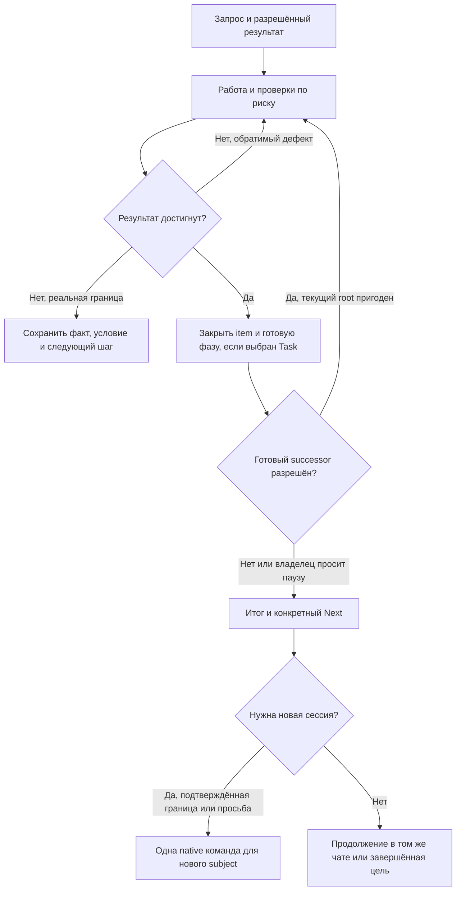

# Сценарии отказа: контекст, authority, Next и final

Это acceptance для будущих изменений, **не результат уже выполненного model replay**.
Существующие детерминированные механизмы переиспользуются; новый универсальный gate не нужен.

## Приоритет смысла

Запрос владельца и разрешённый результат определяют работу. Проектный контракт задаёт
реальные инварианты. Task выбирается явным plan intent/локальной политикой, а не самим фактом
наличия скилла. Скилл даёт метод выполнения, не новую authority и не повторное согласование.
Непринятые примеры стиля, coverage и review остаются советами.

Новая продуктовая идея после полного выполнения цели — рекомендация, не повод продолжать
бесконечно или запускать незапрошенную разработку. «Всегда Next» означает ясную навигацию,
в том числе честное «цель достигнута; дальнейшая работа отдельно», а не выдуманный item.

## Таблица next-action

| Состояние | Исполнение | Что показывать при ответе | Чего не делать |
|---|---|---|---|
| GREEN item, compatible ready successor внутри разрешённого batch | Inline close и продолжить в том же root | Короткое progress сообщение | Final, новый codex, повтор закрытого item |
| GREEN последний item GREEN фазы, следующая работа разрешена | Inline phase close, recompute Next, продолжить | Progress | Отдельный plan-close текущего результата |
| Владелец просил ровно один item, successor вне разрешённого исполнения | Закрыть текущий, остановить product writes | Итог + exact successor как рекомендация; продолжение возможно в том же чате | Выполнять successor или автоматически объявлять cold-start |
| Явно запрошена команда новой сессии | Сформировать свежий post-close handoff | Один native block активного provider с cwd/model/effort/approval/sandbox | Скрывать команду под continue-root; команда старого item |
| Реальная context/capability boundary | Checkpoint, typed continuity | Причина + runnable next native block | Назвать обычный test failure недостатком контекста |
| Waiting external/calendar | Сохранить observation и predicate, доступную независимую работу продолжить | Условие/время и gated continuation | Печатать безусловную команду «запускай сейчас»; reset observation |
| Нет detailed/ready successor или нужна новая scope authority | Сохранить результат и конкретный пробел | Назвать недостающий scope/decision и предложить действие | Выдумать ID, rerun старого item или новый root |
| Цель целиком выполнена | Завершить | Результат/проверки; дополнительное предложение лишь при пользе | Бесконечно искать новую обязательную работу |
| Отдельно заказан design/review | Вернуть заказанный артефакт | Исполнитель и следующий шаг | Самовольно начать реализацию |

Третья строка разрешает расхождение двух roadmap-предложений: **final в чате не равен
fresh session**. Автоматический launch при любом final с successor закрепил бы исходную
жалобу владельца. При отдельной просьбе о новой сессии launch обязателен даже если до
просьбы текущий root был технически пригоден. Новая просьба обновляет continuity context.

## Failure-mode matrix

| ID | Причинная цепочка | Исправление/проверяемый исход |
|---|---|---|
| S01 | global plugin → невыбранный bucket в проекте → description truncation | Effective selection совпадает с намерением; явные отрицательные overrides покрыты readback. |
| S02 | vendor copy + plugin → два имени одной capability → выбор разных версий правил | Одна managed identity; уникальная модификация local не потеряна. |
| S03 | native listing + full AGENTS index → двойной resident tax | Краткий Codex hub; отсутствующие в native capabilities имеют точный pointer. |
| S04 | длинный description → отрезан explicit-only/negative trigger → случайный workflow | Positive/negative prompts при полном и сокращённом description выбирают одинаковый intended workflow. |
| S05 | task:dev разрешён → TDD требует approval → повторный вопрос | Работа начинается в согласованном scope без повторного approval; реально неизвестный API/продуктовый выбор уточняется. |
| S06 | разрешённый package bugfix → Rule of Three → consumer workaround вместо исправления причины | Bugfix owning package идёт по имеющейся authority; несогласованное public API expansion остаётся границей. |
| S07 | dirty файл прошлого item → «чужой» → pause | Diff читается и безопасно компонуется; отсутствие достоверной ownership истории не даёт права затирать изменения. |
| S08 | два исполнителя меняют один semantic fragment → невозможная композиция | Конкретный конфликт показан, раздельная работа продолжается; не выдаётся автоматическое overwrite разрешение. |
| S09 | generated Exec=plan-run → закрытый enum → routing-rejected → обход lifecycle | Alias нормализуется единожды; command и route evidence сохраняются; неизвестные Exec fail closed. |
| S10 | alias failure оставил stale handoff → terminal item получает repeat launch | Current journal/state/continuity превосходят stale view; view регенерируется один раз. |
| S11 | GREEN → отдельный plan-close → ещё сессия → successor потерян | Inline item/phase close; successor после closure; два разрешённых item выполняются одним root. |
| S12 | receipt записан → optional lease отсутствует → final без Next | Общий renderer выдаёт recommendation при реальном final; тестируется фактический provider path, а не только builder. |
| S13 | continue-root → инструкция «не final» → владелец просит новый launch → игнор просьбы | Owner-requested boundary обновляет typed decision, выдаётся один свежий launch. |
| S14 | исправление S12 как «любой final → launch» → просьба одного item создаёт ненужный новый root | Chat stop остаётся chat stop; no auto fresh-session. |
| S15 | Unicode path → не распознан → D16 ошибочно локальный → missing bundle | Существующие два regression tests; consumer bundle содержит ровно declared cross-plan input. |
| S16 | source tests GREEN → объявлена fleet delivery GREEN | Отдельные source/cache/consumer/loaded-session evidence; mismatch не маскируется версией plugin. |
| S17 | advice coverage/PR size → reviewer Major → repair loop без поведенческого дефекта | Severity основана на impact; непринятый default не блокирует; не повторяется весь audit без новой гипотезы. |
| S18 | отключили все safety skills ради бюджета → тесты на dev DB/двойная доставка события | Negative controls isolation/auth/idempotency проходят до rollout. |
| S19 | все нужные references разрезали на новые SKILL.md → число entries выросло | Сравнение native listing до/после; references не resident discovery. |
| S20 | краткая задача пересекает много файлов → design + template workflow автоматически | Direct execution сохраняется; scope/risk определяет validation, не количество файлов. |
| S21 | отсутствует optional telemetry → ещё инфраструктурное исследование → цель забыта | Честный unknown, доступные проверки продолжаются; без неподтверждённого budget verdict у порога. |
| S22 | release/update поменял диск → старый root якобы читает новые правила | Новый snapshot проверен только при следующей реальной сессии; update не требует перезапусков между обычными item. |

Сценарии S09/S15 проверяются детерминированно на fixtures. S01–S04/S12/S13/S22 требуют
native provider observation. S05–S08/S10/S11/S14/S17/S18/S20 нуждаются также в небольшом
поведенческом replay: keyword-тест текста не доказывает, как действует модель.

## Все 11 команд Task: рекомендации

| Команда | Результат аудита |
|---|---|
| design | Сохранить отдельно заказанный design-only; заменить «МАКСИМАЛЬНО подробный» на достаточный для реализации объём, конкретные решения и явные границы. |
| dev | Хороший direct/opt-in контракт; использовать как смысловую основу, не оборачивать автоматически master plan. |
| fix | Убрать clean-tree gate, недоказанную 5–50× экономию; узкий single-agent путь сохранить. |
| research | Явный исследовательский результат; workflow craft лишь при действительной необходимости workflow, не автоматически от исследования. |
| review | Read-only сохранить; skill conformance не сильнее scope/impact; не направлять любое обсуждение спецификации в phase lifecycle. |
| make-workflow | Только явный workflow authoring; фиксированные template stages не распространять на обычную разработку. Согласовать формулировки «review всегда» и «risk-adaptive». |
| plan-design | Сохранить заказанную authoring boundary; общий source контракт и native adapter не должны добавлять другие произвольные restarts. |
| plan-exec | Inline close, доказанная risk-adaptive validation, готовый разрешённый successor; единый final seam. |
| plan-run | Owner route сохраняется; alias admission и requested-new-session exception согласуются с общим lifecycle. |
| plan-audit | Один разрешённый bounded audit, evidence reuse; не второй executor и не автоматический phase audit любой plan/spec. |
| plan-close | Явная reconciliation команда остаётся; обычное завершение item не требует отдельного invocation. |
